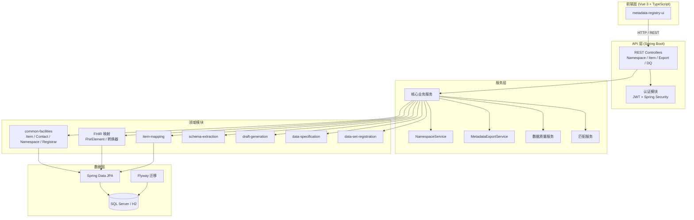

# MetadataRegistry4j 架构文档

> 生成日期: 2026/06/01
> 基于 GitNexus 知识图谱分析 (1117 文件, 14745 符号, 300 执行流程)

---

## 1. 概述

**MetadataRegistry4j** 是一个企业级元数据注册表与管理系统，基于 Spring Boot + Vue3 技术栈构建。系统支持元数据项的注册、版本控制、多语言命名、数据质量评估、FHIR 映射以及数据字典导出等核心能力。

### 技术栈

| 层级 | 技术 |
|------|------|
| 前端 | Vue 3 + TypeScript + Vite |
| 后端 API | Spring Boot 3 + Spring Security (JWT) |
| 数据访问 | Spring Data JPA + QueryDSL |
| 数据库迁移 | Flyway |
| 元数据模型 | 基于 ISO/IEC 11179 标准 |
| 数据交换 | FHIR R4 映射支持 |

---

## 2. 模块结构

本项目采用 Maven 多模块架构，共 8 个模块：

```
MetadataRegistry4j/
├── pom.xml                                    # 根 POM (BOM 管理)
├── metadata-registry-web/                     # Web 层 — REST API + 认证
├── metadata-registry-common-facilities/       # 公共基础设施 — 核心实体与基础类
├── metadata-registry-data-specification/      # 数据规范模块
├── metadata-registry-data-set-registration/   # 数据集注册模块
├── metadata-registry-item-mapping/            # 项目映射模块
├── metadata-registry-schema-extraction/       # 模式提取模块
├── metadata-registry-draft-generation/        # 草案生成模块
└── metadata-registry-ui/                      # 前端应用 (独立构建)
```

---

## 3. 功能区域

基于代码知识图谱的社区检测分析，系统包含以下主要功能区域：

| 功能区域 | 符号数 | 内聚度 | 说明 |
|----------|--------|--------|------|
| **Service** | 1,380 | 67% | 业务服务层，处理核心领域逻辑 |
| **Controller** | 359 | 66% | REST API 控制器层 |
| **Fhir** | 349 | 68% | FHIR R4 资源映射与转换 |
| **Matching** | 219 | 75% | 元数据匹配与去重 |
| **Dataquality** | 187 | 68% | 数据质量评估与规则引擎 |
| **Identification** | 170 | 72% | 命名空间与标识符管理 |
| **Entity** | 118 | 59% | JPA 实体定义 |
| **Mapping** | 101 | 64% | 字段/类型映射逻辑 |
| **Predefinedtypes** | 101 | 80% | 预定义数据类型体系 |
| **Itemmapping** | 91 | 79% | 项目间映射关系 |
| **Static** | 67 | 82% | 静态资源与常量 |
| **Namingconvention** | 65 | 58% | 命名规范检查 |
| **Registration** | 61 | 65% | 注册管理流程 |
| **Compliancereport** | 61 | 71% | 合规性报告生成 |
| **Datadictionary** | 60 | 61% | 数据字典导出 (PDF/CSV) |
| **Logging** | 54 | 82% | 审计日志与敏感数据脱敏 |
| **Schemaextraction** | 46 | 78% | 数据库模式提取 |
| **Javasource** | 44 | 71% | Java 源码解析 |
| **Openapi** | 44 | 76% | OpenAPI 规范处理 |
| **Connection** | 42 | 79% | 外部系统连接管理 |

---

## 4. 架构图



---

## 5. 核心执行流程

以下是系统中最具代表性的 5 个执行流程，展示了从 API 入口到核心业务逻辑的关键调用链。

### 5.1 认证流程 — 密码修改与敏感数据脱敏

**流程**: `ChangePassword → MaskSensitiveData`

```
AuthController.changePassword
  └── AuthService.changePassword
        └── SensitiveDataMaskingEncoder.encode
              └── SensitiveDataMaskingEncoder.maskSensitiveData
```

**说明**: 用户修改密码时，认证服务会对敏感数据进行脱敏处理，确保日志中不会泄露密码等敏感信息。

---

### 5.2 命名空间创建流程

**流程**: `CreateWizard → BusinessException`

```
NamespaceController.createWizard
  └── NamespaceService.createWizard
        └── NamespaceService.validateNamingAuthorityRequired
              └── BusinessException (验证失败时抛出)
```

**说明**: 命名空间创建向导包含严格的验证逻辑，确保命名机构等治理属性完整。若验证失败，将抛出业务异常。

---

### 5.3 元数据同步导出流程

**流程**: `ExportSync → Min`

```
MetadataExportController.exportSync
  └── MetadataExportService.export
        └── MetadataExportService.toExport
              └── ItemNamingHelper.preferredDesignation
                    └── ItemNamingHelper.pickByLanguage
                          └── FhirElement.Builder.min
```

**说明**: 同步导出元数据时，系统会根据首选语言和命名规则解析项目标识，最终转换为 FHIR 元素格式。

---

### 5.4 数据质量评估流程

**流程**: `Assess → JdbcDataQualityExecutor`

```
DataQualityController.assess
  └── DataQualityController.createExecutor
        └── JdbcDataQualityExecutor
```

**说明**: 数据质量评估通过 JDBC 执行器对数据库表进行质量规则检查，返回评估结果。

---

### 5.5 数据字典 PDF 导出流程

**流程**: `ExportPdf → GetIdentifiedItem`

```
DataDictionaryExportController.exportPdf
  └── DataDictionaryExportService.exportSync
        └── DataDictionaryExportService.queryItems
              └── DataDictionaryExportService.toExportDto
                    └── Item.getIdentifiedItem
```

**说明**: 数据字典导出从 Item 核心实体中提取已标识的元数据项，组装为 DTO 后生成 PDF 报告。

---

## 6. 数据模型核心

系统的核心数据模型围绕 `Item` 展开，所有元数据项均继承或关联自该基类：

```
Item (核心元数据项)
├── IdentifiedItem (已标识项)
├── ScopedIdentifier (作用域标识符)
├── Contact (联系人)
├── Namespace (命名空间)
├── Registrar (注册机构)
└── Designation (多语言命名)
```

主要实体类型包括：

- **概念域 (ConceptualDomain)** — 值含义的定义域
- **数据元素 (DataElement)** — 数据元的具体定义
- **数据元素概念 (DataElementConcept)** — 数据元的概念层
- **值域 (ValueDomain)** — 允许值的集合
- **数据类型 (DataType)** — 数据类型定义
- **对象类 (ObjectClass)** — 现实世界事物的抽象
- **属性 (Property)** — 对象类的特征
- **计量单位 (UnitOfMeasure)** — 度量单位

---

## 7. 安全架构

系统采用基于 JWT 的认证机制：

| 组件 | 职责 |
|------|------|
| `JwtAuthenticationFilter` | 拦截请求并验证 JWT Token |
| `AuthController` | 提供登录/登出/修改密码 API |
| `AuthService` | 处理认证业务逻辑 |
| `AppUser` / `AppUserRole` | 用户与角色定义 |
| `SensitiveDataMaskingEncoder` | 敏感数据脱敏 |

---

## 8. 扩展点

系统通过以下机制支持扩展：

- **模块化 Maven 结构** — 可独立开发/部署子模块
- **FHIR 映射器** — 可扩展新的资源类型映射
- **数据质量规则** — 通过 `JdbcDataQualityExecutor` 支持自定义规则
- **导出格式** — 支持 PDF / CSV / FHIR Bundle 等多种导出格式
- **命名空间状态机** — 支持自定义治理工作流

---

*本文档由 GitNexus 知识图谱自动生成，反映了代码库的静态结构与运行时执行流程。*
