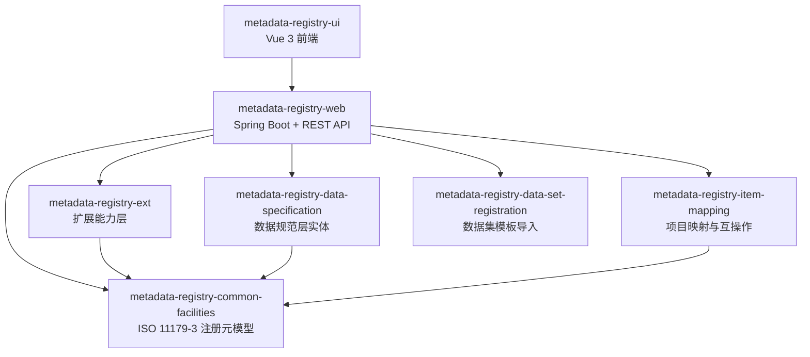

> 本文档由 GitNexus wiki 生成于 2026-09-13（kimi-for-coding，--lang chinese）。内容变化时请重新运行 `gitnexus wiki --lang chinese` 生成，勿手工改写。

# MetadataRegistry4j 项目概览

**MetadataRegistry4j** 是一个基于 **ISO/IEC 11179-3:2023 元数据注册系统（MDR）** 标准的元数据注册中心实现。它将标准中的注册元模型（数据元、数据元概念、值域、概念域等）落地为一组可持久化的 JPA 实体，并在其上构建完整的治理能力：注册条目的 CRUD 与生命周期管理、多语言指称/定义、分类方案、条目映射与互操作匹配，以及前端可视化操作界面。

本项目的目标读者是参与元数据治理平台开发的工程师。本页帮助你快速建立全局认知：系统做什么、由哪些模块组成、一次典型请求如何流转。各模块的详细设计请跳转对应模块页面。

## 系统架构总览

系统采用经典的**分层架构**：领域模型层提供 ISO 11179 标准元模型，扩展层承载超出标准的能力，Web 层组装为可运行的 Spring Boot 应用，前端提供操作界面。



依赖关系有一个明确的原则：**领域模块（`common-facilities`、`data-specification`、`item-mapping`）不依赖 Web 层，只被上层引用**。其中 [metadata-registry-common-facilities](modules/metadata-registry-common-facilities.md) 是约 35 个 JPA 实体构成的领域核心，是整个系统被引用最多的模块；[metadata-registry-web](modules/metadata-registry-web.md) 作为交付入口，向它发起了 400+ 次调用，向数据规范层 170+ 次。

## 各模块的角色

- **[metadata-registry-common-facilities](modules/metadata-registry-common-facilities.md)** — 领域模型底座。落地 ISO/IEC 11179-3:2023 注册元模型（AdministeredItem、ScopedIdentifier、Namespace 等约 35 个实体），同时为持久化、JSON 序列化、Lombok 样板代码提供统一基础设施。边界清晰：本模块只管"注册元模型是什么"，业务编排在上层 Service。
- **[metadata-registry-data-specification](modules/metadata-registry-data-specification.md)** — 数据规范层，实现 ISO/IEC 11179-31 的业务词汇：数据元（Data Element）、数据元概念（Data Element Concept）、值域（Value Domain）、概念域（Conceptual Domain）、允许值（Permissible Value）等。本模块**不含方法逻辑**，所有类均为 Lombok 驱动的纯实体；校验、关联与生命周期规则由 Web 层的 Service 承担。
- **[metadata-registry-ext](modules/metadata-registry-ext.md)** — 扩展能力承载层。超出 ISO 11179 标准的治理能力（卫星实体的扩展属性、标识符生成策略、简化分类模型）全部收敛于此，遵循 **MDR / EXT schema 拆分** 原则，避免污染标准模型。
- **[metadata-registry-item-mapping](modules/metadata-registry-item-mapping.md)** — 实现 ISO/IEC 11179-3:2023 第 11 章 Item_Mapping 包（映射条目为 Item 子类，1..* 主体/客体关联类绑定携带 mapping_variable_name，14 值映射度，mapping_hierarchy），并扩展 FHIR 映射与互操作匹配能力。
- **[metadata-registry-data-set-registration](modules/metadata-registry-data-set-registration.md)** — 互联互通数据集模板的导入与注册。支持 Excel / CSV 解析、中英文表头别名映射、行级错误定位与增量更新，为概念对齐引擎预留映射字段。
- **[metadata-registry-web](modules/metadata-registry-web.md)** — 可执行的 Spring Boot 应用组装层：主类 `MetadataRegistryApplication`、REST Controller、应用 Service、JWT 安全、统一响应契约（`ApiResponse` / `GlobalExceptionHandler`）、Flyway 迁移与静态前端资源托管。工作空间（Workspace）相关端点与状态机也位于本模块。
- **[metadata-registry-ui](modules/metadata-registry-ui.md)** — Vue 3 + TypeScript + Element Plus 前端，覆盖注册实体 CRUD、多语言指称编辑、分类方案树、标识符策略配置、联邦节点合并评审、项目映射管理以及工作空间三视图。

此外，仓库还包含两个非代码模块：docs 承载领域建模、ISO 11179 符合性审计与 UAT 等知识库文档；openspec 实现"提案 → 规格 → 任务"的规范驱动开发体系，代码改动之前先落地书面规格。

## 关键端到端流程

### 查询流程：列表 + 按语言选取首选指称

几乎所有注册实体的列表接口都遵循同一条链路（以概念域为例）：

1. Controller（如 `ConceptualDomainController`）接收请求，转给 Service；
2. Service 组装查询条件（关键字过滤等），从领域层取回实体；
3. 通过 `ItemAdministrationService` 批量映射多语言定义与上下文；
4. 最终由 `ItemNamingHelper.pickByLanguage` 按语言偏好挑选首选指称（preferred designation），保证响应中条目的显示名始终符合当前语言环境。

### 创建流程：概念内容应用 + 命名空间标识符策略

创建受管项（如对象类、度量类）时，系统会执行一套统一的"注册管线"：

1. Controller 接收创建请求 → Service 校验业务规则；
2. `ConceptContentApplier` 将概念内容（指称、定义）应用到实体上；
3. `ItemAdministrationService.ensureAdministeredItem` 确保条目具备完整的注册元数据；
4. `IdentifierInputPolicyService` 解析标识符输入策略，委托 `NamespaceIdentifierPolicyResolver` 按命名空间级配置（由 `NamespaceIdentifierSettingsService` 从 `NamespaceIdentifierSettingsRepository` 读取）决定标识符的生成或校验方式。

新开发一个注册实体时，复用这两条管线（命名统一走 `ItemNamingHelper`，注册统一走 `ensureAdministeredItem`）是保持一致性的关键。

### 工作空间流程：管理状态与注册状态解耦

工作空间（`WorkspaceController` / `WorkspaceService`）治理管理状态（administrative status）与注册状态（registration status）的分离：

1. 新建/编辑保存后 `ItemAdministrationService.ensureAdministeredItem()` 将管理项标记为 `DRAFT`，注册状态保持 `INCOMPLETE`；
2. `WorkspaceService.submit()` 将 `DRAFT` 提交为 `INITIAL` 并生成 `SubmissionRecord`；
3. 具备主管记录（`StewardshipRecord`）的 `INCOMPLETE` 项可经 `requestCandidate()` 推进为 `CANDIDATE`；
4. 经注册流程到达 `RECORDED` 后，再次编辑会进入 `DRAFT`，此时可调用 `WorkspaceRollbackService.rollback()` 回退到最近 `BASELINE` 快照并清空管理状态；
5. 主管可申请合格（`PROVISIONALLY_QUALIFIED`），Registrar 批准/拒绝后最终进入 `QUALIFIED` 或 `REJECTED`。

详细端点与行级权限标志见 [metadata-registry-web](modules/metadata-registry-web.md)。

## 快速开始

### 环境要求

- JDK 17+
- Maven 3.8+
- Node.js 18+ 与 pnpm（前端）

### 构建

```bash
# 后端：根 POM 聚合全部 Maven 子模块并统一锁定依赖版本
mvn clean install -DskipTests

# 前端
cd metadata-registry-ui
pnpm install
```

### 运行

根目录提供了 Windows 下的一键脚本；也可以手动启动：

```bash
# 后端（默认配置见根目录 application.yml，支持 SQLite / SQL Server / 达梦 方言切换）
mvn -pl metadata-registry-web spring-boot:run

# 前端开发服务器（代理到后端 API）
cd metadata-registry-ui
pnpm dev
```

启动时应用会先执行 `DatasourceConfigService.migrateLegacyConfigIfNeeded()` 完成旧版数据源配置迁移，再进入 Spring 环境准备阶段。数据库结构由 Flyway 迁移管理，首次启动会自动建表。

### 配置说明

根目录 `application.yml` 是默认配置源，涵盖数据源、JPA、Flyway、JWT、CORS 与种子数据开关。通过环境变量配合 `application-local.yml` 即可切换数据库方言，无需修改代码。

## 约定与规范

- **数据库可移植性**：实体与查询必须兼容多种数据库方言，具体规则见 `docs/technical/`。
- **Agent 规则**：`AGENTS.md` 是所有 Coding Agent 共享规则的唯一事实源，修改代码前请先阅读。
- **变更流程**：任何代码改动遵循 OpenSpec 流程，先写提案与规格，再实现——详见 openspec。

## 深入阅读

- 架构细节与功能区域划分：`docs/architecture/`
- 领域模型说明：docs 中的 `domain-modeling.md`
- ISO 11179 符合性审计记录：`docs/` 下的审计文档
- 各模块设计与源码组织：点击上文模块链接进入对应页面。
---

## 数据库可移植性规则

系统同时支持 SQLite / SQL Server / 达梦 三种数据库方言，相关可移植性规则（Hibernate/Flyway 分工、方言迁移目录、native SQL 约束等）统一维护在 [docs/technical/database-portability.md](../technical/database-portability.md)。
