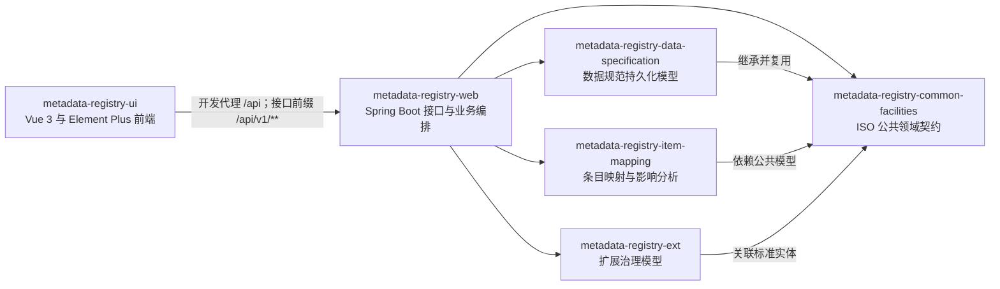

> 本文档由 GitNexus wiki 生成于 2026-10-25（minimax-MiniMax-M3，--lang chinese）。内容变化时请重新运行 `gitnexus wiki --lang chinese` 生成，勿手工改写。

# MetadataRegistry4j — Wiki

# MetadataRegistry4j

MetadataRegistry4j 是一个基于 **ISO/IEC 11179-3:2023** 的元数据注册中心，使用 Maven 多模块工程构建。它用于统一管理数据元、数据元概念、概念域、值域、标识、命名、定义和条目映射，并通过 Spring Boot REST API 与 Vue 3 前端提供访问能力。

项目既包含标准领域模型，也提供数据集导入、扩展治理、模式提取和草案生成等配套能力。新成员通常应先阅读 [Root](root.md) 了解父工程、构建规则和协作约束，再从 [metadata-registry-common-facilities](metadata-registry-common-facilities.md) 进入领域模型。

## 总体架构

系统采用“前端交互、接口编排、领域模型、扩展能力”分层结构。在线请求由前端进入 Web 模块，再由 Web 模块调用相应的领域模块；数据规范、条目映射和扩展治理模块共同复用公共领域契约。



图中的领域模块都是可独立导航的代码边界：

- [metadata-registry-common-facilities](metadata-registry-common-facilities.md) 是基础契约层，提供核心实体、预定义类型、注册项、标识、命名、定义及公共注解能力。数据规范、条目映射和扩展模块都从这里复用标准类型。
- [metadata-registry-data-specification](metadata-registry-data-specification.md) 依据 ISO/IEC 11179-31:2023 提供数据元、数据元概念、概念域、值域、数据类型、量纲和枚举支持结构等 JPA 模型。该模块是声明式实体层，不负责仓储、服务、校验器或对象工厂。
- [metadata-registry-item-mapping](metadata-registry-item-mapping.md) 管理本地注册条目与其他数据语义之间的关系，提供映射持久化、互操作匹配、FHIR 路径关联和变更影响分析。
- [metadata-registry-ext](metadata-registry-ext.md) 承载标准模型之外的治理能力，包括标识符策略、顺序号、版本、分类和卫星信息。它通过 `namespace_id`、`scoped_identifier_id` 等外键关联标准实体，而不修改标准定义。
- [metadata-registry-web](metadata-registry-web.md) 是 Spring Boot 接入层，以 `/api/v1/**` 暴露 REST API，并使用 `ApiResponse<T>` 统一响应结构。Controller、Service、Repository、DTO、认证授权和运行时适配集中位于该模块。
- [metadata-registry-ui](metadata-registry-ui.md) 是 Vue 3、TypeScript、Vite、Pinia 和 Element Plus 前端。开发服务器将 `/api` 代理到 `http://localhost:8081`，业务源码位于其 `src` 目录。

数据集导入位于 [metadata-registry-data-set-registration](metadata-registry-data-set-registration.md)，围绕文件解析和增量保存形成独立批处理支线。仓库还包含面向模式提取和草案生成的 [metadata-registry-schema-extraction](metadata-registry-schema-extraction.md) 与 [metadata-registry-draft-generation](metadata-registry-draft-generation.md)。

## 关键端到端流程

### 在线查询与语言偏好的名称解析

1. 前端 API 客户端向 `/api/v1/**` 发起查询。`ConceptualDomainController`、`ContextController`、`ConstraintSetController` 等 Controller 接收请求。
2. Web 模块中的 Service 完成对象查询，并通过 `toResponse` 转换为接口响应模型。
3. `ItemAdministrationService.mapDefinitions` 和 `mapDefinitionContexts` 补充定义及其上下文。
4. `ItemNamingHelper.preferredDesignation` 通过 `pickByLanguage` 选择符合语言偏好的名称，最终读取 `Definition.getLanguage` 或 `Designation.getLanguage`。
5. 结果以统一的 `ApiResponse<T>` 返回前端。

这条链路体现了 Web 模块与公共领域设施之间的紧密协作：Web 负责请求编排和输出适配，公共模型负责名称、定义及语言语义。

### 数据集导入与增量注册

1. [metadata-registry-data-set-registration](metadata-registry-data-set-registration.md) 使用 Apache POI 读取 Excel `.xlsx`，或以 UTF-8 读取 CSV。
2. `ColumnMappingConfig` 将中英文表头转换为标准内部字段。
3. 数据元素按 `(data_set_id, de_identifier)` 执行增量新增或更新，重复导入不会无条件创建副本。
4. `ImportResult` 返回成功状态、导入数量、错误行和耗时。
5. 原始互联互通字段会被保留；`mappedItemId` 和 `mappingStatus` 为后续 ISO 语义对齐预留。

当前实现不会自动完成 ISO 11179 语义对齐。需要理解这一边界，避免把“字段导入成功”误认为“已完成标准概念匹配”。

### 条目映射与变更影响分析

1. 前端通过 [metadata-registry-web](metadata-registry-web.md) 提交本地条目及目标语义。
2. [metadata-registry-item-mapping](metadata-registry-item-mapping.md) 持久化映射关系，并复用 [metadata-registry-common-facilities](metadata-registry-common-facilities.md) 中的注册项、标识和定义类型。
3. 匹配策略处理条目间的互操作关系，FHIR 路径信息用于关联外部系统中的实际数据位置。
4. 映射或目标条目发生变化时，影响分析能力识别受影响的注册内容。
5. 标识、版本和分类等治理信息由 [metadata-registry-ext](metadata-registry-ext.md) 提供，并继续关联标准模型对象。

## 本地开发与运行

仓库提供 Maven Wrapper，无需预先安装 Maven。根工程负责统一依赖版本、运行配置以及 ISO 数据分层、实体继承和受管链闭环等建模规则。

先根据根目录配置准备数据库、JWT、数据源和 Flyway 所需环境，再执行完整构建：

```bash
# Linux 或 macOS
./mvnw clean verify
```

```powershell
# Windows PowerShell
.\mvnw.cmd clean verify
```

启动 [metadata-registry-web](metadata-registry-web.md) 中的 Spring Boot 应用，并确保后端监听 `8081` 端口。根目录同时提供适用于 Windows 的启动、停止和进程托管脚本。

随后启动前端。以下以 npm 为例；若仓库使用其他包管理器，应优先遵循其锁文件：

```bash
cd metadata-registry-ui
npm install
npm run dev
```

前端的 `/api` 请求会代理到 `http://localhost:8081`。端到端验证使用 Playwright 和 Python 探针，覆盖登录、初始化、权限、分类、映射和表单等关键流程。

## 开发协作入口

[Root](root.md) 负责父 POM、Maven Wrapper、统一配置、运行脚本和强制建模规则。功能变更应先在 [openspec](openspec.md) 中形成提案、设计、任务和能力规约；已完成且仍有效的契约保存在现行规约目录中。

架构、领域建模、标准符合性审计和验收材料集中在 [docs](docs.md)。修改公共模型、跨模块契约或 REST API 时，应同步检查这些文档以及相关模块测试，确保实现、规范和审计结论保持一致。
