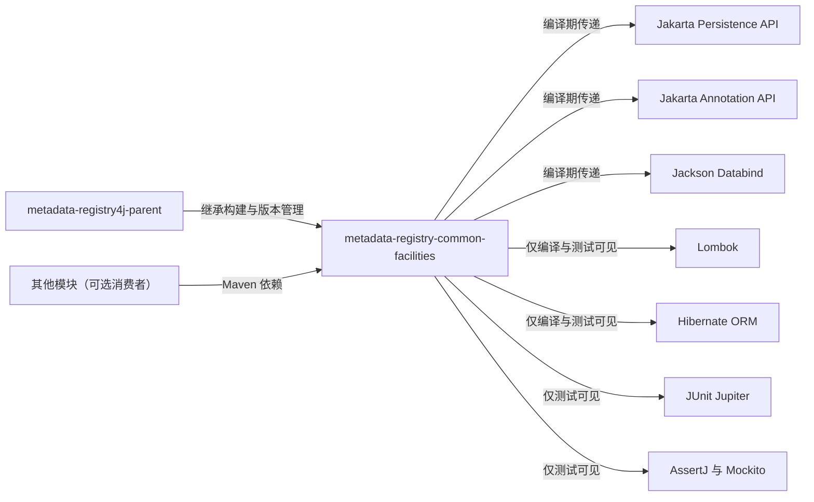

# metadata-registry-common-facilities — metadata-registry-common-facilities

# metadata-registry-common-facilities

`metadata-registry-common-facilities` 是 `metadata-registry4j-parent` 多模块工程中的公共基础模块。它集中提供元数据注册场景常用的编译期契约，包括 Jakarta Persistence、Jakarta Annotation 和 Jackson，并允许实体类使用 Lombok 与 Hibernate 专有注解。

当前提供的源码仅包含 `pom.xml`，未包含 Java 源文件。静态调用图也未检测到模块内部调用、外部调用或执行流，因此该模块不包含可执行入口、请求处理流程或后台任务。现有实现主要承担公共依赖与编译边界的定义。

## 模块坐标与构建关系

| 项目 | 值 |
| --- | --- |
| `groupId` | `io.github.matrixlane`，继承自父工程 |
| `artifactId` | `metadata-registry-common-facilities` |
| `version` | `0.1.0-SNAPSHOT`，继承自父工程 |
| 父工程 | `io.github.matrixlane:metadata-registry4j-parent:0.1.0-SNAPSHOT` |
| 打包类型 | 未显式声明，按 Maven 默认规则生成 JAR |

该模块没有自定义 Maven 插件或独立构建配置。编译插件、测试插件、依赖版本和通用属性均由父工程统一管理。依赖声明未指定版本，版本同样来自父工程的 `dependencyManagement`。



## 依赖边界

| 依赖 | Maven 作用域 | 用途与影响 |
| --- | --- | --- |
| `jakarta.persistence:jakarta.persistence-api` | `compile` | 提供 JPA 实体、映射及相关持久化契约的注解和类型。 |
| `jakarta.annotation:jakarta.annotation-api` | `compile` | 提供 Jakarta 标准注解，例如生命周期和通用注解。 |
| `com.fasterxml.jackson.core:jackson-databind` | `compile` | 为公共数据模型的 JSON 序列化、反序列化和对象映射提供运行时支持。 |
| `org.projectlombok:lombok` | `provided` | 仅参与编译期代码生成，不应成为应用运行时的显式依赖。 |
| `org.hibernate.orm:hibernate-core` | `provided` | 仅用于编译实体所需的 Hibernate 扩展注解，例如 `@BatchSize`；不在本模块中引入 Hibernate 运行时。 |
| `org.junit.jupiter:junit-jupiter` | `test` | 编写 JUnit 5 单元测试和参数化测试。 |
| `org.assertj:assertj-core` | `test` | 提供声明式断言。 |
| `org.mockito:mockito-core` | `test` | 隔离单元测试中的协作对象。 |

### `compile` 与 `provided` 的区别

- `compile` 依赖会进入普通编译类路径，并作为传递依赖提供给下游模块。
- `provided` 依赖只在当前模块的编译和测试阶段可见，不会被打包为运行时依赖，也不会传递给下游模块。
- `jakarta.persistence-api` 和 `jakarta.annotation-api` 只定义规范，不包含持久化运行时实现。应用若实际使用 JPA，需要由应用或其他基础模块提供兼容的持久化 provider。
- Hibernate 在此模块中明确属于编译期依赖，因此实体可以引用 Hibernate 专有注解，但公共模块本身不会强制应用采用 Hibernate。

## 工作方式

该模块没有检测到方法调用或执行流，其工作过程主要发生在构建阶段：

1. Maven 根据父工程解析依赖版本和构建插件配置。
2. Java 编译器可以访问 Jakarta、Jackson 和 Hibernate 类型。
3. Lombok 在编译阶段执行注解处理并生成样板代码；具体处理器配置由父工程决定。
4. Hibernate 专有注解可在实体源码中正常编译，但 Hibernate 不会因此成为下游应用的运行时依赖。
5. JUnit、AssertJ 和 Mockito 仅在测试执行阶段加载。

如果后续向该模块加入实体、DTO、序列化模型或工具类，应保持这一边界：公共 API 可以依赖 `compile` 作用域的规范库，而代码生成器和特定框架实现应保持为 `provided` 或放入专用实现模块。

## 与代码库其他部分的连接

从当前分析结果看：

- 父工程通过 Maven 继承关系管理该模块的版本、依赖和构建生命周期。
- 未检测到其他模块对该模块的静态方法调用。
- 未检测到该模块对其他模块的静态方法调用。
- 未检测到服务启动、事件处理、持久化操作或消息消费等运行时流程。

这并不意味着该模块不能被其他模块使用。下游模块可以通过 Maven 依赖引用其中的公共类型；如果使用方式仅包含注解、反射、序列化元数据或类型引用，静态调用图也可能不会显示对应的源码级调用关系。

在业务模块中引入该公共模块：

```xml
<dependency>
    <groupId>io.github.matrixlane</groupId>
    <artifactId>metadata-registry-common-facilities</artifactId>
    <version>0.1.0-SNAPSHOT</version>
</dependency>
```

引入后应注意：

- 若公共类型包含 Jackson 注解或映射逻辑，运行时需要保留 Jackson 依赖。
- 若公共类型包含 JPA 实体，应用仍需配置独立的持久化 provider、实体扫描和数据库连接。
- 不应依赖本模块间接获得 Hibernate 运行时；需要 Hibernate 的应用或持久化实现模块应显式声明相应依赖。

## 测试与验证

从父工程根目录可以单独测试该模块：

```bash
# 构建该模块及其必要的上游模块
mvn -pl metadata-registry-common-facilities -am test
```

也可以直接使用模块 POM：

```bash
# 执行该模块的完整测试生命周期
mvn -f metadata-registry-common-facilities/pom.xml test
```

建议根据代码性质补充以下测试：

- Jackson 模型：验证 JSON 字段命名、未知属性处理、日期格式及多态映射。
- JPA 映射：通过实际持久化 provider 的集成测试验证表结构、关联关系和批量配置。
- Lombok 生成代码：测试应验证生成后的构造器、访问器和值对象语义。
- 公共工具类：使用 JUnit 5、AssertJ 和 Mockito 隔离外部依赖。

仅依赖 API 注解的模块适合使用轻量单元测试；涉及 Hibernate 专有映射时，应将数据库级验证放在集成测试模块中。

## 贡献指南

新增或修改该模块时，应遵守以下原则：

1. **保持依赖作用域准确**  
   Lombok 和 Hibernate 保持为 `provided`；不要为解决编译问题将实现依赖无意中改为 `compile`。

2. **区分规范与实现**  
   Jakarta API 和 Jackson 属于公共编译契约。数据库、消息代理或特定 ORM 的运行时实现应留在下游或专用实现模块。

3. **评估下游兼容性**  
   修改公共实体的字段、Jackson 可见性或 JPA 映射可能影响序列化格式、数据库结构和调用方的二进制兼容性。

4. **为公共行为添加测试**  
   新增 DTO、映射规则或工具方法时，应同时添加正常路径、边界条件和失败路径测试。

5. **避免引入业务编排逻辑**  
   该模块适合保存跨模块共享的模型、契约和轻量工具，不应承担注册流程编排、数据库访问流程或外部服务调用。

6. **通过父工程验证版本兼容性**  
   修改依赖后，应至少运行模块测试，并检查使用 Hibernate 专有注解的实体是否仍能在实际持久化 provider 中正确映射。