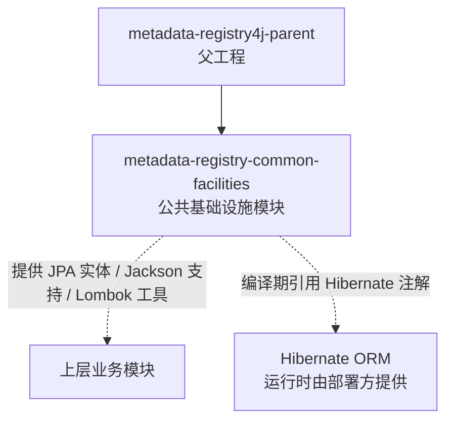

> 本文档由 GitNexus wiki 生成于 2026-09-13（kimi-for-coding，--lang chinese）。内容变化时请重新运行 `gitnexus wiki --lang chinese` 生成，勿手工改写。

# metadata-registry-common-facilities 模块

## 模块概述

`metadata-registry-common-facilities` 是 `metadata-registry4j-parent` 多模块工程下的一个基础支撑模块，承担"公共基础设施"（common facilities）的角色。它为上层模块提供跨模块共享的公共能力——基于其依赖声明，该模块面向以下场景：

- **JPA 实体与持久化基础设施**：以 `jakarta.persistence-api` 为核心依赖
- **JSON 序列化/反序列化**：通过 Jackson 提供统一的数据转换支持
- **编译期代码简化**：使用 Lombok 减少样板代码
- **Hibernate 特定优化注解**：允许实体使用 `@BatchSize` 等 Hibernate 专有注解而不引入运行时硬依赖

> **当前状态说明**：该模块目前仅包含构建描述文件（`pom.xml`），尚无 Java 源码。以下文档基于构建配置与依赖选型进行说明，描述了该模块的设计意图与使用约定。

## 在工程中的位置



该模块位于依赖图的底层：它只依赖 Jakarta 标准 API 与通用工具库，不引用工程内其他业务模块，因此被设计为可被任意上层模块安全引用的公共底座。

## 依赖说明

### 编译期依赖

| 依赖 | 作用域 | 用途 |
|------|--------|------|
| `jakarta.persistence-api` | compile | 提供 JPA 标准注解（`@Entity`、`@Table`、`@Column` 等），供实体类定义使用 |
| `jakarta.annotation-api` | compile | 提供 `@PostConstruct`、`@PreDestroy` 等通用注解 |
| `com.fasterxml.jackson.core:jackson-databind` | compile | JSON 序列化与反序列化支持，常用于实体的 DTO 转换或元数据结构的存取 |
| `org.projectlombok:lombok` | provided | 编译期注解处理器，简化 getter/setter/构造器等样板代码 |

### 编译期限定依赖：Hibernate

```xml
<!-- 编译期引入：实体类可使用 @BatchSize 等 Hibernate 专有注解 -->
<dependency>
    <groupId>org.hibernate.orm</groupId>
    <artifactId>hibernate-core</artifactId>
    <scope>provided</scope>
</dependency>
```

`hibernate-core` 被显式声明为 `provided` 作用域，这是一种刻意的架构决策：

- **编译期可见**：实体类可以直接使用 `@org.hibernate.annotations.BatchSize` 等优化注解，例如为集合关联配置批量抓取策略，避免 N+1 查询。
- **运行时不传递**：上层模块或部署环境必须自行提供 Hibernate ORM 实现，该模块不会将具体 JPA 实现强加给使用者。这保证了模块对 JPA Provider 的可替换性。

### 测试依赖

| 依赖 | 用途 |
|------|------|
| `junit-jupiter` | JUnit 5 测试框架 |
| `assertj-core` | 流式断言 |
| `mockito-core` | 单元测试中的 mock 支持 |

测试三件套已就绪，后续向该模块添加代码时应配套单元测试。

## 使用约定

基于依赖选型，向该模块添加代码时应遵循以下约定：

1. **实体类基于 Jakarta Persistence 标准**：使用 `jakarta.persistence.*` 包下的注解（注意是 Jakarta 命名空间，而非旧的 `javax.persistence`）。仅当确实需要 Hibernate 专有优化（如批量抓取）时才引入 `org.hibernate.annotations.*`。
2. **JSON 处理统一走 Jackson**：涉及元数据注册结构（metadata registry structures）的序列化时，使用 `jackson-databind`，避免混用其他 JSON 库。
3. **样板代码用 Lombok**：实体/DTO 类优先使用 `@Getter`、`@Setter`、`@Builder` 等 Lombok 注解。
4. **不引入运行时强耦合**：新依赖若属于具体实现（如特定数据库驱动、具体 JPA Provider），应保持 `provided` 或 `optional` 作用域，延续当前设计。

## 构建

该模块继承父工程 `metadata-registry4j-parent`（版本 `0.1.0-SNAPSHOT`）的配置，版本管理与依赖版本号统一在父 POM 中维护。标准构建命令：

```bash
mvn clean install        # 构建并安装到本地仓库，供上层模块引用
mvn test                 # 运行单元测试
```

## 模块边界

- **该模块做什么**：沉淀跨模块共享的持久化实体、注解配置、序列化辅助等基础设施代码。
- **该模块不做什么**：不包含业务逻辑、不依赖其他业务模块、不绑定具体的 JPA 实现或部署环境。

随着功能代码的落地（实体类、公共注解、Jackson 配置等），本文档应同步补充具体的类级 API 说明。