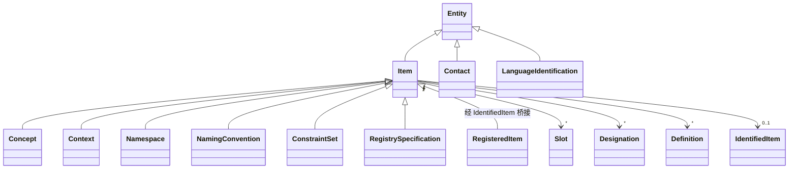

> 本文档由 GitNexus wiki 生成于 2026-09-13（kimi-for-coding，--lang chinese）。内容变化时请重新运行 `gitnexus wiki --lang chinese` 生成，勿手工改写。

# metadata-registry-common-facilities — src 模块文档

## 模块定位

本模块是元数据注册系统(`metadata-registry`)的**领域模型层**,实现 **ISO/IEC 11179-3:2023《元数据注册系统(MDR)第 3 部分:注册元模型与基本属性》** 定义的注册元模型。模块内包含约 35 个 JPA 实体/值对象/枚举,覆盖标准中第 6~9 章的核心概念,是系统中所有业务模块(web 服务层、rest 层)共同依赖的持久化基石。

模块本身**不含业务逻辑**:只有实体、映射、少量的派生计算和验证规则。业务行为集中在 `web` 模块的 Service 层,扩展属性集中在 `ext` 模块的卫星实体。

## 设计原则

### 标准条款的可追溯性

每个对应标准概念的类都标注 `@StandardReference` 注解,指明其在 ISO/IEC 11179-3:2023 中的条款号,例如:

```java
@StandardReference("ISO/IEC 11179-3:2023, 6.4.2.1")
@Entity
@Inheritance(strategy = InheritanceType.JOINED)
public abstract class Item extends Entity { ... }
```

该注解包含 `value`(条款引用)和可选的 `deviation()`(对标准偏离的说明)。`StandardReferenceTest` 会断言关键类(Item、Slot、BooleanType、IValueType)的条款引用准确性,防止重构时丢失溯源信息。

### 纯技术基类与标准实体的分离

| 类 | 性质 | 说明 |
|---|---|---|
| `core.Entity` | `@MappedSuperclass`,**非标准概念** | 提供 `UUID id` 主键和基于 id 的 `equals`/`hashCode` |
| `core.Item` | 实体,对应 6.4.2.1 | 标准中所有注册条目的抽象超类 |
| `identification.IdentifiedItem` | 实体,对应第 7 章 | Item 与标识符之间的桥接 |

注意 `Entity` 曾错误引用旧版条款号 6.4.5,2023 版标准中不存在"Entity"领域概念,已在 Javadoc 中明确纠正并声明为**偏离项**。

### 标准外扩展的剥离

凡不属于标准模型的属性,一律**不放入本模块实体**,而是剥离到 `ext` 模块按 1:1 对应的卫星实体表(有意不建 JPA 关联),由 web 层 Service 读写。已在实体 Javadoc 中记录的剥离项:

- `LanguageIdentification.enabled` → `ext.LanguageGovernance`(缺失行等同 `enabled=true`)
- `NamingConvention.rulesJson` → `ext.NamingConventionRules`(缺失行等同 `null`)
- `Namespace` 的 `versioningPolicy` / `identifierInputMode` / `versionInputMode` / `manualIdentifierPattern` → `ext.NamespaceIdentifierSettings`
- `ScopedIdentifier` 的创建方式/版本状态/生命周期时间戳 → `ext.ScopedIdentifierLifecycle`
- `Contact` ↔ `Account` 绑定 → `ext.ContactAccountBinding`

**新增非标准属性时遵循同样模式**,避免标准实体膨胀。

### SQLite 兼容性约束驱动的加载策略

系统以 SQLite 为存储后端,其 SQL 解析器存在 64 表 JOIN / 200 FROM 项的上限。Item 层级有 30+ 个子类(joined 继承),不加控制会在单条查询中多态连接全部子类表。因此:

- `Designation.item` 与 `Definition.item` 为 `FetchType.LAZY`,只读外键 id 时不初始化代理;
- `IdentifiedItem.item` 采用 `@Fetch(FetchMode.SELECT)`,用独立二次 SELECT 而非 JOIN 加载。

```java
// Item 是 JOINED 继承的层级根,默认 EAGER 会让单行加载多态连接全部 Item 子类表,
// 超出 SQLite 的 64 表 join 上限。
@ManyToOne(fetch = FetchType.LAZY)
@JoinColumn(name = "item_id")
private Item item;
```

**修改 Item 相关关联的 fetch 策略时必须复查 SQLite 上限。**

## 包结构

### `basicandcore.basicandcore` — 标准引用注解

`StandardReference` 为 `@Retention(RUNTIME)` 注解,可标注于 TYPE、FIELD、METHOD。

### `basicandcore.core` — 元模型核心(Item 层级)

这是整个注册元模型的继承根:



- **`Entity`**:技术基类,UUID 主键,`id == null` 时 `equals` 恒为 false(未持久化实体不与任何实体相等)。
- **`Item`(6.4.2.1)**:所有注册条目的抽象超类,`JOINED` 继承。聚合 `slots`、`designations`、`definitions`(均 `CascadeType.ALL + orphanRemoval` 由 Item 侧驱动持久化),以及 0..1 的 `IdentifiedItem` 关联(7.4.1)。`setIdentifiedItem()` 维护双向关系。
- **`Concept`(6.4.2.2)**:带 `sourceUri` 的知识单元。
- **`Context`(6.4.2.3)**:术语/定义具有特定含义的领域,聚合两侧上下文关联(`DesignationContext`、`DefinitionContext`,均 `CascadeType.ALL`)。
- **`Slot`(6.4.2.4)**:Item 的动态扩展机制,`name` + 多值 `value`(1..*) + 可选 `type`。数据库唯一约束 `uk_slot_item_name` 强制 (item_id, name) 唯一。便捷构造器 `new Slot(name, value, type, item)` 将单值包入 `value` 列表。
- **`toString()` 约定**:Item 返回首个 Designation 的字符串表示;无 Designation 时回退到 `super.toString()`。

### `basicandcore.basicclasses` — 管理类实体(第 6.3 节)

- **`Individual`(6.3.2)/`Organization`(6.3.3)/`Role`(6.3.4)**:均继承 `Entity`。三者共享 `mailAddress`(PostalAddress)、`emailAddress`(0..* String 元素集合)、`phoneNumber`(0..* PhoneNumber 元素集合)的建模模式。`Organization` 用 `JOINED` 继承(`RegistrationAuthority` 为其子类);`name` 为 `List<Sign>` 元素集合(Organization)或单个 `Sign`(Individual);`Contact` 也使用 `JOINED` 继承(`Registrar` 为其子类)。
- **`Contact`(6.3.5)**:连接 Individual、Organization、Role 三元组。
- **`DocumentType`(6.3.6)/`ReferenceDocument`(6.3.8)**:参考文档及其分类,ReferenceDocument 与 LanguageIdentification、Organization 为 ManyToMany。
- **`LanguageIdentification`(6.3.7)**:按 BCP 47 子语言/文字/地区/变体/扩展/私有用组件建模。`toBcp47Tag()` 按 `language[-script][-region][-variant...][-extension...][-x-privateuse]` 组装标签。
- **`Datetime_Period`(6.3.10)**:可嵌入值对象,`startDateTime`/`endDateTime` 均可为 null 表示开放区间。`contains(point)` 含端点判断;`overlaps(other)` 处理开放区间重叠。
- **`RegistrationAuthorityIdentifier`(6.3.9)**:可嵌入,`internationalCodeDesignator` 与 `organizationIdentifier` 列上为 `nullable=false`(标准必备)。
- **`Account`**:**标准外**实体,系统登录账号。持有 `username`、`passwordHash`、`SystemRole`(目前仅 `SUPER_ADMIN`,`authority()` 返回 Spring Security 形式的 `"ROLE_xxx"`)、可选 Individual 关联,以及密码策略字段(`forcePasswordReset`、`tempPasswordUsed`)与 **active-registrar-ownership** 字段 `activeRegistrarId`(为空时由 web 层 `ActiveRegistrarService` 按首个有效绑定回退解析)。
- **`SystemRole`**:枚举,`authority()` 生成 `"ROLE_" + name()`。

### `basicandcore.predefinedtypes` — 预定义数据类型(第 6.2 节)

全部实现统一接口:

```java
@StandardReference("ISO/IEC 11179-3:2023, 6.2")
public interface IValueType<T> {
    T getValue();
    void setValue(T value);
}
```

| 类 | 条款 | 值类型 |
|---|---|---|
| `BooleanType` | 6.2.2 | `Boolean` |
| `Datetime` | 6.2.3 | `OffsetDateTime`(含时区) |
| `Date` | 6.2.4 | `LocalDate` |
| `IntegerType` | 6.2.5 | `Long` |
| `NaturalRange` | 6.2.6 | `min`(必备,非负)+ 可选 `max` |
| `Notation` | 6.2.7 | `String` |
| `PhoneNumber` | 6.2.8 | `String` |
| `PostalAddress` | 6.2.9 | `String` |
| `Sign` | 6.2.10 | `String` |
| `StringType` | 6.2.11 | `String` |
| `Text` | 6.2.12 | `String`(自然语言文本) |

统一模式:全部 `@Embeddable`,提供静态工厂 `of(value)`,实现值语义 `equals`/`hashCode`/`toString`。嵌入时用 `@AttributeOverride` 将内部 `value` 字段映射到业务化列名,例如:

```java
@Embedded
@AttributeOverrides({
        @AttributeOverride(name = "value", column = @Column(name = "name"))
})
private Sign name = new Sign();
```

**`NaturalRange` 是例外**:setter 中执行不变量校验 —— `min` 必须非负,`max` 若指定必须**严格大于** `min`,违反时抛 `IllegalArgumentException`。

### `designationanddefinition` — 命名与定义(第 8 章)

- **`Designation`(8.4.1)/`Definition`(8.4.2)**:关联到 `Item`、`LanguageIdentification`、`ReferenceDocument` 与 `Acceptability`。两者均带 `designationContexts`/`definitionContexts` 逆集合,**必须保留 `CascadeType.ALL + orphanRemoval`** —— JPA 中 inverse 集合无级联时 flush 不会落库,该问题曾导致 `designation_context_relation` 恒为空表。
- **`Acceptability`(8.7.1)**:枚举 PREFERRED / ADMITTED / DEPRECATED / SUPERSEDED / OBSOLETE。`AcceptabilityConverter`(`@Converter(autoApply = true`)在落库时转标准小写值(preferred/admitted/...),读取时大小写不敏感解析,兼容历史导入数据。
- **`DesignationContext`(8.5.2)/`DefinitionContext`(8.5.1)**:带自身 `acceptability` 的关联实体,表上有双向索引(`definition_id` / `context_id` 等)。
- **`DesignationDefinitionPairing`(8.4.3)**:Designation、Definition、Context 三元组配对。
- **`NamingConvention`(8.4.4)**:`Item` 子类,五个规则槽位 —— `scopeRule`、`authorityRule`、`semanticRule`、`syntacticRule`、`lexicalRule`(均 `Text`)。机器可执行规则 JSON 已剥离至 ext 卫星实体。

### `identification` — 标识(第 7 章)

- **`IdentifiedItem`**:Item 与标识符的桥(7.4.1)。`item` 关联用 `@Fetch(FetchMode.SELECT)`(见 SQLite 约束说明);级联持有全部 `ScopedIdentifier`。
- **`ScopedIdentifier`**:`identifier` 为业务标识符,**赋值后不可变**;`version` 必备;唯一约束 `uk_scoped_identifier_ns_identifier` 保证标识符在单个命名空间内唯一。派生属性不落库:
  - `getFullExpansion()`:仅当所属 Namespace 恰好有一个标识符时返回 `"{命名空间标识符}:{标识符}"`,否则 `null`;
  - `getShorthandExpansion()`:Namespace 配置了 `shorthandPrefix` 时返回 `"{前缀}{标识符}"`。
- **`Namespace`**:治理开关 —— `oneItemPerNameIndicator`(默认真)、`oneNamePerItemIndicator`(对应 7.3.3)、`mandatoryNamingConventionIndicator`、`shorthandPrefix`、`schemeReference`(IRI)。`scopedIdentifiers` 带 `orphanRemoval`(7.3.2.4:Namespace 删除时关联标识符一并删除)。经 `registrationAuthority_id` 关联 9.5.5 的 `RegistrationAuthority`,经 `namespace_naming_convention` 关联 8.6.6 的 `NamingConvention`。

### `registration` — 注册管理(第 9 章)

- **`RegisteredItem`(抽象)**:继承 `IdentifiedItem`,关联 `ConstraintSet`(9.4.5)、`ReferenceDocument`、`SubmissionRecord`(逆侧)。
- **`AdministeredItem`**:`creationDateTime` 必备;持有 1:1 的 `RegistrationState`(级联)、`StewardshipRecord`、`RegistrationAuthority`,以及 `orphanRemoval` 的 `attachedItems`(9.4.3.5)。
- **`AttachedItem`**:挂在 AdministeredItem 之下的注册条目。
- **`RegistrationState`**:`registrationStatus` + `effectiveDate` 必备(表 22),`previousState` 构成状态链。
- **`RegistrationStatus`**:枚举与标准 Table 30 / 11179-6 Table 1 完全对齐(INCOMPLETE → CANDIDATE → RECORDED → QUALIFIED → STANDARD → PREFERRED_STANDARD / APPLICATION,及 SUPERSEDED / RETIRED / HISTORICAL)。标准中不存在 "Submitted" 状态 —— 添加状态值前须核对标准。
- **`ConstraintSet`(9.4.5)**:`Item` 子类,三个布尔指示器控制"Recorded 及以上状态时必须被命名/定义/分类"。
- **`Registrar`**:`Contact` 子类,持有 `identifier` 与所属 `RegistrationAuthority`。
- **`RegistrationAuthority`**:`Organization` 子类,嵌入 `RegistrationAuthorityIdentifier`,级联持有 `regars`、`Namespace`(逆侧)。
- **`StewardshipRecord`/`SubmissionRecord`**:organization 与 contact 均为必备关联(表 26/27)。
- **`RegistrySpecification`(9.4.10)**:`Item` 子类,描述注册系统运行环境。`defaultTimeZone` 按表 28 校验 `[-+]HHMM` 格式(如 `"-0230"`),`null` 放行;实现刻意保持 String 存储、不附加时区偏移语义(Javadoc 中有妥协声明)。

## 资源文件

`src/main/resources/object-abbreviations.json` 定义 Item 子类名到短缩写(对象类型代码)的映射,如 `DataElement → DE`、`ObjectClass → OC`、`Concept → CN`。该文件被标识符生成逻辑使用,**新增 Item 子类时需要同步在此登记缩写**,否则缩写生成会失败。

## 与代码库其他部分的连接

本模块是被依赖方,自身无对外调用:

- **web/service 层**(如 `ItemAdministrationService`)是主要消费者:创建流程经 `ConceptContentApplier` → `applyDesignations`/`applyDefinitions` 构造 `Sign.of(...)`、`Text.of(...)`,经 `ensureAdministeredItem` 使用 `Item.getIdentifiedItem()`。删除 Designation/Definition 前须检查 `DesignationDefinitionPairing` 引用(web 层负责)。
- **web/federation 层**(`GlobalNamespaceService`、`MergeExecutor`、`GenericItemCreator`)使用 `Designation`、`ScopedIdentifier`、`Context` 做命名空间注册与版本推进。
- **ext 模块**为本模块的多个实体提供卫星扩展表(见"扩展剥离"一节),读写经 web 层对应 Service。

## 贡献指南

1. **溯源**:任何对应标准概念的类必须加 `@StandardReference`;偏离标准处用 `deviation()` 或 Javadoc 显式声明。
2. **不变量**:值对象须实现值语义 `equals`/`hashCode`;`NaturalRange`、`RegistrySpecification.setDefaultTimeZone` 这类校验应放在 setter。
3. **持久化语义**:从 Item/Designation/Definition 聚合根向下的集合须保留级联 + orphanRemoval;不得将相关实体的 fetch 改为 EAGER。
4. **测试**:模块测试为纯单元测试(无 Spring 上下文),验证字段语义、派生计算(`getFullExpansion`、BCP 47 组装)、`equals`/`hashCode` 契约及标准引用注解。新增行为类方法应遵循同风格。