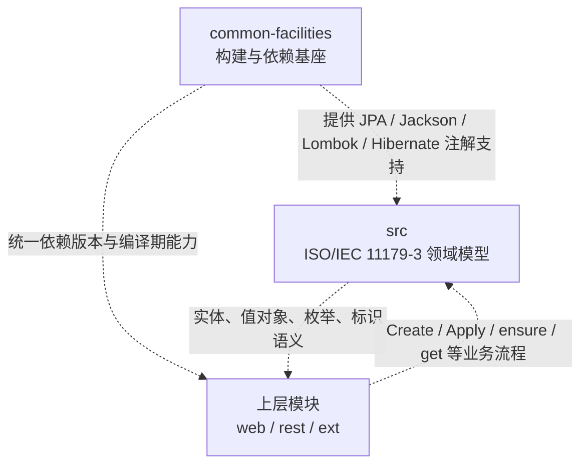

> 本文档由 GitNexus wiki 生成于 2026-09-13（kimi-for-coding，--lang chinese）。内容变化时请重新运行 `gitnexus wiki --lang chinese` 生成，勿手工改写。

# metadata-registry-common-facilities

## 定位

本模块组是 `metadata-registry4j-parent` 的公共支撑与领域模型底座：  
[metadata-registry-common-facilities](metadata-registry-common-facilities.md) 目前主要承担构建与依赖基座角色，为持久化、JSON、样板代码与 Hibernate 注解使用提供统一入口；[src](metadata-registry-common-facilities-src.md) 则落地 **ISO/IEC 11179-3:2023** 注册元模型，包含约 35 个 JPA 实体、值对象与枚举，是 `web`、`rest`、`ext` 等上层模块共同依赖的领域核心。

关键边界是：**基础设施只管“如何被持久化/序列化/低成本编写”，`src` 只管“注册元模型是什么”，业务编排放在上层 Service，扩展属性放在卫星实体。**

## 子模块如何协作

- [metadata-registry-common-facilities](metadata-registry-common-facilities.md) 聚合 `jakarta.persistence-api`、Jackson、Lombok 以及 Hibernate 注解相关依赖，避免各业务模块重复声明。
- [src](metadata-registry-common-facilities-src.md) 中的实体与值对象依赖该基座使用 JPA 映射、Lombok 简化代码、Jackson 支持数据交换；需要 `@BatchSize` 等 Hibernate 优化注解时，可在编译期引用而不把上层锁死到特定运行时。
- 上层 `web` 的 Controller/Service 不复制领域规则，而是驱动 `src` 中的工厂方法、构造器与查询语义，例如 `Sign.of(...)`、`Text.of(...)`、`Item.getIdentifiedItem()`。

## 跨子模块的关键约定

- **标准可追溯**：`src` 中对应标准概念的类通过 `@StandardReference` 绑定条款号，偏离标准时用 `deviation()` 说明；`StandardReferenceTest` 保护 `Item`、`Slot`、`BooleanType`、`IValueType` 等关键溯源信息不被重构丢失。
- **纯技术基类**：`Entity`、`Item`、`IdentifiedItem`、`RegisteredItem`、`AdministeredItem` 等形成标识—注册—管理的技术继承链，不包含业务流程；业务动作由上层 Service 编排。
- **值语义优先**：`Sign`、`Text`、`PostalAddress`、`Date`、`Datetime`、`IntegerType`、`StringType`、`BooleanType` 等依赖基于值的 `equals/hashCode`，上层缓存、去重和请求应用层可安全复用这些语义。
- **受保护的行为契约**：`Datetime_Period.contains` 需同时处理闭区间与开区间；`Namespace` 默认值需符合标准；`AcceptabilityConverter` 的转换行为由测试固定，供上层引用时保持稳定。

## 典型跨模块流程

上层创建概念对象时，通常沿着 Controller → Service → `ConceptContentApplier` → `ItemAdministrationService` 的路径进入 `src`：

- **Create → Sign**：创建数据元概念后应用 Designations，最终调用 `Sign.of(...)` 生成基于值的 `Sign`。
- **Create → Text**：创建概念域后应用 Definitions，最终调用 `Text.of(...)` 生成基于值的 `Text`。
- **Create → GetIdentifiedItem**：在确保 `AdministeredItem` 存在后，通过 `Item.getIdentifiedItem()` 取得受管标识项。

## 使用入口

需要了解依赖选型与构建约定，看 [metadata-registry-common-facilities](metadata-registry-common-facilities.md)；需要了解实体关系、标准条款映射和可复用语义，看 [src](metadata-registry-common-facilities-src.md)。新增能力时应优先复用 `src` 的值对象与标识链，把流程编排留在上层，把扩展字段放入卫星实体。