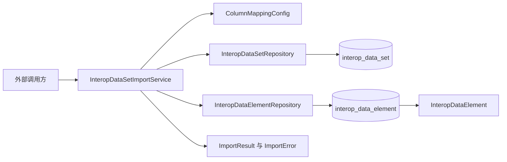

# metadata-registry-data-set-registration

# metadata-registry-data-set-registration

## 模块定位

`metadata-registry-data-set-registration` 是元数据注册系统中的数据集注册模块，负责将互联互通标准数据集模板导入并持久化。

模块支持：

- Apache POI 解析 Excel `.xlsx` 文件；
- UTF-8 CSV 文件导入；
- 通过 `ColumnMappingConfig` 将中英文表头映射为标准内部字段；
- 按 `(data_set_id, de_identifier)` 对数据元素执行增量新增或更新；
- 返回包含成功状态、导入数量、错误行和耗时的 `ImportResult`；
- 保留原始互联互通字段，并为后续 ISO 11179 对齐预留 `mappedItemId` 和 `mappingStatus`。

当前实现只负责导入和保存原始字段副本，不执行实际的 ISO 11179 语义对齐。对齐相关字段目前由后续对齐引擎负责填充。

模块的 Maven 坐标为：

```xml
<groupId>io.github.matrixlane</groupId>
<artifactId>metadata-registry-data-set-registration</artifactId>
<version>0.1.0-SNAPSHOT</version>
```

基础包名为：

```text
io.github.matrixlane.metadataregistry.datasetregistration
```

## 能力边界

本模块包含以下职责：

1. 解析 `.xlsx` 或 CSV 模板；
2. 识别并映射表头；
3. 校验每个数据元素行；
4. 根据数据集编码查找或创建 `InteropDataSet`；
5. 新增或更新 `InteropDataElement`；
6. 更新数据集中的数据元素总数；
7. 汇总导入结果和逐行错误。

本模块不负责：

- 暴露 HTTP 或消息队列接口；
- 执行完整的 ISO 11179 Item 层级建模；
- 执行数据元语义匹配、候选冲突检测或人工映射；
- 校验 `permissibleValues` 是否为合法 JSON；
- 删除导入文件中已经不存在的数据元素。

调用图中没有发现其他模块对当前模块的直接调用，也没有控制器实现。外部集成层需要通过 Spring 注入 `InteropDataSetImportService` 后主动调用导入方法。

## 总体架构



核心关系是一个 `InteropDataSet` 对应多个 `InteropDataElement`：

```text
InteropDataSet 1 ─── N InteropDataElement
```

服务通过两个 Spring Data JPA 仓库完成持久化。`ColumnMappingConfig` 只负责表头解析，不直接访问数据库。

## 导入执行流程

`importFromExcel` 和 `importFromCsv` 共享相同的主要处理阶段。

### 1. 创建导入结果

每次调用都会创建新的 `ImportResult`，初始状态为：

- `success = false`
- `totalRows = 0`
- `importedRows = 0`
- `errorRows = 0`
- `errors` 为空
- `durationMs = 0`

### 2. 读取文件并识别表头

服务只读取第一个工作表或 CSV 第一行作为表头。

表头通过 `ColumnMappingConfig.resolve` 转换为内部字段名。当前导入服务能够识别的内部字段为：

- `deIdentifier`
- `deName`
- `deDefinition`
- `dataType`
- `representationFormat`
- `permissibleValues`
- `required`

如果没有任何可识别列，导入会在创建数据集之前终止，并向结果添加文件级错误。

如果缺少 `deIdentifier` 列，当前实现只记录警告，不会立即终止。后续所有数据行会因为缺少标识符而失败。

### 3. 解析或创建数据集

导入服务调用 `createOrGetDataSet`：

1. 通过 `deriveCodeFromFileName` 从文件名推导数据集编码；
2. 调用 `InteropDataSetRepository.findByCode`；
3. 已存在时复用原数据集；
4. 不存在时创建新的 `InteropDataSet`。

例如：

```text
HDSB01.01.xlsx → HDSB01.01
```

新数据集的初始属性为：

- `code`：文件名推导出的编码；
- `name`：移除 `.xlsx` 或 `.csv` 后的文件名；
- `version`：`1.0`；
- `sourceFileName`：原始文件名。

数据集总是在数据行解析前创建。因此，即使所有数据行都校验失败，也可能留下一个没有有效数据元素的数据集。

### 4. 解析和校验数据行

每个数据行会被转换为 `InteropDataElement`。以下两个字段是导入必需字段：

- `deIdentifier`
- `deName`

缺少任意字段时，该行不会进入持久化批次，并会生成一条 `ImportError`。

合法行会加入内存中的 `batch`，同时增加 `ImportResult.importedRows`。错误行不会阻止后续行继续处理，因此一次导入可以同时包含成功行和失败行。

### 5. 持久化和增量更新

`persistBatch` 对每个合法元素执行以下操作：

1. 使用 `findByDataSetIdAndDeIdentifier` 查询已有元素；
2. 已存在时合并非空字段并保存；
3. 不存在时设置 `mappingStatus = UNMAPPED` 并插入。

虽然方法名为 `persistBatch`，当前实现是逐条调用 `dataElementRepository.save`，并没有使用 `saveAll` 或 JDBC 批量写入。

### 6. 更新数据集计数

持久化完成后，服务调用：

```java
dataElementRepository.countByDataSetId(dataSet.getId())
```

并将结果写入 `InteropDataSet.elementCount`。

该值表示数据集中当前已有的数据元素总数，而不只是本次文件导入的行数。增量导入后，它通常包含之前已经存在的数据元素。

### 7. 标记导入结果

正常完成全部处理后，服务调用：

```java
result.markSuccess(dataSet.getId(), dataSet.getName());
```

因此，只要导入流程正常走到结束，即使存在被跳过的错误行，`success` 仍会为 `true`。

## 公共 API

### `importFromExcel`

```java
@Transactional
public ImportResult importFromExcel(String fileName, InputStream inputStream)
```

行为：

- 使用 `XSSFWorkbook` 读取 `.xlsx`；
- 只处理第一个工作表；
- 第一行作为表头；
- 后续行使用与 CSV 相同的字段映射、校验和持久化逻辑；
- 空工作簿、空表或无法识别表头时返回失败结果；
- `inputStream == null` 时返回错误 `ImportError`，错误行号为 `0`。

Excel 单元格支持：

- 字符串；
- 数值，整数去除小数形式；
- 布尔值；
- 公式，优先读取缓存数值，然后尝试字符串，最后回退到公式文本；
- 空白单元格，转换为 `null`。

公式单元格的数值不会根据 Excel 日期格式进行日期类型解释。

### `importFromCsv`

```java
@Transactional
public ImportResult importFromCsv(String fileName, InputStream inputStream)
```

行为：

- 固定使用 UTF-8；
- 自动移除首行开头的 UTF-8 BOM；
- 第一行作为表头；
- 后续物理行作为数据行；
- 空文件返回失败结果；
- 只有表头时创建数据集并返回部分成功语义，`success = true`，但 `isFullySuccessful() = false`。

CSV 解析由 `parseCsvLine` 手工实现，支持：

- 双引号包围字段；
- 字段中的逗号；
- 使用两个双引号表示转义双引号。

当前实现不支持引号字段内跨越多行，也不支持 TSV。字段在解析时会被执行 `trim()`，因此字段开头或结尾有意保留的空格会丢失。

虽然 `pom.xml` 声明了 `com.opencsv:opencsv`，当前源代码没有使用 OpenCSV。

## 导入结果语义

### `ImportResult`

| 场景 | `success` | `isFullySuccessful()` |
|---|---:|---:|
| 所有数据行成功导入 | `true` | `true` |
| 部分数据行成功、部分失败 | `true` | `false` |
| 表头有效但没有数据行 | `true` | `false` |
| 空文件、无有效表头或文件级失败 | `false` | `false` |

`isFullySuccessful()` 的判断条件是：

```java
errorRows == 0 && importedRows > 0
```

因此，调用方需要区分两个状态：

- `success`：导入流程是否正常完成；
- `isFullySuccessful()`：是否至少导入一行且没有任何错误。

### 统计字段

- `totalRows`：正常完成时等于已导入行数加错误行数，不包含表头；
- `importedRows`：通过校验的行数，更新已有数据元素也计入该值；
- `errorRows`：调用 `addError` 的次数；
- `durationMs`：导入耗时，单位为毫秒。

`addError` 也用于文件级错误，因此 `errorRows` 并不严格等于“被跳过的数据行数”。

部分提前返回路径不会执行方法末尾的耗时赋值，因此空文件、无有效表头等场景的 `durationMs` 可能保持为 `0`。

### `ImportError`

每条错误包含：

- `row`：错误行号，数据行从 `2` 开始且包含表头；文件级错误使用 `0`；
- `column`：错误列索引，行级错误使用 `-1`；
- `message`：错误描述；
- `rawValue`：触发错误的原始值或行摘要。

`ImportError` 的字段为 `final`，实际上是不可变对象。

当前缺少 `deName` 时，错误列固定记录为 `1`，并不根据实际表头位置动态计算。

## 表头映射

`ColumnMappingConfig` 的解析优先级为：

1. 实例级 `customMappings`；
2. 静态 `DEFAULT_MAPPINGS`；
3. 去除首尾空格后的原始表头。

匹配区分大小写。

| 内部字段 | 中文表头 | 英文表头 |
|---|---|---|
| `deIdentifier` | `数据元标识符`、`数据元标识`、`DE标识符` | `Data Element Identifier`、`DE Identifier`、`Identifier` |
| `deName` | `数据元名称`、`数据元名` | `Data Element Name`、`DE Name`、`Name` |
| `deDefinition` | `定义`、`数据元定义` | `Definition` |
| `dataType` | `数据类型` | `Data Type` |
| `representationFormat` | `表示格式`、`格式` | `Representation Format`、`Format` |
| `permissibleValues` | `允许值`、`值域`、`允许值/值域` | `Permissible Values`、`Value Domain` |
| `required` | `必填标识`、`是否必填`、`必填` | `Required` |

自定义映射示例：

```java
ColumnMappingConfig mapping = new ColumnMappingConfig();
mapping.addMapping("机构标识", "deIdentifier");
```

当前导入服务在每次调用时都会自行创建 `new ColumnMappingConfig()`，没有构造函数参数、Setter 或其他注入入口。因此，实例级 `addMapping` 目前不能直接用于 `importFromExcel` 或 `importFromCsv`。若要让调用方提供自定义映射，需要修改服务构造和依赖注入方式。

此外：

- 未知表头虽然会由 `resolve` 返回原表头，但 `setField` 不会持久化未知字段；
- 直接使用内部字段名作为文件表头，例如 `deIdentifier`，不会被当前列收集逻辑当作可识别列；
- `MIN_FIELDS_EXPECTED` 虽已定义，但当前没有被使用，最少字段数并未真正校验。

## 必填值转换

`required` 字段使用以下规则转换为 `Boolean`：

| 输入值 | 结果 |
|---|---|
| `是`、`Y`、`Yes`、`true`、`1` | `true` |
| `否`、`N`、`No`、`false`、`0` | `false` |
| 其他值或空值 | `null` |

由于增量更新只覆盖非空源字段，无法识别的必填值不会清除已有数据元素中的 `required` 值。

## 持久化模型

### `InteropDataSet`

映射表：`interop_data_set`。

| 属性 | 数据库列 | 说明 |
|---|---|---|
| `id` | `id` | UUID 主键，由 JPA 生成 |
| `code` | `code` | 数据集编码，例如 `HDSB01.01` |
| `name` | `name` | 数据集名称 |
| `version` | `version` | 模板版本 |
| `sourceFileName` | `source_file_name` | 原始导入文件名 |
| `importedAt` | `imported_at` | 首次导入时间 |
| `updatedAt` | `updated_at` | 最后更新时间 |
| `elementCount` | `element_count` | 冗余保存的数据元素总数 |

`@PrePersist` 会设置 `importedAt` 和 `updatedAt`，`@PreUpdate` 只更新 `updatedAt`。

`code` 当前没有数据库唯一约束。虽然服务按编码复用数据集，但并发导入相同编码时仍可能创建重复数据集。

### `InteropDataElement`

映射表：`interop_data_element`。

| 属性 | 数据库列 | 说明 |
|---|---|---|
| `id` | `id` | UUID 主键 |
| `dataSet` | `data_set_id` | 所属数据集，非空、多对一、延迟加载 |
| `deIdentifier` | `de_identifier` | 数据元标识符，非空 |
| `deName` | `de_name` | 数据元名称 |
| `deDefinition` | `de_definition` | 定义，文本类型 |
| `dataType` | `data_type` | 数据类型 |
| `representationFormat` | `representation_format` | 表示格式 |
| `permissibleValues` | `permissible_values` | 允许值或值域，以原始文本保存 |
| `required` | `required` | 是否必填，可为空 |
| `mappedItemId` | `mapped_item_id` | 对齐目标 ISO 11179 Item 的 UUID |
| `mappingStatus` | `mapping_status` | 映射状态，字符串枚举 |
| `createdAt` | `created_at` | 创建时间 |
| `updatedAt` | `updated_at` | 更新时间 |

数据库定义了唯一约束：

```text
uk_interop_de_dataset_identifier (data_set_id, de_identifier)
```

`MappingStatus` 包含：

- `UNMAPPED`：尚未映射；
- `MAPPED`：已映射到单个 ISO 11179 Item；
- `CONFLICT`：存在多个候选，需要人工处理。

新导入的数据元素默认设置为 `UNMAPPED`。`mappedItemId` 是普通 UUID 字段，没有使用 `@ManyToOne` 建立数据库外键关系。

### 增量更新规则

已有数据元素更新时，`mergeFields` 仅覆盖源对象中的非空字段：

- `deName`
- `deDefinition`
- `dataType`
- `representationFormat`
- `permissibleValues`
- `required`

以下字段不会在导入时被覆盖：

- `deIdentifier`
- `mappedItemId`
- `mappingStatus`

因此，导入空单元格无法清除数据库中的旧值。对齐引擎写入的映射信息也不会被普通导入意外重置。

## 仓库接口

### `InteropDataSetRepository`

```java
Optional<InteropDataSet> findByCode(String code);
boolean existsByCode(String code);
```

同时继承 `JpaRepository<InteropDataSet, UUID>` 的通用 CRUD 能力。

导入服务使用 `findByCode`。`existsByCode` 当前没有调用方。

### `InteropDataElementRepository`

```java
List<InteropDataElement> findByDataSetId(UUID dataSetId);
Optional<InteropDataElement> findByDataSetIdAndDeIdentifier(
        UUID dataSetId,
        String deIdentifier);
long countByDataSetId(UUID dataSetId);
```

导入服务使用后两个方法完成增量更新和计数。

## 与代码库其他部分的连接

### Spring 集成

- `InteropDataSetImportService` 使用 `@Service`；
- 两个仓库使用 `@Repository`；
- 仓库继承 `JpaRepository`；
- 导入方法使用 `@Transactional`；
- 实体位于标准 `entity` 包，便于宿主应用执行 JPA 实体扫描。

外部模块可以在 Spring 容器中直接注入 `InteropDataSetImportService`。当前模块本身不提供 REST 控制器、命令行入口或消息监听器。

### `metadata-registry-common-facilities`

`pom.xml` 声明了对 `metadata-registry-common-facilities` 的依赖。当前提供的源代码没有直接导入该模块中的类型，因此现阶段属于构建层依赖，而不是明确的运行时调用关系。

### `metadata-registry-data-specification`

`pom.xml` 声明了对 `metadata-registry-data-specification` 的依赖，但当前导入代码没有调用其 API。标准字段到 ISO 11179 Item 的真实转换尚未接入，现有实现只是保留 `mappedItemId` 和 `mappingStatus` 作为后续对齐入口。

## 使用示例

CSV 文件示例：

```csv
数据元标识符,数据元名称,定义,数据类型,表示格式,允许值,必填标识
DE01.01.001,医疗机构组织机构代码,各级各类医疗机构的唯一编码,字符型,AN..20,,是
DE01.01.002,医疗机构名称,医疗机构登记注册的名称,字符型,AN..100,,是
```

调用方式：

```java
ImportResult result =
        interopDataSetImportService.importFromCsv(fileName, inputStream);

if (!result.isSuccess()) {
    // 文件级失败，查看具体错误
    for (ImportError error : result.getErrors()) {
        log.error("第 {} 行导入失败：{}", error.getRow(), error.getMessage());
    }
    return;
}

if (!result.isFullySuccessful()) {
    // 文件处理完成，但存在被跳过的数据行
    log.warn(
            "导入部分成功：成功 {} 行，失败 {} 行",
            result.getImportedRows(),
            result.getErrorRows()
    );
}
```

调用方应根据业务需要同时检查 `success` 和 `isFullySuccessful()`，不能只依赖其中一个状态。

## 事务与一致性

两个公共导入方法都标注了 `@Transactional`，正常返回时由 Spring 管理事务。

但方法内部会捕获 `IOException` 和其他 `Exception`，并将其转换为 `ImportResult` 中的错误，而不是继续向外抛出。因此：

- 文件级解析错误通常发生在持久化之前；
- 仓储操作异常可能发生在部分数据已经保存之后；
- `success = false` 不应被调用方直接理解为数据库必然已经回滚；
- 如果导入必须具备严格的整批原子性，应让异常逃出事务边界或显式标记事务回滚。

逐条执行 `findByDataSetIdAndDeIdentifier` 和 `save` 也会产生较多数据库查询。大文件导入时，当前实现的主要扩展性限制是全量文件读取、逐行查询和逐条保存。

## 已知限制与维护注意事项

1. **自定义表头映射未接入服务**  
   `ColumnMappingConfig.addMapping` 可以独立使用，但导入服务无法接收调用方创建的映射配置。

2. **数据集编码仅由文件名决定**  
   `resolveDataSet` 虽然尝试读取 Excel 首个表头单元格中的编码，但得到的 `code` 没有被使用。实际编码始终来自 `deriveCodeFromFileName`。

3. **数据集编码缺少唯一约束**  
   `interop_data_set.code` 没有唯一约束，不能完全依赖数据库阻止并发重复创建。

4. **文件扩展名处理区分大小写**  
   文件名推导只移除小写 `.xlsx`、`.xls` 和 `.csv`。大写扩展名可能成为编码的一部分。

5. **`.xls` 并未真正受支持**  
   文件名推导会移除 `.xls`，但 `importFromExcel` 使用 `XSSFWorkbook`，只能处理 `.xlsx`。

6. **CSV 不支持跨物理行字段**  
   自定义解析器无法处理引号字段中的换行。对于包含多行说明或允许值的模板，应改用 OpenCSV 或其他符合 RFC 4180 的解析器。

7. **空值不能清除已有字段**  
   增量合并采用非空覆盖策略，这是当前明确的字段级更新约定。

8. **真实 ISO 11179 对齐尚未实现**  
   服务类注释中列出了转换阶段，但当前代码只完成互联互通原始字段的复制和持久化。

9. **包级说明已经过时**  
   `package-info.java` 仍将该模块描述为占位包，与当前已有的实体、仓库和导入服务不一致，修改模块时应同步更新。

10. **最小字段数校验未生效**  
    `MIN_FIELDS_EXPECTED` 当前未被引用，不能依赖它拒绝字段过少的模板。

## 依赖说明

| 依赖 | 用途 |
|---|---|
| `metadata-registry-common-facilities` | 公共基础能力，当前源代码未直接引用其类型 |
| `metadata-registry-data-specification` | 数据规范及 ISO 11179 相关能力的构建依赖 |
| `jakarta.persistence-api` | JPA 实体和生命周期注解 |
| `jakarta.annotation-api` | Jakarta 注解支持 |
| `lombok` | 生成实体、DTO 和配置类的访问方法 |
| `spring-data-jpa` | 提供 `JpaRepository` 和派生查询 |
| `poi-ooxml:5.2.5` | 解析 `.xlsx` 工作簿 |
| `opencsv:5.9` | 已声明但当前实现未使用 |

测试依赖包括 JUnit Jupiter、AssertJ、Mockito 和 `spring-boot-starter-test`。

## 测试与贡献指南

当前测试覆盖：

- `ImportError` 和 `ImportResult` 的状态与统计行为；
- `InteropDataSet` 和 `InteropDataElement` 的属性及生命周期时间戳；
- `ColumnMappingConfig` 的中文、英文、自定义和未知表头解析；
- CSV 的正常导入、部分成功、空文件、仅表头、带引号字段、BOM 和增量更新；
- Excel 空输入流处理。

建议在修改导入逻辑时补充以下测试：

- `.xlsx` 正常导入、公式单元格和多工作表行为；
- 缺少 `deIdentifier` 表头时的处理结果；
- 同一文件内重复 `deIdentifier`；
- 更新时确认 `mappedItemId` 和 `mappingStatus` 保持不变；
- 空值是否保持旧值；
- 文件级异常后的数据一致性；
- 提前返回路径的 `durationMs`；
- 大文件和特殊 CSV 引号、换行场景。

可在模块目录运行：

```bash
mvn test
```