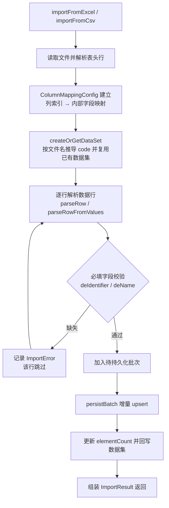

> 本文档由 GitNexus wiki 生成于 2026-09-13（kimi-for-coding，--lang chinese）。内容变化时请重新运行 `gitnexus wiki --lang chinese` 生成，勿手工改写。

# 数据集注册模块（metadata-registry-data-set-registration）

## 模块概述

本模块负责**互联互通数据集模板**（互联互通标准 Data Set Template）的导入与注册。它从国家健康信息互联互通标准发布的 Excel（.xlsx）或 CSV 文件中解析数据集定义，将其中的数据元（Data Element）持久化为可追踪、可增量更新的实体记录，并为后续的 ISO 11179 概念对齐引擎（WI-013-2）预留映射字段。

模块的核心能力：

- **多格式导入**：支持 Excel（Apache POI）与 CSV（自实现解析器，支持引号转义与 UTF-8 BOM）两种输入格式
- **灵活的列名映射**：内置中英文表头别名映射，支持自定义覆盖，容忍模板列名差异
- **行级错误定位**：导入错误精确到行号与列号，支持部分成功（partial success）
- **增量更新**：同一数据集重复导入时按 `(dataSetId, deIdentifier)` 唯一键做字段级合并更新

> **MVP 技术债说明**：当前采用扁平表结构直接存储，未接入 ISO 11179 Item 层级体系（见 WI-013-1 trio review 条件 #5）。该设计是刻意为之的过渡方案。

## 架构与依赖

模块分层结构清晰，依赖关系自上而下单向流动：

```
service  →  repository  →  entity（JPA）
    ↓           ↓
   dto      Spring Data JPA
```

依赖的 Maven artifact：

| 依赖 | 用途 |
|---|---|
| `metadata-registry-common-facilities` | 公共基础设施（父模块提供） |
| `metadata-registry-data-specification` | 数据规范领域模型 |
| `spring-data-jpa` | Repository 支持 |
| `poi-ooxml` 5.2.5 | Excel (.xlsx) 解析 |
| `opencsv` 5.9 | CSV 解析（依赖已声明；当前 CSV 解析为自实现） |
| `jakarta.persistence-api` / `jakarta.annotation-api` | JPA 注解 |
| `lombok`（provided） | 样板代码消除，通过 annotation processor 配置 |

## 核心组件

### 实体层（entity）

#### `InteropDataSet` — 互联互通数据集

对应一个数据集模板（如 `HDSB01.01`），主要字段：

- `code`：数据集编码，如 `"HDSB01.01"`
- `name`：数据集名称
- `version`：模板版本标识
- `sourceFileName`：来源文件名（溯源用）
- `elementCount`：数据元数量（反规范化字段，加快查询）
- `importedAt` / `updatedAt`：由 `@PrePersist` / `@PreUpdate` 自动维护

#### `InteropDataElement` — 互联互通数据元

存储模板中每个数据元的**原始字段副本**，保证可追溯性。字段分为三组：

**互联互通标准字段**：
- `deIdentifier`（数据元标识符，如 `DE01.01.001.00`）
- `deName`（数据元名称）
- `deDefinition`（定义）
- `dataType`（数据类型，如"字符型"）
- `representationFormat`（表示格式，如 `N..20`、`AN..100`）
- `permissibleValues`（允许值/值域，MVP 以原始文本存储）
- `required`（必填标识，Boolean）

**ISO 11179 映射预留字段**（由对齐引擎 WI-013-2 填充）：
- `mappedItemId`：映射到的本地 ISO 11179 Item 引用
- `mappingStatus`：枚举 `UNMAPPED` / `MAPPED` / `CONFLICT`（多候选需人工裁决），新导入元素默认 `UNMAPPED`

**约束**：`(data_set_id, de_identifier)` 组合唯一（`uk_interop_de_dataset_identifier` 唯一约束），这是增量更新策略的匹配键。

### 仓储层（repository）

两个 Spring Data JPA 接口，均为标准 CRUD 扩展：

- `InteropDataSetRepository`：`findByCode(String)`、`existsByCode(String)`
- `InteropDataElementRepository`：`findByDataSetId(UUID)`、`findByDataSetIdAndDeIdentifier(UUID, String)`（增量更新的关键查询）、`countByDataSetId(UUID)`

### DTO 层（dto）

- `ImportError`：单行导入错误，含行号（1 起始，含表头）、列索引（行级错误为 `-1`）、错误描述、触发错误的原始值
- `ImportResult`：导入结果汇总，含成功标志、数据集 ID/名称、总行数/成功行数/错误行数、错误列表、耗时（毫秒）。关键方法：
  - `addError(ImportError)` — 追加错误并自动递增 `errorRows`
  - `markSuccess(UUID, String)` — 标记整体成功（**部分成功也算 success**）
  - `isFullySuccessful()` — 仅当无错误且有导入行时才为 `true`

### 服务层（service）

#### `ColumnMappingConfig` — 列名映射配置

将文件中实际出现的表头文本解析为 `InteropDataElement` 内部字段名。解析优先级：

1. `customMappings`（用户自定义映射，`addMapping()` 添加）
2. `DEFAULT_MAPPINGS`（静态内置映射，含中文标准列名、中文别名、英文列名三套）
3. 回退：原样返回表头文本（容忍自定义模板列）

内置中文映射示例：`数据元标识符`/`数据元标识` → `deIdentifier`，`允许值`/`值域` → `permissibleValues`，`必填标识`/`是否必填`/`必填` → `required`。输入会做 `trim()` 处理。

#### `InteropDataSetImportService` — 导入主服务

`@Service` + `@Transactional`，两个公开入口方法：

| 方法 | 说明 |
|---|---|
| `importFromExcel(String fileName, InputStream inputStream)` | 导入 .xlsx 文件 |
| `importFromCsv(String fileName, InputStream inputStream)` | 导入 CSV（UTF-8，自动剥离 BOM） |

## 导入执行流程

两个入口共用同一套三阶段策略（Parse → Transform → Persist），仅在文件读取与行解析上存在差异：



关键内部环节说明：

**数据集解析（`createOrGetDataSet`）**：通过 `deriveCodeFromFileName` 从文件名推导数据集编码——优先匹配 `[A-Z]{2,}[0-9]+\.[0-9]+` 模式（如 `HDSB01.01.xlsx` → `HDSB01.01`），否则使用去扩展名的文件名。若 `findByCode` 命中已有数据集则复用（支持重复导入同一模板）。

**字段填充（`setField`）**：按字段名反射式赋值；`required` 字段接受多语言/多格式真值（`是`/`Y`/`Yes`/`true`/`1` 为 true，`否`/`N`/`No`/`false`/`0` 为 false），无法识别的值保持 `null`（未知），未知字段名仅记 debug 日志。

**CSV 解析（`parseCsvLine`）**：自实现的最小化解析器，支持双引号包裹值、引号内转义（`""` → `"`）及内嵌逗号。注意：当前实现不支持跨行引号字段。

**单元格取值（`getCellValueAsString`）**：统一处理 STRING / NUMERIC（整数去除小数尾零）/ BOOLEAN / FORMULA（带异常回退）/ BLANK 类型。

**增量更新（`persistBatch` + `mergeFields`）**：对每个待入库元素，用 `findByDataSetIdAndDeIdentifier` 检查是否已存在——

- 已存在：执行**字段级合并**，仅非 null 源字段覆盖目标（trio review 决定的增量更新语义），并刷新 `updatedAt`
- 不存在：新元素置为 `UNMAPPED` 后插入

**错误处理语义**：行级校验失败不中断整个导入，该行跳过并记入 `ImportResult.errors`；整体异常（IO 错误、解析崩溃）在结果中以行 0 的错误记录。因此 `isSuccess() == true` 并不保证全部行成功，需结合 `isFullySuccessful()` 与 `getErrorRows()` 判断。

## 使用示例

```java
// 注入服务
InteropDataSetImportService importService = ...;

// 导入 CSV 模板（中文表头）
ImportResult result = importService.importFromCsv(
        "HDSB01.01.csv", inputStream);

if (result.isFullySuccessful()) {
    // 全部行导入成功
    UUID dataSetId = result.getDataSetId();
} else {
    // 部分或全部失败：逐行定位问题
    for (ImportError err : result.getErrors()) {
        log.warn("第 {} 行错误: {}（原始值: {}）",
                err.getRow(), err.getMessage(), err.getRawValue());
    }
}
```

自定义列名映射（在扩展场景下，目前导入服务内部固定使用默认配置）：

```java
ColumnMappingConfig mapping = new ColumnMappingConfig();
mapping.addMapping("我的标识列", "deIdentifier");
String field = mapping.resolve("我的标识列"); // → "deIdentifier"
```

## 测试

测试覆盖充分，位于 `src/test/java`，按包结构镜像主代码：

| 测试类 | 覆盖重点 |
|---|---|
| `ImportErrorTest` | 三个构造器重载、默认值（`column = -1`、`rawValue = null`） |
| `ImportResultTest` | 错误追踪、成功标记、`isFullySuccessful()` 三种边界（无错、有错、零行） |
| `InteropDataSetTest` / `InteropDataElementTest` | 属性读写、审计时间戳钩子、全部映射状态枚举 |
| `ColumnMappingConfigTest` | 中/英文及别名映射、自定义覆盖优先级、回退行为、trim、null 输入 |
| `InteropDataSetImportServiceTest` | CSV 中英文表头导入、缺标识符/缺名称报错、空文件、仅表头、引号内逗号、UTF-8 BOM、增量更新合并、Excel null 流 |

服务层测试使用 Mockito（`@ExtendWith(MockitoExtension.class)`）mock 两个 Repository，通过 `thenAnswer` 模拟 save 时回填 UUID。

## 已知限制与后续方向

- **MVP 扁平存储**：未接入 ISO 11179 Item 层级，迁移路径见 WI-013-1 条件 #5
- **CSV 解析器为自实现**：`pom.xml` 已声明 OpenCSV 依赖但代码未使用；如需支持跨行引号字段或多行表头，建议切换至 OpenCSV
- **数据集编码推导启发式**：`deriveCodeFromFileName` 依赖文件名约定，非标准命名会退化为完整文件名
- **单 Sheet 限制**：Excel 导入只读取第一个 Sheet（`getSheetAt(0)`）
- **Transform 阶段未实现**：导入策略文档中的"映射到 ISO 11179 概念"阶段当前为空操作，对齐逻辑由 WI-013-2 对齐引擎承担