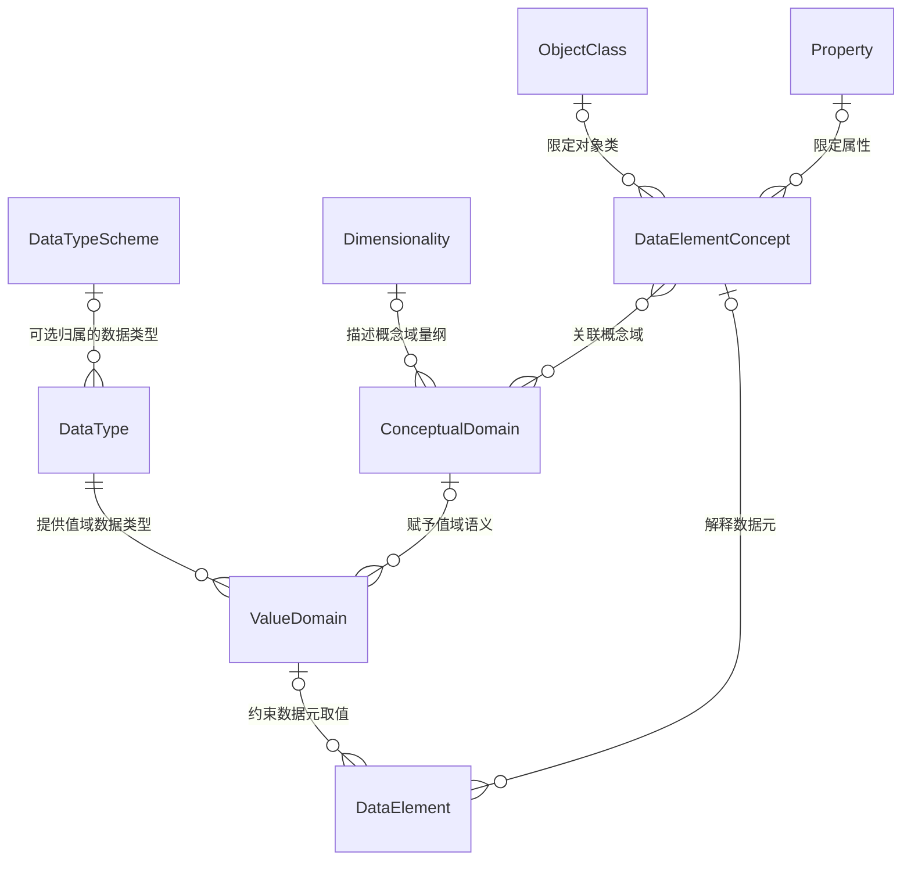

# metadata-registry-data-specification

# metadata-registry-data-specification

`metadata-registry-data-specification` 是元数据注册库中“数据规范”子域的持久化模型模块，包名为 `io.github.matrixlane.metadataregistry.dataspecification`。该模块依据 ISO/IEC 11179-31:2023，将数据元、数据元概念、概念域、值域、数据类型、量纲以及枚举值支持结构映射为 JPA 实体。

模块本身是一个**声明式实体层**，不包含仓储、服务、校验器或对象工厂。实体的创建、关联同步、业务校验和持久化流程均由其他模块负责。

## 模块边界与依赖

模块复用 `metadata-registry-common-facilities` 提供的公共模型：

| 公共类型 | 在本模块中的用途 |
|---|---|
| `Concept` | 概念型元数据的基类，如 `ObjectClass`、`Property`、`ConceptualDomain`、`ValueMeaning` |
| `Item` | 条目型元数据的基类，如 `DataElement`、`ValueDomain`、`DataType`、`PermissibleValue` |
| `Datetime_Period` | 概念域、值域、允许值含义及集合的有效期 |
| `ReferenceDocument` | 数据类型方案引用的外部文档 |

其他构建依赖包括：

- `jakarta.persistence-api`：实体、关联和嵌入式对象映射。
- `hibernate-core`，`provided` 作用域：编译期使用 Hibernate 的 `@Nationalized`，不表示应用运行时必须使用 Hibernate。
- `lombok`，`provided` 作用域：生成无参构造器、getter 和 setter。
- JUnit Jupiter 与 AssertJ：仅用于测试。

本模块未声明主键字段，实体标识及通用注册元数据由继承体系提供。

## 核心领域模型

数据元由两部分共同解释：

1. `DataElementConcept` 描述“被观测什么”，由 `ObjectClass` 和 `Property` 组成。
2. `ValueDomain` 描述“数据如何表示”，并引用必需的 `DataType`。
3. `ConceptualDomain` 为数据元概念提供语义范围，并通过 `ValueDomain.conceptualDomain` 与具体表示形式关联。



图中的可空关系按 JPA 映射表达；标准或业务层可能施加更严格的约束。枚举子类型及其有效期支持结构未在图中展开。

## 关键实体

### 数据元与数据元概念

| 实体 | 关键成员 | 说明 |
|---|---|---|
| `DataElement` | `dataElementConcept`、`valueDomain`、`precision` | 表示一个数据元。`precision` 是允许的小数位数，对应 ISO/IEC 11179-31:2023 中的可选 `precision`。 |
| `DataElementConcept` | `objectClass`、`property`、`conceptualDomains` | 组合对象类和属性，并关联一个或多个概念域。 |
| `ObjectClass` | 无附加字段 | 继承 `Concept`，表示被描述的对象类别。 |
| `Property` | 无附加字段 | 继承 `Concept`，表示对象类上的属性。 |

`DataElement` 使用 `data_element_concept_id` 和 `value_domain_id` 两个外键分别关联 `DataElementConcept` 与 `ValueDomain`。这两个关联在 JPA 映射层均为可选。

`DataElementConcept.conceptualDomains` 是 `ConceptualDomain.dataElementConcepts` 的反向集合。持久化写入以 `ConceptualDomain` 一侧为拥有方；应用层应同时维护两端集合，使内存对象图与服务层双向同步行为保持一致。

### 概念域

`ConceptualDomain` 是抽象实体，继承 `Concept`，包含：

- `validPeriod`：嵌入的 `Datetime_Period`。按标准，有效期整体为必备属性；起止时间各自可为 `0..1`，但至少应指定一端。该约束不能仅由当前 `@Embedded` 映射保证。
- `dimensionality`：可选的 `Dimensionality`，外键为 `dimensionality_id`。
- `dataElementConcepts`：与 `DataElementConcept` 的多对多关联，也是该关联的拥有方。

概念域有三个具体方向：

#### 描述型概念域

`DescribedConceptualDomain` 继承 `ConceptualDomain`，通过：

```java
@OneToMany(mappedBy = "conceptualDomain")
private List<DescribedValueDomain> describedValueDomains;
```

维护与描述型值域的反向关系。它没有独立的关联列；实际外键仍是 `ValueDomain.conceptualDomain`。

#### 枚举型概念域

`EnumeratedConceptualDomain` 是抽象实体，继承 `ConceptualDomain`，增加：

- `expandedOnDatetime`：取值含义集合展开为枚举取值集的时间，映射为 `OffsetDateTime`。
- `lockedDatetime`：枚举取值集被锁定、不可继续增删的时间，映射为 `OffsetDateTime`。

`LocalEnumeratedConceptualDomain` 和 `ReferenceEnumeratedConceptualDomain` 是其