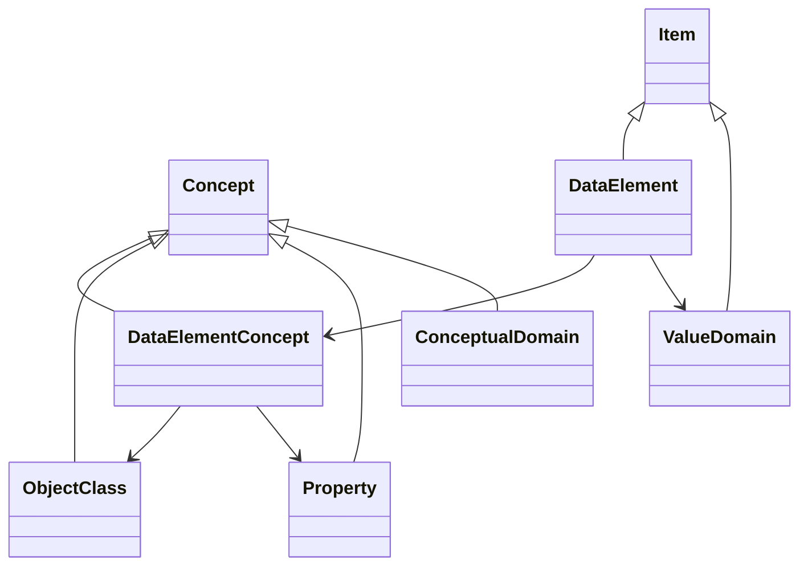
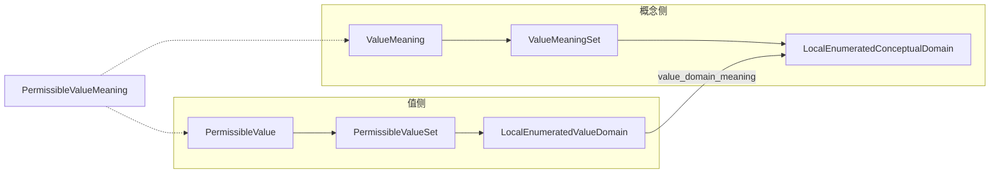
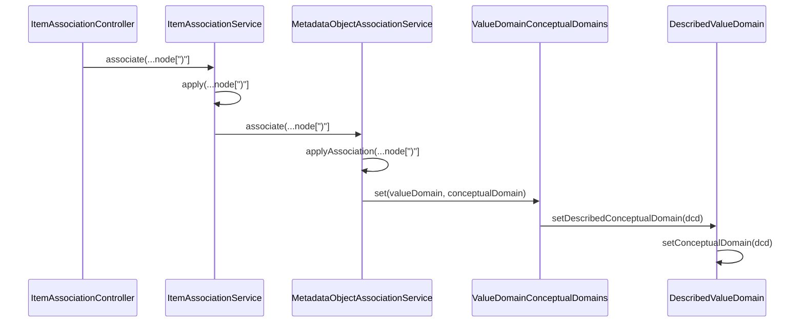

> 本文档由 GitNexus wiki 生成于 2026-09-13（kimi-for-coding，--lang chinese）。内容变化时请重新运行 `gitnexus wiki --lang chinese` 生成，勿手工改写。

# metadata-registry-data-specification

本模块是 Metadata Registry4J 的**数据规范层（Data Specification）**，将 ISO/IEC 11179-31:2023《信息技术 — 元数据注册系统（MDR）— 第 31 部分：数据规范》中的核心元模型实现为一组 JPA 实体。这些实体构成注册系统的"业务词汇"：数据元（Data Element）、数据元概念（Data Element Concept）、值域（Value Domain）、概念域（Conceptual Domain）、允许值（Permissible Value）、值含义（Value Meaning）等。

本模块本身**不含任何方法逻辑**——所有类均为 Lombok 驱动的实体类。真正的业务规则（校验、关联、生命周期管理）位于上游模块：

- `service/association/` — 关联管理与写入时约束强制（如 `ValueDomainConceptualDomains`）；
- `web/service/` — 应用层服务（如 `ValueDomainService`、`ConceptualDomainService`、`ItemAssociationService`）；
- `web/federation/` — 联邦条目创建（`GenericItemCreator`）。

模块唯一依赖 `metadata-registry-common-facilities`（提供 `Item`、`Concept`、`Datetime_Period`、`ReferenceDocument` 等基础类）与 Jakarta Persistence / Annotation。

## 核心概念

模块实现 ISO/IEC 11179-31 的类图（图 5），所有实体继承自 `common-facilities` 中的两个基类：

- **`Item`** — 可注册条目基类（有注册状态、标识、命名等），如 `DataElement`、`ValueDomain`、`PermissibleValue`；
- **`Concept`** — 概念基类，如 `ObjectClass`、`Property`、`ConceptualDomain`。



### 数据元的三元构成

按 ISO/IEC 11179 的经典定义，`DataElement` 不直接描述含义，而是组合两个概念并通过值域约束取值：

- `dataElementConcept`（0..1）：关联 `DataElementConcept`，而 `DataElementConcept` 又由 `objectClass`（0..1，如"患者"）与 `property`（0..1，如"出生日期"）组合而成——"对象类 + 特性"表达数据元的语义；
- `valueDomain`（0..1）：关联 `ValueDomain`，表达允许的取值集合；
- `precision`（0..1，Integer）：数据元值允许的小数位数（§7.6.2.1.4 Table 23）。

### 值域（ValueDomain）层级

`ValueDomain` 是抽象类，按取值描述方式分化为两个抽象中间层，再分化为三个具体子类：

| 子类 | 含义来源 | 关键附加属性 |
|---|---|---|
| `DescribedValueDomain` | 描述性概念域 | 无附加属性 |
| `LocalEnumeratedValueDomain` | 本地枚举概念域 | `permissibleValueSets`（允许值集） |
| `ReferenceEnumeratedValueDomain` | 引用枚举概念域 | `permittedValuesFieldname`（必填，外部源字段名） |

`ValueDomain` 的关键属性：

- `dataType`（**1，必备**，`optional = false, nullable = false`）— 每个值域必须声明数据类型；
- `validPeriod` — 嵌入式 `Datetime_Period`，**必备且必须包含 start_datetime**（§7.4.2.8.5）。列可空性不变，start 的存在性由应用层 `ValueDomainAssociationValidator.validateCompleteness` 在保存前强制（enforce-valid-period D1）；
- `unitOfMeasure`（0..1）、`maximumCharacterQuantity`、`format`；
- `conceptualDomain`（0..1，LAZY 加载）— 值域的含义（`value_domain_meaning`）。

### 概念域（ConceptualDomain）层级

与值域平行的概念层，同样分化为三个具体子类：

| 子类 | 说明 |
|---|---|
| `DescribedConceptualDomain` | 描述性概念域，持有 `describedValueDomains` 列表 |
| `LocalEnumeratedConceptualDomain` | 本地枚举，持有 `valueMeaningSets`（值含义集） |
| `ReferenceEnumeratedConceptualDomain` | 引用枚举，**无附加属性**（§7.4.2.6.4 明确"has no additional attributes"），其外部源定义由 `Enumerated_Conceptual_Domain_Definition` 承载（§7.4.2.7） |

`ConceptualDomain` 公共属性：

- `validPeriod` — 概念域有效期（两端 datetime 各自 0..1，至少其一）；
- `dimensionality`（0..1）— 量纲；
- `dataElementConcepts` — 与 `DataElementConcept` 的多对多关联（join 表 `conceptual_domain_dec`）。

抽象中间类 `EnumeratedConceptualDomain` 附加两个时间戳（均 0..1，`OffsetDateTime`）：

- `expandedOnDatetime` — 值含义集合展开为取值集的时间；
- `lockedDatetime` — 取值集被锁定（不可再增删）的时间。

### 枚举值的实现：四实体模式

本地枚举通过两对"内容 + 集合"实体实现：



- **`ValueMeaning`**（概念侧单元）与 **`ValueMeaningSet`**：值含义通过集合条目挂接到 `LocalEnumeratedConceptualDomain`，集合条目携带 `validPeriod`，用于含义随时间演变；
- **`PermissibleValue`**（值侧单元）：`permittedValue` **非空**（即使父 `Item` 可有多个 designation，标准 NOTE 要求取值唯一）；与 `PermissibleValueMeaning` 通过多对多关联（join 表 `permissible_value_pvm`）；
- **`PermissibleValueMeaning`**：桥接实体，连接一个值含义与一个允许值，同样携带 `validPeriod`（"只允许存在一个当前有效的允许值含义"）；
- **`PermissibleValueSet`**：允许值挂接到 `LocalEnumeratedValueDomain` 的集合条目。

## 子类型一致约束（Subtype Consistency）

ISO/IEC 11179-31 §7.4.5.2.1 要求值域的 `value_domain_meaning` 必须是**同型**概念域：

- `DescribedValueDomain` → `DescribedConceptualDomain`（a 款）
- `LocalEnumeratedValueDomain` → `LocalEnumeratedConceptualDomain`（b 款）
- `ReferenceEnumeratedValueDomain` → `ReferenceEnumeratedConceptualDomain`（c 款）

实体层以**类型化访问方法**实现这一窄化。基类持有通用的 `conceptualDomain` 字段，子类提供类型化视图：

```java
// DescribedValueDomain.java
public DescribedConceptualDomain getDescribedConceptualDomain() {
    return getConceptualDomain() instanceof DescribedConceptualDomain dcd ? dcd : null;
}

public void setDescribedConceptualDomain(DescribedConceptualDomain describedConceptualDomain) {
    setConceptualDomain(describedConceptualDomain);
}
```

`LocalEnumeratedValueDomain` 与 `ReferenceEnumeratedValueDomain` 上的 `getLocalEnumeratedConceptualDomain()` / `getReferencedConceptualDomain()` 遵循同一模式：**读取时类型不匹配返回 null，写入时委托给基类 setter**。类型合法性的强制在写入路径上由 `service/association/ValueDomainConceptualDomains` 执行。

## 关联写入的执行流

本模块实体被动地由关联服务装配。以"将概念域关联到值域"为例，完整调用链如下：



解绑（`dissociate`）走同一管道——`ValueDomainConceptualDomains.set(...)` 以 null 调用类型化 setter 清除关联。`MetadataObjectAssociationService.applyAssociation` 根据两个实体的具体类型分派到相应的关联处理器；不支持的类型组合会抛出异常（见 `MetadataObjectAssociationServiceTest.associate_unsupportedType_throws`）。

## 其余实体

- **`DataType` / `DataTypeScheme`**：数据类型注册。`DataType` 含 `annotation`（0..1，最长 2000 字符）；`DataTypeScheme` 含 `schemeReference`（0..1 → `ReferenceDocument`，标准中图 5 与表 11 矛盾处以表 11 为准）并通过 `dataTypes` 反向持有类型列表。
- **`Dimensionality`**（量纲）：`coordinateIndicator` 为**三态 Boolean**——`null` 表示 Not applicable（0..1）；与 `MeasureClass` 多对多（join 表 `dimensionality_measure_class`）。
- **`MeasureClass`**：度量类，被 `Dimensionality` 和 `UnitOfMeasure` 双向引用。
- **`UnitOfMeasure`**：计量单位，与 `MeasureClass` 多对多（join 表 `unit_of_measure_measure_class`）。
- **`ObjectClass` / `Property`**：均为空的 `Concept` 子类，自身无属性，语义完全继承自基类。

## 依赖与使用方

```
metadata-registry-data-specification
    ↑ 被依赖
    ├── service/association/  （关联与约束强制）
    ├── web/service/          （应用层服务与校验）
    └── web/federation/       （GenericItemCreator 创建各实体）
```

主要使用方及入口：

- `GenericItemCreator`（联邦创建）：实例化模块内大多数实体类；
- `ValueDomainService.applyTypeSpecific` / `applyPermissibleValues`：设置类型化概念域并装配允许值集合；
- `ConceptualDomainService.applyValueMeanings`：装配值含义集合；
- `ItemAssociationService` / `MetadataObjectAssociationService`：维护 `DataElement ↔ DataElementConcept`、`DataElement ↔ ValueDomain`、`DataElementConcept ↔ ConceptualDomain` 等双向关联（含测试 `associate_dataElementToValueDomain_setsValueDomain`、`associate_decConceptDomain_linksBothSides` 等保证两端同步）。

## 实现约定

- 所有实体使用 `@Getter @Setter @NoArgsConstructor`（Lombok，provided 范围），无自定义构造函数；
- 表名默认由 JPA 命名策略从类名派生；显式 join 表：`conceptual_domain_dec`、`dimensionality_measure_class`、`unit_of_measure_measure_class`、`permissible_value_pvm`、`value_meaning_permissible_value_meaning`；
- 多对多字段统一初始化为 `new ArrayList<>()`，避免 null 集合；
- 抽象类（`ConceptualDomain`、`EnumeratedConceptualDomain`、`ValueDomain`、`EnumeratedValueDomain`）对应标准中的抽象元类，映射由 JPA 继承策略处理，具体子类才是可实例化的注册对象；
- 涉及时间的属性使用 `OffsetDateTime`（含时区，对应标准的 Datetime 类型），有效期统一嵌入 `Datetime_Period`。