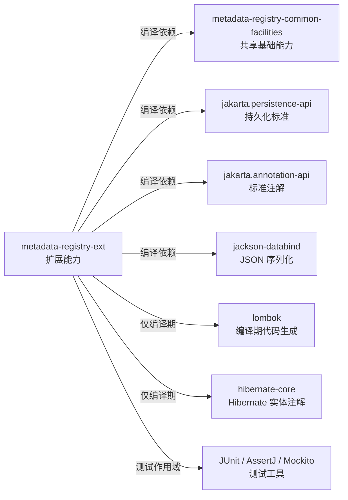

# metadata-registry-ext — metadata-registry-ext

# metadata-registry-ext — metadata-registry-ext

## 模块定位

`metadata-registry-ext` 是 `metadata-registry4j-parent` 下的 Maven 扩展模块，坐标为：

| 属性 | 值 |
|---|---|
| `groupId` | `io.github.matrixlane` |
| `artifactId` | `metadata-registry-ext` |
| `version` | `0.1.0-SNAPSHOT` |
| 默认打包类型 | `jar` |

该模块用于承载 **ISO/IEC 11179 标准元模型之外** 的注册中心扩展能力。按照模块描述，扩展被划分为三个主要方向：

- **标识符策略**：描述业务标识符的分配、生成或解析规则。
- **卫星实体**：在不修改标准元模型定义的前提下，为注册中心对象承载补充信息。
- **分类能力**：表达分类、分组或分类体系关系。

这些能力与标准领域模型分离，形成 `MDR/EXT` 的边界：标准元模型负责符合 ISO/IEC 11179 的核心定义，`EXT` 侧负责标准模型未覆盖的扩展语义。

当前提供的模块源码仅包含 `pom.xml`，没有 Java 类型、持久化实体或资源文件。因此，可以确认模块职责、Maven 坐标和依赖边界，但不能从现有代码中确定具体策略接口、实体名称、仓储方法或数据库表结构。

## 能力边界

| 扩展方向 | 预期职责 | 与标准模型的关系 |
|---|---|---|
| 标识符策略 | 承载业务标识符的生成、分配、格式化或解析规则 | 独立于标准模型实现，不应通过修改标准实体来加入扩展行为 |
| 卫星实体 | 为已有注册中心对象保存补充属性或关联信息 | 保持标准实体的结构和映射稳定 |
| 分类 | 表达对象与分类、类别或分类体系之间的关系 | 作为扩展关系建模，不纳入标准元模型核心定义 |

这里的“标识符策略”是注册中心业务概念，不应与 JPA 的 `@Id`、主键生成器或数据库序列机制混为一谈，除非具体实现明确建立了二者之间的转换关系。

## 依赖与架构

模块依赖关系如下。该图表示 Maven 构建依赖，而不是 Java 方法调用图。



### 依赖说明

| 依赖 | 作用域 | 在模块中的职责 |
|---|---|---|
| `metadata-registry-common-facilities` | `compile` | 引入注册中心公共设施和共享基础类型，避免扩展模块重复定义通用能力 |
| `jakarta.persistence-api` | `compile` | 为扩展实体提供与 JPA 实现无关的实体、关系和查询注解 |
| `jakarta.annotation-api` | `compile` | 提供 Jakarta 标准注解，例如生命周期或通用代码注解 |
| `jackson-databind` | `compile` | 支持扩展对象、DTO 或 API 模型的 JSON 序列化与反序列化 |
| `lombok` | `provided` | 在编译期生成构造器、访问器、值对象方法等样板代码，不作为运行时依赖传递给消费者 |
| `hibernate-core` | `provided` | 仅用于编译 Hibernate 特定注解；`pom.xml` 明确提到实体可以使用 `@BatchSize` 等注解 |
| `junit-jupiter` | `test` | 提供 JUnit 5 测试运行环境 |
| `assertj-core` | `test` | 提供流式断言和可读性较强的单元测试断言 |
| `mockito-core` | `test` | 用于隔离依赖并模拟协作对象 |

所有未显式指定版本的依赖均由父 POM 的依赖管理配置提供，具体版本应以 `metadata-registry4j-parent` 为准。

### `provided` 依赖的运行时影响

`lombok` 和 `hibernate-core` 不会作为传递运行时依赖进入下游应用：

- Lombok 只在编译阶段处理源码，生成后的字节码不依赖 Lombok。
- 如果扩展实体使用 `org.hibernate.annotations.*` 下的 Hibernate 专属注解，最终运行环境必须提供兼容的 Hibernate 实现。
- 仅使用 `jakarta.persistence.*` 注解时，运行时应提供任意兼容的 JPA Provider。
- 如果扩展对象需要 JSON 处理，下游运行环境需要保证 Jackson 能力可用；本模块直接依赖 `jackson-databind`。

## 实现方式

虽然当前没有可公开的 Java 实现，但依赖组合表明该模块主要面向以下技术形态。

### 扩展数据持久化

扩展实体应使用 Jakarta Persistence API 进行映射，而不是依赖 Hibernate 的专有映射 API。Hibernate 专属注解只适合用于实现细节或查询优化，例如批量抓取大小。

扩展模型与标准模型应继续保持存储边界：

- 标准实体继续由 `MDR` 侧负责。
- 扩展实体、关系和补充属性应归属于 `EXT` 侧。
- 跨边界关联应使用明确、稳定且可验证的契约，避免把扩展字段逐步渗透到标准实体中。
- 不应仅为了复用某个标准实体，就把扩展行为直接加入标准实体的生命周期。

模块目前没有声明数据库迁移工具、DDL 文件或持久化单元配置，因此数据库结构生成和迁移机制不在当前模块配置中。

### 序列化

`jackson-databind` 为扩展模型提供 JSON 绑定能力。增加或修改扩展对象时，需要注意：

- 序列化结果属于模块外部可观察契约。
- 字段命名、枚举值和空值处理应保持稳定。
- 不应依赖 Lombok 生成的方法签名作为序列化协议的一部分。
- 对反序列化输入的校验应在进入标识符策略、分类关系或卫星实体逻辑之前完成。

### 公共设施复用

扩展模块直接依赖 `metadata-registry-common-facilities`。新增代码应优先复用公共模块中的基础类型和约定，避免在扩展包中复制相似实现。若公共能力本身需要调整，应先确认是否会影响标准模型和扩展模型两侧的兼容性。

## 与代码库其余部分的连接

### 构建期连接

`metadata-registry-ext` 通过 Maven 依赖连接公共设施模块。模块本身没有在 `pom.xml` 中声明对标准领域模型构件的直接依赖，这与 `MDR/EXT` 隔离原则一致。

其他模块可以通过以下方式引入扩展能力：

```xml
<dependency>
    <groupId>io.github.matrixlane</groupId>
    <artifactId>metadata-registry-ext</artifactId>
    <version>0.1.0-SNAPSHOT</version>
</dependency>
```

消费者应统一通过父工程的依赖管理选择版本，避免扩展模块与标准领域模型使用不一致的公共设施版本。

### 调用关系

提供的静态调用图未检测到模块内部、传入或传出的调用边，也没有识别到执行流。这表示当前分析数据中没有可确认的 Java 方法级协作关系，但不能据此认定模块在运行时完全未被使用。以下集成方式可能不会被普通方法调用分析捕获：

- JPA Provider 在运行时加载扩展实体。
- 应用通过反射、序列化或依赖注入使用扩展类型。
- Hibernate 根据实体注解执行持久化生命周期。
- 消费者模块通过 Maven 依赖直接引用扩展 API。

由于没有固定执行流被确认，不应假设存在某个注册中心启动过程、服务调用顺序或扩展生命周期回调链。

## 开发与贡献指南

### 保持扩展边界

新增能力时，应先判断其属于标准元模型还是扩展模型：

- 如果能力可以被 ISO/IEC 11179 标准元模型直接表达，应优先放在标准模型侧。
- 如果能力依赖具体产品策略、组织规则或部署环境，应放在 `metadata-registry-ext`。
- 卫星实体应作为独立扩展建模，不应把非标准字段加入标准实体。
- 分类关系应显式表达，不应借由字符串约定隐式编码。

### 持久化约束

- 优先使用 `jakarta.persistence` 中的标准注解。
- Hibernate 专属注解必须具有明确的运行时兼容要求。
- 扩展实体的表、列、关系和约束应稳定，并保持 `EXT`  schema 的独立性。
- 修改实体映射时，需要同时验证数据库映射和 JSON 映射是否仍然兼容。

### 依赖约束

- 不要将 `lombok` 或 `hibernate-core` 改成运行时作用域，除非模块确实向消费者暴露其运行时对象。
- 不要在扩展模块中重复引入公共设施已经提供的类型。
- 新增第三方依赖前，应确认标准模型与扩展模型是否都需要该能力。
- 测试依赖必须保持在 `test` 作用域。

### 测试建议

模块已配置 JUnit 5、AssertJ 和 Mockito，可分别用于：

- 使用 JUnit Jupiter 描述标识符策略、卫星实体和分类规则的行为。
- 使用 AssertJ 对集合、值对象和业务结果进行断言。
- 使用 Mockito 隔离公共设施或外部协作对象。

建议至少覆盖以下边界：

1. 标识符策略对正常输入、空值和冲突标识符的处理。
2. 卫星实体与标准对象之间的关联建立和解除。
3. 分类关系去重、循环约束及无效分类的处理。
4. Jackson 序列化与反序列化的字段兼容性。
5. JPA 映射在目标数据库方言下的加载和持久化行为。

当前模块没有显式集成测试框架或独立测试数据库配置，因此需要区分纯单元测试与依赖真实 JPA Provider 的集成测试。

## 构建方式

在包含该模块的 Maven Reactor 根目录中，可以连同依赖模块一起运行测试：

```bash
mvn -pl metadata-registry-ext -am test
```

构建构件：

```bash
mvn -pl metadata-registry-ext -am package
```

如果父 POM 和公共设施依赖已安装到本地或远程仓库，也可以直接指定模块 POM：

```bash
mvn -f metadata-registry-ext/pom.xml test
```

该模块没有声明可执行入口、命令行插件或独立应用配置，默认用于构建可被其他模块消费的 JAR 构件。