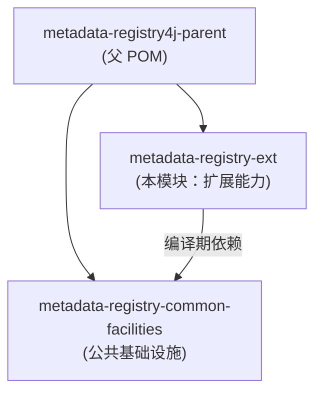

> 本文档由 GitNexus wiki 生成于 2026-09-13（kimi-for-coding，--lang chinese）。内容变化时请重新运行 `gitnexus wiki --lang chinese` 生成，勿手工改写。

# metadata-registry-ext

## 模块概述

`metadata-registry-ext` 是 `metadata-registry4j-parent` 项目中的**扩展层模块**，承载超出 ISO/IEC 11179 标准元模型之外的注册库能力，包括：

- **标识符策略（Identifier strategies）**：非标准的数据元 / 元数据标识生成与管理策略
- **卫星实体（Satellite entities）**：围绕标准领域模型存在的附属/支撑性实体
- **分类（Classification）**：扩展的分类体系实现

该模块在架构上与标准领域模型严格隔离，遵循 **MDR / EXT schema 拆分**原则：标准元模型相关代码归属于标准领域模块，超出标准的扩展能力全部收敛到本模块，避免污染标准模型。

## 在代码库中的位置

## 依赖说明

| 依赖 | 作用域 | 用途 |
|------|--------|------|
| `metadata-registry-common-facilities` | compile | 继承项目的公共基础设施（如公共工具、基础类型） |
| `jakarta.persistence-api` | compile | JPA 实体定义，支撑 ORM 映射 |
| `jakarta.annotation-api` | compile | 标准注解支持 |
| `jackson-databind` | compile | JSON 序列化 / 反序列化（用于 DTO 与实体交互） |
| `lombok` | provided | 减少样板代码（getter/setter、构造器等） |
| `hibernate-core` | provided | 仅编译期使用 Hibernate 专有注解（如 `@BatchSize`），运行时由容器提供 |
| `junit-jupiter` / `assertj-core` / `mockito-core` | test | 单元测试框架 |

### 关于 `hibernate-core` 的 `provided` 作用域

本模块的实体类会使用 Hibernate 专有注解（例如 `@BatchSize` 用于控制批量抓取行为），但刻意将其声明为 `provided` 作用域：

- 编译期可用这些注解
- 运行时实现由部署环境注入，不向模块使用者传递传递依赖
- 保持模块对特定 JPA 实现的最小耦合

## 设计原则

1. **标准与扩展隔离**：所有超出 ISO/IEC 11179 元模型的概念（标识符策略、卫星实体、分类逻辑）只能出现在本模块，标准模块不得反向依赖本模块。
2. **单向依赖**：本模块只依赖 `metadata-registry-common-facilities` 等公共层，不依赖标准领域模块之外的具体业务实现。
3. **ORM 中立性优先**：核心模型基于 `jakarta.persistence` 标准 API，Hibernate 特性仅作为可选增强使用。

## 测试

测试使用 JUnit 5（`junit-jupiter`）配合 AssertJ 断言与 Mockito 模拟，遵循父 POM 统一的测试配置。扩展实体的持久化行为测试建议在提供 `hibernate-core` 运行时的集成测试环境中执行。