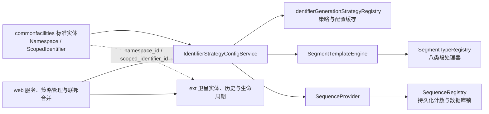

# metadata-registry-ext — src

# metadata-registry-ext — src

## 模块定位

`metadata-registry-ext` 是元数据注册表的扩展领域层，负责承载不属于 ISO/IEC 11179 标准模型、但由注册表软件自身提供的治理能力，主要包括：

- 标识符、版本号和命名空间级治理策略；
- 标识符生成策略、配置解析与运行时路由；
- 基于分段模板的标识符生成、格式校验和反向解析；
- 顺序号分配状态与作用域管理；
- 标识符版本生命周期和变更历史；
- 分类方案、分类节点等扩展领域模型；
- 与标准实体分离存储的卫星实体。

标准模型仍位于 `commonfacilities`，例如 `Namespace`、`ScopedIdentifier`、`LanguageIdentification` 和 `NamingConvention`。本模块中的多数扩展属性不直接修改标准实体，而是通过独立表和值键关联，例如 `namespace_id`、`scoped_identifier_id`。

这种设计有两个主要目的：

1. 保持标准模型与软件治理模型之间的边界；
2. 避免加载卫星实体时反向触发标准实体的完整 JPA 对象图。

本模块主要提供 JPA 实体、领域服务和可扩展注册表，并不负责事务边界、数据库行锁或 Web 请求编排。相关编排位于 `web`、`service` 等上层模块。

## 包结构

| 包 | 主要类型 | 职责 |
|---|---|---|
| `ext.basicandcore` | `LanguageGovernance`、`ContactAccountBinding` | 语言治理等基础扩展属性 |
| `ext.classification` | `ClassificationScheme`、`ClassificationNode` | 简化的分类方案和树形分类节点模型 |
| `ext.designationanddefinition` | `NamingConventionRules` | 命名约定机器规则的卫星实体 |
| `ext.identification` | 策略、配置、顺序号、版本工具、生命周期实体 | 标识符和版本治理的核心实现 |
| `ext.identification.segment` | 模板模型、引擎、段类型注册表和处理器 | 分段式标识符模板能力 |
| `ext.identification.segment.types` | 八种内置段处理器 | 各段的参数校验、生成和格式正则实现 |

## 总体架构



## 扩展领域模型

### 语言治理

`LanguageGovernance` 是标准实体 `LanguageIdentification` 的卫星实体，对应表 `language_governance`。

关键字段：

- `id`：UUID 主键；
- `languageId`：语言标识符值键，非空且唯一；
- `enabled`：语言是否在注册表中启用，数据库非空，Java 默认值为 `true`。

该实体故意不建立到 `LanguageIdentification` 的 JPA 关联。读写方应通过 `languageId` 查找，不应依赖对象导航。

缺少卫星行时，语义等同于 `enabled=true`，与标准实体原字段的默认行为保持一致。

### 命名约定规则

`NamingConventionRules` 是 `NamingConvention` 的卫星实体，对应表 `naming_convention_rules`。

- `namingConventionId`：命名约定值键，非空且唯一；
- `rulesJson`：可执行的 JSON 规则，使用 `@Lob` 持久化；
- 缺少卫星行时，语义等同于 `rulesJson=null`，校验引擎应回退到标准命名属性生成的规则。

该实体同样不建立到 `NamingConvention` 的 JPA 关联。

### 分类方案与分类节点

`ClassificationScheme` 和 `ClassificationNode` 提供简化的分类元模型：

- `ClassificationScheme` 对应表 `classification_scheme`，包含名称、描述、版本、状态以及创建和更新时间；
- `ClassificationNode` 对应表 `classification_node`，包含编码、名称、描述、定义、排序值、父节点和所属分类方案；
- 根节点的 `parent` 为 `null`；
- `parent` 使用延迟加载的 `@ManyToOne`；
- `parentId` 映射到同一 `parent_id` 列，但设置为 `insertable=false, updatable=false`，主要作为只读值投影；
- `classificationScheme` 是必填的延迟关联；
- `createdAt` 和 `updatedAt` 分别由 `@PrePersist`、`@PreUpdate` 更新。

当前实现明确属于简化模型，并未完整重建 ISO/IEC 11179-3:2023 第 10 章元模型。扩展该模型时，不应将现有类结构描述为完全符合该章的元模型。

### `ContactAccountBinding`

`ContactAccountBinding.java` 位于 `ext.basicandcore`。当前提供的源文件不可读，因此无法可靠确认其字段、关联方式、持久化语义或公开 API。修改该类前应直接核对实际源码、数据库迁移和调用方，不应仅依据类名推断其行为。

## 标识符治理模型

### 命名空间输入模式

`IdentifierInputMode` 描述命名空间允许的标识符或版本号输入方式：

| 值 | 行为 |
|---|---|
| `AUTO_ONLY` | 仅允许自动生成；非空手工标识符请求必须被拒绝 |
| `AUTO_WITH_OVERRIDE` | 空值触发自动生成；非空值经过校验后直接采用 |
| `MANUAL_ONLY` | 仅允许手工录入；空值请求必须被拒绝 |

未配置时，有效模式为 `AUTO_WITH_OVERRIDE`。

该枚举描述命名空间级治理规则，实际策略校验位于上层 `IdentifierInputPolicyService` 等服务中，而不是本枚举本身。

### 命名空间版本策略

`VersioningPolicy` 定义：

- `SEMVER`：初始版本为 `1.0.0`；
- `SEQUENTIAL`：初始版本为 `1`；
- `DATE`：初始版本为当前日期；
- `FREE_TEXT`：不限制手工版本格式，主要用于 `MANUAL_ONLY` 命名空间。

未配置时使用 `SEMVER`。

### 实际创建方式

`IdentifierCreationMode` 记录条目创建时用户实际选择的方式：

- `AUTO`：标识符或版本号由命名空间策略自动生成，编辑态应锁定输入；
- `MANUAL`：由用户手工录入，编辑态应保持可编辑。

它与 `IdentifierInputMode` 的区别是：

- `IdentifierInputMode` 是命名空间当前允许的输入规则；
- `IdentifierCreationMode` 是某个已创建对象的历史事实，用于后续编辑行为和创建元数据回溯。

`null` 表示迁移前记录或外部命名空间产生的标识符，应按 `MANUAL` 等价处理。

### 命名空间设置卫星实体

`NamespaceIdentifierSettings` 对应表 `namespace_identifier_settings`，通过唯一的 `namespaceId` 与标准实体 `Namespace` 一一对应。

默认值为：

- `versioningPolicy = "SEMVER"`；
- `identifierInputMode = "AUTO_WITH_OVERRIDE"`；
- `versionInputMode = "AUTO_WITH_OVERRIDE"`；
- `manualIdentifierPattern = null`。

实体使用 `String` 保存模式与策略值，而不是直接使用枚举字段；调用方应保证写入值与 `VersioningPolicy`、`IdentifierInputMode` 的枚举名称一致。

缺少卫星行时，语义等同于上述字段默认值。

### 标识符生命周期

`ScopedIdentifierLifecycle` 对应表 `scoped_identifier_lifecycle`，通过唯一的 `scopedIdentifierId` 与 `ScopedIdentifier` 一一对应，不建立 JPA 导航关联。

保存内容包括：

- `identifierCreationMode`；
- `versionCreationMode`；
- `versionStatus`，默认 `DRAFT`；
- `createdAt`；
- `publishedAt`；
- `deprecatedAt`；
- `obsoleteAt`。

`VersionStatus` 的生命周期为：

```text
DRAFT → PUBLISHED → DEPRECATED → OBSOLETE
```

具体状态迁移由调用服务负责，本实体仅保存状态和时间点。

### 标识符版本历史

`IdentifierVersionHistory` 对应表 `identifier_version_history`，与前述卫星实体不同，它通过 `@ManyToOne` 直接关联 `ScopedIdentifier`。

记录字段包括：

- `version`；
- `versionStatus`；
- `operator`；
- `timestamp`；
- `changeSummary`。

构造方法会自动写入当前时间。当前实现只保存生命周期元数据，不保存完整快照或字段差异。

## 标识符生成策略

### 策略接口

`IdentifierGenerationStrategy` 是简单生成策略的统一接口：

```java
String generate(Namespace namespace);
String getType();
```

实现必须：

- 在给定 `Namespace` 范围内生成唯一、稳定的标识符；
- 返回非空、非空白字符串；
- 通过 `getType()` 提供稳定的策略类型名称。

### 内置策略

| 策略 | `getType()` | 行为 |
|---|---|---|
| `UuidGenerationStrategy` | `UUID` | 返回随机 RFC 4122 UUID |
| `UrnGenerationStrategy` | `URN` | 生成 `urn:<namespace>:<uuid>` |
| `SequenceGenerationStrategy` | `SEQUENCE` | 由配置服务分配前缀和补零顺序号 |
| `TemplateGenerationStrategy` | `TEMPLATE` | 按简单占位符模板生成 |

`UrnGenerationStrategy` 使用命名空间第一个 designation 的 `sign.value` 作为命名空间部分：

1. 转换为小写；
2. 空白替换为 `-`；
3. 删除除字母、数字和 `-` 之外的字符；
4. 没有 designation 或 sign 时使用 `mdr`。

`SequenceGenerationStrategy.generate` 和 `TemplateGenerationStrategy.generate` 的直接调用只返回占位值。真实顺序号和模板生成必须经过 `IdentifierStrategyConfigService`，因为该服务负责读取持久化配置并接入顺序号分配器。

### 简单模板占位符

`TemplateGenerationStrategy.generateFromTemplate` 支持：

- `{yyyyMM}`、`{yyyy}`、`{MM}`、`{dd}`；
- `{HH}`、`{mm}`、`{ss}`；
- `{uuid}`；
- `{seq}`、`{seq:N}`；
- `{prefix}`；
- `{ns}`；
- `{type}`。

模板先经过白名单校验，只允许字母、数字、空格、`.`、`-`、`_`、`:` 和占位符花括号。

其中：

- `{ns}` 使用 `Namespace.shorthandPrefix`；
- `{type}` 使用简单类型名中的大写字母，例如 `DataElement → DE`；
- `{prefix}` 使用模板配置中的 `prefix`，不是 `GenerationContext.prefix`；
- 没有上下文时，顺序号、命名空间和类型占位符会被替换为空值或默认零值。

### 策略配置实体

`IdentifierStrategyConfig` 对应表 `identifier_strategy_config`，保存可版本化的策略配置。

核心字段：

- `strategyType`；
- `namespace`，为 `null` 时可作为全局配置；
- `configJson`；
- `version`，默认 `1`；
- `status`，默认 `DRAFT`；
- `isGlobalDefault`；
- `effectiveFrom`；
- `effectiveUntil`；
- `createdBy`、`createdAt`；
- `modifiedBy`、`modifiedAt`。

`IdentifierStrategyConfig.StrategyStatus` 包含：

- `DRAFT`；
- `PUBLISHED`；
- `DISABLED`。

`publish()` 将状态改为 `PUBLISHED` 并刷新 `effectiveFrom`；`disable()` 将状态改为 `DISABLED` 并写入 `effectiveUntil`。关闭旧版本和创建新版本需要由服务层协调，`publish()` 本身不会遍历历史版本。

`isEffective()` 仅在以下条件全部成立时返回 `true`：

1. 状态为 `PUBLISHED`；
2. `effectiveFrom` 不晚于当前时间；
3. `effectiveUntil` 为 `null` 或晚于当前时间。

`createdAt` 和 `modifiedAt` 没有 JPA 生命周期回调自动赋值，持久化调用方需要显式维护。

### 策略注册表

`IdentifierGenerationStrategyRegistry` 是线程安全的进程级单例，通过 `getInstance()` 获取。

它维护三类状态：

1. `strategies`：策略类型到策略实例；
2. `globalDefault`：全局默认配置；
3. `namespaceConfigs`：以命名空间 UUID 为键的命名空间配置。

构造时注册四种内置策略：

- `UUID`；
- `URN`；
- `SEQUENCE`；
- `TEMPLATE`。

策略类型统一以大写形式作为注册表键。`register` 允许运行时注册或替换策略，`unregister` 可以移除策略。

`resolve(namespace)` 的优先级为：

1. 命名空间专属配置，且配置当前有效；
2. 全局默认配置，且配置当前有效；
3. `UUID` 策略。

`getStrategyInstance` 对 `null` 或未知类型同样回退到 `UUID`。因此 `UUID` 是注册表兜底契约的一部分，不应在运行时被注销，否则 `resolve` 可能返回 `null`。

`clearCache()` 只清除全局和命名空间配置，不清除已注册策略。

### 生成服务

`IdentifierStrategyConfigService` 是标识符生成的主要入口：

```java
String generateIdentifier(
    Namespace namespace,
    GenerationContext context
);
```

主要执行流程如下：

1. 调用 `resolveStrategyConfig(namespace)`，优先读取命名空间配置，否则读取全局配置。
2. 如果配置类型为 `SEGMENT_TEMPLATE`，直接进入分段模板引擎。
3. 否则调用 `registry.resolve(namespace)` 获取有效策略实例。
4. 根据 `strategy.getType()` 分派：
   - `UUID`：调用策略自身；
   - `URN`：调用策略自身；
   - `SEQUENCE`：解析顺序号配置、解析前缀、分配顺序号并补零；
   - `TEMPLATE`：解析模板配置、准备顺序号和上下文后生成；
   - 未知类型：回退到 `UUID`。

#### 顺序号生成

顺序号路径使用 `SequenceGenerationStrategy.Config` 读取：

- `prefix`；
- `start`；
- `pad`；
- `incrementBy`。

前缀先解析日期占位符，再解析：

- `{ns}`：命名空间简写；
- `{type}`：条目类型缩写。

最终格式为：

```text
[prefix][补零顺序号]
```

例如 `prefix=DE`、`pad=6`、顺序号 `42` 的结果为 `DE000042`。

#### 模板生成

`TEMPLATE` 配置读取：

- `template`；
- `prefix`；
- `pad`。

如果 `GenerationContext.sequenceNumber` 大于零，则直接使用；否则模板包含 `{seq` 时会通过 `SequenceProvider` 分配顺序号。

#### 分段模板生成

`SEGMENT_TEMPLATE` 不是 `IdentifierGenerationStrategy` 实例，因此不能依赖注册表对未知类型的 UUID 回退。服务会直接：

1. 使用 `SegmentTemplate.fromJson` 读取配置；
2. 从 `GenerationContext` 取得 `itemType` 和 `variables`；
3. 创建 `SegmentContext`；
4. 通过 `SegmentTemplateEngine.generate` 生成标识符。

### `GenerationContext`

`IdentifierStrategyConfigService.GenerationContext` 提供：

- `sequenceNumber`；
- `prefix`；
- `itemType`；
- `variables`。

工厂方法包括：

- `GenerationContext.ofSeq(long)`；
- `GenerationContext.ofPrefix(String)`；
- `GenerationContext.ofItemType(String)`；
- `GenerationContext.of(String, Map<String, String>)`。

设置 `variables` 为 `null` 时会转换为不可变空映射。

## 顺序号分配

### `SequenceProvider`

`SequenceProvider` 抽象顺序号分配，包含两个入口：

```java
long getNextValue(
    Namespace namespace,
    long start,
    int increment,
    int pad,
    String prefix
);
```

以及带作用域的扩展入口：

```java
long getNextValue(
    Namespace namespace,
    String scopeKey,
    long start,
    int increment,
    int pad
);
```

默认实现会把带作用域调用委托给旧接口，并忽略 `scopeKey`。持久化实现必须覆盖带作用域的方法，才能实现不同对象类型或分段组合的独立计数。

### 默认内存实现

`IdentifierStrategyConfigService` 内置的默认 `SequenceProvider`：

- 使用 `synchronized` 防止单进程并发冲突；
- 初始值为 `start`；
- 后续按 `increment` 递增；
- 不持久化；
- 不按命名空间或作用域隔离；
- 不适用于多实例部署。

生产环境应通过 `setSequenceProvider` 注入数据库实现。`null` 不会替换当前 provider。

### `SequenceRegistry`

`SequenceRegistry` 对应表 `identifier_sequence_registry`，保存顺序号状态。

唯一约束为：

```text
(namespace_id, scope_key)
```

`GLOBAL_SCOPE_KEY` 的值为 `__GLOBAL__`。使用非空哨兵而不是空字符串，是为了兼容 SQLite、SQL Server 和 Oracle 模式下的空字符串语义。

主要字段：

- `namespace`；
- `scopeKey`；
- `currentValue`；
- `incrementBy`；
- `startValue`；
- `padLength`；
- `prefix`；
- `lastAllocatedAt`；
- 审计字段。

辅助 API：

- `peekNext()`：返回下一个值，但不递增；
- `wouldOverflow(maxValue)`：判断下一个值是否超过上限；
- `getMaxValue()`：根据补零长度计算最大值；
- `formatNext()`：格式化下一个值。

该实体不执行实际递增。`web.service.SequenceRegistryService` 负责数据库锁定、状态更新、溢出检查和计数器对齐。

## 分段标识符模板

分段模板用于替代简单字符串模板，提供结构化生成、格式校验和反向解析能力。

### 核心模型

| 类型 | 职责 |
|---|---|
| `SegmentTemplate` | 有序段列表及 JSON 序列化 |
| `SegmentDefinition` | 段的类型、名称和类型化参数 |
| `SegmentContext` | 生成过程中的变量、已解析值、当前前缀、对象缩写和分配器 |
| `SegmentType` | 内置段类型枚举 |
| `SegmentTypeHandler` | 单个段类型的参数校验、生成、正则和 UI 描述接口 |
| `SegmentTypeRegistry` | 段处理器注册表 |
| `SegmentTemplateEngine` | 模板生成、预览、校验、解析和示例渲染 |
| `SegmentTemplateException` | 模板结构或生成错误 |
| `SequenceOverflowException` | 顺序号超过补零长度上限 |
| `SequenceAllocator` | 分段模板使用的原子顺序号分配接口 |

`SegmentTemplate` 使用 Jackson 序列化到 `IdentifierStrategyConfig.configJson`。`SegmentDefinition` 忽略未知 JSON 字段，参数统一保存在 `Map<String, Object>` 中。

`SegmentDefinition` 提供类型化参数读取方法：

- `stringParam`；
- `longParam`；
- `intParam`；
- `boolParam`；
- `mapParam`；
- `listParam`。

`segmentType()` 会规范化类型名称；已移除的 `RANDOM` 类型会抛出明确异常，提示改用顺序号、时间戳或 UUID。

### 支持的段类型

| 类型 | 主要用途 |
|---|---|
| `LITERAL` | 固定字符串，`value` 必填 |
| `OBJECT_ABBREVIATION` | 从系统目录解析注册对象类型缩写 |
| `SEQUENCE` | 分配可补零的顺序号 |
| `UUID` | 生成完整或短 UUID |
| `SEPARATOR` | 插入受约束的分隔字符 |
| `TIMESTAMP` | 按日期时间模式生成时间戳 |
| `CHECKSUM` | 根据前序段计算校验位 |
| `VARIABLE` | 使用调用方提供的变量值 |

`CHECKSUM` 支持：

- `luhn`：输出一个十进制数字；
- `mod11`：输出 `0` 至 `9` 或 `X`。

校验位基于前序段输出中提取出的数字计算；如果没有可用数字，会抛出 `SegmentTemplateException`。

### 对象缩写目录

`ObjectAbbreviationCatalog` 从类路径资源 `/object-abbreviations.json` 加载“持久化类简单名 → 标识符缩写”的映射。

主要 API：

- `getInstance()`；
- `reload()`；
- `abbreviationOf(String itemType)`；
- `all()`；
- `maxAbbreviationLength()`。

映射在加载后不可修改，`all()` 返回不可变映射。`reload()` 会替换当前单例实例，适合测试和管理端重载流程。

`ObjectAbbreviationSegmentHandler` 的行为：

- 优先从系统目录解析缩写；
- 未命中时使用段的 `default` 参数；
- 两者均不存在时抛出异常；
- 旧的每段 `mapping` 参数被忽略；
- 将解析结果写入 `SegmentContext`，供后续 `SEQUENCE` 推导作用域。

该机制与简单 `TEMPLATE` 的 `{type}` 不同：简单模板按类型名中的大写字母生成缩写，分段模板则使用可编辑的系统目录。

### 模板 JSON 示例

```json
{
  "segments": [
    {
      "type": "OBJECT_ABBREVIATION",
      "name": "objectType",
      "params": {}
    },
    {
      "type": "SEQUENCE",
      "name": "serial",
      "params": {
        "start": 1,
        "pad": 6
      }
    },
    {
      "type": "CHECKSUM",
      "name": "check",
      "params": {
        "algorithm": "luhn"
      }
    }
  ]
}
```

在该示例中：

- 对象缩写段有名称；
- 对象缩写位于顺序号之前；
- 顺序号按对象缩写作用域计数；
- 校验位基于前序输出计算。

### 模板引擎

`SegmentTemplateEngine` 无状态，行为由 `SegmentTypeRegistry` 和各 `SegmentTypeHandler` 驱动。

#### 生成

`generate(SegmentTemplate, SegmentContext)` 按顺序：

1. 获取当前段对应的 handler；
2. 调用 `handler.generate`；
3. 拼接输出；
4. 将输出追加到 `context.currentPrefix`；
5. 按段名称记录到 `context.resolvedValues`。

#### 预览

`preview` 使用 `SegmentContext.preview`：

- 不提供分配器；
- 顺序号显示起始值；
- 不实际分配或持久化顺序号。

#### 格式正则

`deriveFormatPattern` 组合各段的 `valueRegex`，生成完整匹配正则。

`matchesFormat` 使用完整匹配语义，而不是子串匹配。

#### 反向解析

`parse` 使用相同正则将标识符拆回段值：

- 返回结果以段 `name` 为键；
- 未命名段不会出现在结果中；
- 不匹配模板时抛出 `SegmentTemplateException`。

该能力用于迁移导入、已有标识符分析和顺序号计数器回填。

#### 描述与示例

- `describeFormat` 生成面向错误消息的分段格式说明；
- `renderExample` 根据目录缩写、变量模式、当前时间和顺序号起始值渲染示例。

### 模板结构校验

`SegmentTemplateEngine.validate` 返回错误列表，空列表表示有效。主要规则包括：

1. 模板不能为空，至少包含一个段；
2. 每个段的参数必须通过对应 handler 的 `validateParams`；
3. 每个段必须能够派生格式正则；
4. `VARIABLE` 段的名称不能重复；
5. `SEQUENCE`、`TIMESTAMP`、`UUID` 三种唯一性段必须恰好出现一个；
6. 作为唯一性段的 `TIMESTAMP` 必须至少包含三个连续的 `S`，即达到毫秒精度；
7. `CHECKSUM` 不能是第一个段；
8. `SEQUENCE` 不允许显式配置 `scopeRefs`，作用域由模板结构自动推导；
9. 如果同时存在 `OBJECT_ABBREVIATION` 和 `SEQUENCE`：
   - 缩写段必须位于顺序号之前；
   - 缩写段必须具有名称；
10. 所有段的最大输出长度之和不得超过 `MAX_IDENTIFIER_LENGTH`，当前为 `255`。

`generate` 不会自动调用 `validate`。调用方应在保存或启用模板前显式执行校验。

### 