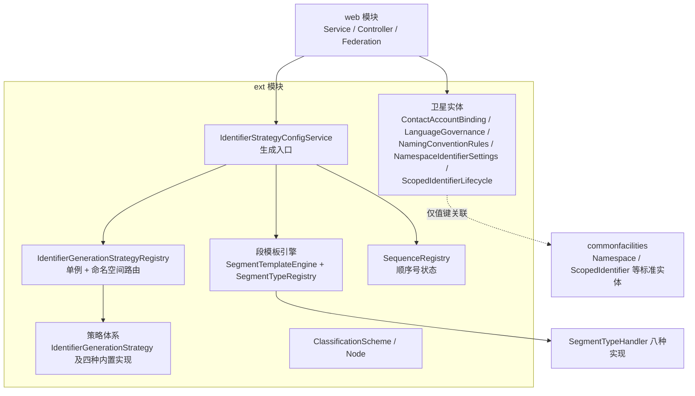

> 本文档由 GitNexus wiki 生成于 2026-09-13（kimi-for-coding，--lang chinese）。内容变化时请重新运行 `gitnexus wiki --lang chinese` 生成，勿手工改写。

# metadata-registry-ext 模块

## 模块定位

`metadata-registry-ext` 是元数据注册表系统中承载**非 ISO/IEC 11179 标准模型**扩展的模块。标准实体（如 `Contact`、`LanguageIdentification`、`NamingConvention`、`ScopedIdentifier`、`Namespace`）在 `commonfacilities` 模块中按 ISO/IEC 11179-3:2023 元模型实现，只保留标准属性；本模块通过两类机制补充软件自身的治理与工程能力：

1. **卫星实体（Satellite Entities）**——标准实体之外的扩展属性，按主键一一对应地剥离成独立表，物理上与标准实体隔离，阶段 3 起归入 EXT schema。
2. **标识符生成体系**——可插拔的标识符/版本生成策略、顺序号注册表、段模板引擎，以及版本治理相关的枚举与工具类。
3. **简化的分类模型**——未按标准第 10 章元模型重建的 `ClassificationScheme`/`ClassificationNode`（标准重建另立 change 处理，暂归入 ext）。

## 核心设计原则：卫星实体模式

卫星实体是刻意的架构决策，要点如下：

- **值键关联，无 JPA 对象图关联**：所有卫星实体只持有 `contactId`、`namespaceId`、`scopedIdentifierId` 等 UUID 值列，不建立 `@ManyToOne` 到标准实体。这是有意为之——避免加载卫星时反向触发标准实体对象图。
- **一一对应**：每个标准实体最多一个卫星行，值键列带 `unique = true` 约束。
- **缺失行语义**：缺失行等同字段时代的列默认值。例如 `LanguageGovernance` 缺失等同 `enabled=true`，`NamespaceIdentifierSettings` 缺失等同 `SEMVER / AUTO_WITH_OVERRIDE`。

## 卫星实体一览

| 实体 | 表名 | 关联值键 | 承载内容 |
|---|---|---|---|
| `ContactAccountBinding` | `contact_account_binding` | `contact_id`（唯一） | Contact 与登录账号的绑定；`contact_id` 唯一、`account_id` 不唯一（一个账号可绑多个 Contact） |
| `LanguageGovernance` | `language_governance` | `language_id`（唯一） | `enabled`：语言在注册表中是否启用 |
| `NamingConventionRules` | `naming_convention_rules` | `naming_convention_id`（唯一） | `rulesJson`：机器可执行命名规则，缺失时引擎回退到标准五属性生成 |
| `NamespaceIdentifierSettings` | `namespace_identifier_settings` | `namespace_id`（唯一） | `versioningPolicy`、`identifierInputMode`、`versionInputMode`、`manualIdentifierPattern` |
| `ScopedIdentifierLifecycle` | `scoped_identifier_lifecycle` | `scoped_identifier_id`（唯一） | 创建方式（AUTO/MANUAL）、版本状态及生命周期时间戳 |
| `IdentifierVersionHistory` | `identifier_version_history` | `scoped_identifier_id`（多对一） | 版本生命周期事件（操作人、时间、状态、摘要）；MVP 只存元数据，快照/diff 延后 |
| `IdentifierStrategyConfig` | `identifier_strategy_config` | `namespace_id`（可空，空=全局默认） | 策略类型 + JSON 配置 + 版本 + 生效窗口 |
| `SequenceRegistry` | `identifier_sequence_registry` | `(namespace_id, scope_key)` 唯一 | 顺序号计数器状态 |

注意 `IdentifierStrategyConfig` 和 `SequenceRegistry` 是例外：它们建立了到 `Namespace` 的 `@ManyToOne` 关联，因为本身是独立的配置/状态实体而非纯属性卫星。

## 标识符生成体系

### 策略接口与内置实现

`IdentifierGenerationStrategy` 是策略接口，约定在单个 `Namespace` 范围内产出唯一、稳定的业务标识符。内置四种实现（注意它们大多是"无状态占位"，真正的编排发生在 service 层）：

| 策略 | `getType()` | 行为 |
|---|---|---|
| `UuidGenerationStrategy` | `UUID` | 直接返回 RFC-4122 随机 UUID，真正的兜底策略 |
| `UrnGenerationStrategy` | `URN` | 产出 `urn:<ns>:<uuid>`；`<ns>` 由 `Namespace` 首个 Designation 的 Sign 值小写化、空格转 `-`、剔除非法字符得到，无 Designation 时用 `mdr` |
| `SequenceGenerationStrategy` | `SEQUENCE` | 独立调用返回 `SEQ-xxxxxxxx` 占位；真正的原子递增由 `SequenceProvider`/`SequenceRegistryService`（web 模块）完成。其内部 `Config` 类支持无 Jackson 的 JSON 解析（正则提取 `prefix/start/pad/incrementBy`），并支持 `{yyyyMM}` 等日期占位符 |
| `TemplateGenerationStrategy` | `TEMPLATE` | 独立调用返回 `TPL-xxxxxxxx` 占位；真正的模板填充走静态方法 `generateFromTemplate(template, TemplateContext)`，支持 `{seq:N}`、`{yyyyMM}`、`{uuid}`、`{prefix}`、`{ns}`（命名空间缩写）、`{type}`（条目类型缩写）等占位符 |

模板安全由 `TEMPLATE_WHITELIST` 白名单正则保障（仅允许字母数字、空白、`- _ .` 分隔符和 `{ } :`），`isValidTemplate()` 校验，非法模板抛 `IllegalArgumentException`。

### 注册表：命名空间路由

`IdentifierGenerationStrategyRegistry` 是单例（DCL 双检锁），职责：

- **运行时策略注册**：`register(IdentifierGenerationStrategy)`，构造时自动注册四种内置策略；`unregister`/`isStrategyRegistered`/`getRegisteredStrategyTypes` 管理生命周期。
- **配置缓存**：`Map<UUID, IdentifierStrategyConfig> namespaceConfigs` 存命名空间级配置，`globalDefault` 存全局默认。由 service 层（如 web 模块的 `IdentifierStrategyLoader.refreshRegistry()`）从数据库加载后写入，`clearCache()` 支持刷新。
- **解析优先级**：`resolve(namespace)` 按 **命名空间配置 → 全局默认 → UUID** 的顺序回退，永不为 null。

### 生成服务：`IdentifierStrategyConfigService`

这是上层调用的主要入口（web 模块的 `GenericItemCreator`、`IdentifierInputPolicyService` 等均经此生成标识符）。`generateIdentifier(namespace, context)` 的分派逻辑：

1. 先解析配置；若为 `SEGMENT_TEMPLATE` 类型**直接走段模板引擎**——这是有意绕开 registry 的，因为段模板不是 `IdentifierGenerationStrategy` 实现，若走 `registry.resolve()` 会被兜底逻辑吞掉退回 UUID。
2. 按 `strategyType` 分派：`UUID`/`URN` 直接调用策略；`SEQUENCE` 从配置 JSON 解析 `Config`，经 `SequenceProvider` 原子分配后按 pad 补零，前缀中的 `{ns}`/`{type}` 令牌会被替换；`TEMPLATE` 用 `TemplateGenerationStrategy.generateFromTemplate()` 渲染，模板含 `{seq}` 而上下文未提供序号时自行分配。
3. 未知类型打印日志并回退 UUID。

要点：

- **默认 `SequenceProvider` 是进程内自增计数器**（仅适合演示/测试），生产应通过 `setSequenceProvider()` 注入数据库级实现（web 模块 `SequenceRegistryService`，行级悲观锁）。
- `GenerationContext` 携带序号、前缀、条目类型（itemType）和自定义变量（variables）。
- `itemTypeAbbreviation()` 从类简单名提取大写字母：`DataElement` → `DE`，`DataElementConcept` → `DEC`。

### 顺序号注册表：`SequenceRegistry`

跟踪 `(namespace, scope_key)` 维度的计数器状态，`uk_seq_registry_ns_scope` 唯一约束保证并发正确性。设计要点：

- **作用域键（scope key）**：由段模板中 SEQUENCE 段引用段的值拼接（如对象缩写 `DE`）；保留字 `GLOBAL_SCOPE_KEY = "__GLOBAL__"` 表示命名空间级全局计数。特意使用非空哨兵值而非 NULL/空串，以保证 SQLite、SQL Server、达梦（Oracle 模式将 `''` 视为 NULL）上唯一约束行为一致。
- `peekNext()` 预读下一值；`getMaxValue()` 由 pad 长度推出上限（pad=4 → 9999）；`wouldOverflow()`/`formatNext()` 供 web 层 `SequenceRegistryService.allocateScoped()` 在 `SELECT FOR UPDATE` 锁内做溢出检测与格式化。
- **溢出必须拒绝**：溢出抛 `SequenceOverflowException`（segment 包），绝不截断或复用序号。

## 段模板引擎（segment 包）

段模板是标识符策略的最高级形态：`IdentifierStrategyConfig.configJson` 持久化一个有序的 `SegmentDefinition` 列表，一个模板同时派生三种能力——**生成器、格式校验正则、反向解析器**（反向解析是序号回填的基础）。

### 架构

- `SegmentTemplateEngine`：无状态核心，所有行为委托 `SegmentTypeRegistry` 的 handler，引擎本身永不需要为新段类型改动。
- `SegmentTypeRegistry`：单例，注册八种内置 handler；新段类型通过 `register(SegmentTypeHandler)` 插件化接入。
- `SegmentTypeHandler` 接口五要素：`type()`、`validateParams()`（参数 schema）、`generate()`、`valueRegex()`（该段值的正则片段）、`uiPanelSchema()`（前端设计器面板 JSON 描述）。
- `SegmentContext`：贯穿生成的上下文，携带 itemType、调用方变量、已解析值（供 CHECKSUM 输入与反向解析）、已生成的输出前缀，以及 `SequenceAllocator` 和 preview 标志。
- `ObjectAbbreviationCatalog`：系统级对象类型缩写映射表，从类路径资源 `/object-abbreviations.json` 加载（用户可编辑），`reload()` 支持热更新；单例缓存。

### 八种段类型

| 段类型 | 说明 | 关键参数 |
|---|---|---|
| `LITERAL` | 固定字符串 | `value`（必填） |
| `OBJECT_ABBREVIATION` | 条目对象类型缩写（经系统目录解析） | `default`（未命中目录时回退）；解析值记入 context 驱动 SEQUENCE 作用域 |
| `SEQUENCE` | 自动递增序号 | `start`、`increment`、`pad`(1–18)；作用域**隐式推导**，显式 `scopeRefs` 会被校验拒绝 |
| `UUID` | 随机 UUID | `form`: `full`(36) / `short`(8) |
| `SEPARATOR` | 分隔符 | `char`，限 `.` `-` `_` `/` `:` |
| `TIMESTAMP` | 格式化当前时间 | `pattern` |
| `CHECKSUM` | 校验位（前序段数字的 Luhn 或 MOD 11） | `algorithm`: `luhn` / `mod11` |
| `VARIABLE` | 调用方输入变量 | 含 `maxLength` 等；段已移除的类型 `RANDOM` 会给出明确中文报错（随机段无唯一性保证） |

### 引擎关键方法

- `generate(template, context)`：顺序拼接各段输出；preview 模式下 SEQUENCE 段显示 start 值且**不触发分配**（预览必须无副作用）。
- `preview(template, itemType, sampleVariables)`：`SegmentContext.preview(...)` 构造只读预览。
- `deriveFormatPattern()` / `matchesFormat()`：拼接各段 `valueRegex` 得全匹配正则，用于手动录入与导入校验。
- `parse(template, identifier)`：反向解析，命名段按名字入结果 Map，是管理端序号回填（`IdentifierStrategyAdminService.backfill()`）的基础。
- `validate(template)`：结构校验，规则包括——唯一性段（SEQUENCE/TIMESTAMP/UUID）**三者择其一且必须恰好一个**；作为唯一性段的 TIMESTAMP 必须精确到毫秒（pattern 中连续 `S` ≥ 3）；CHECKSUM 不能是第一个段；变量段名去重；模板含 OBJECT_ABBREVIATION 时其必须**位于 SEQUENCE 之前且必须命名**（作用域取其值）；各段最大输出长度之和不得超过 `MAX_IDENTIFIER_LENGTH = 255`（`scoped_identifier.identifier` 列宽）。
- `scopeKeyOf(template, segmentValues)`：静态方法，从已解析的段值推导作用域键（有缩写段取其值，否则 `__GLOBAL__`）。

`SequenceSegmentHandler.scopeKeyOf(context)` 与引擎的同名静态方法共同保证一个不变量：**SEQUENCE 作用域完全由模板结构推导**——含对象缩写段则按对象类型独立计数，否则命名空间全局计数。

## 版本治理

### 枚举

- `VersioningPolicy`（持久化于 `namespace_identifier_settings.versioning_policy`）：`SEMVER`（初始 `1.0.0`）、`SEQUENTIAL`（初始 `1`）、`DATE`（初始为当日）。未设置时按 `SEMVER` 处理。
- `IdentifierInputMode`：`AUTO_ONLY`（携带非空标识符的请求被拒）、`AUTO_WITH_OVERRIDE`（空则生成，非空则校验后照用，**默认值**）、`MANUAL_ONLY`（空标识符被拒）。
- `IdentifierCreationMode`：`AUTO` / `MANUAL`，记录用户创建该 SI 时**实际**选择了自动生成还是手动录入，驱动编辑态输入框锁定/可编辑决策；与命名空间级 `IdentifierInputMode` 约束解耦。NULL 表示迁移前既存记录，按 MANUAL 等价处理。
- `VersionStatus`：`DRAFT`、`PUBLISHED`、`DEPRECATED`、`OBSOLETE`。

### `Versions` 工具类

统一处理 `ScopedIdentifier.version` 字符串（可能是整数、SemVer 或日期）的比较与递增：

- `compare(incoming, base)`：同为整数或同为 SemVer 时按数值比较；无法解析且不等时**保守视为 incoming 较新**（返回 1），避免联邦合并静默漏判来源变更。
- `bump(current, policy)`：按命名空间策略递增——DATE 返回当日日期（同日重复递增追加 `-N` 后缀）；整数 +1；SemVer 递增补丁位（`1.0.0` → `1.0.1`）；空版本按 `initial()` 处理；不可解析版本**保持不变**以防版本回退。
- 被 web 模块联邦合并（`MergeExecutor.applyUpdate`/`advanceVersions`、`MergeRequestService.classify`）与本地编辑版本递增使用。

### `SemVerValidator`

MVP 级格式校验：`major.minor.patch` 三段数字正则（禁止前导零），`isValid()` 返回布尔，`validate()` 失败抛 `IllegalArgumentException`。

## 分类模型（妥协实现）

`ClassificationScheme` 与 `ClassificationNode` 是 ISO 11179-3 第 10 章的**简化实现**，类注释明确声明未按 2023 版元模型重建，标准重建另立 change，暂归 ext：

- `ClassificationScheme`：方案名、描述、版本、状态，带 `@PrePersist`/`@PreUpdate` 自动维护 `createdAt`/`updatedAt`。
- `ClassificationNode`：树形结构，经 `parent`（自关联 `@ManyToOne`，懒加载）形成层级，根节点 parent 为 null；同时冗余 `parentId` 只读列便于无代理取值。通过 `scheme_id` 归属方案，含 `sortOrder` 排序字段。

## 与代码库其他部分的连接

本模块是底层扩展层，主要被 web 模块消费：

- **标识符生成**：`GenericItemCreator.create()`、`ScopedIdentifierService.create()` → `IdentifierStrategyConfigService.generateIdentifier()` + `Versions.initial()`；`IdentifierInputPolicyService` 依据 `IdentifierInputMode` 决定生成或拒收。
- **策略管理**：`IdentifierStrategyAdminController/Service`（启停策略）→ `IdentifierStrategyLoader.refreshRegistry()` → 重建 registry 缓存（执行流中会重新走一遍 `registerBuiltInStrategies()` 注册内置策略）；`IdentifierStrategyAdminService.backfill()` 使用引擎的 `parse()`/`scopeKeyOf()` 做序号回填对齐。
- **顺序号分配**：`SequenceRegistryService.allocateScoped()` 在 `SequenceRegistry` 行锁内调用 `peekNext()`/`wouldOverflow()`/`getMaxValue()`，溢出抛 `SequenceOverflowException`。
- **命名空间治理**：`NamespaceService.applyStrategyConfig()` 调用 `IdentifierStrategyConfig.publish()`/`disable()` 管理策略版本生效窗口。
- **联邦合并**：`MergeExecutor` 用 `Versions.compare()`/`bump()` 做合并基与冲突判定、版本推进，并写 `IdentifierVersionHistory` 与 `ScopedIdentifierLifecycle`。
- **卫星读取**：web 各服务（如 `LanguageIdentificationService.governanceOf()`、`ItemAdministrationService.buildItemMeta()`、`ScopedIdentifierLifecycleService.getOrDefault()`）以"取或默认"模式读卫星实体，保证缺失行不抛异常。
- **账号绑定**：`ContactAccountBindingService.bind()` 写入 `ContactAccountBinding`。

## 贡献指南

- **新增扩展属性**：优先按卫星模式建新表（值键唯一、无 JPA 关联、定义缺失行语义），不要往 commonfacilities 的标准实体上加列。
- **新增标识符策略**：实现 `IdentifierGenerationStrategy` 并在 `IdentifierGenerationStrategyRegistry.registerBuiltInStrategies()` 注册；若策略需要编排逻辑（如 SEQUENCE/TEMPLATE），在 `IdentifierStrategyConfigService.generateIdentifier()` 的 switch 中加分派。
- **新增段类型**：实现 `SegmentTypeHandler`（含五要素），在 `SegmentTypeRegistry` 构造函数注册；若涉及唯一性或作用域语义，同步更新 `SegmentTemplateEngine.validate()` 的规则。
- **JSON 解析**：ext 模块刻意避免强依赖 Jackson（`SequenceGenerationStrategy.Config`、`TemplateGenerationStrategy.Config` 用正则提取）；segment 包使用 Jackson，因该包本就面向配置持久化场景。
- **并发**：任何序号分配路径必须通过 `SequenceProvider`/`SequenceAllocator` 抽象，保证生产实现可换入数据库行锁版本。