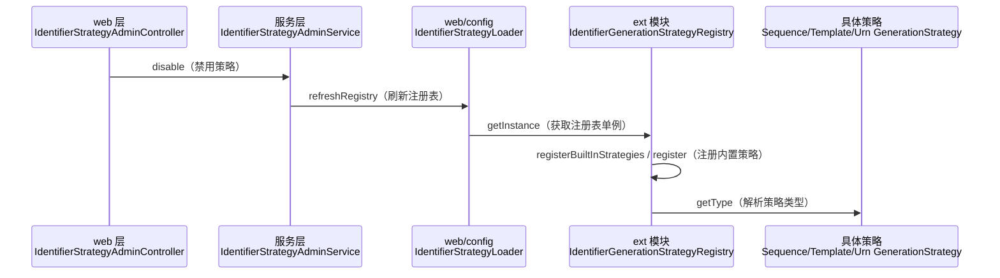

> 本文档由 GitNexus wiki 生成于 2026-09-13（kimi-for-coding，--lang chinese）。内容变化时请重新运行 `gitnexus wiki --lang chinese` 生成，勿手工改写。

# metadata-registry-ext

## 模块组定位

`metadata-registry-ext` 是元数据注册表系统中的**扩展能力承载层**，汇集所有超出 ISO/IEC 11179 标准元模型的功能。它与标准领域模块严格隔离：标准实体（如 `Contact`、`ScopedIdentifier`、`Namespace` 等）只保留标准属性，由 `commonfacilities` 按 ISO/IEC 11179-3:2023 实现；超出标准的治理能力——扩展属性、标识符生成策略、简化分类模型——全部收敛到本模块组，遵循 **MDR / EXT schema 拆分** 原则，避免污染标准模型。

该模块组内的文档拆分为两个页面：

- [metadata-registry-ext](metadata-registry-ext.md) — 模块整体概述：定位、与父项目及 `metadata-registry-common-facilities` 的依赖关系、EXT schema 边界
- [src](metadata-registry-ext-src.md) — 源码结构与内部组织：卫星实体、标识符体系、分类模型的包级布局

## 核心能力

扩展能力通过三类机制提供：

1. **卫星实体（Satellite Entities）** — 标准实体的扩展属性按主键一一对应剥离为独立表，物理上与标准实体隔离，包括 `ContactAccountBinding`、`LanguageGovernance`、`NamingConventionRules`、`NamespaceIdentifierSettings`、`ScopedIdentifierLifecycle`。
2. **标识符生成体系** — 可插拔策略（`SequenceGenerationStrategy`、`TemplateGenerationStrategy`、`UrnGenerationStrategy`、`UuidGenerationStrategy`）、顺序号注册表（`SequenceRegistry`）、段模板引擎（`SegmentTemplateEngine`），以及配套的枚举与异常（如 `SequenceOverflowException` → `SegmentTemplateException` 的异常链）。
3. **简化分类模型** — 未按标准第 10 章元模型重建的 `ClassificationScheme` / `ClassificationNode`。

## 子模块如何协同

两个页面描述的是同一模块的不同视角：概述页回答"为什么存在、依赖谁"，源码页回答"代码如何组织"。理解本模块组需要结合两者——前者界定 EXT 边界，后者展示三类能力在包结构中的落位。

## 关键工作流：标识符策略的运行时治理

标识符体系内部组件高度协作，形成一个可插拔的注册—解析—生成流水线：

- `IdentifierStrategyConfigService` 通过 `SegmentTemplateEngine` 渲染配置模板，并经由 `IdentifierGenerationStrategyRegistry.getInstance()` 获取策略注册表。
- `SegmentTemplateEngine` 委托 `SegmentTypeRegistry` 按段类型分发到具体处理器：`ChecksumSegmentHandler`、`LiteralSegmentHandler`、`ObjectAbbreviationSegmentHandler`、`SeparatorSegmentHandler`、`SequenceSegmentHandler`、`TimestampSegmentHandler`、`UuidSegmentHandler`、`VariableSegmentHandler`。
- 模板需满足结构约束（如缩写段必须命名、且须位于顺序号段之前），由引擎在 `validate` 阶段校验。

跨模块的典型治理流程（"禁用策略 → 重新注册 → 类型解析"）贯穿 web 层与本模块组：

该流程说明：`ext` 中的策略注册表是整个标识符治理链路的终点与状态中心——web 与服务层的管理操作最终都落到注册表的刷新与策略类型解析上。各策略与段处理器的详细契约，请见 [src](metadata-registry-ext-src.md) 页面包级文档。