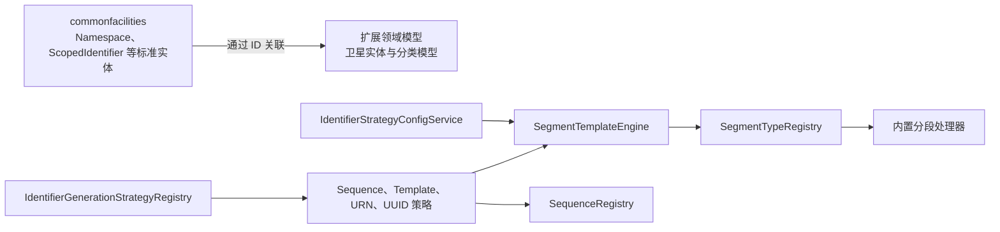

# metadata-registry-ext

# metadata-registry-ext

`metadata-registry-ext` 是元数据注册表的扩展领域层，用于承载 ISO/IEC 11179 标准模型之外的治理能力，包括标识符策略、顺序号与版本管理、分类体系，以及与标准实体解耦的卫星信息。

标准模型仍由 `commonfacilities` 提供，例如 `Namespace`、`ScopedIdentifier`、`LanguageIdentification` 和 `NamingConvention`；扩展模块通过 `namespace_id`、`scoped_identifier_id` 等外键关联标准对象，而不直接修改其定义。

## 子模块

| 子模块 | 作用 |
|---|---|
| [metadata-registry-ext](metadata-registry-ext.md) | 定义 Maven 坐标、打包方式和 `MDR/EXT` 能力边界；当前主要承载模块级配置。 |
| [metadata-registry-ext/src](metadata-registry-ext-src.md) | 提供扩展领域实现，包括 JPA 实体、领域服务、标识策略注册表和分段模板引擎。 |

## 组成部分

`metadata-registry-ext/src` 按职责划分为以下领域：

- `ext.basicandcore`：提供 `LanguageGovernance`、`ContactAccountBinding` 等基础治理属性。
- `ext.classification`：维护分类方案、分类节点及分类关系。
- `ext.identification`：负责标识符配置、生成、校验、解析、版本生命周期和顺序号分配。
- 卫星实体：独立保存标准注册表对象的补充信息，避免加载扩展数据时触发完整标准 JPA 对象图。

标识生成由 `IdentifierGenerationStrategyRegistry` 统一注册和路由。目前的内置策略包括：

- `SequenceGenerationStrategy`
- `TemplateGenerationStrategy`
- `UrnGenerationStrategy`
- `UuidGenerationStrategy`

`IdentifierStrategyConfigService` 负责读取和解析策略配置，并通过 `SegmentTemplateEngine` 执行模板校验与生成。`SegmentTemplateEngine` 从 `SegmentTypeRegistry` 获取对应分段处理器，包括校验和、字面量、对象缩写、分隔符、顺序号、时间戳、UUID 和变量处理器。顺序号状态及作用域由 `SequenceRegistry` 管理；超过可用范围时使用 `SequenceOverflowException` 表示失败。

## 协作关系



## 关键工作流

### 策略注册与类型查询

初始化或重置流程可以触发以下调用链：

```text
InitWizardController.abort
  → InitWizardService.abort
  → StaticDataPresetService.presetAll
  → IdentifierStrategyLoader.refreshRegistry
  → IdentifierGenerationStrategyRegistry.getInstance
  → registerBuiltInStrategies / register
  → IdentifierGenerationStrategy.getType
```

该流程先完成静态数据预置，再刷新策略注册表、注册内置策略，最后按照策略类型取得 `SequenceGenerationStrategy`、`TemplateGenerationStrategy` 或 `UrnGenerationStrategy` 等实现。

### 模板标识符生成

```text
IdentifierStrategyConfigService
  → SegmentTemplateEngine
  → SegmentTypeRegistry
  → 具体分段处理器
```

配置服务解析模板后，模板引擎负责校验分段结构和顺序，再按分段类型委托给对应处理器生成结果。顺序号分段依赖 `SequenceRegistry` 提供的分配状态和作用域。

## 模块边界

本模块主要提供领域模型、JPA 映射、服务和可扩展注册表，不负责事务边界、数据库行锁或 Web 请求编排。这些职责由 `web`、`service` 等上层模块处理。