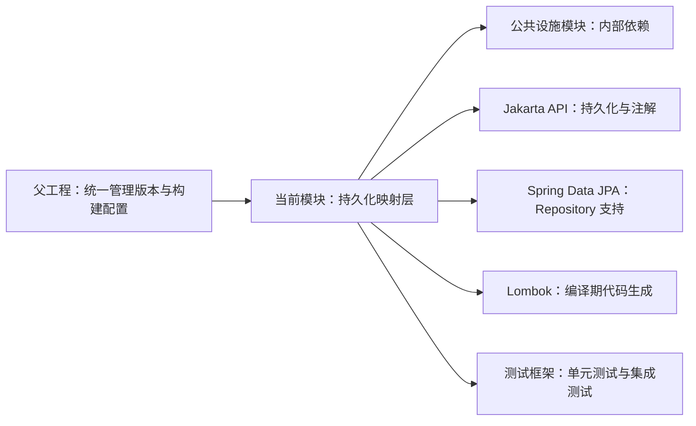

# metadata-registry-item-mapping — metadata-registry-item-mapping

# metadata-registry-item-mapping

## 模块概述

`metadata-registry-item-mapping` 是 `metadata-registry4j-parent` 下的 Maven 子模块，坐标为：

```xml
<groupId>io.github.matrixlane</groupId>
<artifactId>metadata-registry-item-mapping</artifactId>
<version>0.1.0-SNAPSHOT</version>
```

从模块名称与依赖配置看，该模块用于承载元注册表条目映射相关的持久化模型，包括 JPA 实体、嵌入对象、关系映射以及 Spring Data JPA Repository。

> **当前快照状态：**本模块目前仅包含 `pom.xml`，尚未提供 Java 源码、资源文件或测试源码。因此，当前没有可确认的实体类、Repository 接口、业务方法或执行流程。下面的内容描述模块已经确定的依赖边界、预期工作方式以及新增实现时需要遵循的约束。

## 职责与边界

该模块的职责范围集中在持久化层：

- 使用 Jakarta Persistence API 描述对象与数据库表、列、关联关系之间的映射。
- 使用 Spring Data JPA 提供 Repository 接口支持。
- 复用 `metadata-registry-common-facilities` 中的共享类型或基础能力。
- 使用 Lombok 减少实体类中的样板代码。
- 提供基于 JUnit、AssertJ、Mockito 和 Spring Boot Test 的测试基础。

本模块不应承担以下职责：

- 元数据注册表的业务流程编排。
- HTTP、消息队列等外部接口适配。
- 数据库连接池、Datasource 或部署环境配置。
- 数据库迁移脚本管理；当前模块中没有发现 Flyway、Liquibase 或 SQL 脚本。

## 依赖结构



### 内部依赖

| 依赖 | 作用 |
| --- | --- |
| `io.github.matrixlane:metadata-registry-common-facilities` | 本模块唯一的显式内部模块依赖。实体、值对象或共享标识应优先复用该模块提供的公共设施，避免重复定义。 |

调用图中没有检测到 Java 方法调用关系，但 Maven 依赖图仍然存在上述内部依赖。调用图中的“无调用”表示当前没有可执行源码，并不表示该模块与公共设施模块之间没有构建关系。

### Jakarta 依赖

| 依赖 | 预期用途 |
| --- | --- |
| `jakarta.persistence:jakarta.persistence-api` | 提供 `@Entity`、`@Id`、`@Column`、`@OneToMany`、`@ManyToOne`、`@Embeddable` 等持久化映射 API。 |
| `jakarta.annotation:jakarta.annotation-api` | 提供持久化实现可能使用的 Jakarta 标准注解。 |

依赖版本未在当前 POM 中单独指定，应由父工程或父工程导入的依赖管理规则统一控制。

### Spring Data JPA

`spring-boot-starter-data-jpa` 为模块提供 Spring Data JPA Repository 支持，并引入相关 JPA 运行时依赖。具体 Spring Boot、Spring Framework 和 JPA Provider 版本由父工程的依赖管理决定。

Repository 通常通过继承 Spring Data 的 `JpaRepository` 或其他 Spring Data Repository 接口获得查询、保存和删除能力。Repository 接口由 Spring Data 在运行时生成代理实现，不应手工创建实现类。

### Lombok

Lombok 的作用域为 `provided`：

- Lombok 注解在编译期生成 getter、setter、构造器等代码。
- Lombok 注解处理器不需要进入最终运行时依赖。
- 运行时行为不能依赖 Lombok 本身生成额外资源。

当前源码中尚未发现 Lombok 的实际使用方式，因此新增代码时应避免仅为减少少量样板代码而引入难以追踪的生成行为。

### 测试依赖

| 依赖 | 预期用途 |
| --- | --- |
| `junit-jupiter` | 编写 JUnit 5 单元测试。 |
| `assertj-core` | 使用可读的断言表达验证结果。 |
| `mockito-core` | 隔离外部协作者进行单元测试。 |
| `spring-boot-starter-test` | 提供 Spring 测试支持，包括 `@DataJpaTest` 等测试能力。 |

## 持久化工作方式

当前没有可执行 Java 实现。后续加入实体和 Repository 后，其典型运行流程如下：

1. 消费方 Spring Boot 应用扫描到模块中的 JPA 实体。
2. Spring Data 为 Repository 接口创建运行时代理。
3. Repository 方法调用被转换为 JPA 操作。
4. JPA Provider 将操作转换为数据库 SQL。
5. 查询结果被映射回实体或嵌入对象。

实体必须位于消费方应用的实体扫描范围内，或者由消费方通过 `@EntityScan` 显式指定扫描位置。当前模块没有提供 `@EntityScan`、`@EnableJpaRepositories` 或 Spring Boot 启动类，这些配置应由实际承载应用上下文的模块负责。

## 与代码库其他部分的连接

### 父工程

模块继承 `metadata-registry4j-parent`：

```xml
<parent>
    <groupId>io.github.matrixlane</groupId>
    <artifactId>metadata-registry4j-parent</artifactId>
    <version>0.1.0-SNAPSHOT</version>
</parent>
```

插件、编译器、依赖版本和通用测试配置均应优先由父工程统一管理。当前 POM 未覆盖打包类型，其有效打包类型由父 POM 决定。

### 公共设施模块

`metadata-registry-common-facilities` 是当前唯一明确声明的内部代码库依赖。新增映射模型时，应先检查该模块是否已经提供可复用的：

- 标识符与值对象；
- 枚举和基础类型转换规则；
- 审计字段或通用持久化约定；
- 异常及校验基础设施。

### 上层模块

提供的调用图没有检测到入站调用，当前资料也无法确认哪些模块直接依赖本制品。上层模块可以通过以下坐标引用它：

```xml
<dependency>
    <groupId>io.github.matrixlane</groupId>
    <artifactId>metadata-registry-item-mapping</artifactId>
</dependency>
```

引入后，上层模块可以使用本模块提供的持久化类型和 Repository；但 Repository 的可用性仍取决于 Spring Data Repository 扫描配置。

### 外部服务

本模块不直接调用数据库以外的外部服务，也不包含消息、HTTP 或远程 RPC 客户端。数据库连接信息、凭据、方言和连接池参数均由消费方应用配置提供。

## 新增实现时的约定

### 实体与映射

- 使用 `jakarta.persistence` 中的正式映射 API，避免同时混用旧版 `javax.persistence` 注解。
- 主键策略应明确声明，不要依赖数据库默认值或运行环境差异。
- 表名、列名、长度、精度、是否可空以及唯一约束应显式表达，避免仅依赖 ORM 隐式规则。
- 关联关系必须明确 `fetch`、级联行为和孤儿项处理策略。
- 嵌入对象与独立实体应使用不同映射方式，避免将所有共享字段都建模为独立表。

### Repository

- Repository 接口应保持面向持久化查询，避免在接口中承载业务编排。
- 派生查询、注解查询和自定义 Repository 实现应选择最简单且可验证的方式。
- 涉及集合加载、排序、分页或关联关系的查询，应通过集成测试验证生成结果，而不仅验证方法是否被调用。

### 数据库结构

当前模块没有迁移工具或建表脚本。新增实体时，需要同步确定数据库结构由哪个模块维护：

- 如果项目统一使用版本化迁移，应在对应迁移模块增加脚本。
- 如果暂时仅使用自动建表，应明确该配置仅适用于开发和测试环境。
- 不要让生产环境依赖 Hibernate 自动生成的 DDL。

## 测试建议

当前没有测试源码。新增功能时，可按以下层次组织测试：

1. **映射单元测试**  
   使用 JUnit 和 AssertJ 验证值对象、默认构造器、访问器及业务不变量。

2. **Repository 集成测试**  
   使用 `@DataJpaTest` 和真实测试数据库验证保存、查询、更新、删除、唯一约束及关联映射。

3. **边界行为测试**  
   重点覆盖空值、枚举转换、关联对象不存在、分页排序和事务回滚等场景。

4. **隔离测试**  
   只有在需要验证与外部协作者交互时使用 Mockito；Repository 行为不应仅通过 Mock 验证。

当前 POM 没有提供嵌入式数据库或 Testcontainers 依赖。如果集成测试需要这些能力，应显式添加相应测试依赖及版本管理。

## 构建与验证

在父工程根目录执行：

```bash
# 构建本模块及其 Maven 依赖
mvn -pl metadata-registry-item-mapping -am test

# 执行完整验证阶段
mvn -pl metadata-registry-item-mapping -am verify

# 跳过测试打包
mvn -pl metadata-registry-item-mapping -am package -DskipTests
```

`-am` 会同时构建本模块依赖的内部模块，包括 `metadata-registry-common-facilities`。

## 当前限制

- 尚无 Java 类型、Repository 或可调用的模块 API。
- 尚无单元测试和集成测试。
- 尚未检测到入站或出站 Java 调用。
- 未提供实体扫描、Repository 扫描或数据源配置。
- 未提供数据库迁移脚本。
- 依赖版本完全依赖父工程及上层依赖管理配置。