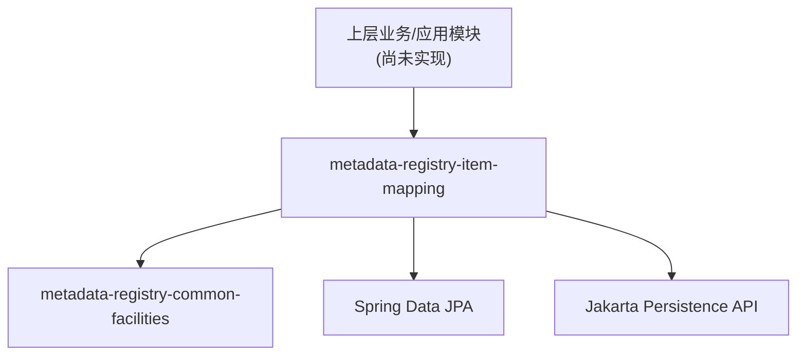

> 本文档由 GitNexus wiki 生成于 2026-09-13（kimi-for-coding，--lang chinese）。内容变化时请重新运行 `gitnexus wiki --lang chinese` 生成，勿手工改写。

# metadata-registry-item-mapping 模块

## 模块概述

`metadata-registry-item-mapping` 是 metadata-registry4j 项目中负责**元数据注册表条目与持久化层映射**的模块。该模块目前处于早期搭建阶段，代码库中仅包含 Maven 构建描述文件（`pom.xml`），尚未包含任何 Java 源代码、实体类或仓储接口。

从模块命名和依赖声明可以推断，该模块的规划职责是：

- 定义元数据注册表条目（metadata registry item）的 JPA 实体类
- 提供实体与数据库表之间的映射关系（`jakarta.persistence` 注解）
- 提供基于 Spring Data JPA 的 Repository 接口，供上层模块执行数据访问操作

## 在代码库中的定位

该模块继承自父工程 `metadata-registry4j-parent`（版本 `0.1.0-SNAPSHOT`），属于多模块工程的一部分。它与 `metadata-registry-common-facilities` 模块存在编译期依赖关系，表明其设计意图是复用公共基础设施（如基础实体、通用类型、工具类等）。



当前模块的调用图（call graph）为空——无内部调用、无对外调用、无入站调用、无执行流，这与"仅有 pom.xml、无源代码"的现状一致。

## 构建配置详解

### 父工程继承

```xml
<parent>
    <groupId>io.github.matrixlane</groupId>
    <artifactId>metadata-registry4j-parent</artifactId>
    <version>0.1.0-SNAPSHOT</version>
</parent>
```

所有依赖版本均由父 POM 统一管理，本模块不声明任何 `<version>` 标签。

### 内部依赖

| 依赖 | 说明 |
|------|------|
| `metadata-registry-common-facilities` | 公共基础设施模块，提供共享的实体基类、常量或工具组件（待源码落地后确认具体内容） |

### 框架与规范依赖

| 依赖 | 作用 |
|------|------|
| `jakarta.persistence:jakarta.persistence-api` | JPA 规范 API，用于 `@Entity`、`@Table`、`@Column` 等映射注解 |
| `jakarta.annotation:jakarta.annotation-api` | Jakarta 通用注解（如 `@PostConstruct`） |
| `org.springframework.boot:spring-boot-starter-data-jpa` | Spring Data JPA 支持，用于 Repository 接口的自动实现与代理生成 |

### 开发辅助依赖

| 依赖 | Scope | 作用 |
|------|-------|------|
| `org.projectlombok:lombok` | `provided` | 编译期代码生成，减少实体类的样板代码（getter/setter/builder 等） |

### 测试依赖

| 依赖 | Scope | 作用 |
|------|-------|------|
| `junit-jupiter` | `test` | JUnit 5 测试框架 |
| `assertj-core` | `test` | 流式断言库 |
| `mockito-core` | `test` | Mock 框架 |
| `spring-boot-starter-test` | `test` | Spring 测试全家桶（含 MockMvc、AssertJ、Hamcrest 等） |

## 预期开发方向

基于依赖组合（JPA + Spring Data JPA + Lombok），后续在该模块中预期会出现以下组件：

1. **实体类**：使用 Lombok 简化代码，使用 Jakarta Persistence 注解完成表结构映射，可能继承自 `metadata-registry-common-facilities` 中的公共基类。
2. **Repository 接口**：继承 `JpaRepository` 或 `JpaSpecificationExecutor`，Spring Data 在运行期自动生成实现。
3. **实体测试**：利用 `spring-boot-starter-test` 进行映射验证和数据访问层测试。

## 贡献指南

向该模块添加代码时，请注意：

- **版本管理**：所有依赖版本统一在父 POM 中声明，本模块内不要写死版本号。
- **命名约定**：遵循项目包结构 `io.github.matrixlane...`，实体类建议与模块名对应（如 `*RegistryItem*` 命名）。
- **最小依赖原则**：该模块定位为数据映射层，避免引入业务逻辑依赖；业务逻辑应放在上层模块中。
- **Lombok 使用**：实体类优先使用 Lombok 注解（如 `@Getter`、`@Builder`），避免手写样板代码。