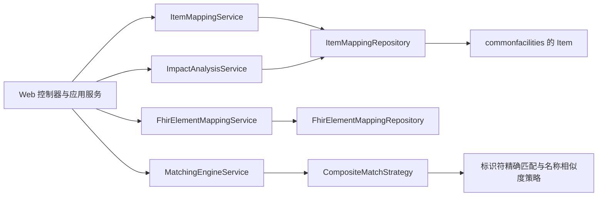

# metadata-registry-item-mapping — src

# metadata-registry-item-mapping — src

## 模块职责

`metadata-registry-item-mapping` 是元数据注册中心的映射领域模块，负责管理本地注册条目与其他数据语义之间的映射关系，主要覆盖四个领域：

| 领域 | 核心职责 | 主要类型 |
|---|---|---|
| ISO 11179 条目映射 | 建模映射条目、主体、客体及转换规则 | `ItemMapping`、`ItemMappingSubject`、`ItemMappingObject` |
| FHIR R4 映射 | 将本地 `AdministeredItem` 映射到 FHIR Element 路径 | `FhirElementMapping`、`FhirElementMappingService` |
| 互操作元素匹配 | 生成、持久化、确认和撤销互操作匹配建议 | `InteropMapping`、`MatchingEngineService`、`InteropMappingResultService` |
| 映射影响分析 | 沿映射关系分析变更影响范围 | `ImpactAnalysisService`、`ImpactAnalysisResult` |

模块依赖 `commonfacilities` 中的 `Item` 作为注册条目基类，同时被 Web 层的控制器和应用服务调用。

该模块负责**描述、匹配和审计映射关系**，但不负责执行实际的 FHIR 数据转换。`ItemMapping.transformationRule` 仅保存规则文本，模块内没有规则解释器或 FHIR 客户端。

## 总体架构



核心调用关系如下：

- 创建条目映射时，`ItemMappingController.create` 调用 `ItemMappingCrudService.create`，再进入 `ItemMappingService.createMapping`，执行应用层校验并构造 `ItemMapping`。
- 查询条目映射时，`ItemMappingCrudService.list` 使用 `ItemMappingRepository` 的标量投影查询装配主体和客体，不直接加载完整 `Item` 对象图。
- 删除条目映射时，`ItemMappingService.deleteMapping` 同时调用 `MappingHierarchyRepository.deleteBySubsetMappingId` 和 `deleteBySupersetMappingId` 清理层级关系。
- Web 层通过 `MappingImpactController` 调用 `ImpactAnalysisService.analyzeItemChange` 和 `analyzeMappingChange`。
- `AsyncImpactAnalysisService` 包装同步影响分析，将异常转换为失败的 `CompletableFuture`。
- 互操作映射控制器调用 `InteropMappingResultService.confirmMapping`、`batchConfirm`、`batchReject` 和 `countPendingByDataset`。

---

## ISO 11179 条目映射模型

### `ItemMapping`

`ItemMapping` 直接继承 `Item`，因此映射本身也是一个可识别、命名、分类并参与注册状态流转的注册条目。

映射实体使用 `JOINED` 继承策略，自身数据保存在 `item_mapping` 表中，继承自 `Item` 的字段保存在 `Item` 根表中。

| 属性 | 数据库列 | 约束 | 含义 |
|---|---|---|---|
| `degree` | `degree` | 非空 | 映射度，由 `MappingDegree` 表达 |
| `description` | `description` | 可空，最长 2000 | 映射的可读描述 |
| `transformationRule` | `transformation_rule` | 可空，最长 4000 | 从主体转换到客体的规则文本 |
| `transformationRuleNotation` | `transformation_rule_notation` | 可空，最长 255 | 规则表示法，例如 EBNF |

`MappingDegree` 通过 `MappingDegreeConverter` 持久化标准值。`MappingDegree.isSymmetric()` 用于判断映射是否双向影响；其中 `SAME_AS` 和 `SEMANTICALLY_EQUIVALENT` 属于对称映射。

转换规则可引用主体或客体绑定上的 `mappingVariableName`。例如，一个日期主体可以分别使用 `day`、`month` 和 `year` 变量名。

### 主体和客体关联

`ItemMapping` 与注册条目之间是多对多关系，由两个关联实体承载：

- `ItemMappingSubject`：映射主体侧，包含 `itemMapping`、`item` 和 `mappingVariableName`。
- `ItemMappingObject`：映射客体侧，包含 `itemMapping`、`item` 和 `mappingVariableName`。

两侧关联都使用：

```java
@ManyToOne(optional = false, fetch = FetchType.LAZY)
```

`ItemMapping` 通过以下关系持有集合：

```java
@OneToMany(mappedBy = "itemMapping",
           cascade = CascadeType.ALL,
           orphanRemoval = true)
```

因此：

- 从 `ItemMapping` 移除关联对象时，关联行会被删除。
- 新增或删除 `ItemMappingSubject`、`ItemMappingObject` 时会触发级联持久化。
- `mappingVariableName` 属于单个主体或客体绑定，而不是整个映射。
- `ItemMappingSubject`、`ItemMappingObject` 使用数据库 UUID 作为实体标识，`equals` 和 `hashCode` 仅在实体已经具有 ID 时按 ID 比较。

### 应用层约束

实体注释定义了以下业务约束，但数据库列本身没有全部实现这些约束：

- `degree` 必填。
- `transformationRule` 存在时，`transformationRuleNotation` 必须由应用层补齐。
- 一个映射至少应包含一个主体和一个客体。
- `mappingVariableName` 在需要引用具体绑定时必须唯一且可读。

这些规则主要由 `ItemMappingService.validate` 负责，而不是由 JPA Bean Validation 保证。

---

## FHIR R4 元素映射

### 映射实体

`FhirElementMapping` 保存本地 `AdministeredItem` 与 FHIR Element 的映射关系，对应表 `fhir_element_mapping`。

| 属性 | 数据库列 | 说明 |
|---|---|---|
| `localItemId` | `local_item_id` | 本地条目的语义 UUID，不使用 JPA 外键 |
| `fhirPath` | `fhir_path` | FHIR Element 路径，例如 `Patient.name.given` |
| `fhirResourceType` | `fhir_resource_type` | FHIR Resource 类型，例如 `Patient` |
| `fhirEquivalence` | `fhir_equivalence` | FHIR ConceptMap 等价关系 |
| `mappingType` | `mapping_type` | 一对一或一对多映射 |
| `mappingVariable` | `mapping_variable` | 一对多映射中的组件变量名 |
| `description` | `description` | 可读说明 |
| `createdBy`、`updatedBy` | `created_by`、`updated_by` | 创建和更新用户 UUID |
| `createdAt`、`updatedAt` | `created_at`、`updated_at` | 审计时间戳 |
| `version` | `version` | JPA 乐观锁版本 |

`fhirPath` 是语义引用，而不是指向 `FhirElement` 表的外键。这样可以避免将映射生命周期与 FHIR 元素目录的生命周期耦合。

表上建立了以下索引：

- `idx_fem_local_item`
- `idx_fem_fhir_path`
- `idx_fem_fhir_resource_type`
- `idx_fem_local_fhir`

### 构造和更新规则

完整构造函数会拒绝以下无效输入：

- `localItemId` 为 `null`。
- `fhirPath` 或 `fhirResourceType` 为空或纯空白。
- `fhirEquivalence` 或 `mappingType` 为 `null`。

`FhirElementMapping.update` 采用“`null` 表示保留原值”的更新约定：

| 参数 | `null` | 空字符串或纯空白 |
|---|---|---|
| `fhirPath` | 保留原值 | 保留原值 |
| `fhirEquivalence` | 保留原值 | 不适用 |
| `mappingType` | 保留原值 | 不适用 |
| `mappingVariable` | 保留原值 | 清空为 `null` |
| `description` | 保留原值 | 清空为 `null` |

无论字段是否实际变化，`update` 都会更新 `updatedBy` 和 `updatedAt`。

其他业务辅助方法：

- `isOneToMany()` 判断映射类型是否为 `ONE_TO_MANY`。
- `getDisplayName()` 在存在变量名时返回 `变量名 → FHIR 路径`，否则只返回路径。

### 映射类型

`FhirMappingType` 定义两个值：

- `ONE_TO_ONE`：一个本地条目对应一个 FHIR Element。
- `ONE_TO_MANY`：一个本地条目拆分为多个 FHIR Element，例如姓名拆分为 `family` 和 `given`。

一对多映射要求 `mappingVariable` 非空，该规则由 `FhirElementMappingService` 保证。

### FHIR 等价关系

`FhirMappingEquivalence` 覆盖 FHIR R4 ConceptMap 的十种标准关系：

`EQUIVALENT`、`EQUAL`、`WIDER`、`NARROWER`、`SUBSUMES`、`SPECIALIZES`、`RELATEDTO`、`INEXACT`、`UNMATCHED`、`DISJOINT`。

`toCode()` 返回小写标准代码，例如 `equivalent`；`fromCode(String)` 忽略大小写解析代码，遇到未知值时抛出 `IllegalArgumentException`。

### 服务层约束

`FhirElementMappingService` 使用类级 `@Transactional`，主要职责包括：

- 创建一对一和一对多映射。
- 防止同一个 `localItemId` 与 `fhirPath` 重复。
- 更新映射并执行冲突检测。
- 删除和查询映射。
- 通过 `FhirMappingConflictDetector` 生成冲突检测结果。

`createOneToOneMapping` 在持久化前调用重复校验，并记录 `createdBy`。一对一映射的 `mappingVariable` 为 `null`。

### 冲突检测

`FhirElementMappingRepository` 提供两种不同语义的冲突查询：

- `findLocalItemIdsWithMultipleMappings()`：按映射行数统计，一个条目存在多行即返回。
- `findConflictingLocalItemIds()`：按不同的 `fhirPath` 统计，真正识别一个条目映射到多个 FHIR 路径的情况。

`FhirMappingConflictWarning.of(localItemId, conflictingPaths)` 生成标准警告消息：

```text
Local item {localItemId} is mapped to {count} FHIR Elements: {paths}
```

该记录直接持有传入的路径列表，调用方不应在创建后修改原始列表。

---

## 互操作映射与生命周期

### `InteropMapping`

`InteropMapping` 保存匹配引擎为互操作数据元素生成的匹配结果，对应表 `interop_mapping`。

主要字段包括：

- `interopDataElementId`：互操作数据元素 UUID。
- `localItemId`：匹配的本地条目 UUID。
- `confidenceScore`：置信度，数据库精度为 `3,2`。
- `strategy`：产生结果的策略，例如 `EXACT_IDENTIFIER`。
- `status`：映射生命周期状态。
- `reason`：可读的评分或匹配原因。
- `confirmedBy`、`confirmedAt`：人工确认或拒绝的审计信息。
- `datasetId`：互操作数据集分组。
- `batchOperationId`：最后修改该映射的批次，用于撤销。
- `previousStatus`、`previousLocalItemId`：撤销所需的旧状态和旧条目。
- `version`：乐观锁版本。

表上存在唯一约束：

```text
interop_data_element_id + local_item_id
```

因此同一个互操作元素不能同时对同一个本地条目保存多条映射记录。

### 状态与操作

| 方法 | 结果状态 | 审计行为 |
|---|---|---|
| `autoMatch()` | `AUTO_MATCHED` | 记录旧状态，不写确认人和确认时间 |
| `confirm(userId)` | `CONFIRMED` | 记录旧状态、确认人和确认时间 |
| `reject(userId)` | `REJECTED` | 记录旧状态、确认人和确认时间 |
| `manualMap(newLocalItemId, userId)` | `CONFIRMED` | 同时保存旧条目 ID |
| `markUnmatched()` | `UNMATCHED` | 记录旧状态 |
| `undo()` | 恢复旧状态和旧条目 | 清除确认信息、批次 ID 和旧值 |

`undo()` 仅在 `previousStatus` 或 `previousLocalItemId` 存在时恢复相应字段；它不会恢复之前的 `batchOperationId`。

### 状态分类

`InteropMappingStatus` 定义：

- `AUTO_MATCHED`
- `PENDING`
- `CONFIRMED`
- `REJECTED`
- `UNMATCHED`

`MatchingEngineService.classifyConfidence` 使用实际配置阈值分类：

- `score >= highConfidenceThreshold`：`HIGH`
- `score >= mediumConfidenceThreshold`：`MEDIUM`
- 其他：`LOW`

默认阈值下，`0.85` 本身属于 `HIGH`，`0.60` 本身属于 `MEDIUM`。

---

## 匹配引擎

### 输入模型

匹配引擎使用两个轻量模型，避免直接依赖完整 JPA 实体图：

- `InteropElement`：包含 `id`、业务 `identifier` 和显示名称 `name`。
- `LocalItemInfo`：包含 `itemId`、名称和 `ScopedIdentifier` 值列表。

`LocalItemInfo` 在构造时防御性复制标识符列表；`null` 名称转换为空字符串，`null` 标识符列表转换为空列表。

### 策略接口

所有匹配算法实现 `MatchStrategy`：

```java
List<MatchCandidate> match(InteropElement source,
                            List<LocalItemInfo> candidates);

MatchStrategyType getType();
```

返回的候选按置信度降序排列。`MatchCandidate` 的自然顺序依次比较：

1. 置信度降序。
2. `MatchStrategyType` 枚举顺序。
3. `localItemId`，用于稳定排序。

### 标识符精确匹配

`ExactIdentifierMatchStrategy` 比较互操作元素标识符与本地条目的所有 `ScopedIdentifier`。

`NameNormalizer.normalizeIdentifier` 的处理顺序为：

1. Unicode NFKC 规范化。
2. 删除空格、连字符、圆括号、斜杠和点。
3. 使用 `Locale.ROOT` 转小写。

因此以下标识符会被视为相同：

```text
DE01.01.001.00
DE01-01-001-00
de01 01 001 00
```

命中时置信度固定为 `1.00`，每个本地候选最多产生一个结果。

### 名称相似度匹配

`NameSimilarityMatchStrategy` 综合两种指标：

```text
score = (levenshteinWeight × levenshteinSimilarity
       + jaccardWeight × jaccardSimilarity)
       / (levenshteinWeight + jaccardWeight)
```

权重和为零时得分固定为 `0.0`。

Levenshtein 相似度支持两种归一化方式：

- `longer`：编辑距离除以两个字符串长度的最大值。
- `sum`：编辑距离除以两个字符串长度之和。

Jaccard 系数使用字符二元组，即连续两个字符组成的集合。

名称会先经过 NFKC 规范化、首尾去空白、连续空白折叠和小写转换。最终得分使用 `HALF_UP` 保留两位小数，低于 `0.20` 的候选会被直接过滤。该 `0.20` 是策略内部的固定噪声阈值，与置信度分类阈值相互独立。

### 复合策略

`CompositeMatchStrategy` 默认按以下顺序配置子策略：

1. `ExactIdentifierMatchStrategy`
2. `NameSimilarityMatchStrategy`

执行时会运行所有子策略，而不是在精确匹配成功后立即短路。随后：

- 按 `localItemId` 去重。
- 同一本地条目保留置信度最高的候选。
- 分数相同时保留先执行策略的结果。
- 按置信度、策略类型和 UUID 稳定排序。
- 按 `maxCandidatesPerElement` 截断。

`MatchSuggestion` 在构造时复制候选列表，`bestCandidate()` 返回列表第一个元素，因此调用方应确保候选已经按期望顺序排列。

### 名称索引和预过滤

`NameIndexCache` 使用 `ConcurrentHashMap` 保存：

```text
规范化名称 → 本地条目 UUID 集合
```

主要操作：

- `buildIndex`：清空并重建全部索引。
- `addItem`、`removeItem`：增量维护。
- `lookup`：按规范化名称精确查找。
- `preFilter`：保留至少共享一个字符二元组的候选。
- `clear`：清空索引。
- `itemCount`、`nameCount`：返回索引规模。

如果输入名称过短、无法生成二元组，或者没有任何条目共享二元组，`preFilter` 会回退到完整候选列表，避免过滤掉所有结果。

`MatchingEngineService.matchAll` 仅在缓存为空时自动建立索引。候选集合发生变化后，应显式调用 `buildIndex`，否则服务可能继续使用旧索引。

### 配置

`MatchConfigurationProperties` 使用前缀 `mdr.matching`：

```yaml
mdr:
  matching:
    levenshtein-weight: 0.6
    jaccard-weight: 0.4
    high-confidence-threshold: 0.85
    medium-confidence-threshold: 0.60
    levenshtein-normalization: longer
    max-candidates-per-element: 3
```

`toMatchConfiguration()` 将属性转换为带校验规则的 `MatchConfiguration`：

| 配置 | 默认值 | 约束 |
|---|---:|---|
| `levenshteinWeight` | `0.6` | `[0.0, 1.0]` |
| `jaccardWeight` | `0.4` | `[0.0, 1.0]` |
| `highConfidenceThreshold` | `0.85` | `[0.0, 1.0]` |
| `mediumConfidenceThreshold` | `0.60` | `[0.0, 1.0]` |
| `levenshteinNormalization` | `longer` | 仅允许 `longer` 或 `sum` |
| `maxCandidatesPerElement` | `3` | 必须大于等于 1 |

### 同步与异步入口

- `matchOne`：匹配单个互操作元素。
- `matchAll`：顺序匹配一批元素。
- `matchAllFiltered`：面向已筛选候选