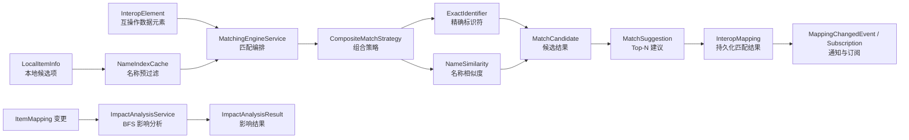

> 本文档由 GitNexus wiki 生成于 2026-09-13（kimi-for-coding，--lang chinese）。内容变化时请重新运行 `gitnexus wiki --lang chinese` 生成，勿手工改写。

# metadata-registry-item-mapping — src

## 模块定位与职责

`metadata-registry-item-mapping` 是元数据注册体系中的**映射域模块**，负责表达、存储、分析和辅助维护本地受管项（AdministeredItem / Item）与外部标准之间的映射关系。它对应 ISO/IEC 11179-3:2023 Clause 11 的 Item Mapping 概念，并在此基础上扩展了三类能力：

1. **通用项映射**：`ItemMapping` 连接两个内部受管项，或连接内部项与外部 URI。
2. **FHIR 映射**：`FhirElementMapping` 将本地受管项映射到 FHIR R4 Element 路径，并记录 ConceptMap equivalence。
3. **互操作匹配**：`InteropMapping` 与 `matching` 包提供候选匹配、置信度评分、人工确认/拒绝、批量操作与撤销支持。

该模块偏向领域核心与算法组件：Web 控制器、异步包装、批量结果服务等位于其他模块；本模块通过 Spring Service、JPA Repository、Spring `ApplicationEvent` 和配置属性被上层组装调用。

## 包结构与核心类型

| 包 | 关键类型 | 职责 |
|---|---|---|
| `dto` | `FhirMappingConflictWarning` | FHIR 一对多/冲突场景下的警告 DTO，支持自动生成可读消息 |
| `entity` | `ItemMapping`, `ItemMappingSubject`, `ItemMappingObject` | ISO 11179 风格映射关系、subject/object 端点 |
| `entity` | `MappingScheme` | 版本化映射方案容器，支持 draft/published/archived 生命周期 |
| `entity` | `FhirElementMapping` | 本地项到 FHIR Element 的映射，含 path/resource/equivalence/type |
| `entity` | `InteropMapping` | 匹配引擎产生的映射结果，保存置信度、策略、状态与撤销字段 |
| `notification` | `MappingSubscription`, `MappingSubscriptionRepository` | 用户按 scheme 或 item 订阅映射变更 |
| `enums` | `MappingType`, `MappingSchemeStatus`, `FhirMappingEquivalence`, `FhirMappingType`, `InteropMappingStatus` | 领域枚举与生命周期状态 |
| `event` | `MappingChangedEvent` | 映射创建、修改、删除事件 |
| `impact` | `ImpactAnalysisService`, `ImpactAnalysisResult`, `ImpactedItem`, `ImpactLevel`, `ImpactDirection` | 映射变更影响面分析，BFS 最大 3 层、500 节点 |
| `matching` | `MatchingEngineService`, `CompositeMatchStrategy`, `ExactIdentifierMatchStrategy`, `NameSimilarityMatchStrategy` | 同步/异步匹配编排与策略实现 |
| `matching` | `InteropElement`, `LocalItemInfo`, `MatchCandidate`, `MatchSuggestion` | 匹配过程中的轻量 DTO/record |
| `matching` | `NameNormalizer`, `SimilarityCalculator`, `NameIndexCache` | 名称规范化、相似度计算、候选预过滤索引 |
| `matching` | `MatchConfiguration`, `MatchConfigurationProperties` | 权重、阈值、归一化方式与候选数配置 |

## 总体架构与数据流



## 领域模型

### `ItemMapping`、`ItemMappingSubject`、`ItemMappingObject`

`ItemMapping` 是通用映射关系实体，包含：

- `subject`：映射源，类型为 `ItemMappingSubject`。
- `object`：映射目标，类型为 `ItemMappingObject`。
- `mappingType`：映射关系类型，取值见 `MappingType`。
- `description`：可选说明。
- `transformationRule`：可选转换规则，长度 4000，适用于 `DERIVED`、`AGGREGATED`、`SUBDIVIDED` 等方向性关系。
- `mappingScheme`：所属 `MappingScheme`。
- `createdAt`：创建时间。

`ItemMappingSubject` 与 `ItemMappingObject` 结构对称，均只允许以下两种引用之一：

- `itemId`：内部 `AdministeredItem.id`
- `externalUri`：外部资源 URI

二者互斥由应用层 `isReferenceMutuallyExclusive()` 校验，也可通过数据库 CHECK 约束兜底。创建端点推荐静态工厂：

```java
// 内部受管项作为映射源
ItemMappingSubject subject = ItemMappingSubject.forItem(itemId);

// 外部标准作为映射目标
ItemMappingObject object = ItemMappingObject.forExternalUri("http://hl7.org/fhir/StructureDefinition/Patient");

ItemMapping mapping = new ItemMapping(subject, object, MappingType.EQUIVALENT);
```

所有实体 `equals/hashCode` 均基于 `id`，且 `id == null` 时相等判断返回 `false`，符合 JPA 托管对象比较习惯。

### `MappingScheme`

`MappingScheme` 是版本化映射方案容器，字段包括 `name`、`sourceUri`、`targetUri`、`description`、`version`、`status`、`parentId`。核心约束是 `(parent_id, version)` 唯一，用于保证同一条版本链路上不会出现重复版本。

版本规则：

- 初始版本固定为 `0.1.0`，状态 `DRAFT`。
- 发布时版本号不变，状态变为 `PUBLISHED`。
- 基于已发布版本创建新草稿时，使用 `parentId` 指向前驱，`nextPatchVersion()` 自动增加 patch 位，例如 `0.1.0 → 0.1.1`。
- 归档后进入 `ARCHIVED`，语义上只读。

`MappingSchemeStatus` 独立三态生命周期与 WI-007 的注册生命周期不同，不应混用。

### `FhirElementMapping`

`FhirElementMapping` 扩展 WI-011 通用映射框架，面向 WI-012-2 的本地元数据到 FHIR Element 映射。它不显式持有 `FhirElement` 外键，而是使用语义引用：

- `localItemId`：本地受管项 UUID。
- `fhirPath`：FHIR 路径，例如 `Patient.name.given`，最长 500。
- `fhirResourceType`：资源类型，例如 `Patient`、`Observation`，用于过滤与 ConceptMap group 组织。
- `fhirEquivalence`：FHIR R4 ConceptMap equivalence，字符串枚举存储。
- `mappingType`：`ONE_TO_ONE` 或 `ONE_TO_MANY`。
- `mappingVariable`：一对多映射时的组件名，例如本地“姓名”拆到 `family` 与 `given`；一对一映射时为空。
- `mappingSchemeId`：归属方案，提供版本谱系。
- 审计字段：`createdBy`、`updatedBy`、`createdAt`、`updatedAt`。
- 乐观锁：`@Version version`。

构造器强制校验 `localItemId/fhirPath/fhirResourceType/fhirEquivalence/mappingType` 非空，其中字符串字段还要求非 blank。`update(...)` 采用“null 表示不变”的局部更新语义；`mappingVariable` 与 `description` 传入 blank 时会被规范化为 `null`。展示名由 `getDisplayName()` 生成：

- 有 `mappingVariable`：`family → Patient.name.family`
- 无 `mappingVariable`：`Patient.name.family`

### `InteropMapping`

`InteropMapping` 保存匹配引擎产生的一条映射建议，核心字段包括：

- `interopDataElementId`：互操作数据元素。
- `localItemId`：匹配到的本地项。
- `confidenceScore`：`BigDecimal(3,2)`，范围 `[0.00, 1.00]`。
- `strategy`：产生该结果策略名，例如 `EXACT_IDENTIFIER`、`NAME_SIMILARITY`。
- `status`：`InteropMappingStatus`。
- `reason`：人类可读原因或分数拆解。
- `confirmedBy/confirmedAt`：人工确认或拒绝记录。
- `datasetId`：按数据集分组。
- 撤销支持：`batchOperationId`、`previousStatus`、`previousLocalItemId`。

生命周期方法：

- `autoMatch()`：高置信自动匹配，置为 `AUTO_MATCHED`。
- `confirm(UUID userId)`：置为 `CONFIRMED` 并记录确认人与时间。
- `reject(UUID userId)`：置为 `REJECTED`。
- `manualMap(UUID newLocalItemId, UUID userId)`：改绑到新的本地项，状态置为 `CONFIRMED`，同时保存 `previousLocalItemId` 便于撤销。
- `undo()`：恢复 `previousStatus` 与 `previousLocalItemId`，清空确认信息与 `batchOperationId`。
- `markUnmatched()`：标记未找到对应本地项。

唯一约束为 `(interop_data_element_id, local_item_id)`。调用图显示上层 `InteropMappingController` 与 `InteropMappingResultService` 会组合使用 `confirm/reject`、批量确认/拒绝、`countPendingByDataset`、`findByDatasetIdAndStatusOrderByConfidenceScoreDesc` 等能力完成人工治理流程。

## 枚举语义

### `MappingType`

- `EQUIVALENT`：双向语义等价，与其他映射类型互斥。
- `DERIVED`：subject 派生 object，方向为 subject → object。
- `AGGREGATED`：object 聚合 subject，方向为 subject → object。
- `SUBDIVIDED`：subject 拆分为 object，方向为 subject → object，方向上与 `AGGREGATED` 相反。

互斥规则在服务层执行，例如 `EQUIVALENT` 不应与任何方向性映射并存；`DERIVED` 与 `AGGREGATED` 互斥；`AGGREGATED` 与 `SUBDIVIDED` 互斥。

### `FhirMappingEquivalence`

对齐 FHIR R4 ConceptMap equivalence：`EQUIVALENT`、`EQUAL`、`WIDER`、`NARROWER`、`SUBSUMES`、`SPECIALIZES`、`RELATEDTO`、`INEXACT`、`UNMATCHED`、`DISJOINT`。

- `toCode()` 返回小写 FHIR code，如 `equivalent`。
- `fromCode(String code)` 大小写不敏感解析，空值抛 `IllegalArgumentException`。

### `FhirMappingType`

- `ONE_TO_ONE`：一个本地项对应一个 FHIR Element。
- `ONE_TO_MANY`：一个本地项拆分映射到多个 FHIR Element，需 `mappingVariable` 区分目标组件。

### `InteropMappingStatus`

- `AUTO_MATCHED`：置信度高于高阈值，自动匹配。
- `PENDING`：中等置信度，待数据管理员确认。
- `CONFIRMED`：人工确认。
- `REJECTED`：人工拒绝。
- `UNMATCHED`：无对应本地项。

## 匹配引擎

### 编排入口：`MatchingEngineService`

`MatchingEngineService` 是匹配流程门面，主要职责：

1. 将 `MatchConfigurationProperties` 转为运行时 `MatchConfiguration`。
2. 构建默认 `CompositeMatchStrategy`。
3. 维护 `NameIndexCache`，用于候选预过滤。
4. 提供单条、批量、异步批量匹配。
5. 按阈值将分数分类为 `HIGH/MEDIUM/LOW`。

典型调用：

```java
// 构建或刷新本地项索引
matchingEngineService.buildIndex(localItems);

// 单元素匹配
MatchSuggestion suggestion = matchingEngineService.matchOne(interopElement, localItems);

// 批量同步匹配
List<MatchSuggestion> suggestions = matchingEngineService.matchAll(interopElements, localItems);

// 批量异步匹配；当前 MVP 使用 CompletableFuture.supplyAsync
CompletableFuture<List<MatchSuggestion>> future =
        matchingEngineService.matchAllAsync(interopElements, localItems);
```

若索引尚未构建，`matchAll(...)` 会自动调用 `buildIndex(candidates)`。对于大数据集，建议显式管理索引生命周期，避免在每次批处理中重复构建。

### 策略链：`CompositeMatchStrategy`

默认策略顺序固定：

1. `ExactIdentifierMatchStrategy`
2. `NameSimilarityMatchStrategy`

执行逻辑：

- 先跑所有子策略。
- 按 `localItemId` 去重，同一本地项被多个策略命中时保留更高 `confidenceScore`。
- 最终按分数降序、策略名、 `localItemId` 排序，截取 `maxCandidatesPerElement`。

`MatchStrategyType` 中枚举顺序体现优先级：`EXACT_IDENTIFIER` 最高，`SEMANTIC` 预留给 V1。

### 精确标识符匹配

`ExactIdentifierMatchStrategy` 对 `InteropElement.identifier` 与 `LocalItemInfo.identifiers` 做归一化后精确比较：

- Unicode NFKC。
- 去除空格、连字符、括号、斜杠、点号。
- 英文小写。

命中即产生 `confidenceScore = 1.00` 的 `MatchCandidate`，每个候选项只取首个命中标识符。

### 名称相似度匹配

`NameSimilarityMatchStrategy` 使用加权组合分：

```text
score = (levenshteinWeight * levSim + jaccardWeight * jacSim) / weightSum
```

其中：

- `levSim` 来自 `SimilarityCalculator.levenshteinSimilarity(...)`。
- `jacSim` 来自字符 bigram 的 Jaccard 相似度。
- `weightSum = levenshteinWeight + jaccardWeight`，允许权重和不为 1，最后再归一化到 `[0.0, 1.0]`。
- 结果用 `BigDecimal` 保留两位小数。
- 小于 `0.20` 的噪声匹配会被丢弃。

Levenshtein 归一化支持两种分母：

- `longer`：默认，`max(len1, len2)`。
- `sum`：`len1 + len2`。

### 规范化与索引

`NameNormalizer` 区分两类归一化：

- `normalizeName`：NFKC、去首尾空白、压缩连续空格、小写。
- `normalizeIdentifier`：NFKC、去除 `[\s\-()/.]+`、小写。

`NameIndexCache` 使用 `ConcurrentHashMap` 保存：

- `nameToItemIds`：归一化名称 → itemId 集合。
- `cachedItemIds`：已缓存 itemId 集合。

`preFilter(name, allCandidates)` 对输入名称生成 bigram，并扫描索引名称的 bigram 是否有交集。MVP 实现是 O(索引大小) 扫描；V1 可替换为倒排 bigram 索引。若名称长度小于 2 或无法生成 bigram，则回退为全量候选。

## 影响分析

`ImpactAnalysisService` 用于评估某个元数据项或某条映射发生 `UPDATED/DELETED/MODIFIED` 时的级联影响。类级配置：

- `@Transactional(readOnly = true)`
- `MAX_DEPTH = 3`
- `MAX_NODES = 500`

### `analyzeItemChange(UUID itemId, String changeType)`

从变更项出发做 BFS：

- 每层调用 `ItemMappingRepository.findByItemId(current.itemId)`。
- 使用 `visitedItems/visitedMappings` 去重。
- 跳过仅外部 URI 的映射，因为不存在可追踪内部项。
- 若当前项是 subject，则邻居 object 为 `TARGET_AFFECTED`；若当前项是 object，则邻居 subject 为 `SOURCE_AFFECTED`。
- `EQUIVALENT` 映射方向统一记为 `BOTH`。
- 深度 1/2/3 映射为 `ImpactLevel.DIRECT/INDIRECT/CASCADE`。
- 原始变更项本身不计入受影响结果。
- 达到 `MAX_NODES` 时置 `truncated = true`。

结果封装为 `ImpactAnalysisResult(changedItemId, changeType, impactedItems, totalImpacted, truncated)`。

### `analyzeMappingChange(UUID mappingId, String changeType)`

先加载触发分析的 `ItemMapping`。若不存在，返回空结果。若存在：

- subject/object 均非空时，object 作为 `DIRECT` 受影响项；`EQUIVALENT` 记 `BOTH`，否则记 `TARGET_AFFECTED`。
- 从 subject 与 object 两侧分别继续 BFS，但排除触发映射本身。
- 起始深度设为 1，使得经由其他映射到达的邻居成为 `INDIRECT`。
- 合并两侧结果后按 `ImpactedItem.itemId` 去重。

调用图显示 web 层 `MappingImpactController` 与 `AsyncImpactAnalysisService` 分别同步/异步调用这两个入口。

## 事件与订阅

### `MappingChangedEvent`

继承 Spring `ApplicationEvent`，字段：

- `mappingId`
- `changeType`：`CREATED`、`MODIFIED`、`DELETED`
- `mapping`：删除事件时可能为 `null`

V1 主要发布 `CREATED` 与 `DELETED`；`MODIFIED` 预留。订阅方可用于审计、站内通知、影响分析触发或联动缓存失效。

### `MappingSubscription`

支持两类订阅：

- `SCHEME`：按 `MappingScheme` 订阅。
- `ITEM`：按元数据项订阅。

可见 repository 方法包括按用户查询、按 type/target 查询、判断订阅是否存在，以及批量查询 scheme 订阅。上层在发布 `MappingChangedEvent` 后，可依据事件中的 scheme/item 信息找到订阅者并生成站内通知；邮件与 Webhook 为后续扩展。

## 配置

匹配参数通过 Spring Boot 配置属性加载，前缀为 `mdr.matching`：

```yaml
mdr:
  matching:
    levenshtein-weight: 0.6        # Levenshtein 权重，范围 [0.0, 1.0]
    jaccard-weight: 0.4            # Jaccard 权重，范围 [0.0, 1.0]
    high-confidence-threshold: 0.85 # 高于该值视为 HIGH，可自动匹配
    medium-confidence-threshold: 0.60 # 高于该值视为 MEDIUM，需人工确认
    levenshtein-normalization: longer # longer 或 sum
    max-candidates-per-element: 3   # 每个互操作元素返回的最大候选数
```

`MatchConfiguration` 对 setter 做校验：权重与阈值必须落在 `[0.0, 1.0]`，`levenshteinNormalization` 只允许 `longer/sum`，`maxCandidatesPerElement` 必须大于等于 1。`MatchConfigurationProperties.toMatchConfiguration()` 完成外部配置到运行时配置的转换。

## 并发、事务与性能注意事项

- JPA 实体大量使用 Lombok `@Getter/@Setter/@NoArgsConstructor`；领域行为集中在实体方法中，避免把生命周期逻辑散落在 controller。
- `FhirElementMapping` 与 `InteropMapping` 使用 `@Version` 乐观锁，适合并发更新与批量治理场景。
- `MatchingEngineService` 当前为同步实现；异步能力用 `CompletableFuture` 包装，V1 可替换为 Spring `@Async` 与受控线程池。
- `NameIndexCache` 线程安全，但 `removeItem(UUID)` 是 O(索引大小) 扫描；高频删除场景需要重建索引或升级为倒排索引。
- 影响分析通过 `MAX_DEPTH` 与 `MAX_NODES` 限制爆炸半径；调用方应检查 `ImpactAnalysisResult.truncated()`，不能把截断结果当作完整影响面。
- `analyzeMappingChange` 对已删除映射不抛错，而是返回空 `ImpactAnalysisResult`，上层如需区分“不存在”和“无影响”应额外校验。

## 与代码库其他部分的连接

典型入向调用来自 web/controller 与 service 层：

- `MappingImpactController` 调用 `ImpactAnalysisService.analyzeItemChange/analyzeMappingChange`。
- `AsyncImpactAnalysisService` 将同步影响分析包装为异步 `CompletableFuture`。
- `InteropMappingController` 调用 `InteropMappingResultService` 完成确认、拒绝、批量确认、批量拒绝与 pending 统计。
- `MappingDiffService` 通过 `ItemMappingRepository.findByMappingSchemeId` 比较不同 scheme 版本下的映射差异。

本模块向下主要依赖 JPA/Hibernate、Spring Context、Spring Boot ConfigurationProperties 与 SLF4J；源码片段中没有直接 outgoing 外部系统调用。集成时应将本模块视为纯领域与算法核心：URI、标识符、置信度阈值、状态机与影响策略都在这里定义，REST 语义、权限、异步执行策略和通知投递由外层模块补齐。

## 开发建议与扩展点

- 新增匹配策略时实现 `MatchStrategy`，并在 `MatchStrategyType` 中登记优先级，再按需扩展 `CompositeMatchStrategy` 的默认链。
- 修改权重默认值时保持 `getWeightSum()` 语义清晰；不要假设权重和恒等于 1。
- 增加 `MODIFIED` 映射事件时，需要同步评估 `ImpactAnalysisService.analyzeMappingChange` 的触发时机，避免与实体 `@Version` 更新产生循环事件。
- 扩展 `FhirElementMapping` 到 `FhirElement` 强外键前，需要处理 WI-012-2 的 MVP 决策：当前是有意使用语义 `fhirPath`，不是遗漏 FK。
- 将 `InteropMapping.undo()` 用于批量撤销时，必须保证 `batchOperationId`、`previousStatus`、`previousLocalItemId` 的写入与状态迁移同事务完成，否则撤销可能恢复到不完整状态。
- 订阅通知建议消费 `MappingChangedEvent` 而非直接扫描映射表，这样能复用 V1 已定义的 `CREATED/DELETED/MODIFIED` 语义，并保留未来 webhook/email 扩展点。