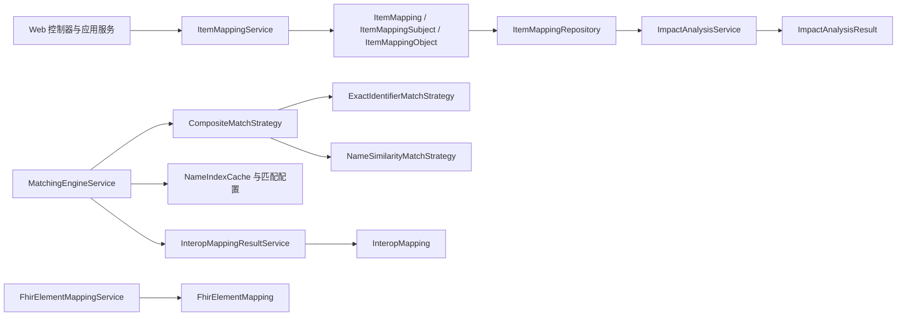

# metadata-registry-item-mapping

# metadata-registry-item-mapping

`metadata-registry-item-mapping` 是元数据注册中心的条目映射模块，负责描述本地注册条目与其他数据语义之间的关系，并提供映射持久化、互操作匹配、FHIR 路径关联和变更影响分析能力。其 Maven 坐标为 `io.github.matrixlane:metadata-registry-item-mapping:0.1.0-SNAPSHOT`。

## 子模块组成

- [`metadata-registry-item-mapping`](metadata-registry-item-mapping.md)：定义 Maven 坐标及依赖边界，包括 Jakarta Persistence、Spring Data JPA、`metadata-registry-common-facilities` 和 Lombok。
- [`metadata-registry-item-mapping — src`](metadata-registry-item-mapping-src.md)：包含实体、Repository、服务、匹配策略和影响分析等实际实现。

模块级配置负责提供持久化与共享类型能力，源码子模块则基于这些边界实现映射领域能力。

## 协作关系

- `ItemMappingService` 使用 `ItemMapping`、`ItemMappingSubject` 和 `ItemMappingObject` 表达 ISO 11179 映射关系，并通过 `ItemMappingRepository` 持久化。
- `MatchingEngineService` 通过 `CompositeMatchStrategy` 组合标识符精确匹配与名称相似度匹配；`NameIndexCache` 和 `MatchConfiguration` 分别提供检索加速与阈值、权重控制。
- `InteropMappingResultService` 承接 `InteropMapping` 建议的生成、持久化、确认和撤销。
- `FhirElementMappingService` 维护 `FhirElementMapping`，将 `AdministeredItem` 关联到 FHIR Element 路径。
- `ImpactAnalysisService` 基于 `ItemMappingRepository` 遍历映射关系，并输出包含影响方向、程度、层级和变更建议的 `ImpactAnalysisResult`。

## 关键流程

1. **创建映射**：`ItemMappingController` 调用 `ItemMappingCrudService`，再由 `ItemMappingService.createMapping` 完成校验和实体构建，最终写入映射存储。
2. **查询映射**：`ItemMappingCrudService` 解析排序条件，并通过 `ItemMappingRepository.findSubjectRowsByMappingIds` 与 `findObjectRowsByMappingIds` 批量装配主体和客体，避免逐条查询。
3. **生成互操作匹配**：`MatchingEngineService` 组合精确标识符与名称相似度策略，利用缓存和配置筛选候选结果，再交由 `InteropMappingResultService` 管理匹配建议生命周期。
4. **分析映射变更**：`ImpactAnalysisService` 从持久化映射图出发，找出直接和间接受影响的注册条目，并通过 `ImpactAnalysisResult` 返回可审计的分析结果。

该模块负责映射关系的建模、匹配和审计，不执行实际的 FHIR 数据转换；`ItemMapping.transformationRule` 仅保存规则文本，规则解释与 FHIR 转换由外部组件完成。