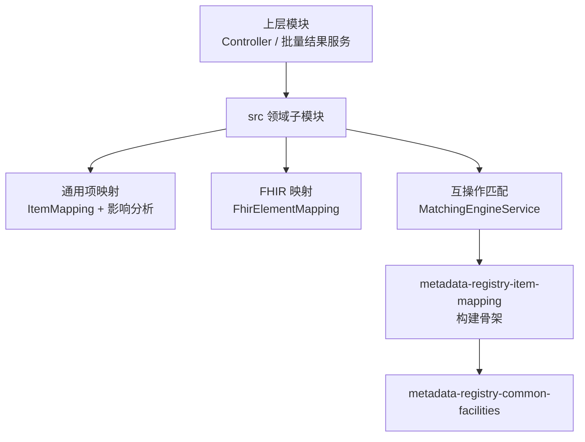

> 本文档由 GitNexus wiki 生成于 2026-09-13（kimi-for-coding，--lang chinese）。内容变化时请重新运行 `gitnexus wiki --lang chinese` 生成，勿手工改写。

# metadata-registry-item-mapping 模块组

## 概述

`metadata-registry-item-mapping` 是 metadata-registry4j 中负责**元数据注册表条目映射**的模块组，实现了 ISO/IEC 11179-3:2023 Clause 11 的 Item Mapping 概念，并在此之上扩展了 FHIR 映射与互操作匹配能力。整个模块组围绕一条主线展开：**本地受管项（AdministeredItem）与外部标准之间的映射关系如何表达、存储、分析和维护**。

模块组由两个子模块组成：

- [metadata-registry-item-mapping](metadata-registry-item-mapping.md) — 模块的构建与工程定位：继承自 `metadata-registry4j-parent`，编译期依赖 `metadata-registry-common-facilities` 以复用公共基础设施（基础实体、通用类型等），为整个模块组提供 Maven 构建骨架。
- [src](metadata-registry-item-mapping-src.md) — 模块的全部领域实现：JPA 实体、Repository、Spring Service、匹配算法与配置属性。

## 三层核心能力

`src` 子模块内的领域代码按三条能力线组织，彼此共享实体与仓储基础设施：

1. **通用项映射** — `ItemMapping`（含 `ItemMappingSubject` / `ItemMappingObject`）表达 ISO 11179 风格的映射关系，可连接两个内部受管项或内部项与外部 URI；配套的 `impact` 包（`ImpactAnalysisService` 等）通过 `ItemMappingRepository` 做 BFS 遍历，分析条目变更的连锁影响并给出处理建议。
2. **FHIR 映射** — `FhirElementMapping` 将本地受管项映射到 FHIR R4 Element 路径并记录 ConceptMap equivalence；`dto` 包中的 `FhirMappingConflictWarning` 处理一对多/冲突场景的警告表达。
3. **互操作匹配** — `InteropMapping` 实体与 `matching` 包（`MatchingEngineService`、`CompositeMatchStrategy`、`ExactIdentifierMatchStrategy`、`NameSimilarityMatchStrategy`、`NameIndexCache` 等）提供候选匹配生成、基于编辑距离/Jaccard 加权的置信度评分，以及人工确认/拒绝与批量操作支持。

## 子模块间的协作关系

工程子模块（`metadata-registry-item-mapping`）声明依赖并搭建构建环境，领域子模块（`src`）在其上产出领域核心与算法组件；Web 控制器、异步包装、批量结果服务等位于上层模块，通过 Spring Service、JPA Repository、Spring `ApplicationEvent` 和配置属性调用本模块组。

## 跨子模块的关键工作流

**批量确认（Batch Confirm）** 是最典型的跨层流程，从上层 Web 控制器进入，贯穿服务层与实体/仓储层：

1. `InteropMappingController.batchConfirm`（上层 web 模块）
2. `InteropMappingResultService.batchConfirm` → `confirm`（`InteropMapping` 实体状态变更）
3. 批量处理前通过 `InteropMappingRepository.findByDatasetIdAndStatusOrderByConfidenceScoreDesc` 按置信度排序取回待处理项，并以 `countByDatasetIdAndStatus` 统计待确认数量

**匹配引擎调度** 则展示了 `matching` 包内部的组合式策略设计：`MatchingEngineService` 从 `MatchConfigurationProperties` 构建 `MatchConfiguration`，读取高/中置信度阈值及 Levenshtein/Jaccard 权重，驱动 `CompositeMatchStrategy` 组合精确标识符匹配与名称相似度匹配；`NameIndexCache` 依赖 `NameNormalizer` 与 `LocalItemInfo` 构建规范化名称索引，支撑高效的候选查找。

## 使用入口

- 需要了解模块依赖与构建结构，参见 [metadata-registry-item-mapping](metadata-registry-item-mapping.md)。
- 需要了解实体模型、匹配算法、影响分析与各包的详细职责，参见 [src](metadata-registry-item-mapping-src.md)。