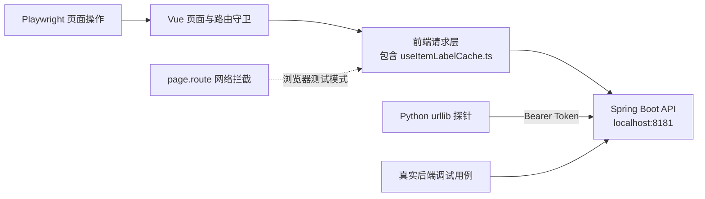

# metadata-registry-ui — e2e

# metadata-registry-ui — e2e

## 模块定位

`metadata-registry-ui/e2e` 是前端应用的端到端测试、回归测试和后端诊断脚本集合，主要验证以下能力：

- 登录、首次登录强制改密、应急登录
- 初始化向导及个人版、团队版分支
- 恢复出厂设置与初始化路由守卫
- 用户注册开关、用户列表、重置密码
- 分类方案与分类节点管理
- 侧边栏菜单重组、权限可见性和折叠行为
- 映射网络查询、过滤和节点截断提示
- 数据元创建表单的跨标签页校验
- 真实 Spring Boot API 的连通性、分页性能和应急登录流程

该目录包含两种执行模式：

1. **隔离测试**：通过 Playwright `page.route()` 模拟 API，不要求 Spring 后端运行。
2. **真实联调**：直接连接 `http://localhost:8181/api/v1`，用于调试真实页面或诊断后端性能。

两种模式位于同一目录，但运行条件和风险差异较大，不应不加区分地执行整个目录。

## 架构与代码库连接



测试通过真实浏览器执行页面操作，因此会间接覆盖：

- Vue 页面和 Element Plus 组件
- `router/index.ts` 中的登录、初始化状态和权限路由守卫
- `main.ts` 启动就绪检查
- 前端请求封装
- `src/composables/useItemLabelCache.ts` 等通过 `request` 发起请求的代码

`useItemLabelCache.ts` 并非由测试文件直接导入，而是在页面渲染期间被间接触发。因此许多测试使用 `**/api/v1/**` 捕获全部请求并返回空分页数据，避免未模拟请求返回 `401` 后触发登录重定向。

## 文件组成

| 文件 | 类型 | 主要职责 | 是否依赖真实后端 |
|---|---|---|---|
| `auth.setup.ts` | 公共辅助模块 | 模拟初始化状态、管理员身份和令牌 | 否 |
| `admin-emergency-login-verify.spec.ts` | 回归测试 | 注册开关、系统设置、用户列表、重置密码 | 否 |
| `login-flow.spec.ts` | 回归测试 | 普通登录、强制改密、应急登录、错误密码 | 否 |
| `factory-reset.spec.ts` | 回归测试 | 恢复出厂设置完整交互 | 否 |
| `factory-reset-init-guard.spec.ts` | 回归测试 | 重置后重新进入系统时跳转初始化向导 | 否 |
| `init-wizard.spec.ts` | 回归测试 | 个人版、团队版初始化流程和提交载荷 | 否 |
| `classification.spec.ts` | 回归测试 | 分类方案选择、懒加载树和节点详情 | 否 |
| `mapping-network.spec.ts` | 回归测试 | 映射网络查询、过滤、深度和截断 | 否 |
| `menu.spec.ts` | 回归测试 | 菜单分组、导航、权限和折叠 | 否 |
| `test_save_designation.spec.ts` | 探索性测试 | 数据元指称、上下文、定义和属性填写 | 否 |
| `test_tab_validation.spec.ts` | 回归测试 | 数据元表单跨标签页校验 | 否 |
| `debug_namespace.spec.ts` | 真实联调 | 调试命名空间页面并生成截图 | 是 |
| `debug_real.spec.ts` | 真实联调 | 调试数据元页面并生成截图 | 是 |
| `test_emergency.spec.ts` | 真实联调 | 应急登录、强制改密、恢复管理员密码 | 是，且会修改密码 |
| `check_elements.py` | 后端探针 | 验证数据元分页接口及响应时间 | 是 |
| `check_sizes.py` | 后端探针 | 测量多种分页大小下的响应时间 | 是 |
| `check_sql.py` | 后端探针 | 使用较长超时重复测量分页接口 | 是 |

此外，`mapping-network.spec.ts` 依赖未在当前源码中提供的 `e2e/fixtures/network-data`，其中至少包含：

- `MOCK_CENTER_ID`
- `createMockNetworkResponse(filterTypes, depth)`
- `createTruncatedResponse()`

## 公共测试机制

### 统一响应结构

大部分模拟接口使用统一业务响应包装：

```ts
const ok = <T>(data: T) => ({
  code: 0,
  data,
  message: 'success',
});
```

前端通常按以下结构消费数据：

- 普通对象：`data`
- 布尔设置：`data: true | false`
- 分页列表：`data.content`、`data.totalElements`、`data.number`、`data.size`
- 登录结果：`data.token` 和 `data.user`
- 错误响应：HTTP 状态码为 `401` 或 `4xx`，业务字段 `code`、`message`

新增模拟接口时必须保持这一结构，否则即使 HTTP 状态为 `200`，前端仍可能进入错误分支。

### `setupAuthenticatedPage`

`auth.setup.ts` 导出：

```ts
setupAuthenticatedPage(page: Page): Promise<void>
```

它完成以下准备工作：

1. 将 `/api/v1/init-wizard/status` 模拟为已初始化：
   - `initialized: true`
   - `runningMode: 'SINGLE'`
2. 将 `/api/v1/auth/me` 模拟为超级管理员 `testuser`。
3. 将 `/api/v1/auth/login` 模拟为返回固定令牌。
4. 通过 `page.addInitScript()` 在页面加载前写入：
   - `localStorage.token = 'mock-jwt-token-for-e2e-tests'`

该辅助函数用于：

- `classification.spec.ts`
- `factory-reset.spec.ts`
- `mapping-network.spec.ts`
- `menu.spec.ts`

目录外的 `registration-process.spec.ts` 也依赖该函数，因此修改其返回用户结构或令牌键名时，需要同步检查注册流程测试。

### Playwright 路由匹配顺序

Playwright 在多个路由同时匹配时，后注册的路由优先处理请求。当前代码同时使用两种方式避免通用路由吞掉专用路由：

- 将专用路由注册在通用路由之后，例如重置密码路由位于账户列表路由之后。
- 在通用路由中调用 `route.fallback()`，将请求交回前一个匹配的处理器，例如 `classification.spec.ts` 对分类接口的处理。

新增接口模拟时，应保留这一顺序约束。通用处理器只有在明确知道接口行为时才应直接 `route.fulfill()`。

### 认证与初始化前置条件

受保护页面的测试通常依赖两个独立条件：

- `localStorage` 中存在 `token`
- `/api/v1/init-wizard/status` 返回 `initialized: true`

部分页面还会在挂载前请求 `/api/v1/startup/status`，其响应应为：

```json
{
  "code": 0,
  "data": {
    "ready": true
  }
}
```

`factory-reset-init-guard.spec.ts` 特别验证了路由守卫的执行顺序：即使存在重置前的旧令牌，只要系统未初始化，也必须优先跳转 `/init-wizard`，不能跳转 `/login`。

## 功能测试说明

### 注册、用户和系统设置

`admin-emergency-login-verify.spec.ts` 覆盖以下场景：

- `/auth/allow-registration` 返回 `false` 时，登录页不显示“新用户注册”。
- `/auth/allow-registration` 返回 `true` 时，登录页显示“新用户注册”。
- `/system-settings` 中的“允许注册新用户”开关初始为开启状态。
- 关闭开关后，前端向 `/system/settings/allow-user-registration` 发出 `PUT`，查询参数包含：
  - `allowRegistration=false`
- `/app-users` 显示“上次登录时间”列。
- 有 `lastLoginAt` 的用户显示年份日期，空值显示 `-`。
- 当前管理员所在行的“删除”和“禁用”按钮不可用。
- 普通用户行提供可用的“重置密码”按钮。
- 重置流程依次经过：
  1. “确定要重置用户”确认框
  2. `POST /api/v1/accounts/{id}/reset-password`
  3. 显示“重置成功”及一次性临时密码
  4. 提示“此密码仅能成功登录一次”

该文件使用固定账户数据：

| 用户 | ID | 角色 | 状态 | 用途 |
|---|---|---|---|---|
| `admin` | `u-1` | `SUPER_ADMIN` | 启用 | 当前用户、禁用按钮验证 |
| `alice` | `u-2` | 普通用户 | 启用 | 重置密码验证 |
| `bob` | `u-3` | 普通用户 | 禁用 | 空登录时间验证 |

重置密码路由通过正则从 URL 中提取用户 ID，并断言最终调用的是 `u-2`。

### 登录流程

`login-flow.spec.ts` 的 `beforeEach` 使用通用路由返回空的分页响应，并默认模拟系统已经初始化。测试包括：

- 普通用户登录后跳转 `/dashboard`。
- 超级管理员首次登录时弹出“安全提示：需要修改密码”。
- 首次改密对话框不显示原密码或应急码输入框。
- 应急登录同样强制改密，且提交时 `oldPassword` 必须为空字符串。
- 错误密码返回 HTTP `401` 和“用户名或密码错误”。
- 错误密码只显示 Element Plus 错误消息，不进入 `.error-boundary` 崩溃页面。

### 恢复出厂设置

`factory-reset.spec.ts` 验证完整交互顺序：

1. 进入 `/system-settings`。
2. 点击“恢复出厂设置”。
3. 阅读风险警告。
4. 点击“我已了解风险，继续”。
5. 在身份验证对话框输入管理员密码。
6. 点击“确认重置”。
7. 显示 `.reset-overlay` 和“正在恢复出厂设置…”。
8. 成功后跳转 `/init-wizard`。

模拟接口会直接断言请求体中的 `password` 为 `Admin@123`。

`factory-reset-init-guard.spec.ts` 进一步验证重置后的路由行为：

- 初始状态包含一个旧的 `stale-pre-reset-token`。
- 成功调用恢复出厂设置后，模拟的 `initialized` 变为 `false`。
- 离开 `/init-wizard` 后重新访问 `http://localhost:5173/`。
- 最终 URL 必须包含 `/init-wizard`，且不能包含 `/login`。

### 初始化向导

`init-wizard.spec.ts` 通过 `mockWizardApis()` 建立完整模拟环境。该函数接收：

- `currentVendor`：当前数据库类型
- `expectEdition`：预期版本，如 `PERSONAL`、`TEAM`
- `raName`：预期注册机构名称
- `selfAsRegistrarOff`：团队版是否关闭“设为注册人员”

模拟接口包括：

- `/init-wizard/status`
- `/init-wizard/wizard-state`
- `/init-wizard/setup`
- `/init-wizard/commit`
- `/datasource/config`
- `/startup/status`
- `/languages`
- `/auth/me`
- `/dashboard/stats`

`/organizations/options` 使用 fail-fast 路由：初始化阶段一旦请求组织列表，测试立即失败，因为此时尚不存在可选组织。

`/init-wizard/setup` 会严格检查提交载荷：

- 个人版文档语言为 `['zh-CN']`。
- 团队版文档语言为 `['en-US']`。
- 不提交 `adminOrganizationId`。
- 个人版：
  - `adminIndividualName` 为 `null`
  - `adminRoleName` 为“注册管理员”
- 团队版默认：
  - `selfAsRegistrar` 为 `true`
  - 管理员姓名为“李雷”
  - 管理员角色为“数据治理主管”
- 团队版关闭“设为注册人员”后：
  - `selfAsRegistrar` 为 `false`
  - 姓名和角色均为 `null`
- 标识策略默认为 `SEGMENT_TEMPLATE`。
- 版本策略默认为 `SEMVER`。
- 注册规范默认包含：
  - `characterRepertoire: 'UTF-8'`
  - `standard: 'ISO/IEC 11179-3:2023'`

覆盖的分支包括：

- 个人版完整流程。
- 团队版完整流程。
- 团队版关闭注册人员身份。
- 团队版使用 SQLite 时被数据库步骤阻止并提示“团队版不支持 SQLite”。

`/init-wizard/commit` 还会断言新密码和确认密码均为 `E2ePass@123`。提交成功后向导状态切换为已初始化，并跳转 `/login`。

### 分类方案与节点

`classification.spec.ts` 在 `beforeEach` 中模拟分类方案列表、详情、更新、删除、节点树、子节点、节点创建、移动和级联删除接口。

当前实际执行的测试覆盖：

- 打开 `/classification`。
- 从方案下拉框选择 `Test Scheme 1`。
- 显示根节点 `Root Node 1`。
- 点击节点后显示右侧详情。
- 展开节点后按 `parentId=node-001` 懒加载 `Child Node 1.1`。

以下两个测试被 `test.skip()` 标记，当前不会执行：

- 分类方案的创建、编辑和删除。
- 分类节点的创建、编辑、移动和级联删除。

这两项仍可作为对应功能的交互参考，但不能视为持续运行的回归保障。

### 映射网络

`mapping-network.spec.ts` 拦截 `/api/v1/mappings/network`，读取：

- `filterTypes`：逗号分隔的映射类型
- `depth`：展开层数，默认 `3`
- `centerId`：中心条目 ID

特殊中心 ID `truncated-test-id` 返回 `createTruncatedResponse()`，其他请求返回 `createMockNetworkResponse(filterTypes, depth)`。

覆盖场景包括：

- 页面和 ECharts 图形正常加载。
- 节点数、边数徽标正确显示。
- 只选择“等价”时过滤网络。
- 同时选择“等价”和“派生”时合并过滤。
- 节点超过 500 个时显示“节点数超过显示上限”。
- 点击“重置”后显示空状态。
- 鼠标移动不会破坏图形容器。
- 展开层数支持 `1` 到 `3`。

### 侧边栏菜单

`menu.spec.ts` 提供三个定位辅助函数：

- `mainLabel(scope, text)`：定位菜单主标签。
- `expandGroup(page, groupTitle)`：展开目标子菜单，并避免重复点击已展开菜单。
- `expectGroupItems(page, groupTitle, labels)`：校验菜单项数量和顺序。

主要断言包括：

- “概览”“数据字典”等顶层入口存在。
- 顶栏显示工作空间和应用设置入口。
- 管理员侧边栏底部显示“系统”入口。
- 各业务菜单组及其子项顺序固定。
- 工作空间、值含义、文档类型、注册流程、条目映射等路由可正确跳转。
- “维度”和“角色”已不再是占位页。
- 旧的“映射网络”“匹配结果管理”侧边栏入口被移除。
- 非管理员不显示底部“系统”入口。
- 侧边栏折叠后添加 `collapsed` 类。
- “我的”固定在侧边栏底部，而不是顶栏。
- 折叠后仍显示“我的”图标，仅隐藏文本。

**已知源码异常：**当前 `mainLabel()`、`expandGroup()` 和 `expectGroupItems()` 中的正则字符串混入了与菜单无关的额外文本，不再是预期的精确标签匹配。运行该文件前应先清理这些正则模板，否则菜单标签断言可能无法匹配。

### 数据元表单

`test_save_designation.spec.ts` 使用模拟接口覆盖数据元新建对话框：

1. 登录并进入 `/data-elements`。
2. 选择命名空间、唯一标识符、版本和注册机构。
3. 在“指称”页签添加语言和指称内容。
4. 添加上下文并选择认可状态。
5. 在“定义”页签添加定义。
6. 在“属性”页签选择数据元概念和值域。
7. 点击保存。

该用例当前主要作为交互调试脚本：虽然 `POST /api/v1/data-elements` 会返回 `de-new`，但末尾只等待三秒，没有断言对话框关闭、请求载荷或保存成功提示，因此不宜作为严格回归测试。

`test_tab_validation.spec.ts` 则验证跨标签页校验：

- “注册标识”页签缺少必填项。
- “指称”和“属性”页签填写有效。
- 点击保存后自动切回“注册标识”。
- “注册标识”标签显示 `.tab-error-icon`。
- 页面显示“表单验证失败”警告。

## 真实后端诊断工具

### Playwright 真实联调

`debug_namespace.spec.ts` 和 `debug_real.spec.ts` 会：

- 使用 `admin` / `Admin@123` 登录真实后端。
- 等待进入 `/dashboard`。
- 打开 `/namespaces` 或 `/data-elements`。
- 监听浏览器控制台、异常、请求、响应和失败事件。
- 等待八秒，输出仍未结束的 API 请求。
- 生成截图：
  - `e2e/namespace_screenshot.png`
  - `e2e/data_elements_screenshot.png`

这两个文件没有真正的业务断言，主要用于收集网络和渲染诊断信息。

### 应急登录真实流程

`test_emergency.spec.ts` 会读取相对路径 `../emergency-code.txt` 中的应急码，并执行：

1. 使用应急码登录管理员账户。
2. 等待强制改密对话框。
3. 直接访问 `/my-profile`，确认接口返回 `498` 时仍能正常展示对话框，而不是进入崩溃页。
4. 设置随机新密码并提交。
5. 验证最终位于个人资料页。
6. 再调用 `/api/v1/auth/change-password`，将密码恢复为 `Admin@123`。

该测试会真实修改管理员密码。若恢复步骤失败，其他使用默认密码的测试也会失败，因此必须针对隔离环境运行，不能与其他认证测试并行执行。

### Python API 探针

三个 Python 脚本均直接访问：

```text
http://localhost:8181/api/v1
```

共同流程为：

1. 使用 `admin` / `Admin@123` 调用 `/auth/login`。
2. 从 `data.token` 取得令牌。
3. 使用 `Authorization: Bearer <token>` 请求 `/data-elements`。

| 脚本 | 分页大小 | 超时 | 目的 |
|---|---:|---:|---|
| `check_elements.py` | `20` | 10 秒 | 检查单次请求耗时和 `totalElements` |
| `check_sizes.py` | `1, 2, 3, 4, 5, 8, 10, 20` | 5 秒 | 比较不同分页大小的响应时间和返回数量 |
| `check_sql.py` | `2, 8, 20` | 60 秒 | 使用较长超时重复测量分页接口 |

`check_sql.py` 名称虽然包含 `sql`，但它不直接执行 SQL，只测试 `/data-elements` 分页接口的慢请求表现。

登录失败时脚本会调用 `exit(1)`；登录成功后的接口请求失败只记录错误，不会可靠地转换为非零退出码。因此这些脚本适合作为诊断工具，不应直接作为严格的 CI 断言。

## 运行方式

在 `metadata-registry-ui` 目录中可运行单个 Playwright 文件：

```bash
npx playwright test e2e/login-flow.spec.ts
npx playwright test e2e/admin-emergency-login-verify.spec.ts
npx playwright test e2e/init-wizard.spec.ts
npx playwright test e2e/classification.spec.ts
```

Playwright 配置会启动前端开发服务器；隔离测试不要求 Spring 后端可用。真实联调测试还要求：

- 前端运行在 `http://localhost:5173`
- Spring API 运行在 `http://localhost:8181`
- 使用有效的真实账户和应急码

Python 探针可直接运行：

```bash
python3 e2e/check_elements.py
python3 e2e/check_sizes.py
python3 e2e/check_sql.py
```

不建议直接执行整个 `e2e` 目录，因为其中包含真实登录、截图诊断和会修改管理员密码的 `test_emergency.spec.ts`。在共享或持续集成环境中，应显式选择无副作用的测试文件。

## 维护与扩展指南

### 新增隔离 API 模拟

1. 使用与前端一致的 `{ code, data, message }` 响应结构。
2. 分页接口返回 `content`、`totalElements`、`number` 和 `size`。
3. 在访问受保护页面前注册：
   - `/init-wizard/status`
   - `/auth/me`
   - 必要时 `/startup/status`
4. 精确接口使用专用路由；通用路由应调用 `route.fallback()`。
5. 对请求参数和请求体进行断言，而不仅检查页面是否出现。

### 新增用户流程测试

优先复用 `setupAuthenticatedPage()`，然后覆盖业务专用接口。若测试依赖当前登录用户，应确保 `/auth/me` 返回的 `id` 与业务数据中的用户 ID 一致，否则“当前用户不可删除”等判断无法正确覆盖。

### 选择器策略

当前测试大量使用中文可见文本和 Element Plus 类名，例如：

- `.el-dialog`
- `.el-message-box`
- `.el-switch`
- `.el-select-dropdown__item`
- `.el-tree`
- `.graph-container`
- `[data-testid]`

涉及稳定功能入口时，优先使用现有 `data-testid`。纯文案变化可能破坏测试，应同步更新定位器。

### 避免固定等待

`test_save_designation.spec.ts`、`test_tab_validation.spec.ts` 和真实调试脚本中存在 `waitForTimeout()`。新增回归测试应优先使用：

- `expect(locator).toBeVisible()`
- `expect(locator).toHaveValue()`
- `expect(page).toHaveURL()`
- `page.waitForURL()`
- `expect.poll()`

这样可以减少 CI 环境中的不稳定性和无意义等待。

### 真实状态测试隔离

任何调用恢复出厂设置、修改密码或其他持久化接口的测试都应：

- 使用专用后端或专用账户。
- 禁止并行执行。
- 在 `finally` 或等价清理步骤中恢复状态。
- 不依赖固定默认密码继续执行后续测试。

## 当前限制

- 分类方案的完整 CRUD 和节点 CRUD 测试处于跳过状态。
- `test_save_designation.spec.ts` 缺少保存结果的明确断言。
- `menu.spec.ts` 的菜单文本正则存在额外文本污染。
- 真实调试用例依赖固定账户和固定默认密码。
- `test_emergency.spec.ts` 会真实修改并恢复管理员密码，失败时可能遗留非默认密码。
- Python 探针在登录后的请求失败时仍可能以成功状态退出。
- 映射网络测试依赖未展示的 `fixtures/network-data` 文件。
- 大量测试依赖中文文案和 Element Plus DOM 结构，页面改版时需要同步维护定位器。