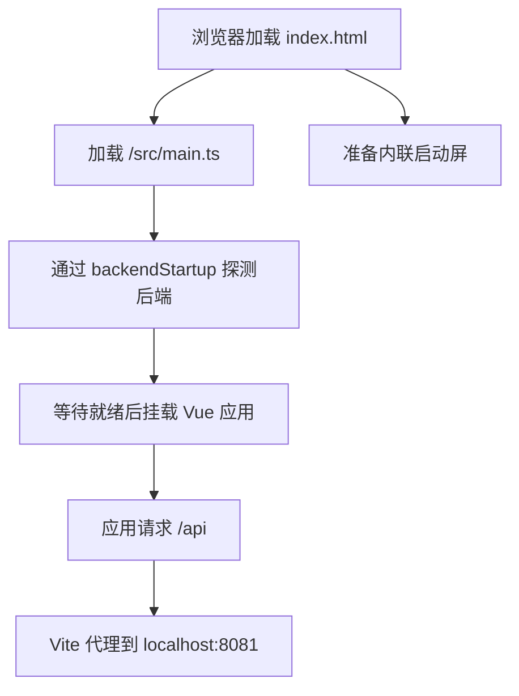

# metadata-registry-ui — metadata-registry-ui

# metadata-registry-ui — metadata-registry-ui

## 模块定位

`metadata-registry-ui` 是元数据注册中心的前端工程，基于 Vue 3、TypeScript 和 Vite 构建。该目录主要负责：

- 提供浏览器入口和后端启动等待界面；
- 配置 Vue、Element Plus、路由、Pinia 和 Vue I18n 的自动导入；
- 提供 TypeScript、SCSS、ESLint、Vitest 和 Playwright 工程配置；
- 在开发环境中将 `/api` 请求代理到本地后端 `http://localhost:8081`；
- 通过 `/src/main.ts` 接入实际业务页面、状态管理、路由和后端通信逻辑。

本目录中的文件以声明式配置和入口 HTML 为主，没有定义业务函数之间的直接调用关系。实际业务调用发生在 `src` 下的页面、组件、Store 和 API 模块中。

## 总体架构



开发环境中的主要连接关系如下：

| 方向 | 连接 | 说明 |
|---|---|---|
| 浏览器 → 前端 | `/src/main.ts` | `index.html` 加载的 Vue 应用入口 |
| 前端 → 业务代码 | `@/*` | 指向 `src/*` 的 TypeScript 和 Vite 别名 |
| 前端 → 后端 | `/api/*` | 开发环境由 Vite 转发到 `http://localhost:8081` |
| 静态资源 → 浏览器 | `/favicon.svg`、`/icons/icon-192.png` 等 | 按 Vite 约定由 `public/` 提供 |
| `src/components` → 应用 | Element Plus 和本地组件自动注册 | 由 `unplugin-vue-components` 扫描 |
| 测试 → 源码 | Vitest、Playwright | 分别覆盖单元测试和浏览器端到端测试 |

## 浏览器启动流程

### `index.html`

`index.html` 是 Vite 的 HTML 入口，承担两个职责：

1. 提供 Vue 挂载节点；
2. 在 JavaScript 应用完成初始化前展示后端启动等待界面。

页面包含两个关键容器：

```html
<div id="boot-screen">...</div>
<div id="app"></div>
```

其中：

- `#boot-screen` 是固定定位的全屏启动层，`z-index` 为 `9999`；
- `#app` 是 Vue 应用的挂载容器；
- `/src/main.ts` 是实际应用入口；
- 页面语言设置为 `zh-CN`，页面标题为“元数据注册中心 / Metadata Registry”。

### 后端就绪等待

启动屏完全由内联 HTML/CSS 实现，不依赖 JavaScript bundle，因此应用资源尚未加载完成时也能提供首屏反馈。

启动层的显示策略为：

- 初始 `opacity` 为 `0`；
- 延迟 `0.35s` 后通过 `boot-fade-in` 淡入；
- 完整淡入动画耗时 `0.4s`；
- 如果后端快速就绪，Vue 应用会在启动屏可见前完成挂载，避免启动屏闪现。

根据 `vite.config.ts` 和 `index.html` 中的约定，`src/main.ts` 使用顶层 `await` 等待后端就绪，后端就绪逻辑位于 `src/utils/backendStartup.ts`。只有等待完成后才挂载 Vue 应用。

### 启动屏 DOM 约定

启动屏为启动逻辑预留了以下元素：

| ID | 用途 |
|---|---|
| `boot-screen` | 启动屏整体容器 |
| `boot-timer` | 显示启动等待时长 |
| `boot-slow-tip` | 后端启动较慢时显示排查提示 |
| `boot-retry` | 重新加载页面 |

“重试”按钮当前直接调用 `location.reload()`。修改这些 ID、默认隐藏逻辑或按钮行为时，需要同步检查 `src/main.ts` 和 `src/utils/backendStartup.ts`，避免破坏静态入口与运行时逻辑之间的约定。

### 静态资源与 PWA 元数据

页面声明了以下根路径资源：

- `/favicon.svg`
- `/favicon.ico`
- `/icons/icon-192.png`
- `/apple-touch-icon.png`
- `/site.webmanifest`

这些文件按 Vite 约定应放置在 `public/` 目录。SVG 图标用于浏览器标签页，`.ico` 和 PNG 图标用于 Windows 任务栏固定、浏览器快捷方式及移动设备场景。

## Vite 构建与开发配置

### 应用构建

`vite.config.ts` 使用以下插件：

| 插件 | 作用 |
|---|---|
| `@vitejs/plugin-vue` | 编译 Vue 单文件组件 |
| `unplugin-auto-import/vite` | 自动导入 Vue、Vue Router、Pinia API，并生成 `src/auto-imports.d.ts` |
| `unplugin-vue-components/vite` | 自动注册 `src/components` 下的组件和 Element Plus 组件，并生成 `src/components.d.ts` |

Element Plus 组件通过 `ElementPlusResolver` 引入，并使用 Sass 样式。

### 路径别名

```ts
resolve: {
  alias: {
    '@': fileURLToPath(new URL('./src', import.meta.url)),
  },
}
```

因此以下写法均指向 `src` 目录：

```ts
import App from '@/App.vue';
import router from '@/router';
```

Vitest 配置也声明了相同的 `@` 别名，保证测试环境与开发环境一致。

### SCSS 公共变量

所有 SCSS 文件会自动注入：

```scss
@use "@/styles/element-variables.scss" as *;
```

新增全局样式或覆盖 Element Plus 主题时，应优先修改 `src/styles/element-variables.scss`，避免在组件中重复维护主题值。

### 构建目标

构建目标设置为 `es2022`：

```ts
build: {
  target: 'es2022',
}
```

这是 `src/main.ts` 顶层 `await` 的必要条件。修改构建目标时，不应将其降级到不支持顶层 `await` 的环境。

### 开发服务器与后端代理

开发服务器配置如下：

- 监听地址：`0.0.0.0`
- 端口：`5173`
- API 代理前缀：`/api`
- 后端地址：`http://localhost:8081`
- 代理时修改请求 Host：`changeOrigin: true`

前端业务代码应使用相对路径访问 API，例如：

```ts
const response = await axios.get('/api/metadata');
```

开发服务器不会在生产构建中充当反向代理。生产部署时，需要由网关或 Web 服务器将 `/api` 转发到实际后端，或者调整前端 API 地址及代理策略。

## TypeScript 配置

项目使用严格的 TypeScript 配置：

- `target` 和 `lib` 均为 `ES2022`；
- 模块使用 `ESNext`；
- 模块解析采用 `Bundler`；
- 开启 `strict`、`isolatedModules` 和 `verbatimModuleSyntax`；
- 编译阶段设置 `noEmit`，类型检查不生成文件；
- 支持 JSON 模块导入；
- 全局类型包含 Node、Vite Client 和 Element Plus。

主要类型声明来自：

- `src/auto-imports.d.ts`
- `src/components.d.ts`

这两个文件由 Vite 插件生成，不应手工维护。

## 依赖构成

### 运行时依赖

| 依赖 | 用途 |
|---|---|
| `vue` | Vue 3 响应式组件运行时 |
| `vue-router` | 页面路由 |
| `pinia` | 全局状态管理 |
| `vue-i18n` | 国际化消息与语言切换 |
| `element-plus` | UI 组件库 |
| `@element-plus/icons-vue` | Element Plus 图标 |
| `axios` | HTTP 请求 |
| `@vue-flow/core` | 节点关系、流程图和网络拓扑展示 |
| `echarts`、`vue-echarts` | 数据图表 |
| `dayjs` | 日期时间处理 |

`src` 下的业务模块可根据功能直接组合这些依赖，但跨页面共享的数据应放入 Pinia Store，请求封装应集中维护，避免不同页面重复创建 Axios 实例和错误处理逻辑。

### 开发与测试依赖

- `vite`：开发服务器和生产构建；
- `typescript`、`vue-tsc`：类型检查；
- `sass`：SCSS 编译；
- `eslint`、`typescript-eslint`、`eslint-plugin-vue`：静态检查；
- `vitest`、`jsdom`、`@vue/test-utils`：单元测试；
- `@playwright/test`：端到端测试。

## 质量检查

### ESLint

`eslint.config.js` 使用 ESLint Flat Config，组合以下规则集：

- JavaScript Recommended；
- TypeScript Recommended；
- Vue Essential。

当前项目对存量问题采用警告而非错误：

- `@typescript-eslint/no-explicit-any`
- `@typescript-eslint/no-unused-vars`
- `@typescript-eslint/no-empty-object-type`
- `vue/no-unused-vars`
- `no-useless-escape`

`vue/multi-word-component-names` 已关闭，因为 `Login`、`Dashboard` 等页面级单文件组件是项目现有惯例。

以下路径不会被检查：

- `dist/`
- `node_modules/`
- `src/auto-imports.d.ts`
- `src/components.d.ts`

执行：

```bash
npm run lint
```

该脚本检查 `src` 下的 `.ts` 和 `.vue` 文件。

### TypeScript 与生产构建

```bash
npm run build
```

构建命令先运行 `vue-tsc --noEmit` 检查类型，再执行 `vite build`。只有类型检查和打包都成功，脚本才会返回成功状态。

### Vitest 单元测试

`vitest.config.ts` 使用 `jsdom` 环境，并自动提供测试全局变量：

```ts
test: {
  environment: 'jsdom',
  globals: true,
  include: ['src/**/*.spec.ts'],
}
```

单元测试文件必须放在 `src` 下并以 `.spec.ts` 结尾。

测试环境还包含两个别名：

- `@` 指向 `src`；
- `/favicon.svg` 和 `favicon.svg` 指向 `src/test-stubs/static-asset.ts` 空模块桩。

这样可以避免测试因静态文件不存在而失败。

执行方式：

```bash
npm run test
npm run test:watch
```

### Playwright 端到端测试

`playwright.config.ts` 当前主要面向映射网络可视化相关 E2E 场景，测试目录为 `e2e`。

主要配置：

- 基础地址：`http://localhost:5173`
- 测试项目：Chromium
- 浏览器通道：系统安装的 `chrome`
- 失败时保存截图
- 首次重试时记录 Trace
- 本地复用已运行的开发服务器
- CI 中禁止使用 `test.only`，失败重试两次

Playwright 会通过 `npm run dev` 自动启动开发服务器，并等待 `http://localhost:5173` 可访问。CI 环境不会复用已有服务器。

执行方式：

```bash
npm run e2e
npm run e2e:ui
```

由于项目指定了 `channel: 'chrome'`，运行 E2E 测试的机器需要安装可用的 Google Chrome 浏览器。

## 常用命令

| 命令 | 作用 |
|---|---|
| `npm run dev` | 启动 Vite 开发服务器，默认端口 `5173` |
| `npm run build` | 执行 Vue TypeScript 检查并生成生产构建 |
| `npm run preview` | 本地预览生产构建结果 |
| `npm run lint` | 检查 `src` 下的 TypeScript 和 Vue 文件 |
| `npm run test` | 运行 Vitest 单元测试 |
| `npm run test:watch` | 以监听模式运行 Vitest |
| `npm run e2e` | 运行 Playwright 端到端测试 |
| `npm run e2e:ui` | 打开 Playwright UI 模式 |

## 开发与贡献指南

### 新增页面或组件

- 页面级组件放入 `src` 的既有页面目录结构中；
- 可复用组件放入 `src/components`，插件会自动注册；
- 使用 `@/` 引用 `src` 内部模块；
- 新增 Element Plus 组件时通常无需手工导入，但仍需确认自动生成声明已刷新。

### 接入后端接口

业务请求统一使用 `/api` 前缀。开发环境由 Vite 转发到 `localhost:8081`，因此本地调试还需要后端在 `8081` 端口运行。

不要在业务代码中直接硬编码 `http://localhost:8081`，否则生产环境无法通过同源反向代理部署。

### 修改启动流程

`index.html` 与 `src/utils/backendStartup.ts` 共同构成启动协议。修改启动屏结构时，应同步检查：

- `boot-screen`
- `boot-timer`
- `boot-slow-tip`
- `boot-retry`
- `src/main.ts` 中的顶层 `await`
- Vite 的 `es2022` 构建目标

### 提交前检查

建议依次执行：

```bash
npm run lint
npm run test
npm run build
```

涉及浏览器交互、映射网络或路由流程时，还应运行：

```bash
npm run e2e
```

新增或修改 API 代理、构建目标、自动导入声明或静态资源路径时，应额外验证开发服务器和生产构建行为，避免只在 Vitest 环境中通过。