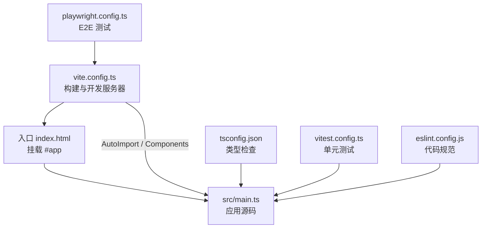

> 本文档由 GitNexus wiki 生成于 2026-09-13（kimi-for-coding，--lang chinese）。内容变化时请重新运行 `gitnexus wiki --lang chinese` 生成，勿手工改写。

# metadata-registry-ui 模块文档

## 概述

`metadata-registry-ui` 是**元数据注册中心（Metadata Registry）**的前端应用，基于 Vue 3 + TypeScript + Vite 构建。本模块文档所覆盖的是项目的**根配置层**——即构建、类型检查、代码规范、单元测试与端到端测试的工程化配置。这些配置文件定义了项目的开发环境、工具链行为和代码质量标准，是整个前端代码库运转的基础设施。

本模块本身不包含运行时代码（无函数调用、无执行流），但其配置决定了 `src/` 目录下所有源码的编译方式、导入约定和测试流程。

## 技术栈

| 类别 | 技术选型 | 版本 |
|------|----------|------|
| 框架 | Vue 3（组合式 API） | ^3.5.10 |
| 语言 | TypeScript | ^5.6.2 |
| 构建工具 | Vite | ^5.4.8 |
| UI 组件库 | Element Plus（Sass 主题定制） | ^2.8.5 |
| 状态管理 | Pinia | ^2.2.4 |
| 路由 | Vue Router | ^4.4.5 |
| 国际化 | vue-i18n | ^9.14.0 |
| HTTP 客户端 | axios | ^1.7.7 |
| 图表 | ECharts + vue-echarts | ^6.0.0 |
| 单元测试 | Vitest（jsdom 环境） | ^4.1.10 |
| E2E 测试 | Playwright | ^1.60.0 |
| 代码规范 | ESLint 9（flat config） | ^9.39.5 |

## 架构关系



## 关键配置文件

### `vite.config.ts` — 构建与开发服务器

这是项目的核心配置，承担三类职责：

**1. 插件链**

- `@vitejs/plugin-vue`：编译 `.vue` 单文件组件。
- `unplugin-auto-import`：自动导入 Vue / Vue Router / Pinia 的常用 API（如 `ref`、`computed`、`useRouter`），无需手动 `import`。生成类型声明到 `src/auto-imports.d.ts`。
- `unplugin-vue-components`：按需自动注册 `src/components/` 目录下的组件及 Element Plus 组件。生成类型声明到 `src/components.d.ts`。

两个自动导入插件都通过 `ElementPlusResolver({ importStyle: 'sass' })` 实现 Element Plus 的按需引入，并使用 **Sass 方式**注入样式——这与下方的 SCSS 配置配合，支持主题变量定制。

**2. 路径别名**

```typescript
resolve: {
  alias: { '@': fileURLToPath(new URL('./src', import.meta.url)) },
}
```

`@` 指向 `src/`，与 `tsconfig.json` 中的 `paths` 映射保持一致，保证编译期与运行期解析结果相同。

**3. 开发服务器与代理**

```typescript
server: {
  host: '0.0.0.0',   // 允许局域网访问
  port: 5173,
  proxy: {
    '/api': {
      target: 'http://localhost:8081',  // 后端服务
      changeOrigin: true,
    },
  },
}
```

前端代码中所有 `/api/*` 请求在开发模式下被代理到 `localhost:8081` 的后端服务，从而绕过跨域限制。这是前后端联调的关键机制。

**4. SCSS 预处理**

```typescript
css: {
  preprocessorOptions: {
    scss: {
      additionalData: `@use "@/styles/element-variables.scss" as *;`,
      api: 'modern-compiler',
      silenceDeprecations: ['legacy-js-api'],
    },
  },
}
```

每个 SCSS 文件编译前自动注入 `@/styles/element-variables.scss`，使 Element Plus 主题变量（如 `$colors`）全局可用，实现统一定制主题。使用 modern-compiler API 并保持与旧 API 的兼容静默。

### `tsconfig.json` — TypeScript 编译配置

- **`strict: true`**：启用全部严格类型检查，是代码质量的底线。
- **`moduleResolution: "Bundler"` + `verbatimModuleSyntax: true`**：匹配 Vite 的打包语义，要求类型导入使用 `import type` 显式区分。
- **`paths: { "@/*": ["src/*"] }`**：与 Vite 别名对应。
- **`types: ["node", "vite/client", "element-plus/global"]`**：注入 Node 类型（配置脚本用）、Vite 客户端类型（`import.meta.env` 等）、Element Plus 全局组件类型（与 unplugin-vue-components 的自动注册配合，使模板中的 `<el-*>` 标签获得类型提示）。
- **`include`** 显式纳入 `src/auto-imports.d.ts` 与 `src/components.d.ts`，确保自动导入的 API 和组件在类型检查中可解析。

### `eslint.config.js` — 代码规范（ESLint 9 Flat Config）

采用 flat config 格式，配置分层组合：

1. **忽略列表**：`dist/`、`node_modules/` 以及两个自动生成的类型声明文件（`auto-imports.d.ts`、`components.d.ts`）不参与 lint。
2. **基础规则**：`@eslint/js` 推荐规则 + `typescript-eslint` 推荐规则 + `eslint-plugin-vue` 的 `flat/essential`（Vue 3 核心规则）。
3. **存量代码策略**：多个规则从 error 降为 `warn`，并附中文注释说明原因——`@typescript-eslint/no-explicit-any`、`no-unused-vars`、`no-empty-object-type`、`vue/no-unused-vars`、`no-useless-escape` 在存量代码中普遍存在，允许警告级别存在以便渐进式清理，新代码应尽量避免触发。
4. **项目惯例豁免**：`vue/multi-word-component-names: 'off'`，因为本项目接受页面级单名单词组件（如 `Login`、`Dashboard`）。
5. **Vue 文件解析**：对 `**/*.vue` 文件将内部脚本解析器指定为 `typescript-eslint` 的 parser，使 `<script setup lang="ts">` 中的 TypeScript 代码被正确 lint。

### `vitest.config.ts` — 单元测试

- **环境**：`jsdom`，模拟浏览器 DOM；`globals: true` 使 `describe`/`it`/`expect` 全局可用，无需逐个导入。
- **用例发现**：仅匹配 `src/**/*.spec.ts`，即测试文件与源码同目录、以 `.spec.ts` 结尾。
- **资源桩（stub）机制**：

```typescript
{ find: /^\/?favicon\.svg$/, replacement: resolve(__dirname, 'src/test-stubs/static-asset.ts') },
{ find: '@', replacement: resolve(__dirname, 'src') },
```

第一条别名把 `favicon.svg` 这类 public 目录静态资源重定向到 `src/test-stubs/static-asset.ts` 空模块桩——jsdom 环境无法加载真实静态文件，桩模块避免测试因此报错。测试配置中 `@` 别名需要**单独声明**，因为 Vitest 不读取 Vite 配置的 `resolve.alias`（此处 Vitest 4 的数组形式别名定义与 Vite 的对象形式也不同，修改别名时注意保持两处同步）。

### `playwright.config.ts` — E2E 测试

- **测试目录**：`./e2e`，当前覆盖 WI-011-2-1（映射网络可视化）的端到端场景。
- **自动启动开发服务器**：`webServer` 配置会在测试前执行 `npm run dev` 并等待 `http://localhost:5173` 就绪（与 `vite.config.ts` 的端口一致）；本地开发时 `reuseExistingServer: !process.env.CI` 允许复用已运行的服务器，CI 环境则强制全新启动。
- **CI 适配**：CI 下限制 `workers: 1`、开启 2 次重试，保证流水线稳定性。
- **调试产物**：`trace: 'on-first-retry'`（仅重试时录制 trace）与 `screenshot: 'only-on-failure'`（仅失败时截图），控制产物体积。
- **浏览器**：指定 `channel: 'chrome'` 使用本机安装的 Chrome，而非 Playwright 自带的 Chromium。

### `index.html` — HTML 入口

Vite 的应用入口模板：`lang="zh-CN"` 表明界面语言为中文，`<div id="app">` 是 Vue 应用的挂载点，`/src/main.ts` 以 ES Module 方式加载启动。

## 常用命令

| 命令 | 作用 |
|------|------|
| `npm run dev` | 启动开发服务器（端口 5173，代理 `/api` 到 8081） |
| `npm run build` | 先 `vue-tsc --noEmit` 做全量类型检查，通过后执行生产构建 |
| `npm run preview` | 本地预览生产构建产物 |
| `npm run lint` | 对 `src/` 下的 `.ts` / `.vue` 文件执行 ESLint |
| `npm run test` | 运行 Vitest 单元测试（单次） |
| `npm run test:watch` | Vitest 监听模式 |
| `npm run e2e` | 运行 Playwright 端到端测试 |
| `npm run e2e:ui` | Playwright UI 模式，可视化调试用例 |

## 与代码库的协作要点

贡献代码时需要理解这些配置之间的联动关系：

1. **自动导入 ≠ 免声明**：`ref`、`useRouter` 等无需手动 import 是 `unplugin-auto-import` 的效果；提交代码前确认 `src/auto-imports.d.ts` 已更新（通常在 `npm run dev` 时自动生成）。
2. **新增组件无需注册**：放入 `src/components/` 即可在模板中直接使用，类型由 `src/components.d.ts` 提供。
3. **修改主题变量**：统一在 `src/styles/element-variables.scss` 中进行，该文件已通过 `additionalData` 注入到所有 SCSS 编译单元。
4. **新增后端接口**：开发环境下走 `/api` 前缀即可被代理；跨域问题由 Vite 代理处理，代码中不应写死后端完整地址。
5. **新代码的 lint 标准**：存量规则虽为 warning，但新代码应避免新增 `any`、未使用变量等告警；CI 若升级告警门禁，历史警告不阻断，新引入的警告需要清理。
6. **路径别名**：源码内统一使用 `@/` 引用 `src/` 下的模块；若新增别名，需同时更新 `vite.config.ts`、`tsconfig.json` 和 `vitest.config.ts` 三处。