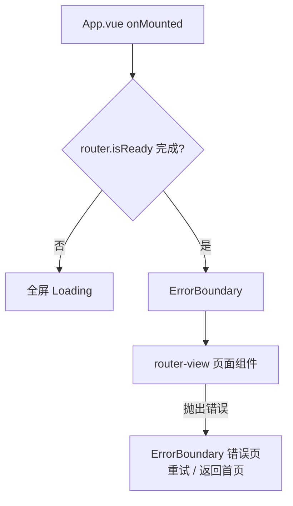
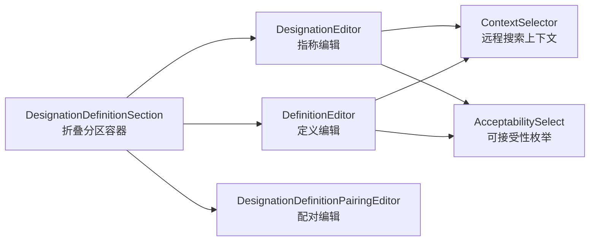

> 本文档由 GitNexus wiki 生成于 2026-09-13（kimi-for-coding，--lang chinese）。内容变化时请重新运行 `gitnexus wiki --lang chinese` 生成，勿手工改写。

# metadata-registry-ui — src

## 模块概述

`src` 是元数据注册系统（ISO/IEC 11179 元数据注册库，MDR）前端应用的源码根目录。它实现了一个基于 **Vue 3（Composition API + `<script setup>`）+ TypeScript + Element Plus + Pinia + vue-router** 的单页应用，覆盖以下业务能力：

- 注册实体（数据元、对象类、属性、值域、概念域、数据类型等）的 CRUD 与生命周期管理
- 多语言指称（Designation）/定义（Definition）编辑及「指称-定义配对」（paired designation/definition）
- 命名空间、命名规范、注册机构（RA）、注册员（Registrar）等注册管理资源
- 分类方案树（Classification Scheme）浏览与导入
- 段模板标识符策略（Segment Template Identifier Strategy）配置与预览
- 联邦节点（Federation）与合并请求（Merge Request）评审流
- 映射方案（Mapping Scheme）版本管理、版本历史 Diff、互操作映射结果审核

## 技术栈与构建约定

### 自动导入（unplugin-auto-import）

`auto-imports.d.ts` 由 unplugin-auto-import 生成，**以下符号无需显式 import 即可在任意组件/脚本中使用**：

- Vue 响应式与生命周期：`ref`、`reactive`、`computed`、`watch`、`onMounted`、`onErrorCaptured` 等
- Pinia：`defineStore`、`storeToRefs`、`acceptHMRUpdate` 等
- vue-router：`useRoute`、`useRouter`、`onBeforeRouteLeave` 等
- Element Plus 消息类：`ElMessage`（注意：`ElMessageBox` 目前在 `DataTablePage.vue` 等文件中仍显式导入）

> 该文件带 `@ts-nocheck` 且不应手工编辑；新增自动导入配置后由构建工具重新生成。

### 组件自动注册（unplugin-vue-components）

`components.d.ts` 同样为生成文件。`src/components/` 下的业务组件（如 `DataTablePage`、`DesignationEditor`、`ErrorBoundary`）与 Element Plus 组件（`ElTable`、`ElDialog` 等）均以**全局组件**形式注册，模板中可直接使用 PascalCase 标签，无需 import。例如 `App.vue` 中直接使用 `<ErrorBoundary>` 与 `<router-view />`。

### 样式

组件样式使用 scoped CSS / SCSS；公共页面卡片类（如 `page-card`）来自全局样式。表格与表单视觉规范集中在 `DataTablePage.vue` 等组件的 scoped 样式中。

## 应用入口：App.vue

`App.vue` 是根组件，职责非常单一：**消除首屏闪烁并兜底渲染异常**。

- 挂载时 `await router.isReady()`，等待路由（含鉴权守卫）解析完成；期间展示全屏加载动画（旋转的 `Loading` 图标 + "加载中..."）。
- 路由就绪后渲染 `<router-view />`，外层包裹 `ErrorBoundary` 组件捕获子树渲染/异步错误。



## API 客户端层（`src/api/`）

所有 HTTP 调用都经由 `@/utils/request` 封装的 Axios 实例（统一处理 baseURL、鉴权头、错误拦截与 498 强制改密、401 消息提示等）。API 模块按业务域拆分：

### `api/resources.ts` — 核心注册资源

这是最大的 API 模块，结构分三层：

1. **`crud<T>(base)` 工厂**：生成标准五件套（`list` / `get` / `create` / `update` / `delete`），供以下资源复用：
   `registrationAuthorityApi`、`registrarApi`、`administeredItemApi`、`organizationApi`、`individualApi`、`referenceDocumentApi`、`objectClassApi`、`propertyApi`、`dataElementConceptApi`、`conceptualDomainApi`、`valueDomainApi`、`dataTypeApi`、`dataTypeSchemeApi`、`unitOfMeasureApi`、`measureClassApi`、`valueMeaningApi`、`dataElementApi`、`languageApi`、`documentTypeApi` 等。
2. **定制扩展的资源**：
   - `namespaceApi`：除 CRUD 外含 `detail`、`deletionCheck`（删除前检查标识符数量）、`createExternal`、`getPermissions`/`savePermission`/`deletePermission`（权限管理）。
   - `contactApi`：扩展 `batchConfigure`（按用户/机构/角色批量配置）。
   - `appUserApi`：扩展 `audit`（审核开关）与 `resetPassword`。
   - `contextApi`：扩展 `options`（远程搜索下拉数据源）与 `usages`（上下文用量，供删除前检查）。
   - `classificationSchemeApi`：分类方案节点树的完整操作集（树/子节点/移动/级联删除/关键字搜索/文件导入校验与导入）。
3. **专项 API**：
   - `metadataSearchApi`：统一元数据搜索（类型、状态、上下文、可接受性、命名空间等过滤）。
   - `itemAssociationApi`：四实体标准关联（见下文 `ItemAssociationsPanel`）。
   - `mappingSchemeApi` + `getMappingNetwork`：映射方案 CRUD、状态流转（DRAFT→PUBLISHED→ARCHIVED）、新版本、谱系版本列表、版本 Diff、映射网络图。
   - `pairingApi` / `itemRelationshipApi`：指称-定义配对与条目级关系统计。
   - `versionHistoryApi`：条目版本历史、Diff、快照。
   - `interopMappingApi`：互操作映射结果的单条/批量确认、驳回、人工映射、撤销、质量评分。
   - `readinessApi` / `activeRegistrarApi`：环境就绪检查与当前激活注册员切换。

> **分页约定**：列表接口统一使用 `PageQuery`（`page`/`size`/`sort`/`q`），返回 `PageResponse<T>`（`content` + `totalElements`）。注意后端页码从 **0** 开始，前端组件（如 `DataTablePage`）需做 `page - 1` 换算。

### `api/federation.ts` — 联邦与合并请求

定义联邦节点（`RegistryNodeView`）与合并请求（`MergeRequestView` / `MergeRequestItemView`）的类型与接口，覆盖完整评审生命周期：

```
创建包 → 导入/提交 → 开始评审 → 逐项决策(decideItem) → 批准/驳回 → 回执应用(applyReceipt)
```

其中 `MergeRequestItemView` 携带三向版本字段（`sourceVersion` / `baseVersion` / `localVersion`），用于冲突条目的三方合并展示。

### `api/identifierStrategy.ts` — 标识符策略

段模板标识符策略管理客户端，提供：视图（发布版 + 草稿 + 历史）、保存草稿、发布/发布草稿/停用、预览（含**无命名空间上下文的匿名预览**，供初始化向导使用）、格式校验、回填（backfill）与预置模板列表。`StrategyConfig.status` 为 `DRAFT | PUBLISHED | DISABLED` 三态。

### `api/system.ts` — 系统级

- `systemApi`：恢复出厂设置、新用户审核开关、自助注册开关。
- `registrySpecificationApi`：注册规范（Registry Specification）的查询/创建/更新及 `hasMetadata` 检查；`RegistrySpecification` 额外携带 `defaultLanguageId` / `defaultLanguageIdentifier` / `alternativeLanguageIds` 供语言预选。
- `dashboardApi.getStats()`：Dashboard 各实体统计数。

## 通用组件

### DataTablePage — 列表页骨架

大多数实体列表页的高阶封装，把「搜索栏 + 表格 + 分页 + 删除确认」的样板逻辑收敛到一处：

- **Props**：`fetchFn`（返回 `PageResponse` 的查询函数）、`canCreate`/`canEdit`/`canDelete`、`showAction`、`actionWidth`（附加操作按钮多时可加宽操作列）。
- **插槽**：`columns`（业务列定义）、`actions`（附加行操作，作用于操作列）。
- **事件**：`create` / `edit` / `delete`。删除先弹 `ElMessageBox.confirm` 确认，再透传给宿主页面执行。
- **行为细节**：搜索重置页码为 1；排序转为 Spring 风格的 `prop,asc|desc`；空字符串关键词自动归一为 `undefined`；页码换算为后端 0 基。
- 通过 `defineExpose({ fetchData })` 暴露刷新方法，宿主可在操作后手动调用。

### 多语言文本行编辑器家族

这一组组件实现 ISO/IEC 11179 的指称/定义/配对模型，是表单类页面复用度最高的组件群：



- **DesignationEditor / DefinitionEditor**：行式编辑 `TextLineForm[]`（`languageId` + `value` + `contexts[]`）。两者结构对称：
  - 语言下拉选项来自 `languageApi.list({ size: 100, enabled: true })`，加载失败静默降级。
  - 新增行通过 `crypto.randomUUID()`（带降级）生成临时 id，并使用 `defaultLanguageId` 预选默认语言。
  - 「上下文关联」区默认折叠，每行上下文由 `ContextSelector` + `AcceptabilitySelect` 组成；上下文计数以 `el-tag` 显示在折叠头上。
  - 仅 `DesignationEditor` 支持 `namingConventionOptions` + `requireNamingConventions`（命名规范多选，必填时未选渲染错误态）。
  - 所有增删改操作均**整体 `emit('update:modelValue', next)` 返回新数组**（不可变更新），由宿主持有状态。
- **DesignationDefinitionSection**：把上述三者组织成三个 `el-collapse` 分区（默认展开指称/定义）。配对分区仅在 `itemId` 存在（已保存）时可编辑，新建态显示"保存后方可配置配对"占位。
- **DesignationDefinitionPairingEditor**：配对行的复杂状态机，关键设计：
  - 指称/定义控件是 `filterable + allow-create` 的合并下拉：选既有 id = 关联；输入新文本 = 调宿主 `createDesignation`/`createDefinition` 回调创建行并以返回的临时键关联（ISO/IEC 11179-3:2023 §8.4 允许指称/定义仅经配对存在）；清空 = 解除关联。
  - **孤儿清理**：改绑/清除/删除后，若原引用是本次会话内联新建（`persisted: false`）且不再被任何配对引用，回调 `unlinkDesignation`/`unlinkDefinition` 将其从表单移除；**已持久化的实例永不删除**（要改须到指称/定义页签）。
  - **已保存配对**（`row.id` 存在）：指称/定义以纯文本展示（可选中复制、不可编辑），上下文与可接受性仍可编辑；删除时不直接过滤列表，而是 `emit('deleteSavedRow')` 交宿主弹确认（仅删关联 / 连同实例一并删除）。
  - 校验：上下文必填 + `(designationId, definitionId, contextId)` 三元组查重，通过 `defineExpose({ validate, hasError, isDuplicate })` 暴露给宿主。
  - `selfContextOption` 支持上下文条目自引用（值为哨兵 NIL UUID，不依赖远程搜索）。

### ErrorBoundary — 渲染错误兜底

通过 `onErrorCaptured` 捕获子树错误并渲染错误页（重试 = 整页刷新；返回首页 = 路由跳转 `/dashboard`）。两个刻意忽略的例外：

- **498**：强制改密流程的错误，交给专门的改密对话框处理。
- **401 且位于 `/login`**：登录页认证失败已由请求拦截器弹出 `ElMessage`，不再渲染全屏错误边界。

### ItemAssociationsPanel — 四实体标准关联面板

实现 ISO/IEC 11179-31:2023 的四类标准关联（`DATA_ELEMENT_MEANING`、`DATA_ELEMENT_DOMAIN`、`VALUE_DOMAIN_MEANING`、`DATA_ELEMENT_CONCEPT_DOMAIN`）的一对多管理：

- 面板由**调用方传入 `sections` 配置**（关联类型、方向、焦点实体角色、目标类型、占位文案），同一关联的正向/反向在界面上不作区分。
- 通过 `itemAssociationApi.list` 拉取全部关联后按 `relationType + direction` 过滤分组展示。
- 写操作时按 `focusRole` 把 `(焦点, 对方)` 映射为标准方向 `(source, target)`，再调用 `/associations/{pathType}`；添加走 `SmartItemPicker` 多选后 `Promise.allSettled` 批量建立，部分失败给出计数提示。
- `itemId` 为空（新建态）显示提示信息；`watch(itemId, { immediate: true })` 驱动加载。

### ItemFormDialog — 条目表单对话框（被截断，仅说明测试所固化契约）

从 `ItemFormDialog.spec.ts` 可确认该组件的以下行为契约：

- **命名空间输入模式联动**：根据所选命名空间的 `identifierInputMode` / `versionInputMode`（`AUTO_ONLY` / `AUTO_WITH_OVERRIDE` / `MANUAL_ONLY`）控制标识符与版本输入框的禁用态、占位文案（如 "保存后自动生成"、DATE 策略的 "如 2026-01-31"），`AUTO_WITH_OVERRIDE` 显示内嵌 `ElSegmented` 切换自动/手动。
- **i18n 资源索引**：标题按 `meta.itemType.<itemType>` 查 i18n，未知类型回退原值避免空白。
- **空指称/定义确认**：两者皆空时先弹 `emptyConfirm` 对话框，取消则不提交。
- **字段级 AI 生成**（Registrar 角色专属，按 `useAuthStore().isRegistrarUser` 门控）：指称/定义行内 AI 按钮 → `assistantApi.createJob({ taskId: 'complete-metadata', ... })` → `pollAssistantJob` 轮询 → 候选浮层点选回填。关键防重入契约：**生成进行中重复点击/悬停一律忽略，一次点击严格一次请求**；浮层被外部关闭后缓存仍须写入发起时的 key（编辑态 `designation:<id>`，新建态 `designation:<clientKey>`），悬停回看命中缓存零请求；新建模式以表单草稿（跳过空行）为上下文且不带 `itemId`，编辑模式带 `itemId` 不带草稿。

### ContextSelector / AcceptabilitySelect

两个小型受控下拉：

- `ContextSelector`：`filterable + remote`，通过 `contextApi.options({ q })` 远程搜索，挂载时预载全量；`clearable` 清空时向上抛出 `undefined`。
- `AcceptabilitySelect`：可接受性五枚举（首选 PREFERRED / 认可 ADMITTED / 已弃用 DEPRECATED / 已取代 SUPERSEDED / 已过时 OBSOLETE）的静态下拉。

## 测试约定

`src` 内组件测试使用 **Vitest + @vue/test-utils**，统一模式：

- 全局挂载 `ElementPlus` 插件，并 mock `vue-i18n` 的 `useI18n`（`t` 直接返回 key 或将参数 JSON 化，便于断言 i18n key）。
- 对 `@/api/resources` 做 `vi.mock` 模块级替换，用 `vi.hoisted` 准备可断言的 mock 函数与状态（如 `authState.isRegistrarUser`）。
- `beforeEach` 中 `vi.clearAllMocks()` 保证用例隔离。
- 测试不仅覆盖交互结果，还固化**回归契约**——例如 `ItemFormDialog.spec.ts` 中针对 ElTooltip click-outside 关闭导致的缓存 key 错乱、AI 作业重复提交等问题，注释中明确记录了 bug 根因与修复后的行为断言。

## 与代码库其余部分的连接

- **上游**：`src/main.ts`（应用引导，未包含在本模块快照中）创建 Vue 应用、挂载 Pinia / vue-router / Element Plus / vue-i18n，并渲染 `App.vue`。
- **路由与布局**：`App.vue` 的 `<router-view />` 由路由配置驱动，业务页面挂在 `src/layouts/AppLayout.vue`（侧边导航、用户菜单，含 `goToProfile`）之下；快照中出现的 `views/` 页面（`BrowserView`、`ClassificationTreeBrowser`、`InitWizard`、`InteropMappingList` 等）通过路由到达，并复用本模块的 `DataTablePage`、API 客户端与文本行编辑器组件。
- **状态层**：Pinia stores（如 `@/stores/auth`）经自动导入的全局符号使用；`ItemFormDialog` 依赖 `useAuthStore` 做角色门控。
- **横切关注**：`@/utils/request` 是所有 API 模块的唯一出口，统一承载鉴权、错误提示与 498/401 特殊处理（与 `ErrorBoundary` 的忽略逻辑相呼应）；`@/types/common` 提供 `PageQuery` / `PageResponse` / `TextLineForm` / `PairingForm` 等共享类型。