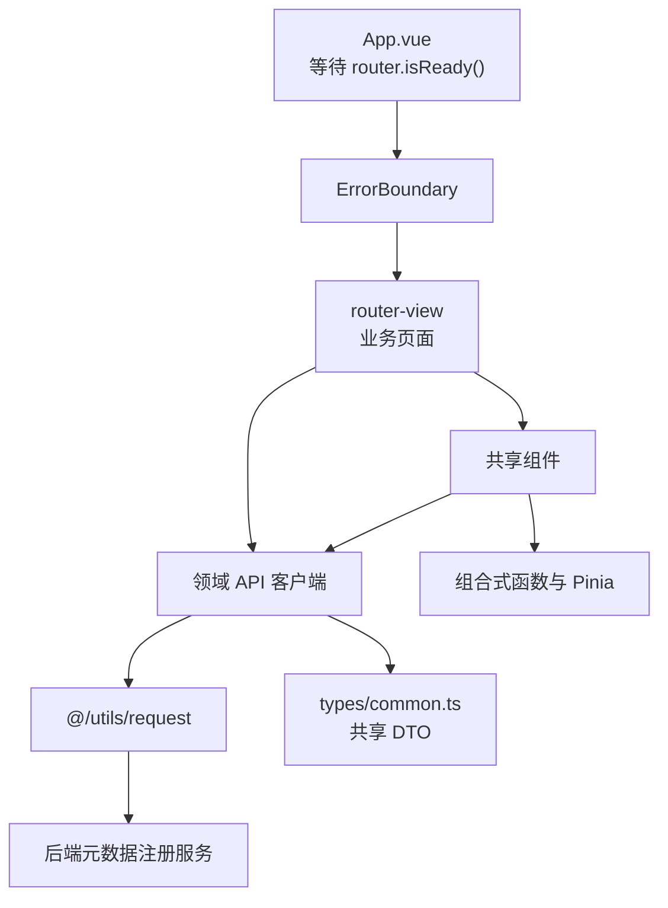

# metadata-registry-ui — src

# metadata-registry-ui — src

## 模块定位

`metadata-registry-ui/src` 是元数据注册中心前端的源码层，基于 Vue 3、TypeScript、Vue Router、Pinia、vue-i18n 和 Element Plus 构建。该目录主要承担四类职责：

1. **应用启动与全局容错**：`App.vue` 等待初始路由解析完成，`ErrorBoundary.vue` 捕获路由页面中的渲染异常。
2. **后端 API 客户端**：按联邦、标识符策略、注册资源、系统设置等领域封装 `request` 调用。
3. **可复用业务组件**：提供通用列表页、定义/指称编辑、指称-定义配对、标准关联管理以及复杂条目表单。
4. **开发期类型声明**：通过 `auto-imports.d.ts` 和 `components.d.ts` 为模板和 TypeScript 编译器补充自动导入及全局组件类型。

业务数据持久化、状态流转校验和权限判定主要由后端负责；前端负责收集输入、调用接口、展示结果和编排交互。

## 总体架构



主要调用方向如下：

- 业务页面通过 `src/api/*` 中的客户端访问后端。
- 通用组件直接调用相关 API，或通过 `fetchFn`、事件和 `v-model` 与宿主页面协作。
- `request` 负责统一的 HTTP 适配、请求头、鉴权及错误拦截；本目录中的 API 文件不重复实现这些能力。
- `types/common.ts` 提供分页、命名空间、联系人、工作空间、条目关联等共享类型。
- 身份状态由 `useAuthStore()` 等 Pinia 状态提供；默认上下文、默认语言和智能选择器状态由组合式函数管理。

## 目录职责

| 路径 | 职责 |
|---|---|
| `src/App.vue` | 应用根组件、初始路由加载态、全局错误边界 |
| `src/api/federation.ts` | 联邦节点、迁移包、合并请求和回执 API |
| `src/api/identifierStrategy.ts` | 命名空间标识符策略生命周期、预览、校验和回填 API |
| `src/api/resources.ts` | 注册项、命名空间、分类、元数据搜索、映射、工作空间等资源 API |
| `src/api/system.ts` | 系统设置、恢复出厂设置和 Dashboard 统计 API |
| `src/components/` | 可跨页面复用的 Element Plus 业务组件 |
| `src/auto-imports.d.ts` | `unplugin-auto-import` 生成的全局 API 类型声明 |
| `src/components.d.ts` | `unplugin-vue-components` 生成的全局组件类型声明 |
| `src/components/*.spec.ts` | 基于 Vitest 和 Vue Test Utils 的组件测试 |

## 应用启动与全局容错

### `App.vue`

`App.vue` 在首次渲染时显示全屏加载动画，避免初始路由的鉴权守卫尚未完成时短暂出现空白页面。

执行流程：

1. `isLoading` 初始值为 `true`。
2. 组件挂载后执行 `await router.isReady()`。
3. 初始路由解析完成后将 `isLoading.value` 设置为 `false`。
4. 加载态结束后渲染 `ErrorBoundary`，由其承载 `<router-view />`。

```text
isLoading = true
        │
        ▼
等待 router.isReady()
        │
        ▼
isLoading = false
        │
        ▼
ErrorBoundary → router-view
```

该文件还包含未加 `scoped` 的全局样式，将 `body` 的 `margin` 和 `padding` 重置为 `0`。修改这些规则会影响整个前端，不应仅按页面级样式处理。

### `ErrorBoundary.vue`

`ErrorBoundary.vue` 使用 `onErrorCaptured` 捕获后代组件异常。普通异常会替换默认插槽，展示“页面加载失败”、错误消息以及两个恢复入口：

- `retry()`：清理当前错误状态后调用 `window.location.reload()`，执行整页刷新。
- `goHome()`：清理错误状态并执行 `router.push('/dashboard')`。

以下异常被特殊处理：

| 异常 | 行为 |
|---|---|
| 状态码 `498` | 不显示错误边界，交由强制修改密码对话框处理 |
| 状态码 `401` 且当前路径为 `/login` | 不显示错误边界，认证错误由请求拦截器提示 |
| 其他异常 | 显示错误页面，并阻止异常继续向上冒泡 |

状态码判断同时兼容 `err.status`、`err.response.status`、响应体 `code` 以及错误字符串中包含状态码的情况。

`message` 属性用于指定面向用户的默认错误文本；如果捕获到原生 `Error`，则优先显示其 `message`。

## API 客户端层

### 通用约定

所有 API 客户端都从 `@/utils/request` 导入默认 `request` 实例：

```ts
import request from '@/utils/request';
```

客户端遵循以下模式：

- 使用 `request.get<T>`、`request.post<T>`、`request.put<T>` 和 `request.delete<T>` 声明响应数据类型。
- 路径通常不包含统一 API 前缀；实际基础路径由 `request` 实例配置。
- 查询参数通过 Axios `params` 配置传递，请求体通过第二个参数传递。
- API 客户端本身不缓存结果，也不提供跨方法的状态管理。
- 除少数显式处理异常的组件外，HTTP 错误会继续向调用方抛出。
- 路径参数直接插入 URL；允许包含特殊字符的调用方应遵守后端约定的编码方式。

`resources.ts` 内部的 `crud<T>(base)` 是通用 CRUD 工厂：

| 方法 | 请求 |
|---|---|
| `list(params?)` | `GET base` |
| `get(id)` | `GET base/:id` |
| `create(data)` | `POST base` |
| `update(id, data)` | `PUT base/:id` |
| `delete(id)` | `DELETE base/:id` |

### 联邦 API：`federationApi`

`src/api/federation.ts` 封装节点间元数据迁移流程。

#### 数据类型

- `RegistryNodeView`：联邦节点，包含 `id`、`name`、`baseUrl`、`rai`、`enabled` 和 `createdAt`。
- `MergeRequestView`：合并请求，包含来源节点、目标命名空间、状态、迁移包引用、提交/审核/合并时间及错误消息。
- `MergeRequestItemView`：单个待处理条目，包含远端键、远端 UUID、变更类型、冲突解决方式、关联本地条目，以及冲突比较所需的 `sourceVersion`、`baseVersion`、`localVersion`。

`status`、`changeType` 和 `resolution` 当前声明为普通 `string`，前端需要容忍后端新增枚举值。

#### 方法

| 方法 | 请求与行为 |
|---|---|
| `listNodes()` | `GET /federation/nodes` |
| `createNode(data)` | `POST /federation/nodes`；请求体支持 `name`、`baseUrl`、`rai`、`authToken` |
| `deleteNode(id)` | `DELETE /federation/nodes/:id` |
| `createBundle(nodeId, targetNamespaceId)` | `POST /federation/bundles?nodeId=...&targetNamespaceId=...` |
| `listMergeRequests(status?)` | `GET /federation/merge-requests`；可选状态过滤 |
| `getMergeRequestItems(id)` | `GET /federation/merge-requests/:id/items` |
| `submitMergeRequest(id)` | `POST /federation/merge-requests/:id/submit` |
| `startReview(id)` | `POST /federation/merge-requests/:id/start-review` |
| `decideItem(mrId, itemId, resolution, linkedLocalItemId?)` | `POST /federation/merge-requests/:mrId/items/:itemId/decision`；请求体为 `null`，解决方式和可选关联 ID 放入查询参数 |
| `approveMergeRequest(id)` | `POST /federation/merge-requests/:id/approve`；返回 `merged`、`skipped`、`receiptFile` |
| `rejectMergeRequest(id)` | `POST /federation/merge-requests/:id/reject` |
| `importBundle(bundlePath)` | `POST /federation/merge-requests/import`；`bundlePath` 位于查询参数 |
| `applyReceipt(nodeId, receiptJson)` | `POST /federation/merge-requests/receipts/apply?nodeId=...`；回执 JSON 作为请求体 |

典型编排顺序是：创建迁移包、查询合并请求、读取冲突条目、提交审核、逐条作出决定，最后批准或拒绝。导入已有迁移包和应用回执是独立的辅助流程。

### 标识符策略 API：`identifierStrategyApi`

`src/api/identifierStrategy.ts` 管理按命名空间隔离的分段模板标识符策略。

主要类型：

- `StrategyConfig`：策略配置，包含策略类型、JSON 字符串、版本、状态和是否为全局默认。
- `NamespaceStrategyView`：返回当前发布版本、草稿列表和历史记录。
- `PreviewResult`：返回样例、格式正则和校验错误。
- `ValidateFormatResult`：返回是否匹配、解析出的变量和错误信息。
- `StrategyPreset`：可复用预设。
- `BackfillResult`：返回解析数量、跳过数量以及各作用域的最大值。

`StrategyConfig.status` 使用明确联合类型：

```ts
'DRAFT' | 'PUBLISHED' | 'DISABLED'
```

命名空间路径由以下函数统一生成：

```ts
const base = (namespaceId: string) => `/namespaces/${namespaceId}/identifier-strategy`;
```

| 方法 | 请求 |
|---|---|
| `view(namespaceId)` | 获取发布版本、草稿和历史 |
| `saveDraft(namespaceId, configJson)` | `POST .../draft`，请求体为 `{ configJson }` |
| `publish(namespaceId, configJson)` | `POST .../publish`，直接发布指定 JSON |
| `publishDraft(namespaceId, configId)` | `POST .../drafts/:configId/publish` |
| `disable(namespaceId)` | `POST .../disable` |
| `preview(namespaceId, configJson, variables?, itemType?)` | 命名空间上下文预览 |
| `previewAnonymous(configJson, variables?, itemType?)` | 无命名空间预览，供初始化向导等场景使用 |
| `objectAbbreviations()` | `GET /identifier-strategy/object-abbreviations`，返回只读映射表 |
| `validateFormat(namespaceId, configJson, identifier)` | 校验标识符是否符合策略并返回解析变量 |
| `backfill(namespaceId)` | 对已有数据执行策略回填 |
| `presets()` | 获取策略预设 |

客户端不会解析 `configJson`；调用方和后端共同约定其 JSON 内容。

### 资源 API：`resources.ts`

`src/api/resources.ts` 是注册中心最大的 API 聚合模块。

#### 命名空间、权限与注册机构

- `registrationAuthorityApi`
  - 继承 `/registration-authorities` 的通用 CRUD。
  - `deletionPreview(id)` 调用 `/registration-authorities/:id/deletion-preview`，用于删除前检查。
- `registrarApi`
  - 提供 `/registrars` 的通用 CRUD。
- `readinessApi`
  - `raNamespaceExists()` 检查注册机构命名空间是否已经存在。
- `activeRegistrarApi`
  - `current()` 获取当前联系人身份和默认注册人员。
  - 活跃注册人员的选择属于浏览器端状态，通过本地存储和请求头传递；该客户端只负责获取当前状态。
- `namespaceApi`
  - 支持命名空间 CRUD。
  - `detail(id)` 获取详细视图。
  - `deletionCheck(id)` 检查是否仍包含标识符。
  - `createExternal(data)` 创建外部命名空间。
  - `getPermissions`、`savePermission`、`deletePermission` 管理命名空间权限。
- `namingConventionApi`
  - 提供 `/naming-conventions` 的 CRUD。

#### 受管项与注册流程

- `administeredItemApi`
  - 提供 `/administered-items` 的 CRUD。
  - `requestQualification(id)` 发起资格申请。
  - `reject(id, note?)` 拒绝资格或迁移。
- `registrationProcessApi`
  - `get()` 获取当前注册机构的流程定义。
  - `availableTransitions(itemId)` 查询条目当前可执行的迁移动作。
  - `execute(itemId, to, note?)` 直接执行无需审核的迁移。
  - `approve(itemId, to)` 批准需要多人审核的迁移。
- `registrationProcessLayoutApi`
  - `get()` 获取流程画布布局。
  - `save(layout)` 保存布局。
  - 后端仅允许 `SUPER_ADMIN` 保存布局；客户端类型本身不表达该权限约束。

#### 人员、联系人与引用文档

- `organizationApi`：组织 CRUD，并提供 `options()`。
- `individualApi`：个人 CRUD。
- `roleApi`：角色 CRUD，并提供 `options()`。
- `contactApi`：联系人 CRUD，并提供 `batchConfigure()` 批量配置组织、角色和账号。
- `myContactApi`：当前用户的联系人身份 CRUD，并支持 `setDefault(id)`。
- `referenceDocumentApi`：参考文档 CRUD。
- `administeredItemReferenceApi`
  - `add(itemId, referenceDocumentIds)` 添加参考文档关联。
  - `remove(itemId, referenceDocumentIds)` 通过 Axios `data` 字段在 `DELETE` 请求体中传递 ID 列表。

#### 元数据字典与分类资源

以下客户端均复用 `crud`：

| 客户端 | 基础路径 |
|---|---|
| `objectClassApi` | `/object-classes` |
| `propertyApi` | `/properties` |
| `dataElementConceptApi` | `/data-element-concepts` |
| `conceptualDomainApi` | `/conceptual-domains` |
| `valueDomainApi` | `/value-domains` |
| `dataTypeApi` | `/data-types` |
| `dataTypeSchemeApi` | `/data-type-schemes` |
| `unitOfMeasureApi` | `/units-of-measure` |
| `measureClassApi` | `/measure-classes` |
| `dimensionalityApi` | `/dimensionalities` |
| `valueMeaningApi` | `/value-meanings` |
| `dataElementApi` | `/data-elements` |
| `languageApi` | `/languages` |
| `documentTypeApi` | `/document-types` |
| `registrySpecificationApi` | `/registry-specifications` |

#### 账号与上下文

- `appUserApi`
  - 基础路径为 `/accounts`。
  - `audit(id, enabled)` 通过查询参数设置审核状态。
  - `resetPassword(id)` 重置密码。
- `contextApi`
  - 提供上下文 CRUD 和 `options({ q })` 远程搜索。
  - `default()` 获取系统默认上下文；系统尚未初始化时后端可能返回 `404`。
  - `usages(id)` 返回上下文使用情况。

#### 分类方案与树结构

`classificationSchemeApi` 除方案 CRUD 外，还提供：

- `getTree(schemeId)`：获取完整节点树。
- `getChildren(schemeId, parentId?)`：获取直接子节点。
- `getNode`、`createNode`、`updateNode`、`deleteNode`。
- `searchNodes(schemeId, keyword)`：按关键词搜索。
- `listNodes(schemeId)`：列出节点。
- `moveNode(schemeId, nodeId, parentId)`：移动节点，支持空父节点。
- `deleteNodeCascade(schemeId, nodeId)`：级联删除。
- `validateImport(file, targetSchemeId?)`：上传文件并执行导入校验。
- `importFile(file, targetSchemeId?)`：执行导入。

导入方法使用 `FormData`，并将文件和可选 `schemeId` 作为 multipart 字段提交。

#### 搜索、关联与映射

- `metadataSearchApi.search(params)`
  - 调用 `/metadata/search`。
  - 支持 `type`、`status`、`contextId`、`acceptability`、`namespaceId`、`exactMatch`、`identifier` 和 `namespaceShorthand`。
- `itemAssociationApi`
  - `list(itemId)` 获取四类标准关联。
  - `associate(relationType, sourceItemId, targetItemId)` 创建关联。
  - `dissociate(...)` 通过 `DELETE` 请求体解除关联。
- `itemMappingApi`
  - 项目映射 CRUD。
  - `getHierarchy(id)` 和 `putHierarchy(id, supersetMappingId)` 管理映射层级。
- `getMappingNetwork(centerId, depth?, filterTypes?)`
  - 获取以指定条目为中心的映射网络。
  - 多个类型过滤器以逗号连接。
- `pairingApi`
  - 管理条目下的指称-定义配对。
  - 删除时可使用 `deleteLines: true` 同时删除配对中的指称或定义行。
- `itemRelationshipApi`
  - 获取条目的指称-定义关系。
- `versionHistoryApi`
  - `list(itemId)` 获取版本列表。
  - `diff(itemId, baseVersion, compareVersion)` 获取版本差异。
  - `snapshot(itemId, versionNumber)` 获取版本快照。

#### 互操作映射与工作空间

- `interopMappingApi`
  - 支持列表、详情、确认、拒绝、人工映射、撤销和标记未匹配。
  - 支持按数据集批量确认、批量拒绝和批量撤销。
  - `qualityScore` 和 `emptyCheck` 提供质量检查。
- `workspaceApi`
  - `summary()` 获取工作空间汇总。
  - `items(view, page?, size?)` 按工作空间视图分页查询。
  - `submit(itemIds, submission?)` 提交一个或多个条目。
  - `requestCandidate(itemId, submission?)` 请求成为候选注册人。
  - `rollback(itemId)` 回滚条目。

### 系统 API：`system.ts`

#### `systemApi`

- `factoryReset(payload)`
  - 调用 `POST /system/factory-reset`。
  - 团队版可通过 `password` 验证管理员身份；个人版使用 `confirmationPhrase`。
- `getNewUserRequireAudit()` / `setNewUserRequireAudit(value)`
  - 管理新用户是否需要审核。
- `getAllowUserRegistration()` / `setAllowUserRegistration(value)`
  - 管理是否允许用户自主注册。

布尔设置通过查询参数传递，例如 `requireAudit=true`。

#### `dashboardApi`

`dashboardApi.getStats()` 调用 `/dashboard`，返回 `DashboardStats`，包括：

- 各类元数据实体总数。
- 本周新增数量。
- 注册状态分布 `registrationStatusDistribution`。
- 最近变更 `recentChanges`。

`RegistrySpecification` 接口同时提供默认语言 ID 和默认语言 identifier，便于兼容不同后端响应形态。

## 共享组件

### `AcceptabilitySelect.vue`

用于选择 ISO/IEC 11179 可接受性，不触发网络请求。

属性：

| 属性 | 默认值 | 说明 |
|---|---|---|
| `modelValue` | `undefined` | 当前可接受性 |
| `size` | `small` | Element Plus 尺寸 |
| `clearable` | `false` | 是否允许清空 |
| `placeholder` | `可接受性` | 占位文本 |

支持值：

- `PREFERRED`：首选
- `ADMITTED`：认可
- `DEPRECATED`：已弃用
- `SUPERSEDED`：已取代
- `OBSOLETE`：已过时

组件通过 `update:modelValue` 事件发送新值，清空时允许发送 `undefined`。

### `ContextSelector.vue`

远程上下文选择器，使用 `contextApi.options({ q })` 搜索。

主要行为：

1. 挂载时以空查询加载首批选项。
2. 启用 `filterable`、`remote` 和 `reserve-keyword`。
3. `searchContexts(query)` 更新 `options` 并维护 `searching` 加载状态。
4. 请求失败时保留已有选项并静默忽略错误。
5. 首次加载完成前，如果当前值不在已有选项中，标签区域显示 `…`，避免直接暴露内部 ID。

属性默认值为 `size: 'small'`、`clearable: true`，占位文本为“选择上下文（可选）”。清空选择时通过 `update:modelValue` 发送 `undefined`。

### `DataTablePage.vue`

`DataTablePage.vue` 是资源列表页的通用骨架，提供搜索、排序、分页、选择、批量删除和操作列插槽。

#### 属性

| 属性 | 默认值 | 说明 |
|---|---|---|
| `fetchFn` | 必填 | 接收查询参数并返回 `PageResponse` |
| `canCreate` | `true` | 是否显示新建按钮 |
| `canEdit` | `true` | 是否显示编辑按钮 |
| `canDelete` | `true` | 是否允许删除 |
| `showAction` | `true` | 是否显示操作列 |
| `actionWidth` | `160` | 操作列宽度 |
| `selectable` | `false` | 是否显示多选列 |
| `deleteFn` | 可选 | 批量删除时按 ID 执行删除 |

`batchEnabled` 仅在 `canDelete !== false` 且提供 `deleteFn` 时成立。

#### 数据加载

`fetchData()` 将 Element Plus 的一基页码转换为后端使用的零基页码：

```ts
const res = await props.fetchFn({ ...query, page: query.page - 1 });
```

响应通过 `res.content` 和 `res.totalElements` 更新表格。

- `handleSearch()`：回到第一页并重新加载。
