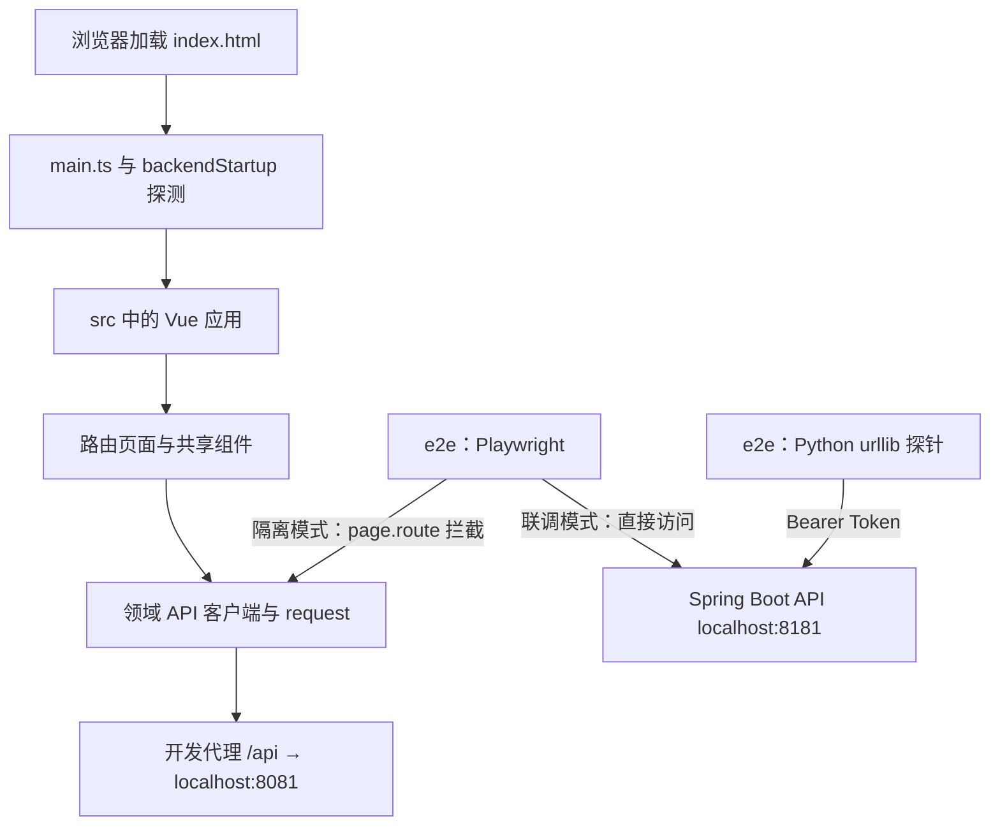

# metadata-registry-ui

# metadata-registry-ui

`metadata-registry-ui` 是元数据注册中心的前端模块组，覆盖从工程启动、业务实现到端到端验证的完整链路。模块组包含三个相互配合的子模块：

- [metadata-registry-ui（工程入口）](metadata-registry-ui.md)：提供 `index.html`、`main.ts` 等应用入口，以及 Vue、Vite、TypeScript、路由、状态管理和测试工具链配置。开发服务器将 `/api` 代理至 `http://localhost:8081`。
- [src（业务源码）](src.md)：实现 Vue 应用主体，包括路由页面、Pinia 状态、领域 API 客户端和可复用业务组件，是实际业务逻辑的主要承载位置。
- [e2e（测试与诊断）](e2e.md)：使用 Playwright 和 Python 探针验证登录、初始化、权限、分类、映射及表单等关键流程，并提供后端连通性和性能诊断能力。

## 协作关系

## 关键工作流

1. **应用启动**  
   工程入口准备启动屏并通过 `backendStartup` 等待后端可用，随后挂载 Vue 应用。进入 `src` 后，`App.vue` 等待初始路由解析完成，再由 `ErrorBoundary.vue` 隔离页面渲染异常。

2. **业务请求**  
   页面通过 `src` 中的领域 API 和 `@/utils/request` 访问后端；共享组件、组合式函数与 Pinia 共同完成输入收集、状态流转和结果展示。开发环境统一使用 `/api`，由 Vite 代理到本地后端。

3. **隔离验证**  
   Playwright 可通过 `page.route()` 模拟 API，在不启动 Spring Boot 的情况下回归页面、路由守卫和交互逻辑，适合快速验证前端行为。

4. **真实联调与诊断**  
   真实模式绕过开发代理，直接连接 `http://localhost:8181/api/v1`；Python `urllib` 探针可携带 Bearer Token 检查接口连通性、分页性能和应急登录流程。该模式依赖真实后端，不应与隔离测试不加区分地批量执行。