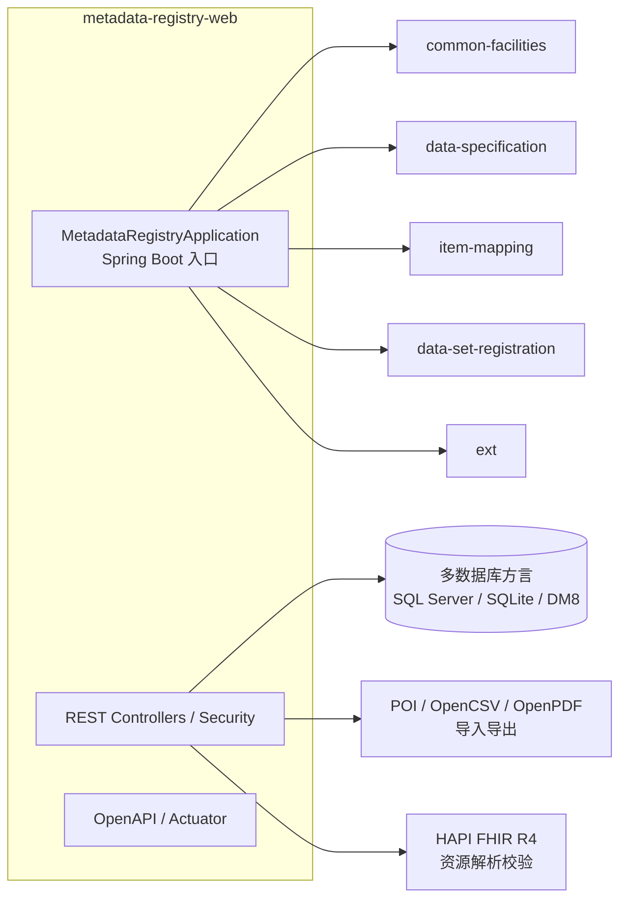

> 本文档由 GitNexus wiki 生成于 2026-09-13（kimi-for-coding，--lang chinese）。内容变化时请重新运行 `gitnexus wiki --lang chinese` 生成，勿手工改写。

# metadata-registry-web 模块

`metadata-registry-web` 是 MetadataRegistry4j 项目的 **Spring Boot Web 应用模块**，承担整个元数据注册系统的 REST API 与 Web 应用入口角色。它是一个可执行（executable）模块，最终通过 `spring-boot-maven-plugin` 打包为可运行的 fat JAR。

## 模块定位

- **GroupId / ArtifactId**：`io.github.matrixlane : metadata-registry-web`
- **父模块**：`metadata-registry4j-parent`
- **主类**：`io.github.matrixlane.metadataregistry.web.MetadataRegistryApplication`
- **用途**：对外暴露 REST API，提供 Spring Security 鉴权、OpenAPI 文档、数据库迁移、报表导出与 FHIR 互操作能力。

该模块本身**不实现业务领域逻辑**，而是将下游的领域模块组装为一个完整的可部署应用。调用图数据显示本模块没有内部调用、出入边或执行流——所有运行时行为都委托给内部依赖模块。

## 依赖结构

依赖可分为六层，从领域模块到底层工具：

| 层次 | 依赖 | 作用 |
|------|------|------|
| 领域模块（内部） | `metadata-registry-common-facilities` | 通用设施层 |
| | `metadata-registry-data-specification` | 数据规范定义 |
| | `metadata-registry-item-mapping` | 条目映射 |
| | `metadata-registry-data-set-registration` | 数据集注册 |
| | `metadata-registry-ext` | 扩展能力 |
| Web 框架 | `spring-boot-starter-web` / `aop` / `validation` / `actuator` / `mail` | REST、AOP、校验、监控端点、邮件通知 |
| 安全 | `spring-boot-starter-security`、`jjwt-api` + `jjwt-impl` + `jjwt-jackson`（runtime） | 基于 JWT 的认证授权 |
| 持久化 | `spring-boot-starter-data-jpa`、`flyway-sqlserver` | JPA 持久化与数据库迁移 |
| 文档 | `springdoc-openapi-starter-webmvc-ui` | Swagger UI / OpenAPI 文档 |
| 映射工具 | `mapstruct` | DTO/实体转换（注解处理器生成） |

### 数据库多方言支持

模块为多数据库环境做了显式配置：

- **SQL Server**：`mssql-jdbc` 驱动 + `flyway-sqlserver` 迁移插件；`mssql-jdbc_auth`（DLL，runtime scope）支持 Windows 集成认证。
- **SQLite（第一类支持）**：`hibernate-community-dialects` 提供社区方言 + `sqlite-jdbc` 驱动。
- **达梦 DM8**：`DmJdbcDriver18`（8.1.3.140）。POM 中注释说明：官方 `DmDialect-for-hibernate5.0` 面向 Hibernate 5，与当前 Hibernate 6.6 的兼容性待实测，**现阶段 DM 使用 Hibernate 内置的 Oracle 兼容方言**，具体方言选择逻辑在 `DatasourceConfigService` 中实现。

### 导入导出与互操作

- **Apache POI**（5.2.5）：Excel 导入/导出。
- **OpenCSV**（5.9）：CSV 导入/导出。
- **OpenPDF**（2.0.3，LGPL/MPL 双许可）：PDF 报表生成。
- **HAPI FHIR**（7.4.0 系列）：FHIR R4 资源解析与校验，包括 `hapi-fhir-base`、`structures-r4`、`validation`、`validation-resources-r4`、`caching-caffeine`。

### JAXB 兼容层

Java 17 移除了 JAXB，为兼容两个消费方做了双轨配置：

- `jakarta.xml.bind-api` + `jaxb-runtime`（Jakarta 命名空间）。
- `javax.xml.bind:jaxb-api:2.3.1` + `jaxb-impl:2.3.9`（runtime）——专为 swagger-core 2.2.21 在 Java 17 下的兼容性，以及 fat JAR 运行时的 JAXB 实现需求。

## 构建配置

### `maven-dependency-plugin`：复制 SQL Server 认证 DLL

在 `process-resources` 阶段将 `mssql-jdbc_auth-12.6.3.x64.dll` 复制到 `${project.build.directory}`。这是 Windows 集成认证（`authenticationScheme=NTLM` 等）的必要前置步骤，运行时需要该路径在 `java.library.path` 中。

### `maven-compiler-plugin`

- 开启 `-parameters` 保留方法参数名（供 Spring 绑定与 OpenAPI 使用）。
- **源码排除清单**（不参与编译）：
  - `MetadataExportService.java`
  - `ClassificationImportExportService.java`
  - `SchemaExtractionApplicationService.java`
  - `InteropMappingListRequest.java`
  - （注释中保留了 `ClassificationSchemeController.java`，当前**启用**）
- **测试排除清单**：`EmailNotificationGreenMailTest.java`、`ClassificationImportExportServiceTest.java`。
- **注解处理器**：Lombok + `lombok-mapstruct-binding` + MapStruct processor，并配置：
  - `-Amapstruct.defaultComponentModel=spring`（生成的 Mapper 注册为 Spring Bean）
  - `-Amapstruct.unmappedTargetPolicy=IGNORE`

### `maven-surefire-plugin` 与 `spring-boot-maven-plugin`

两者都通过 `-Djava.library.path=${project.build.directory}` 将复制的 DLL 目录加入库路径，保证测试与打包运行时的 Windows 认证可用。`spring-boot-maven-plugin` 配置 `repackage` 目标生成可执行 fat JAR。

## 架构关系

## 维护注意事项

- **修改被排除的类**（`MetadataExportService`、`ClassificationImportExportService` 等）时，需要同步在 `maven-compiler-plugin` 的 `<excludes>` 中移除对应条目才能使其参与编译；这些类当前处于半成品或未激活状态，测试类中的 `ClassificationImportExportServiceTest` 也被同步排除。
- **新增数据库支持**：需同时考虑驱动依赖、Flyway 方言、`DatasourceConfigService` 中的 Hibernate 方言映射，以及 `mssql-jdbc_auth` 这类平台相关产物的处理模式。
- **新增 MapStruct Mapper**：无需手动加 `@Component`，`defaultComponentModel=spring` 已保证自动生成 Spring Bean。
- **Windows 集成认证**依赖构建时复制的 DLL，若部署到非 Windows 环境，该 DLL 与相关 JVM 参数可安全忽略。
- 模块的 pom 描述为 "Spring Boot REST API and web application"，与底层领域模块的依赖关系是单向的——领域模块不反向依赖本模块，符合分层架构约束。