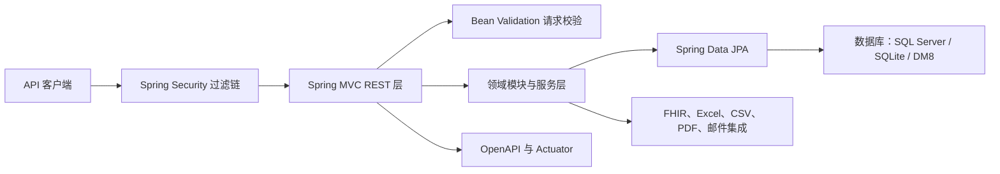

# metadata-registry-web — metadata-registry-web

# metadata-registry-web

`metadata-registry-web` 是 MetadataRegistry4j 的 Spring Boot Web 应用模块，负责承载 REST API，并将元数据规范、数据集注册、条目映射等业务模块接入 Spring Web、Spring Security、Spring Data JPA、邮件及 OpenAPI 等基础设施工。

模块的 Maven 坐标为：

```xml
<groupId>io.github.matrixlane</groupId>
<artifactId>metadata-registry-web</artifactId>
<version>0.1.0-SNAPSHOT</version>
```

其父工程是 `io.github.matrixlane:metadata-registry4j-parent:0.1.0-SNAPSHOT`。除显式声明的版本外，大部分 Spring Boot、数据库、MapStruct 和 JJWT 版本由父工程统一管理。

## 模块职责与边界

该模块主要承担以下职责：

- 启动 Spring Boot 应用；
- 提供 Spring MVC REST API 运行环境；
- 集成 Spring Security 和 JWT 相关能力；
- 使用 Bean Validation 校验请求数据；
- 通过 Spring Data JPA 访问数据库；
- 暴露 OpenAPI 文档和 Spring Boot Actuator 监控端点；
- 集成 FHIR R4、Excel、CSV、PDF 和邮件能力；
- 通过 MapStruct 生成 DTO 与领域对象之间的映射代码；
- 构建可通过 `java -jar` 启动的可执行 JAR。

业务领域本身主要由以下内部模块提供：

- `metadata-registry-common-facilities`
- `metadata-registry-data-specification`
- `metadata-registry-item-mapping`
- `metadata-registry-data-set-registration`
- `metadata-registry-ext`

因此，Web 模块更接近业务模块的宿主和集成边界，而不是所有业务规则的唯一实现位置。

当前提供的模块源码清单仅包含 `pom.xml`，且调用图未识别到内部调用、入站调用、出站调用或完整执行流。这表示没有足够的控制器、服务类和仓储源码可用于列出具体 REST 路由、DTO 字段或方法级调用关系；下述结构依据实际构建依赖、启动类和代码注释整理。

## 架构总览



一次典型请求会经过以下阶段：

1. Spring Security 过滤链处理认证和授权；
2. Spring MVC 将请求分派到 Spring 注册的控制器；
3. Bean Validation 对请求对象执行约束校验；
4. 控制器调用领域模块中的业务服务；
5. 服务通过 JPA、FHIR 或文件处理组件完成业务操作；
6. Spring MVC 将结果序列化为 HTTP 响应。

控制器的具体包名、路径和方法签名未出现在当前源码清单中，不能从依赖关系中可靠推导。

## 与其他代码模块的连接

| 依赖模块 | 集成职责 |
|---|---|
| `metadata-registry-common-facilities` | 提供 Web 模块所需的公共基础能力，例如共享模型、通用设施或基础配置。具体类型应以该模块源码为准。 |
| `metadata-registry-data-specification` | 提供数据规范领域模型和相关业务能力，是规范类 REST API 的主要业务依赖。 |
| `metadata-registry-item-mapping` | 提供条目映射领域能力，Web 层负责对外暴露相应服务。 |
| `metadata-registry-data-set-registration` | 提供数据集注册领域能力，是注册类 API 的主要业务依赖。 |
| `metadata-registry-ext` | 提供扩展能力，使 Web 层可以接入额外或可插拔的业务扩展。 |

这些依赖都是编译期依赖。业务模块需要以 Spring Bean、DTO、领域模型或服务接口等形式对外提供能力；如果依赖中的 Bean 不在应用组件扫描或显式导入范围内，则不会自动参与 Web 调用。

当前调用图没有发现其他模块对该 Web 模块的入站调用。结合其为独立 Spring Boot 可执行应用的定位，它通常是部署和运行入口，而不是被其他内部模块反向调用的基础库。

## Web API 与请求处理

### Spring MVC

`spring-boot-starter-web` 提供 Spring MVC、嵌入式 Web 服务器和 JSON 消息处理能力。应用入口为：

```java
io.github.matrixlane.metadataregistry.web.MetadataRegistryApplication
```

该类由 `spring-boot-maven-plugin` 显式指定为可执行 JAR 的主类。

具体 REST 端点应由控制器上的 Spring MVC 映射注解确定。当前没有控制器源码可供核对，因此不应仅根据依赖猜测端点路径。实际接口清单应以运行后生成的 OpenAPI 文档为准。

### 参数校验

`spring-boot-starter-validation` 引入 Jakarta Bean Validation 支持。控制器接收的请求 DTO 可以使用约束注解声明：

- 必填字段；
- 字符串长度；
- 数值范围；
- 格式约束；
- 嵌套对象校验。

校验失败后的具体响应格式由 Web 层异常处理代码决定，当前源码清单未提供相应实现。

### Spring Security 与 JWT

模块同时引入：

- `spring-boot-starter-security`
- `io.jsonwebtoken:jjwt-api`
- `io.jsonwebtoken:jjwt-impl`，运行时作用域；
- `io.jsonwebtoken:jjwt-jackson`，运行时作用域。

这为 JWT 的创建、解析和 JSON 序列化提供了依赖基础，但不能据此推断实际登录流程、令牌声明、签名算法、有效期或接口权限规则。开发或修改认证逻辑时，应重点检查：

- JWT 签名密钥是否由外部配置提供；
- 认证过滤器是否只拦截预期路径；
- `swagger-ui`、OpenAPI 和 Actuator 是否应匿名访问或要求管理员角色；
- 令牌校验失败时是否统一返回 `401`；
- 权限不足时是否统一返回 `403`；
- 是否避免在日志中输出完整令牌。

Spring Security 的默认行为可能在添加自定义配置前就保护所有端点，因此不能假定 API 默认公开。

## 持久化与数据库支持

模块通过 `spring-boot-starter-data-jpa` 使用 Spring Data JPA 和 Hibernate。当前声明了三种数据库集成：

| 数据库 | 依赖与实现方式 | 注意事项 |
|---|---|---|
| SQL Server | `com.microsoft.sqlserver:mssql-jdbc` | 包含 SQL Server 专用 Flyway 支持；可选的 `mssql-jdbc_auth` 提供 Windows 集成认证所需的本地 DLL。 |
| SQLite | `org.xerial:sqlite-jdbc`、`org.hibernate.orm:hibernate-community-dialects` | POM 将其标记为一等支持，但未显式声明 SQLite 专用 Flyway 模块。 |
| DM8 | `com.dameng:DmJdbcDriver18:8.1.3.140` | 当前使用 Hibernate 内置的 Oracle 兼容方言；DM 官方 `DmDialect-for-hibernate5.0` 面向 Hibernate 5，与当前 Hibernate 6.6 的兼容性尚未完成 DM 实例验证。 |

数据库选择逻辑由 POM 注释指向的 `DatasourceConfigService` 负责。修改数据源、方言或连接池配置时，应同时检查该服务及对应环境配置。

### Flyway 迁移边界

当前只显式引入：

```xml
<artifactId>flyway-sqlserver</artifactId>
```

因此不能假设 SQLite 或 DM8 会自动使用 SQL Server 迁移脚本。为其他数据库增加迁移支持时，需要：

1. 引入对应数据库的 Flyway 支持；
2. 提供兼容各数据库方言的迁移脚本；
3. 验证实体映射中的原生 SQL、函数和类型；
4. 验证 Flyway 基线策略及已有环境升级路径。

### SQL Server 本地认证库

`mssql-jdbc_auth` 是 x64 原生 DLL。构建过程会在 `process-resources` 阶段将其复制到 `${project.build.directory}`，测试和 Spring Boot 启动配置通过以下参数加入本地库搜索路径：

```text
-Djava.library.path=${project.build.directory}
```

部署时应保证：

- JVM 与该 x64 DLL 的体系结构兼容；
- `target` 或实际部署目录中保留该 DLL；
- 启动命令包含正确的 `java.library.path`；
- 容器镜像中包含运行 SQL Server 集成认证所需的本地库。

## 数据交换与外部格式集成

### FHIR R4

模块引入 HAPI FHIR 7.4.0 的以下组件：

- `hapi-fhir-base`
- `hapi-fhir-structures-r4`
- `hapi-fhir-validation`
- `hapi-fhir-validation-resources-r4`
- `hapi-fhir-caching-caffeine`

这为 FHIR R4 资源解析、验证和基于 Caffeine 的缓存提供基础能力。FHIR 校验通常比普通 JSON 反序列化开销更高；新增校验路径时，应关注缓存键、验证上下文和失败响应的可观测性。

### Excel、CSV 与 PDF

| 格式 | 依赖 | 典型用途 |
|---|---|---|
| Excel | `org.apache.poi:poi-ooxml:5.2.5` | 工作簿、元数据模板以及批量导入导出。 |
| CSV | `com.opencsv:opencsv:5.9` | 流式或轻量级批量数据导入导出。 |
| PDF | `com.github.librepdf:openpdf:2.0.3` | 报表生成。OpenPDF 使用 LGPL/MPL 双许可证，再分发前应确认许可证合规性。 |

批量文件处理还应关注上传大小限制、临时文件清理、内存占用、超时以及部分失败时的数据一致性。

### JAXB 兼容性

模块同时提供两套 JAXB 依赖：

- `jakarta.xml.bind-api` 与 `jaxb-runtime`，用于 Java 17 下的 Jakarta XML 处理；
- `javax.xml.bind:jaxb-api:2.3.1` 与 `jaxb-impl:2.3.9`，用于兼容 `swagger-core 2.2.21`。

这是有意保留的兼容层，不应在没有验证 OpenAPI 和 XML 处理行为的情况下直接删除其中一套。

## 对象映射

MapStruct 编译器参数为：

```text
-Amapstruct.defaultComponentModel=spring
-Amapstruct.unmappedTargetPolicy=IGNORE
```

其影响如下：

- 生成的 Mapper 实现会注册为 Spring Bean；
- 未显式映射的目标属性会被忽略；
- MapStruct 编译错误会直接导致构建失败。

`IGNORE` 可以降低增量开发中的阻塞概率，但也可能掩盖模型字段遗漏。修改请求 DTO、响应 DTO 或领域模型时，应检查生成的 Mapper 源码和序列化结果，确保关键字段没有因未映射而丢失。

Lombok 仅在编译期使用，作用域为 `provided`。编译器同时配置了：

- `lombok`
- `lombok-mapstruct-binding`
- `mapstruct-processor`

## OpenAPI 与运行监控

### OpenAPI

`springdoc-openapi-starter-webmvc-ui` 提供 OpenAPI 文档和 Swagger UI。默认情况下通常可通过以下路径访问：

- `/v3/api-docs`
- `/swagger-ui.html`

实际路径和访问权限可能被应用配置覆盖。由于模块同时启用了 Spring Security，OpenAPI 端点不应默认视为匿名可访问。

新增或修改 REST API 时，应同步检查：

- 请求 DTO 的校验约束；
- 响应模型和字段语义；
- 认证要求；
- 错误响应；
- OpenAPI 中的接口描述和示例。

### Actuator

`spring-boot-starter-actuator` 提供健康检查、指标和环境信息等监控能力。生产环境中不应默认暴露全部 Actuator 端点，应根据部署环境显式配置：

- 允许公开的健康检查项；
- 需要认证的指标和管理端点；
- 敏感环境属性是否允许通过端点查看；
- 健康检查依赖的数据库、邮件和外部服务状态。

### AOP

模块引入了 `spring-boot-starter-aop`，具备 Spring AOP 基础设施。当前分析未发现实际切面，因此不能确认是否已有日志、事务、审计或权限切面。新增横切逻辑时，应避免与 Spring Security、服务事务边界及异常转换重复处理。

### 邮件

`spring-boot-starter-mail` 提供 Spring 邮件发送能力。SMTP 主机、端口、认证和 TLS 参数应来自外部配置，并应考虑：

- 凭据是否通过环境变量或密钥管理系统注入；
- 生产环境是否启用 TLS；
- 邮件发送失败是否应影响主业务事务；
- 通知失败是否具有重试和告警机制。

仓库中存在 `EmailNotificationGreenMailTest.java`，但该测试被排除在测试编译之外，因此当前 Maven 测试生命周期不会执行该测试。

## 构建、测试与打包

### 推荐构建命令

从多模块仓库根目录执行：

```bash
mvn -pl metadata-registry-web -am test
mvn -pl metadata-registry-web -am package
```

`-am` 会同时构建 Web 模块依赖的内部模块，避免仅构建当前模块时缺少内部制品。

### 可执行 JAR

`spring-boot-maven-plugin` 配置了 `repackage` 执行。典型启动方式为：

```bash
java -Djava.library.path=target \
  -jar target/metadata-registry-web-0.1.0-SNAPSHOT.jar
```

`-Djava.library.path` 对使用 SQL Server 集成认证的部署尤其重要。

### 编译器配置

`maven-compiler-plugin` 启用了：

```xml
<parameters>true</parameters>
```

这会保留方法参数名称，对 Spring MVC 参数绑定、接口文档和部分反射调用有帮助。

当前构建明确排除了以下源文件：

| 被排除文件 | 排除范围 | 影响 |
|---|---|---|
| `SchemaExtractionApplicationService.java` | 主源码编译 | 文件不会进入主制品，其他代码不能引用其中的类型。 |
| `InteropMappingListRequest.java` | 主源码编译 | 请求模型不会进入主制品，相关控制器或映射代码必须同步排除或重构。 |
| `EmailNotificationGreenMailTest.java` | 测试编译 | GreenMail 邮件测试不会执行。 |

维护这些文件时，应同步检查引用关系。仅将文件保留在目录中并不代表其功能已经生效；如果后续恢复编译，需要同时补齐所需依赖、测试配置和数据库或邮件环境。

### 测试基础设施

模块提供：

- `spring-boot-starter-test`
- `spring-security-test`

Surefire 会把 `${project.build.directory}` 加入本地库搜索路径，因此 SQL Server 认证 DLL 在测试进程中可以被加载。

## 部署配置检查清单

由于当前未提供具体配置键，部署时应以应用实际读取的配置项为准，至少确认：

- 数据库 JDBC URL、用户名、密码和方言选择；
- SQL Server 集成认证 DLL 是否存在且架构匹配；
- SQLite 文件路径及写权限；
- DM8 方言兼容性及必要迁移脚本；
- JWT 签名材料、有效期、签发方和受众；
- OpenAPI 与 Actuator 的暴露策略；
- SMTP 主机、凭据、TLS 和超时；
- 文件上传大小、导出目录和临时目录；
- FHIR 验证资源的缓存策略；
- 日志中是否包含令牌、数据库凭据或业务敏感数据。

## 贡献指南

修改本模块时，建议按以下边界定位代码：

1. **HTTP 接口层**：处理路由、请求响应模型、状态码、校验和认证入口。
2. **领域模块**：将规范、映射、注册和扩展规则保留在对应内部模块，避免在控制器中复制业务逻辑。
3. **数据访问层**：确认 JPA 实体、仓储和数据库方言在目标数据库上均可工作。
4. **对象转换层**：修改 DTO 或实体后检查 MapStruct 生成结果，尤其是被 `unmappedTargetPolicy=IGNORE` 忽略的字段。
5. **集成层**：对 FHIR、Excel、CSV、PDF 和邮件改动分别验证异常路径、文件清理和资源消耗。
6. **接口文档层**：以 OpenAPI 输出为接口契约，不通过猜测路径或字段维护文档。
7. **构建配置层**：任何新增 JDBC 驱动、本地库、注解处理器或排除项，都应同步更新部署说明和构建脚本。

提交前建议至少完成：

```bash
mvn -pl metadata-registry-web -am test
mvn -pl metadata-registry-web -am package
```

并针对受影响的数据库方言、安全规则、OpenAPI 输出以及批量文件流程执行集成验证。