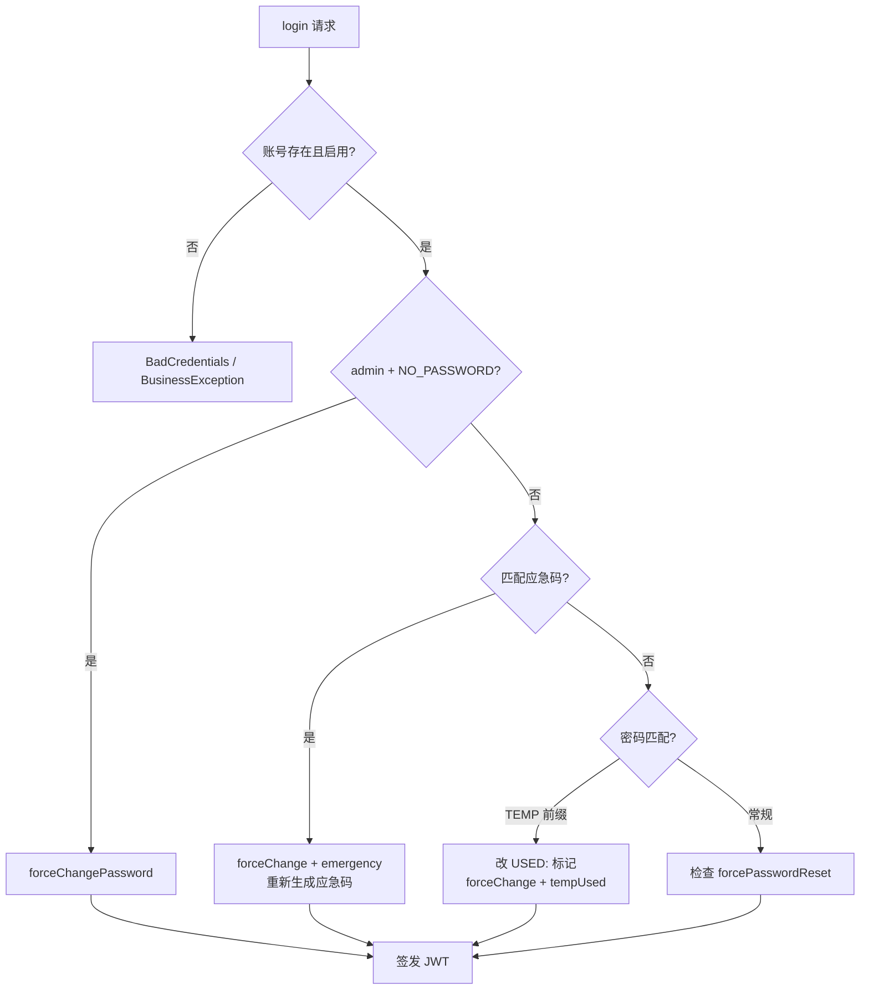
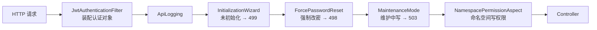

> 本文档由 GitNexus wiki 生成于 2026-09-13（kimi-for-coding，--lang chinese）。内容变化时请重新运行 `gitnexus wiki --lang chinese` 生成，勿手工改写。

# metadata-registry-web — src

## 模块概述

`metadata-registry-web` 是基于 ISO/IEC 11179 的企业元数据注册系统的 Web 层模块，基于 Spring Boot 构建。它承担以下职责：

- **应用入口**：`MetadataRegistryApplication` 启动 Spring Boot 应用，并在启动前迁移旧版数据源配置
- **认证与授权**：基于 JWT 的无状态认证体系，支持首次登录、应急登录码、临时密码等多种登录场景
- **通用基础设施**：统一的 API 响应封装（`ApiResponse`）、错误码体系（`ApiCodes`）、全局异常处理（`GlobalExceptionHandler`）
- **Web 配置**：CORS、拦截器链（初始化向导、强制改密、维护模式）、命名空间权限切面、SPA 前端路由回退
- **持久化适配**：JPA 配置、大小写不敏感枚举读取、达梦 DM8 方言、SQL Server catalog 锁定

模块的包根为 `io.github.matrixlane.metadataregistry.web`，扫描范围覆盖整个 `io.github.matrixlane.metadataregistry`，因此能装配其他子模块（commonfacilities、itemmapping 等）中的实体与仓库。

## 应用入口

`MetadataRegistryApplication` 在 `SpringApplication.run()` 之前调用 `DatasourceConfigService.migrateLegacyConfigIfNeeded()`。这一顺序很关键：旧版本的数据源配置文件位置与新版本不同，必须在 Spring 准备 `Environment`（进而加载 `config.import` 指定的 `application-local.yml`）之前完成迁移，否则加载到的将是错误位置的配置。

```java
public static void main(String[] args) {
    DatasourceConfigService.migrateLegacyConfigIfNeeded();
    SpringApplication.run(MetadataRegistryApplication.class, args);
}
```

类上的注解说明：

- `@SpringBootApplication(scanBasePackages = "io.github.matrixlane.metadataregistry")` — 全模块组件扫描
- `@EnableConfigurationProperties({MatchConfigurationProperties.class, InferenceProperties.class})` — 装配匹配与推理相关的配置属性
- `@EnableScheduling` — 启用定时任务

## 认证子系统（web.auth）

认证子系统是本地账号管理 + JWT 无状态会话的实现，支持多种登录场景和细粒度的密码生命周期管理。

### 核心组件

| 组件 | 职责 |
|---|---|
| `AuthController` | 登录、注册、`/me` 个人资料、个人信息（Individual）维护、修改密码、注册开关查询 |
| `AccountController` | 账号管理（仅 SUPER_ADMIN 可写）：增删改、审核启用、重置密码 |
| `AuthService` | 认证业务逻辑：登录校验、密码生命周期、应急码、个人信息绑定 |
| `AccountRepository` | `Account` 实体的 JPA 仓库，按用户名查找 |
| `JwtService` | 令牌签发与解析 |
| `JwtAuthenticationFilter` | 每请求一次的安全过滤器，将 Bearer token 装配为 Spring Security 认证对象 |
| `SecurityConfig` | 无状态 SecurityFilterChain，声明所有端点的访问规则 |
| `AuthenticatedUser` | 认证主体 record，携带用户 ID、角色及三个会话标志 |
| `AppUserRole` | 本地角色枚举（ADMIN / REGISTRAR / VIEWER），`authority()` 生成 `ROLE_` 前缀 |

### 登录流程（AuthService.login）

`login` 方法区分四种场景，按优先级依次判定：

1. **首次登录的 admin**：`username == "admin"` 且 `passwordHash == "NO_PASSWORD"` 时，无需密码直接放行，设置 `forceChangePassword = true`，要求用户立即设置真实密码。
2. **应急登录**：admin 用户以 `emergency-code.txt` 中的应急码作为密码登录。成功后签发 `forceChangePassword = true`、`emergencyLogin = true` 的令牌，并**立即重新生成**新的应急码写入文件（一次性使用）。
3. **临时密码登录**：`passwordHash` 以 `TEMP:` 前缀存储。校验通过后将其改写为 `USED:<hash>`，使该临时密码失效，并设置 `forcePasswordReset = true`、`tempPasswordUsed = true`。
4. **常规密码登录**：BCrypt 校验。若命中 `USED:` 前缀的哈希，抛出"临时密码已失效"。

账号被禁用（`!user.isEnabled()`）时在任何分支之前拒绝。登录成功后更新 `lastLoginAt` 并签发令牌。



### 应急登录码

`AuthService` 在 `@PostConstruct initEmergencyCode()` 中检查工作目录下的 `emergency-code.txt`，不存在则生成 10 位随机码（`SecureRandom`，字母数字混合）。这是超级管理员在密码完全丢失时的兜底通道，日志会明确提示妥善保存。

### 密码生命周期

- `changePassword`：新密码不得与原密码相同。应急登录或临时密码登录场景下校验"新密码不得与临时密码相同"；常规场景下校验 `oldPassword`（但对 `NO_PASSWORD` 首次登录的 admin 跳过旧密码校验）。
- `resetPassword`：生成 10 位临时密码，以 `TEMP:` 前缀存储（仅 SUPER_ADMIN 可调用，且不能重置 SUPER_ADMIN 本人的密码）。临时密码首次登录后即失效。
- `establishSessionAfterInitialization`：初始化向导完成后为 admin 建立完整会话，签发 `forceChangePassword = true` 的令牌，并**清空 `lastLoginAt`**，使前端能识别这是真正的首次登录（不提示输入不存在的旧密码）。

### 注册人员业务角色（isRegistrar）

`AuthService.isRegistrar(Account)` 判定用户是否为注册人员：SUPER_ADMIN 恒为注册人员；其余账户当其任一联系人角色为「注册管理员」时也是注册人员。该标志以 `registrar` claim 写入 JWT，由 `JwtAuthenticationFilter` 装配为 `ROLE_REGISTRAR` 权限。这样 AI 使用类端点可以按业务角色放行，而不与 SUPER_ADMIN 系统角色耦合。

### JWT 令牌结构（JwtService）

`JwtService.init()` 要求 `app.jwt.secret` 不少于 32 字节（通过环境变量 `JWT_SECRET` 或 `application.yml` 配置），否则启动失败。令牌 claims 包括：`sub`（用户 UUID）、`username`、`role`、`displayName`（优先取 Individual 姓名）、`registrar`、`forceChangePassword`、`emergencyLogin`、`tempPasswordUsed`。过期时间默认 480 分钟（`AppProperties.Jwt.expiresMinutes`）。

### 安全过滤器链（SecurityConfig）

关键规则按声明顺序：

- **匿名放行**：登录/注册/注册开关、datasource、migration、初始化向导全部端点、标识模板设计器的只读端点（`presets`/`object-abbreviations`/`preview`）、静态资源、Swagger、actuator health/info
- **SUPER_ADMIN 专属**：`/api/v1/system/**`、actuator loggers
- **REGISTRAR 业务角色**：`/api/v1/inference/**`、`/api/v1/assistant/**`（显式置于通用写规则之前，不依赖平台默认值）；其中 `GET /assistant/settings` 限 REGISTRAR，`PUT` 限 SUPER_ADMIN
- **联邦**：`/api/v1/federation/inbound/**` 匿名（供对端推送），其余联邦端点限 SUPER_ADMIN
- **通用规则**：GET 登录即可；写操作（POST/PUT/PATCH/DELETE）需 SUPER_ADMIN 或 REGISTRAR
- **SPA 深链接**：通过正则放行非 API 路径的 GET 请求，由 `SpaForwardController` 转发到 `index.html`

异常处理通过 `authenticationEntryPoint` / `accessDeniedHandler` 统一输出 JSON 格式的 `ApiResponse`（401/403），保持与业务错误一致的错误结构。

## 通用层（web.common）

### ApiResponse 与 ApiCodes

所有 REST 端点统一返回 `ApiResponse<T>`：`code`（0 表示成功）、`message`、`data`、`timestamp`。错误码集中定义在 `ApiCodes`：

- 标准 HTTP 语义码：400/401/403/404/409/422/500
- `BUSINESS_ERROR = 1000`：业务规则违例
- `FEATURE_NOT_ENABLED = 1001`
- `1100–1199`：注册生命周期状态迁移错误，且为每个源状态（INCOMPLETE、CANDIDATE、…、APPLICATION）分配独立子码（`INVALID_STATE_TRANSITION_FROM_*`），便于前端精确定位非法迁移

### 异常体系

- `BusinessException`：业务规则违例，可携带自定义 code
- `ResourceNotFoundException`：资源不存在
- `ForcePasswordResetException`：由 `GlobalExceptionHandler` 映射为 **498** 状态码，前端据此弹出强制改密对话框
- `GlobalExceptionHandler`（`@RestControllerAdvice`）：统一映射所有异常——JPA 的 `EntityNotFoundException`、校验失败（422，聚合所有字段错误）、`BadCredentialsException`（统一文案"用户名或密码错误"，避免用户名枚举）、数据完整性冲突（409，取根因消息）、JSON 解析失败（区分"字段名未加双引号"的具体提示）、以及 498/499 特殊状态

### PageResponse

`PageResponse.of(Page<T>)` 与带映射函数的 `of(Page<T>, Function<T, R>)` 将 Spring Data `Page` 转为统一分页响应（content/page/size/totalElements/totalPages）。

## 配置层（web.config）

### 请求处理管线

`WebMvcConfig` 注册了拦截器链与自定义参数解析器，执行顺序如下：

| 顺序 | 组件 | 作用 |
|---|---|---|
| 0 | `ApiLoggingInterceptor` | API 请求日志 |
| 1 | `InitializationWizardInterceptor` | 系统未初始化时（除白名单外）拦截并返回 499，引导前端跳转初始化向导 |
| 2 | `ForcePasswordResetInterceptor` | `forceChangePassword` 会话仅放行登录/改密/个人资料/初始化向导/工厂重置及未初始化时的数据源端点，其余抛出 498 |
| 3 | `MaintenanceModeInterceptor` | 迁移维护模式开启期间拒绝一切非 GET 写操作（迁移与认证端点除外），返回 503 |



### 命名空间权限切面（NamespacePermissionAspect）

通过 AspectJ 在服务层方法上声明式实施命名空间级权限：

- `NamespaceService` 的 `get*` / `update` / `delete`：分别校验读/写/写权限
- `NamespacePermissionService`：读权限管理端点需读权限，写端点需写权限
- `ItemAdministrationService.ensureAdministeredItem`：同时校验条目当前命名空间与目标命名空间的写权限
- `*Service.delete(UUID)` / `*Service.update(UUID, ..)` 通配切面：先按 `ScopedIdentifierRepository.findByItemId` 反查条目所属命名空间校验写权限，再经 `ActiveRegistrarService.assertCanModifyItem` 校验归属机构的活动 Registrar 身份

所有切面方法先经 `shouldBypass()` 判断：匿名或未认证主体直接放行（由 Security 层负责拦截），避免与过滤器重复拒绝。

### 初始化向导相关拦截器

- `InitializationWizardInterceptor` 通过 `@Autowired(required = false)` 注入 `SystemSettingService`（兼容 `@WebMvcTest` 切片），白名单覆盖 `init-wizard`、`datasource`、`migration`、`identifier-strategy`、`auth/login` 等端点
- `ForcePasswordResetInterceptor` 对 `SystemSettingService` 使用 `@Lazy` 延迟代理，理由相同——切片测试不需要该服务即可加载

### 持久化适配

**大小写不敏感枚举（CaseInsensitiveEnumConfig / CaseInsensitiveEnumJavaType）**

ISO/IEC 11179 各部分对枚举大小写约定不一致：11179-3:2023 的可接受性为小写，11179-6:2023 的注册状态为首字母大写，而 Java 枚举常量习惯大写。`CaseInsensitiveEnumConfig` 作为 Hibernate `MetadataBuilderInitializer`（通过 `META-INF/services` 服务文件自动加载），为全部 18 个 `@Enumerated(EnumType.STRING)` 枚举注册 `CaseInsensitiveEnumJavaType`：读取时先尝试精确匹配，失败后归一化（去空白、转大写、空格/连字符转下划线）再匹配，使 `Standard`、`preferred`、`Preferred Standard` 等写法均能读回；写入仍落库 Java 常量名，且**不生成 CHECK 约束**（否则会阻塞直接 SQL 导入标准格式数据的路径）。

**达梦方言（DmOracleDialect）**

继承 `OracleDialect`，替换自增列语法为 DM 专有的 `identity(1,1)` 内联写法，用 `select @@identity` 取回生成键，并将 `BIGINT` 的 DDL 类型注册为 `bigint` 关键字（DM 不接受 `number(19,0)` 作为 IDENTITY 列类型）。

**SQL Server catalog 锁定（HibernateCatalogConfig）**

从 JDBC URL 提取 `databaseName` 并设置 `hibernate.default_catalog`。没有这一锁定时，SQL Server 的 JDBC 元数据会返回同实例其他数据库的同名表，导致 schema migrator 误判"表已存在"、只发 ALTER 不发 CREATE。

**Schema 预建（SchemaBootstrapConfig）**

`DataSourceInitializer` 在任何 `EntityManagerFactory` 创建之前执行。仅对 SQL Server 生效：`IF NOT EXISTS ... CREATE SCHEMA mdr`，解决历史上手工建 schema 导致空库启动失败的问题。SQLite 无 schema 概念、达梦以用户即模式，均跳过。

### Web 层杂项

- **`ItemSortPageableResolver`**：Item 继承链列表页的标识符与名称不在实体表上（分别在 `identifiedItem.scopedIdentifiers` 与内嵌 `designation.sign` 链上）。该解析器将前端提交的虚拟排序键 `meta.identifier` / `meta.label` 改写为可执行的 JPA 属性路径，其余排序键（如 `Registrar.identifier` 等真实字段）原样透传。通过 `WebMvcConfig.addArgumentResolvers` 注册且优先于 Spring Boot 自动配置的解析器。
- **`SpaForwardController`**：采用显式路由清单（与前端 `router/index.ts` 对齐）将 `/login`、`/namespaces`、`/data-dictionary/**` 等客户端路由转发到 `index.html`，避免通配模式吞掉 `/assets/**` 静态资源。新增前端路由需在此补充。Security 链中的正则规则与之配合放行这些 GET。
- **`CorsConfig`**：基于 `AppProperties.Cors.allowedOrigins`（默认 `http://localhost:5173`），暴露 `Authorization` 与 `Content-Disposition` 响应头，允许携带凭证。
- **`IdentifierStrategyLoader`**（`CommandLineRunner`）：启动时将 `SequenceRegistryService` 注入策略配置服务作为序列提供者，向 `IdentifierGenerationStrategyRegistry` 注册 `SequenceGenerationStrategy` 与 `TemplateGenerationStrategy`，并从仓库加载所有生效的策略配置（全局默认或按命名空间）。对存量配置中含已废止的 `scopeRefs` 或 `RANDOM` 段的情况记录警告日志。
- **`JpaConfig` / `JpaAuditingConfig`**：实体与仓库扫描均覆盖整个 `io.github.matrixlane.metadataregistry` 包；启用 JPA Auditing。
- **`OpenApiConfig`**：OpenAPI 3 文档配置，全局声明 `bearerAuth`（HTTP Bearer + JWT），标题"MetadataRegistry4j API"。

## 与其他模块的连接

- **commonfacilities**：`Account`、`SystemRole`、`Individual`、`Contact`、`ScopedIdentifier` 等实体直接来自 commonfacilities 包，由 `JpaConfig` 的扫描装配
- **itemmapping**：`MetadataRegistryApplication` 装配其 `MatchConfigurationProperties`
- **ext.identification**：`IdentifierStrategyLoader` 驱动标识生成策略注册表；`IdentifierConfig` 提供 `IdentifierStrategyConfigService` Bean
- **web.service 层**：auth/config 组件是服务层的入口守卫——`AuthService` 调用 `ContactAccountBindingService`、`SystemSettingService`；切面调用 `NamespacePermissionEvaluator`、`ActiveRegistrarService`；拦截器调用 `MaintenanceModeService`。初始化向导（`InitWizardController.setup`）通过 `AuthService.findAdminId()` 定位唯一的 SUPER_ADMIN，再经 `establishSessionAfterInitialization` 建立首个会话

## 开发者注意事项

1. **新增 REST 端点时**：遵循 `ApiResponse` 统一返回结构；枚举校验失败会经 `GlobalExceptionHandler` 聚合为 422 响应
2. **新增 `@Enumerated(EnumType.STRING)` 枚举时**：必须将其加入 `CaseInsensitiveEnumConfig.ENUM_TYPES`，否则历史标准格式数据无法读取
3. **新增前端路由时**：同时更新 `SpaForwardController` 的路由清单和 `SecurityConfig` 中的 SPA 正则放行
4. **新增命名空间级服务端点时**：若走 `*Service.update(UUID, ..)` / `*Service.delete(UUID)` 签名，命名空间权限切面会自动接管；其他签名需评估是否补充切面规则
5. **修改登录相关逻辑时**：注意 `ForcePasswordResetInterceptor` 的白名单是硬编码路径列表，新增强制改密期间需要访问的端点必须同步加入
6. **应急码与临时密码均为一次性**：`USED:` 前缀标记和应急码轮换是有意设计，不要为"方便调试"绕过这些标记