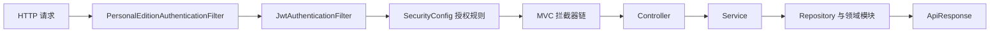

# metadata-registry-web — src

# metadata-registry-web — src

## 模块定位

`metadata-registry-web/src` 是 MetadataRegistry 系统的 Spring Boot Web 适配层，负责把领域模型、注册流程、标识策略、权限模型和外部集成能力暴露为 REST API。

该模块承担以下职责：

- 提供 `/api/v1/**` REST 接口及统一的 `ApiResponse<T>` 响应结构。
- 管理用户名密码登录、JWT 签发与解析、强制改密和个人版隐式登录。
- 执行基于系统角色与业务身份的访问控制。
- 组织 Controller、Service、Repository、DTO 和 JPA 实体之间的调用链。
- 通过 MVC 拦截器实现初始化向导拦截、强制改密拦截、迁移维护模式和 API 日志。
- 适配 SQL Server、SQLite、达梦 DM8 等数据库差异。
- 兼容 ISO/IEC 11179 数据中不同大小写和书写形式的枚举值。
- 装载标识生成策略、命名约定规则和联邦合并能力。
- 为 Swagger、OpenAPI、SPA 前端路由和初始化向导提供运行时支持。

领域实体和部分核心算法位于 `commonfacilities`、`itemmapping`、`ext.identification` 等相邻模块；本模块主要承担控制器、服务编排、认证授权、持久化接入和 Web 配置职责。

### 技术基线

| 能力 | 主要实现 |
|---|---|
| Web 框架 | Spring Boot、Spring MVC |
| 安全认证 | Spring Security、`JwtService`、`JwtAuthenticationFilter` |
| 数据访问 | Spring Data JPA、Hibernate |
| 请求校验 | Jakarta Validation |
| 持久化审计 | Spring Data JPA Auditing |
| 权限切面 | Spring AOP、`NamespacePermissionAspect` |
| API 文档 | Swagger Annotations、OpenAPI |
| JWT | JJWT |
| 数据库兼容 | `DmOracleDialect`、`HibernateCatalogConfig`、`SchemaBootstrapConfig` |

## 包结构

| 包 | 主要职责 |
|---|---|
| `web.auth` | 登录、账户管理、JWT、安全过滤器、认证 DTO |
| `web.common` | 统一响应、分页响应、业务异常、全局异常处理 |
| `web.config` | 应用属性、JPA、OpenAPI、CORS、MVC 拦截器、Hibernate 兼容配置 |
| `web.controller` | REST 控制器和初始化向导、联邦、工作空间等入口 |
| `web.service` | 领域编排、权限判定、初始化、迁移、联邦及工作空间服务 |
| `web.repository` | Spring Data JPA Repository |
| `web.entity` | Web 模块持久化实体 |
| `web.dto` | 请求与响应模型，包含 `common`、`individual`、`datasource` 等子包 |
| `web.edition` | `DeploymentEdition` 等部署版本模型 |
| `web.federation` | 联邦数据接收、全局命名空间和合并执行 |
| `web.inference` | 推理提示词组装和元数据上下文 |
| `web.logging` | `ApiLoggingInterceptor` 等请求日志设施 |
| `web.service.migration` | 迁移维护状态 |
| `web.service.database` | 数据库厂商、环境识别和清理 |
| `web.service.association` | 元数据对象关联校验和默认关联处理 |

`MetadataRegistryApplication` 使用：

```java
@SpringBootApplication(scanBasePackages = "io.github.matrixlane.metadataregistry")
```

因此不仅扫描 `web` 包，也会装配同一顶级包下的其他模块 Bean。`JpaConfig` 同样对 `io.github.matrixlane.metadataregistry` 下的实体和 Repository 做全局扫描。

## 应用启动流程

### 1. 迁移旧版数据源配置

`MetadataRegistryApplication.main` 在创建 Spring `Environment` 之前调用：

```java
DatasourceConfigService.migrateLegacyConfigIfNeeded();
```

该步骤用于：

- 将旧版数据源配置迁移到当前支持的配置位置。
- 确保后续 `spring.config.import` 能加载正确的 `application-local.yml`。
- 从旧格式配置中剥离 `flyway.enabled`、`ddl-auto` 等行为开关，避免旧配置改变当前启动策略。

该调用必须发生在 Spring Boot 准备环境之前，因此不能移到普通 Bean 初始化流程中。

### 2. 注册显式启动初始化器

应用通过 `SpringApplicationBuilder` 注册两个初始化器：

```java
new SpringApplicationBuilder(MetadataRegistryApplication.class)
        .initializers(new LocalConfigBootstrapInitializer(), new FreshDatabaseInitializer())
        .run(args);
```

- `LocalConfigBootstrapInitializer` 将用户保存的 `application-local.yml` 提升到 profile 默认值之上。`spring.config.import` 本身无法保证这种优先级。
- `FreshDatabaseInitializer` 在环境准备完成、上下文刷新之前识别 SQLite、SQL Server 或达梦上的全新空库，并注入基线化属性，避免首次建库使用错误配置。

这两个初始化器没有通过 `META-INF/spring/*.imports` 自动注册。Boot 3.5 repackage 后，可执行 JAR 中无法可靠保留应用自身的 `META-INF/spring` 目录，因此必须保留这里的显式注册。

### 3. 启用配置与调度

应用入口启用了：

- `MatchConfigurationProperties`
- `InferenceProperties`
- Spring 调度任务 `@EnableScheduling`

`AppProperties` 则由 `CorsConfig` 通过 `@EnableConfigurationProperties(AppProperties.class)` 启用。

### 4. 启动后装载标识策略

`IdentifierStrategyLoader` 是 `@Order(90)` 的 `CommandLineRunner`。它必须早于消费标识策略的启动 Runner，例如 `@Order(101)` 的 `RegistryContextBackfillRunner`，否则自动生成标识可能因注册表尚未初始化而退化为 UUID。

装载过程包括：

1. 为 `IdentifierStrategyConfigService` 设置 `SequenceRegistryService` 作为序列提供者。
2. 清理 `IdentifierGenerationStrategyRegistry` 的缓存。
3. 注册 `SequenceGenerationStrategy` 和 `TemplateGenerationStrategy`。
4. 读取全部有效策略配置。
5. 将全局默认策略或命名空间策略写入注册表。

对于包含已废止 `scopeRefs` 或 `RANDOM` 段的存量配置，Loader 会输出警告，但不会阻止启动。

## 请求处理链路



### 安全过滤

`SecurityConfig` 创建无状态 `SecurityFilterChain`：

- 禁用 CSRF、表单登录和 HTTP Basic。
- 使用 `SessionCreationPolicy.STATELESS`。
- 启用 `@EnableMethodSecurity`。
- 使用 `CorsConfig` 提供的跨域配置。
- 注册 `PersonalEditionAuthenticationFilter` 和 `JwtAuthenticationFilter`。
- 未认证请求返回 HTTP 401 和 `ApiResponse.error(ApiCodes.UNAUTHORIZED, ...)`。
- URL 规则拒绝返回 HTTP 403 和统一 JSON。

`JwtAuthenticationFilter` 从 `Authorization: Bearer <token>` 读取令牌，解析失败时清理 `SecurityContextHolder` 并继续过滤器链；最终是否返回 401 由后续授权规则决定。

### MVC 拦截器顺序

`WebMvcConfig` 按以下顺序注册拦截器：

1. `ApiLoggingInterceptor`，顺序 `0`。
2. `InitializationWizardInterceptor`，顺序 `1`。
3. `ForcePasswordResetInterceptor`，顺序 `2`。
4. `MaintenanceModeInterceptor`，顺序 `3`。

安全过滤和 URL 授权发生在 MVC 拦截器之前，因此被 URL 规则拒绝的请求不会进入这些拦截器。

### `InitializationWizardInterceptor`

系统未初始化时，只允许以下路径继续执行：

- `/api/v1/init-wizard/**`
- `/api/v1/datasource/**`
- `/api/v1/migration/**`
- `/api/v1/identifier-strategy/**`
- `/api/v1/auth/login`
- `/api/v1/auth/me`
- `/api/v1/auth/allow-registration`
- `/api/v1/startup/status`
- GET `/api/v1/languages`
- Swagger 和 OpenAPI 路径

其他请求返回：

```json
{
  "code": 499,
  "message": "System uninitialized. Redirecting to wizard."
}
```

注意：HTTP 状态实际设置为 `403`，响应体业务码才是 `499`。该响应由拦截器直接写出，不包含标准 `ApiResponse` 的 `timestamp` 字段。

### `ForcePasswordResetInterceptor`

当 JWT 中的 `forceChangePassword` 为 `true` 时，除白名单外的 API 请求会抛出 `ForcePasswordResetException`，最终返回 HTTP 498。

白名单包括：

- 登录、修改密码、登出和 `/me`。
- 工厂重置。
- 初始化向导端点。
- 系统未初始化时的数据源端点。
- 语言字典只读端点。

个人版不执行强制改密拦截。`DeploymentEdition.PERSONAL` 下，即使令牌携带遗留的强制改密标志，也会直接放行，避免用户无法通过任何合法操作清除该状态。

### `MaintenanceModeInterceptor`

`MaintenanceModeService.isActive()` 为 `true` 时：

- GET 请求继续执行。
- `/api/v1/migration/**` 和 `/api/v1/auth/**` 继续执行。
- 其他非 GET 请求返回 HTTP 503：

```json
{
  "code": 503,
  "message": "系统处于数据迁移维护状态，写操作暂不可用"
}
```

## REST API 约定

### 统一响应

所有常规 Controller 返回 `ApiResponse<T>`：

```json
{
  "code": 0,
  "message": "OK",
  "data": {},
  "timestamp": "2025-01-01T12:00:00+08:00"
}
```

`ApiResponse` 字段：

| 字段 | 含义 |
|---|---|
| `code` | `0` 表示成功，其他值为错误码 |
| `message` | 成功时为 `OK`，失败时为错误说明 |
| `data` | 业务数据，可为空 |
| `timestamp` | 带时区偏移的响应时间 |

`ApiResponse` 使用 `@JsonInclude(NON_NULL)`，因此 `ApiResponse.ok()` 生成的空数据响应不会输出 `data` 字段。

### 分页响应

`PageResponse<T>` 由 `PageResponse.of(Page<T>)` 或带映射函数的重载创建，字段为：

- `content`
- `page`
- `size`
- `totalElements`
- `totalPages`

`page` 直接来自 `Page.getNumber()`，因此从 `0` 开始。

### 请求校验

Controller 对请求体使用 `@Valid`，DTO 通过 record 声明约束。例如：

- `AccountCreateRequest.username`：3～32 个字符，仅允许字母、数字、`_`、`-`、`.`。
- 密码长度：8～64 个字符。
- `AccountUpdateRequest.enabled`：必填。
- `ChangePasswordRequest.oldPassword`：可空，由服务层根据登录场景决定是否验证。
- `ChangePasswordRequest.newPassword`：必填，长度 8～64。

### 异常映射

`GlobalExceptionHandler` 统一转换异常：

| 异常 | HTTP 状态 | 响应码 |
|---|---:|---:|
| `ResourceNotFoundException`、`EntityNotFoundException` | 404 | 404 |
| `BusinessException` | 400 | 默认 1000，也可指定业务码 |
| `MetadataObjectAssociationException` | 400 | 422 |
| `MethodArgumentNotValidException` | 422 | 422 |
| 参数类型不匹配、缺少参数、非法参数 | 400 | 400 |
| `BadCredentialsException`、其他 `AuthenticationException` | 401 | 401 |
| `AccessDeniedException` | 403 | 403 |
| `DataIntegrityViolationException` | 409 | 409 |
| `ForcePasswordResetException` | 498 | 498 |
| `NoResourceFoundException` | 404 | 404 |
| 未处理异常 | 500 | 500 |

服务层抛出的 `AccessDeniedException` 会透传其可操作说明；URL 规则拒绝则统一返回“无权访问此资源”。未处理异常只返回“服务器内部错误”，不会向客户端暴露堆栈或异常消息。

`ApiCodes` 还定义了注册生命周期迁移错误码 `1100`～`1125` 和工作空间管理状态错误码 `1130`～`1139`，供 `BusinessException` 等业务异常使用。

## 认证流程

### 登录分支

`AuthService.login` 根据部署版本和密码状态选择不同流程：

| 场景 | 行为 |
|---|---|
| 个人版 | 忽略服务层用户名和密码，加载系统唯一的 `SUPER_ADMIN`，直接签发隐式管理员会话 |
| `admin` 首次登录，密码哈希为 `NO_PASSWORD` | 不校验请求密码，标记强制改密，并清空 `lastLoginAt` |
| 管理员应急登录 | 请求密码与 `emergency-code.txt` 中的应急码匹配，成功后轮换应急码并标记强制改密 |
| 临时密码登录 | 校验 `TEMP:<bcrypt>` 中的密码，成功后改为 `USED:<bcrypt>`，并标记强制改密和临时密码已使用 |
| 普通密码登录 | 使用 `PasswordEncoder.matches` 校验密码哈希 |

个人版仍受 `LoginRequest` 的 `@NotBlank` 校验约束，因此客户端仍需提交非空用户名和密码，只是 `AuthService.personalAdminSession` 不使用这些值。

### 首次登录与应急登录

应急码由 `AuthService.initEmergencyCode` 在启动后生成：

- 文件名固定为 `emergency-code.txt`。
- 位于应用进程工作目录。
- 长度为 10 个字符。
- 仅当文件不存在时自动创建。
- 管理员每次使用应急码登录后都会生成新应急码。

应急登录令牌携带：

```text
forceChangePassword = true
emergencyLogin = true
```

修改密码时会跳过旧密码校验，但仍禁止新旧密码相同。

### 密码状态

密码在数据库中的 `Account.passwordHash` 可能采用以下前缀：

| 前缀或值 | 含义 |
|---|---|
| `NO_PASSWORD` | `admin` 尚未设置真实密码 |
| `TEMP:` | 管理员重置密码后生成的临时密码 |
| `USED:` | 临时密码已经成功使用，不能再次登录 |

`AuthService.changePassword` 完成后会：

- 写入新的 BCrypt 哈希。
- 清除 `forcePasswordReset`。
- 清除 `tempPasswordUsed`。

`resetPassword` 不允许重置 `SUPER_ADMIN` 密码，而是为普通用户生成一次性临时密码，并通过 API 响应返回明文临时密码。调用方应避免记录该响应。

### JWT 内容

`JwtService` 使用 `app.jwt.secret` 初始化 HMAC 签名密钥。启动时密钥必须非空，且代码按 `String.length()` 检查不少于 32 个字符。

令牌包含以下 claim：

| Claim | 含义 |
|---|---|
| `sub` | 账户 UUID |
| `username` | 用户名 |
| `role` | `Account.sysRole` 名称 |
| `displayName` | 个人姓名，未设置时使用用户名 |
| `registrar` | 是否为注册人员业务身份 |
| `submitter` | 是否已登记为联系人 |
| `forceChangePassword` | 是否必须修改密码 |
| `emergencyLogin` | 是否通过应急码登录 |
| `tempPasswordUsed` | 是否使用过临时密码 |

`JwtAuthenticationFilter` 将其转换为 Spring Security authority：

- `role` 生成 `ROLE_<role>`。
- `registrar=true` 生成 `ROLE_REGISTRAR`。
- `submitter=true` 生成 `ROLE_SUBMITTER`。

`AuthenticatedUser` 保存账户 UUID、用户名、系统角色和三个会话标志，作为 Controller 的 `@AuthenticationPrincipal`。

JWT 过滤不会每次查询数据库，因此以下变更不会立即重算到已有令牌：

- 账户被禁用。
- 账户新增或移除 Registrar、Contact 身份。
- 服务层清除了强制改密状态。

相关操作通常需要重新登录以取得新令牌。

## 角色与授权模型

系统实际存在两类 authority：

1. **系统角色**：来自 `Account.sysRole`，例如 `SUPER_ADMIN`。
2. **业务身份**：来自账户关联的 `Registrar` 或 `Contact`，对应 `ROLE_REGISTRAR`、`ROLE_SUBMITTER`。

`AuthService.isRegistrar` 的判断规则：

- `SUPER_ADMIN` 始终视为 Registrar。
- 其他账户只要绑定了 Registrar 类型的 Contact，即视为 Registrar。

`AuthService.isSubmitter` 判断账户是否绑定了任意 Contact。`AccountProfileResponse.hasContact` 实际承载的就是这一标志。

当账户既不是 `SUPER_ADMIN`，又不是 Registrar，也没有 Contact 时，`profilePrompt` 为 `true`，用于提示用户完善身份资料。

`AppUserRole` 定义了 `ADMIN`、`REGISTRAR`、`VIEWER` 及 `authority()` 映射；当前认证链直接根据 `SystemRole` 和 JWT claim 生成 authority，修改授权时应以 `SecurityConfig`、`JwtAuthenticationFilter` 和 `@PreAuthorize` 的实际组合为准。

### URL 授权规则

`SecurityConfig` 按声明顺序匹配，首个命中的规则生效。主要规则如下：

| 路径或方法 | 要求 |
|---|---|
| 所有 OPTIONS | 放行 |
| `/api/v1/auth/login`、`register`、`allow-registration` | 匿名 |
| `/api/v1/datasource/**`、`migration/**` | 匿名 |
| `/api/v1/startup/status` | 匿名 |
| `/api/v1/init-wizard/status`、`wizard-state`、`setup`、`commit`、`abort` | 匿名 |
| 标识策略 `presets`、`object-abbreviations`、`preview` | 匿名 |
| GET `/api/v1/languages` | 匿名 |
| Swagger、OpenAPI、Actuator health/info | 匿名 |
| `/api/v1/federation/inbound/**` | 匿名 |
| `/api/v1/system/**` | `SUPER_ADMIN` |
| `/api/v1/assistant/settings` | 已认证 |
| `/api/v1/my/**` | 已认证 |
| 生命周期状态迁移 | `SUPER_ADMIN` 或 `REGISTRAR` |
| 注册流程布局保存 | `SUPER_ADMIN` |
| `/api/v1/inference/**`、其余 `/api/v1/assistant/**` | `REGISTRAR` |
| 其余 `/api/v1/federation/**` | `SUPER_ADMIN` |
| 工作空间 GET | 已认证 |
| 工作空间写操作 | `SUPER_ADMIN`、`REGISTRAR` 或 `SUBMITTER` |
| 一般 API GET | 已认证 |
| 一般 API POST、PUT、PATCH、DELETE | `SUPER_ADMIN`、`REGISTRAR` 或 `SUBMITTER` |

新增路径时应检查它是否会被后面的通用规则接管。例如 `/api/v1/auth/me/individual` 的 PUT 被单独设为“已认证”，避免落入只允许三种角色的通用 PUT 规则。

`/api/v1/auth/me/avatar` 的 PUT 和 DELETE 没有单独的“已认证”规则，当前会落入通用写操作规则。修改头像相关授权时应显式补充 matcher，而不是依赖路径名称推断。

### 账户接口

`AccountController` 暴露 `/api/v1/