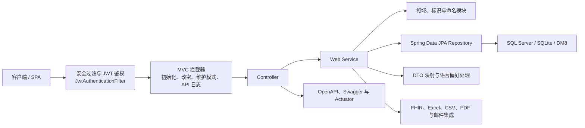

# metadata-registry-web

# metadata-registry-web

`metadata-registry-web` 是 MetadataRegistry4j 的 Spring Boot Web 接入模块，负责将元数据规范、数据集注册、条目映射、权限控制及外部集成能力统一暴露为 REST API。模块基于 `/api/v1/**` 提供接口，并以 `ApiResponse<T>` 作为统一响应结构。

## 子模块分工

- [metadata-registry-web](metadata-registry-web.md)：定义模块边界、技术基线及主要依赖，包括 Spring MVC、Spring Security、Spring Data JPA、Bean Validation、OpenAPI、Actuator、FHIR、邮件及文件导出能力。
- [src](src.md)：承载具体 Web 适配实现，包括 Controller、Service、Repository、DTO、JPA 实体、认证授权、MVC 拦截器、数据库兼容和运行时配置。

领域实体与部分核心算法由 `commonfacilities`、`itemmapping`、`ext.identification` 等相邻模块提供；本模块主要负责请求编排、安全接入、持久化访问和接口输出。

## 总体协作关系

## 关键跨模块流程

### REST 请求处理

请求经 Spring Security 和 `JwtAuthenticationFilter` 完成认证后进入 MVC 拦截器与 Controller。Controller 调用 `DataElementService`、`ValueDomainService`、`ConceptualDomainService` 等 Service，由 Service 协调 Repository 和领域模块完成业务操作，最后转换为 DTO 或统一响应返回。

### 登录、授权与配置

`JwtService` 负责令牌签发和解析，认证主体由 `AuthenticatedUser` 承载。系统角色与业务身份共同参与访问控制；用户名密码登录、强制改密和个人版隐式登录均在这一安全链路中完成。`AppProperties` 集中提供 CORS、JWT 和初始化种子等运行参数。

### 元数据读取与语言偏好

概念域查询以 `ConceptualDomainController` 为入口：

- 单项查询经过 `ConceptualDomainService.get` 和 `toResponse`；
- 列表查询还会调用 `ObjectClassService.byKeyword`、`get` 和 `toResponse`；
- `ItemAdministrationService.mapDefinitions` 与 `mapDefinitionContexts` 整理定义及上下文；
- `ItemNamingHelper.preferredDesignation` 和 `pickByLanguage` 根据 `Definition`、`Designation` 的语言信息选择首选名称。

### 注册与关联治理

`DataElementService`、`DataElementConceptService`、`ItemAssociationService` 和 `ValueDomainService` 共同复用 `MetadataObjectAssociationService.withDefaults`，统一关联对象的默认处理。注册过程中，`NamingConventionEngine` 调用字符集、包含、长度和正则规则检查名称约定；`NamespaceIdentifierPolicy` 与 `ScopedIdentifierCreateRequest` 支持命名空间标识的生成和约束。

### 初始化与数据库适配

`InitWizardController` 负责初始化流程，相关 MVC 拦截器阻止未完成初始化的请求，并支持强制改密、迁移维护模式和 API 日志。运行时数据源由 `DatasourceConfigService` 解析，`DatabaseEnvironment` 根据 `DatabaseVendor` 适配不同数据库；`DatabaseCleaner` 使用相应的外键清理策略。

### 外部能力

Web 层可在注册和导出流程中调用 FHIR、Excel、CSV、PDF 及邮件能力；`DataDictionaryPdfExportService` 等服务负责具体文件生成。OpenAPI、Swagger 和 Spring Boot Actuator 则为接口发现、调试及运行监控提供统一入口。