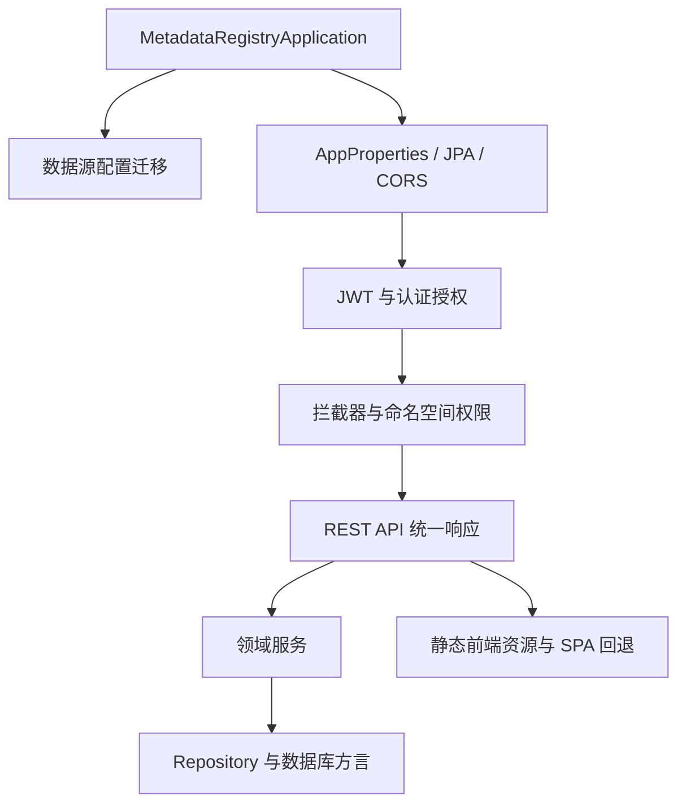

> 本文档由 GitNexus wiki 生成于 2026-09-13（kimi-for-coding，--lang chinese）。内容变化时请重新运行 `gitnexus wiki --lang chinese` 生成，勿手工改写。

# metadata-registry-web

`metadata-registry-web` 是 MetadataRegistry4j 的 Web 交付入口，负责把通用设施、数据规范等领域模块以及安全、持久化、报表导出、FHIR 互操作等能力组装成可运行的 Spring Boot 应用。顶层模块的依赖结构、可执行 JAR 打包和整体定位见 [metadata-registry-web](metadata-registry-web.md)；启动流程、配置体系、REST API、静态前端资源和源码包结构见 [src](metadata-registry-web-src.md)。

## 子模块协作方式

- **可执行应用组装**：`MetadataRegistryApplication` 是应用主类。启动前调用 `DatasourceConfigService.migrateLegacyConfigIfNeeded()`，先完成旧版数据源配置迁移，再进入 Spring `Environment` 准备阶段。
- **统一 Web 契约**：Controller、Service、Repository 与工具类之间通过 `ApiResponse`、`ApiCodes`、`GlobalExceptionHandler` 和 `BusinessException` 形成一致的响应与错误处理约定。
- **安全与控制平面**：JWT 配置由 `AppProperties.Jwt` 管理，并关联 `AppProperties.Cors`、`AppProperties.Seed`；`AuthenticatedUser`、首次登录、应急登录码、临时密码、初始化向导、强制改密、维护模式和命名空间权限切面共同构成请求准入链路。
- **持久化与部署适配**：JPA 配置、大小写不敏感枚举、达梦 DM8 方言和 SQL Server catalog 锁定使同一应用能够适配不同部署环境。
- **前后端集成**：后端 REST API 与构建后的静态前端资源共同发布；SPA 路由回退保证浏览器直接访问前端路由时仍能返回应用页面。静态资源内部的组件引用属于前端构建产物，扩展功能时应优先通过后端 API 契约接入。

## 跨模块关键工作流

### 查询列表并按语言选择首选名称

`ConceptualDomainController.list()` 和 `ConstraintSetController.list()` 共享同一条命名处理链路：

`Controller.list()` → `Service.list()` → `ObjectClassService.byKeyword()/get()/toResponse()` → `ItemAdministrationService.mapDefinitions()/mapDefinitionContexts()` → `ItemNamingHelper.preferredDesignation()` → `pickByLanguage()`。

该流程把领域对象查询、定义与上下文映射，以及按语言挑选首选名称连接起来，保证不同管理项列表使用一致的展示语义。

### 创建管理项并解析命名空间标识策略

创建类请求沿以下链路完成对象创建、内容应用和标识解析：

`MeasureClassController.create()` → `MeasureClassService.create()` → `ConceptContentApplier.applyConcept()/apply()` → `ItemAdministrationService.ensureAdministeredItem()` → `IdentifierInputPolicyService.resolveIdentifier()` → `NamespaceIdentifierPolicyResolver.resolve()` → `NamespaceIdentifierSettingsService.getOrDefault()` → `NamespaceIdentifierSettingsRepository.findByNamespaceId()`。

这条链路体现了模块的核心协作方式：Web 层接收请求，领域服务协调业务对象创建，标识策略服务根据命名空间配置决定或回退到默认规则，最终由持久层读取策略并保存结果。