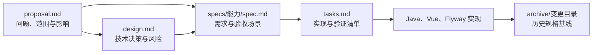

# openspec — changes

# openspec — changes

`openspec/changes` 是系统的变更规格与实施记录层，用于保存 OpenSpec 提案、技术设计、行为规格和任务清单。它不是 Java、Vue 或数据库迁移的运行时代码，因此调用图中没有内部、外部或传入调用边是预期结果。

该模块通过明确的文件路径、类名、DTO、API 路径和数据库迁移，将需求文档与实际代码连接起来。开发者应将其视为变更契约和决策记录，而不是可以直接执行的程序。

## 目录结构

```text
openspec/changes/
├── 2026-09-01-ext-extraction/
│   ├── proposal.md
│   ├── design.md
│   ├── tasks.md
│   └── specs/
│       ├── identifier-auto-generation/spec.md
│       ├── identifier-template-designer/spec.md
│       ├── metadata-object-association/spec.md
│       └── namespace-identifier-policy/spec.md
├── 2026-09-01-mdr-ext-schema-split/
│   ├── proposal.md
│   ├── design.md
│   ├── tasks.md
│   └── specs/
│       └── database-portability/spec.md
├── 2026-09-01-mdr-standard-conformance/
│   ├── proposal.md
│   ├── design.md
│   ├── tasks.md
│   └── specs/
│       └── registration-status/spec.md
└── archive/
    └── YYYY-MM-DD-<change-name>/
        ├── proposal.md
        ├── design.md
        ├── tasks.md
        └── specs/
            └── <capability>/spec.md
```

目录名采用 `YYYY-MM-DD-kebab-case` 格式。`openspec/changes` 下的目录表示仍在提案、实施或验收阶段的变更；`openspec/changes/archive` 保存已经进入历史基线的变更。

归档位置本身不保证所有验收工作均已完成。例如，`archive/2026-07-26-align-namespace-ui/tasks.md` 仍保留未勾选的端到端测试、版本更新和归档任务，因此仍需结合任务状态、实际代码和测试结果判断完成度。

## 文档组成

一个完整的变更目录通常由以下四类文件组成。

| 文件 | 作用 | 主要读者 |
|---|---|---|
| `proposal.md` | 说明变更原因、范围、能力变化和系统影响 | 评审者、产品与架构人员 |
| `design.md` | 记录背景、目标、非目标、技术决策和风险 | 设计与实现人员 |
| `specs/<capability>/spec.md` | 定义可观察行为、需求和验收场景 | 开发、测试与验收人员 |
| `tasks.md` | 将设计拆分为实现、迁移、测试和文档任务 | 执行变更的开发者 |

### `proposal.md`

提案回答以下问题：

- 为什么需要变更，即 `Why`。
- 具体改变什么，即 `What Changes`。
- 新增或修改了哪些能力，即 `Capabilities`。
- 对后端、前端、数据库和接口有什么影响，即 `Impact`。

部分较新的提案使用 YAML 元数据，例如 `status`、`type`、`author`、`created` 和 `updated`；较早的提案直接从 `Why` 开始。元数据格式目前并不统一，读取或评审时不能只依赖 front matter。

### `design.md`

设计文档重点记录需要代码无法直接表达的技术选择，常见结构包括：

- `Context`：现有实现和约束。
- `Goals / Non-Goals`：明确范围内和范围外事项。
- `Decisions`：实体、接口、数据库、事务、安全和前端交互方面的选择。
- `Risks / Trade-offs`：风险、缓解措施及接受的权衡。

设计文档不应重复完整需求。行为的规范性描述应放在 `specs` 中，设计文档只解释实现选择及其原因。

### `specs/<capability>/spec.md`

每个能力使用独立目录，例如：

```text
specs/language-identification-edit/spec.md
specs/registry-specification/spec.md
specs/identifier-auto-generation/spec.md
```

现有文件主要使用两种增量类型：

- `ADDED Requirements`：新增能力。
- `MODIFIED Requirements`：修改已有能力。

典型需求结构为：

```md
### Requirement: 数据库语言标识初始化

系统首次启动或重新初始化时，必须幂等写入内置语言标识。

#### Scenario: 首次启动初始化语言
- **WHEN** 系统首次执行数据初始化
- **THEN** 数据库写入内置语言，且 `enabled` 为 `true`
```

验收场景应描述可观察结果，而不是仅描述某个私有方法是否被调用。涉及多个条件时，应使用 `AND` 明确前置条件、持久化结果、接口返回或界面行为。

如果变更仅重构实现、不改变既有行为，可以在提案中将 `Modified Capabilities` 留空，并在 `design.md` 中说明兼容性保证。

### `tasks.md`

任务清单使用编号和复选框记录实施进度。任务应尽量指向可定位的代码资产，例如：

- Java 类和方法：`RegistrySpecificationService#update`、`LanguageInitializer.initializeLanguages`。
- 前端组件：`NamespaceList.vue`、`DesignationEditor.vue`。
- API：`GET /api/v1/namespaces/{id}/detail`。
- Flyway 脚本：`V20260727001__Remove_identifier_type_columns.sql`。
- 测试类：`RegistrySpecificationServiceTest`、`InitWizardServiceIntegrationTest`。

任务勾选表示执行者认为对应工作已经完成，不等同于运行时代码一定正确。构建失败、类型检查失败和未执行的测试应在任务说明中明确记录。

## 变更生命周期



推荐工作顺序如下：

1. 在 `openspec/changes` 创建带日期前缀的变更目录。
2. 编写 `proposal.md`，先确定问题边界和受影响能力。
3. 对存在架构选择的部分编写 `design.md`。
4. 在 `specs` 中为每个新增或修改的能力编写增量规格。
5. 将实现拆分为 `tasks.md` 中的可验证任务。
6. 同步修改后端、前端、数据库迁移和测试。
7. 完成验证后更新任务状态。
8. 通过项目归档流程将整个变更目录移入 `archive`。

历史任务中使用的归档命令形式为：

```bash
openspec archive align-namespace-ui --yes
```

归档后，应以该目录作为当时的规格依据；后续行为变化应通过新的活动变更和 `MODIFIED Requirements` 表达，而不是直接重写历史规格。

## 当前活动变更

当前源快照中存在三个未归档变更。相关 Markdown 文件在本次可读源中不可读，因此只能根据目录和规格路径确认能力边界，不能据此推断具体需求内容或实现状态。

### `2026-09-01-ext-extraction`

包含四个能力规格：

- `identifier-auto-generation`
- `identifier-template-designer`
- `metadata-object-association`
- `namespace-identifier-policy`

`proposal.md`、`design.md` 和 `tasks.md` 的具体内容在当前源快照中不可读。评审或实施前应直接读取这些文件，确认它们与后续 `2026-07-27-cleanup-identifier-type-and-simplify-strategy-routing` 中“仅按 Namespace 路由”的决策是否一致。

### `2026-09-01-mdr-ext-schema-split`

包含 `database-portability` 能力规格。该变更位于数据库可移植性方向，开发时应重点核对：

- SQL Server、SQLite 和达梦迁移脚本的一致性。
- Schema、序列、自增键和布尔值的方言差异。
- JPA `@Table(..., schema = "mdr")` 与 Flyway 脚本是否一致。
- 是否存在仅在单一数据库上验证过的假设。

### `2026-09-01-mdr-standard-conformance`

包含 `registration-status` 能力规格。其源内容在当前快照中不可读；实现时应以该规格对注册状态、状态迁移和接口表示的定义为准，并与 `RegistrySpecification`、命名空间及其他受管项的生命周期校验保持一致。

## 归档变更索引

当前快照可辨识的归档变更包括以下内容。

| 归档变更 | 主要内容 | 关键代码连接点 |
|---|---|---|
| `2026-06-01-add-language-id-edit` | 将语言标识改为内置字典，仅允许启用或禁用 | `LanguageIdentification`、`LanguageInitializer`、`LanguageIdentificationService`、`LanguageList.vue` |
| `2026-06-01-add-registry-specification-flow` | 引入注册规范、初始化选择、关键字段锁定和治理门禁 | `RegistrySpecification`、`RegistrySpecificationService`、`RegistrySpecificationInterceptor`、`InitWizardService` |
| `2026-06-01-auto-generate-scoped-identifiers` | 引入命名空间作用域的自动标识符生成和序列并发锁 | `ItemAdministrationService`、`IdentifierStrategyConfigService`、`SequenceProvider`、`SequenceRegistryService` |
| `2026-06-02-add-user-profile-individual` | 账户与个人资料关联、个人列表过滤和“我的”页面 | `AuthController`、`AuthService`、`IndividualService`、`MyProfile.vue` |
| `2026-06-02-designation-definition-editor-components` | 拆分指称、定义、上下文和可接受性编辑器 | `DesignationEditor.vue`、`DefinitionEditor.vue`、`ContextSelector.vue`、`AcceptabilitySelect.vue` |
| `2026-06-03-fix-languages-empty-after-factory-reset` | 恢复出厂设置后重新加载语言和默认命名空间 | `LanguageInitializer.initializeLanguages`、`SystemDefaultNamespaceInitializer.initializeSystemDefaultNamespace` |
| `2026-06-03-registration-authority-refinements` | 单注册表删除限制、注册机构中英文名称同步 | `RegistrationAuthorityService`、`InitWizardService`、`OrganizationService` |
| `2026-06-04-refactor-account-schema-and-registration` | 合并账户模型、迁移到 `mdr` Schema、增加自主注册与审核 | `Account`、`Individual`、`Contact`、`AuthService.register` |
| `2026-06-07-factory-reset` | 动态清空数据库、重建管理员、使旧会话失效 | `FactoryResetService.executeFactoryReset`、`POST /api/v1/system/factory-reset` |
| `2026-06-08-admin-emergency-login` | 超级管理员首次免密、应急码、强制改密和临时密码 | `AuthService.login`、`JwtService`、`ForcePasswordResetInterceptor`、`AccountController` |
| `2026-07-26-align-namespace-ui` | 前端命名空间全字段表单和命名规范 CRUD | `NamespaceList.vue`、`NamingConventionList.vue`、`namespaceApi`、`namingConventionApi` |
| `2026-07-27-cleanup-identifier-type-and-simplify-strategy-routing` | 删除 `IdentifierType`，将策略路由简化为 Namespace 单键 | `IdentifierStrategyConfigService`、`IdentifierGenerationStrategyRegistry`、`SequenceProvider` |

这些变更不是相互独立的。后续变更经常修正或取代早期设计，因此阅读历史文档时必须结合时间顺序。

## 关键跨模块链路

### 初始化、恢复出厂设置与基础数据

语言和默认命名空间存在明确依赖：

1. 应用启动时，`LanguageInitializer` 作为 `ApplicationRunner` 初始化 G20 常用语言。
2. `LanguageInitializer` 应先于依赖语言数据的其他初始化器执行。
3. `SystemDefaultNamespaceInitializer` 创建 `system-default` 命名空间时依赖 `en-US`、`zh-CN` 等语言记录。
4. `FactoryResetService.executeFactoryReset` 清空业务表后，将系统初始化状态重置为 `false`。
5. 再次执行 `InitWizardService.setup` 时，必须先调用：
   - `LanguageInitializer.initializeLanguages()`
   - `SystemDefaultNamespaceInitializer.initializeSystemDefaultNamespace()`

语言初始化必须幂等，统一通过 `findByLanguageIdentifier` 查找已有记录。启动初始化和向导初始化应复用同一逻辑，避免出现两条不同的种子路径。

### 注册规范与治理门禁

注册规范能力连接了初始化、领域模型、权限门禁和就绪检查：

- `RegistrySpecification` 保存注册表名称、标识符前缀、自动生成规则、校验正则、版本策略、强制分类和默认语言等配置。
- `RegistrySpecificationService#update` 在已有元数据时锁定以下关键字段：
  - `identifierPrefix`
  - `autoGenerateIdentifier`
  - `identifierPattern`
  - `versioningPolicy`
  - `mandatoryClassification`
  - `defaultLanguage`
- `RegistrySpecificationInterceptor` 阻止尚未创建注册规范时的治理写操作，同时放行初始化、认证和注册规范自身接口。
- `DataGovernanceReadinessService` 和 `ReadinessChecklist` 使用 `registrySpecificationExists` 反映系统是否具备治理条件。
- `InitWizardService.setup` 接收可选的注册规范配置；`InitWizard.vue` 负责立即创建或稍后创建的选择。

该链路的关键原则是：注册规范自身的创建入口不能被治理门禁拦截，否则系统无法从“尚未创建规范”的状态恢复。

### 标识符生成与策略简化

早期归档变更 `2026-06-01-auto-generate-scoped-identifiers` 使用 `(Namespace, IdentifierType)` 作为策略路由键，并通过 `SequenceProvider` 解耦 `common-facilities` 与 `web` 模块：

- `ItemAdministrationService` 在请求标识符为空时调用 `IdentifierStrategyConfigService`。
- `IdentifierGenerationStrategyRegistry` 选择 UUID、SEQUENCE、TEMPLATE 或 URN 策略。
- `SequenceRegistryService` 在 `web` 层实现 `SequenceProvider`。
- `SequenceRegistryRepository` 使用 `PESSIMISTIC_WRITE` 悲观写锁保护同一 Namespace 的序列递增。

后续 `2026-07-27-cleanup-identifier-type-and-simplify-strategy-routing` 明确删除了 `IdentifierType`，策略路由改为仅按 Namespace 查找，同时保留：

- `IdentifierStrategyConfig.version` 版本化机制。
- `publish()`、`disable()` 生命周期。
- 已有 `ScopedIdentifier.identifier` 的实际字符串值。
- SEQUENCE 策略的并发控制。

因此，早期归档文档中出现的 `IdentifierType`、`identifierType` 或双键查询只能作为历史背景，不能直接用于新实现。新增设计应遵循 Namespace 单键模型。

### 指称、定义与语言过滤

多语言编辑能力拆分为以下可复用组件：

- `DesignationEditor.vue`：编辑指称列表。
- `DefinitionEditor.vue`：编辑定义列表。
- `ContextSelector.vue`：远程搜索上下文。
- `AcceptabilitySelect.vue`：选择 `PREFERRED`、`ADMITTED`、`DEPRECATED`、`SUPERSEDED`、`OBSOLETE`。
- `DesignationDefinitionSection.vue`：组合指称、定义和配对区域。

这些组件通过 `languageApi.list`、`contextApi.options` 和 `pairingApi` 与后端交互。语言加载行为经历了后续修订：较早的设计使用 `languageApi.list({ size: 100 })`，而 `2026-06-01-add-language-id-edit` 将其更新为只加载启用语言：

```ts
languageApi.list({ size: 100, enabled: true })
```

因此，`DesignationEditor.vue` 和 `DefinitionEditor.vue` 的新实现应保留 `enabled: true`，避免用户选择已禁用语言。

`DesignationDefinitionSection` 适用于不需要独立 Tab 校验的简单场景；`ItemFormDialog.vue` 可以继续直接使用三个子编辑器，以独立控制各 Tab 的校验状态。

### 账户、个人资料与联系人

账户模型演进为：

- `Account`：对应 `mdr.account`，保存用户名、密码哈希、系统角色、启用状态和审计字段。
- `Individual`：保存真实个人资料，可与 `Account` 一对一关联。
- `Contact`：保存业务角色和组织关系，可以先于 `Individual` 存在。

初始化时，注册管理员先产生没有 `Individual` 的 `Contact`。用户首次在“我的”页面保存资料时，系统才创建 `Individual`，并回填账户和相关联系人记录。

`IndividualService.list` 必须排除与禁用账户关联的个人信息，同时保留：

- 与启用账户关联的个人信息。
- 没有账户关联的独立个人。

早期规格中的 `AppUser`、`app_user` 和 `ADMIN` 已被后续 `Account`、`mdr.account` 和 `SUPER_ADMIN` 模型取代。涉及当前账户模型时应以后者为准。

### 超级管理员、工厂重置与注册控制

安全相关变更形成以下闭环：

- `FactoryResetService.executeFactoryReset` 动态清理除 Flyway 历史表以外的数据，并重建默认管理员。
- 清理后账户 UUID 改变，使旧 JWT 中的 `sub` 无法再解析到有效账户，从而自然失效旧会话。
- `AuthService.login` 支持超级管理员首次免密登录和应急码登录。
- `JwtService.generateToken` 写入 `forceChangePassword`、`emergencyLogin` 等声明。
- `JwtAuthenticationFilter` 将声明传递给 `AuthenticatedUser`。
- `ForcePasswordResetInterceptor` 在强制改密期间仅放行登录、当前用户信息和修改密码接口。
- `AuthService.register` 根据系统设置决定新账户是否立即启用。
- `AccountController` 的密码重设接口生成只展示一次的临时密码，并强制用户首次登录后改密。

当前账户模型下，系统角色应统一使用 `SUPER_ADMIN`。早期归档规格中的 `ROLE_ADMIN` 或 `ADMIN` 表述属于历史状态。

### 命名空间与命名规范

`2026-07-26-align-namespace-ui` 将前端表单与既有后端 `NamespaceRequest` 对齐，要求提交完整结构：

- `designations`
- `definitions`
- `registration`
- `shorthandPrefix`
- `schemeReference`
- 三个 ISO 治理 indicator
- `namingAuthorityId`
- `namingConventionIds`
- `parentId`

命名空间自身标识符不在表单中显示，但编辑提交时必须保留并回传既有标识符。父命名空间候选项需要排除自身及其后代，并在提交前再次防止循环引用。

`resources.ts` 中的 `namespaceApi` 应保持强类型并提供：

- `list`
- `detail`
- `create`
- `update`
- `delete`
- `deletionCheck`

命名规范通过独立的 `namingConventionApi` 管理，不应依赖命名空间页面组件的内部状态。

## 与代码库的连接方式

本模块不通过依赖注入或函数调用连接代码，而是通过以下引用关系连接：

| 规格概念 | 后端实现 | 前端实现 | 持久化或接口 |
|---|---|---|---|
| 语言启用状态 | `LanguageIdentification`、`LanguageIdentificationService` | `LanguageList.vue`、`DesignationEditor.vue`、`DefinitionEditor.vue` | `GET /api/v1/languages`、语言初始化器 |
| 注册规范 | `RegistrySpecificationService`、`RegistrySpecificationInterceptor` | `InitWizard.vue`、`RegistrySpecificationEdit.vue` | `registry_specification`、注册规范 REST API |
| 自动标识符 | `ItemAdministrationService`、`IdentifierStrategyConfigService` | `ItemFormDialog.vue` | `identifier_strategy_config`、`identifier_sequence_registry` |
| 个人资料 | `AuthService`、`IndividualService` | `MyProfile.vue`、`IndividualList.vue` | `/api/v1/auth/me/individual` |
| 账户与审核 | `Account`、`AuthService.register` | 登录页、`AppUserList.vue`、`SystemSettings.vue` | `/api/v1/auth/register`、`/api/v1/accounts/{id}/audit` |
| 工厂重置 | `FactoryResetService` | 系统设置危险操作区 | `POST /api/v1/system/factory-reset` |
| 命名空间治理 | `NamespaceService`、`NamespaceConstraintValidator` | `NamespaceList.vue` | `/api/v1/namespaces`、`/api/v1/namespaces/{id}/deletion-check` |
| 命名规范 | `NamingConventionController` | `NamingConventionList.vue` | `/api/v1/naming-conventions` |

这些路径是文档与代码之间的设计连接点。实际接口前缀、字段和状态码应以当前控制器及 DTO 为准。例如，早期设计曾出现 `/api/auth/register`，后续安全变更使用 `/api/v1/auth/register`。

## 新增变更的推荐流程

### 1. 确认变更归属

先搜索活动变更和归档规格，确认：

- 是否已有相同能力处于实施中。
- 是否会修改既有规范，而不是新增能力。
- 是否与当前活动变更的 `ext-extraction`、Schema 拆分或标准符合性工作冲突。
- 是否存在已经过时的历史设计，例如 `IdentifierType` 或 `AppUser`。

### 2. 编写提案

`proposal.md` 应明确：

- 当前问题及影响。
- 范围内和范围外内容。
- 新增、修改的能力名称。
- 后端、前端、数据库和兼容性影响。

避免在提案中使用模糊表述，如“优化相关逻辑”；应指出具体类、接口或用户行为。

### 3. 编写技术设计

只有存在重要选择时才需要 `design.md`。常见设计主题包括：

- 实体和数据库 Schema 变化。
- 服务层事务和幂等策略。
- API 版本及兼容性。
- 并发锁和初始化顺序。
- 权限白名单和前端状态门禁。
- 多数据库方言差异。

### 4. 编写增量规格

每项行为变化都应有对应的能力目录：

- 新行为放入新增能力的 `ADDED Requirements`。
- 既有行为变化放入对应能力的 `MODIFIED Requirements`。
- 实现重构但行为不变时，不应制造无意义的需求变更。

场景必须覆盖成功路径、边界条件和失败路径，例如：

- 首次初始化与重复初始化。
- 已有元数据时修改受保护字段。
- 并发请求生成相同序列值。
- 禁用语言后编辑器不再返回该选项。
- 恢复出厂设置后旧 JWT 失效。

### 5. 拆分实施任务

任务顺序通常应覆盖：

1. 数据库迁移和实体模型。
2. Repository、Service 和 Controller。
3. 安全配置、拦截器和事务边界。
4. 前端 API 类型、页面和组件。
5. 单元测试、集成测试和端到端测试。
6. 国际化、菜单和路由。
7. 构建、迁移和回归验证。

### 6. 同步修改代码和规格

实现过程中如果发现：

- DTO 字段发生变化，应更新对应规格和前端类型。
- API 路径发生变化，应更新 `proposal.md` 的影响说明。
- 数据库设计变化，应更新 `design.md` 和迁移任务。
- 行为与规格不一致，应先确定哪一个是正确契约，再同步另一方。

### 7. 验收与归档

归档前至少确认：

- 所有行为变化都有增量规格。
- 任务引用真实类、文件、接口和测试。
- 已执行任务有可复现的验证结果。
- 数据库脚本在目标方言上验证。
- 前后端请求体和响应体一致。
- 旧规格与当前行为之间的差异已被显式处理。

## 评审检查清单

### 范围与规格

- `proposal.md` 是否说明“为什么”和“改变了什么”。
- 每个新增或修改能力是否都有对应 `specs/<capability>/spec.md`。
- `MODIFIED Requirements` 是否基于当前有效版本，而不是已归档的旧版本。
- 场景是否包含明确的 `WHEN` 和 `THEN`。
- 实现重构是否被错误地写成行为变化。

### 后端与数据

- DTO、实体、Service 和 Controller 字段是否一致。
- 数据库迁移是否与 JPA 映射一致。
- 所有实体是否使用正确的 `mdr` Schema。
- 初始化器是否幂等，并具有正确的执行顺序。
- 拦截器白名单是否允许必要的恢复入口。
- 并发序列分配是否保留悲观锁保护。

### 前端与接口

- `resources.ts` 是否避免不必要的 `any`。
- 新建、编辑、详情和删除请求体是否与后端 DTO 一致。
- 隐藏字段是否仍会在提交时保留原值。
- 语言下拉是否只加载 `enabled: true` 的记录。
- 前端权限控制是否同时具备后端校验。

### 历史兼容性

- 是否错误地重新引入已删除的 `IdentifierType`。
- 是否仍使用已废弃的 `AppUser` 或 `app_user`。
- 是否混用了 `ADMIN` 和 `SUPER_ADMIN`。
- 是否使用了旧 API 前缀。
- 是否把归档任务中的历史构建问题当作当前事实。

## 维护注意事项

- 归档规格是历史契约，不自动等同于当前实现。
- 任务勾选状态可能滞后，代码和测试结果才是最终证据。
- 较新的变更可能覆盖较旧规格，例如语言过滤和标识符路由。
- `design.md` 中的类名、端点和表名应定期与实际源码核对。
- 数据库变更应同时检查 `sqlserver`、`sqlite` 和 `dm` 目录下的对应脚本。
- `2026-07-26-align-namespace-ui` 曾记录既有 TypeScript 错误及 `NamespaceStatus` 编译问题；这些属于当时快照，不能直接判断当前分支是否仍存在，但遇到相同错误时应优先检查任务记录中的历史背景。
- 活动变更文件不可读时，不应根据目录名猜测需求；应先恢复或读取原始 Markdown，再进行实现和评审。