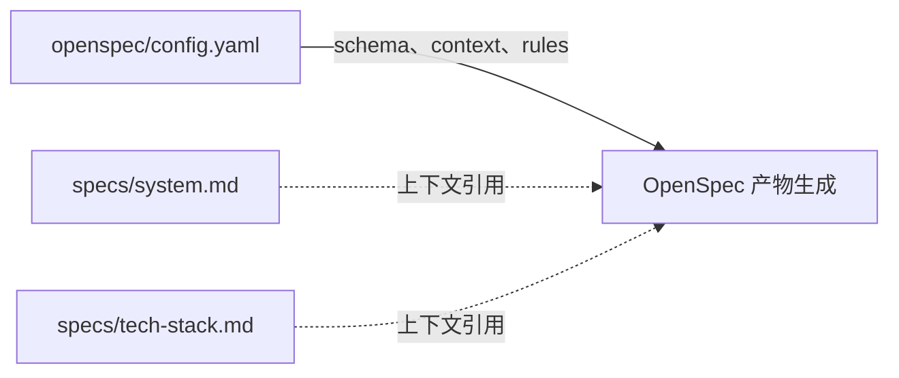

# openspec — openspec

# openspec — openspec

`openspec/config.yaml` 是 OpenSpec 的项目级声明式配置，用于定义产物的组织方式、生成语言以及提供给 AI 的项目上下文。该文件不包含运行时逻辑、函数或类，也不会直接执行文档生成。

## 配置职责

当前配置包含三个核心方面：

| 配置项 | 当前值 | 作用 |
| --- | --- | --- |
| `schema` | `spec-driven` | 选择规格驱动型工作流，用于组织提案、规格和任务等产物 |
| `context` | 多行文本 | 为产物生成过程提供项目背景、语言要求和参考文档 |
| `rules` | 未启用 | 按产物类型定义额外约束；文件中的相关示例当前均处于注释状态 |

其中，`context` 块承担主要的上下文传递职责：

1. 要求所有产物使用简体中文。
2. 指向架构文档 `specs\system.md`。
3. 指向技术栈文档 `specs\tech-stack.md`。

这些文档不是通过代码导入或函数调用连接，而是在生成产物时作为 AI 可参考的项目背景。

## 配置结构

```yaml
schema: spec-driven

context: |
  语言：中文（简体）
  所有产出物必须用简体中文撰写。

  # 其他项目上下文
  架构文档：specs\system.md
  技术栈文档：specs\tech-stack.md
```

### `schema`

```yaml
schema: spec-driven
```

`schema` 决定 OpenSpec 使用哪套产物结构和工作约定。当前项目选择 `spec-driven`，表示产物应以规格为中心进行组织和推进。

修改该字段时，应使用 OpenSpec 支持的架构名称。未知或拼写错误的值可能导致配置无法按预期解释。

### `context`

```yaml
context: |
  语言：中文（简体）
  所有产出物必须用简体中文撰写。
```

`context` 使用 YAML 块标量 `|` 保存多行文本。换行会保留，所有缩进于 `context` 下的内容都会作为上下文文本读取。

需要特别注意：

- `context` 块内的 `# 其他项目上下文` 是传给 AI 的普通文本，不是 YAML 注释，因为它位于块标量内部。
- 文件顶层以 `#` 开头且未缩进的行才是真正的 YAML 注释，不参与配置解析。
- 当前上下文明确规定所有产物必须使用简体中文。新增项目背景时应保留这一要求，除非项目明确决定调整产物语言。

### `rules`

当前文件只提供了按产物类型配置规则的示例，尚未启用：

```yaml
# rules:
#   proposal:
#     - Keep proposals under 500 words
#     - Always include a "Non-goals" section
#   tasks:
#     - Break tasks into chunks of max 2 hours
```

启用后，规则以产物类型作为键，以约束列表作为值。例如：

- `proposal` 规则约束提案内容。
- `tasks` 规则约束任务拆分方式。

这些示例仅用于说明配置形状，不表示当前项目已经执行“提案不超过 500 字”“提案必须包含非目标章节”或“任务最多两小时”等限制。启用前应根据项目实际流程调整并移除不再需要的示例。

## 工作方式

该模块采用声明式数据流，而不是命令调用或函数调用链：



其处理过程可以概括为：

1. OpenSpec 读取 `openspec/config.yaml`。
2. 根据 `schema` 选择 `spec-driven` 工作方式。
3. 将 `context` 作为项目级背景提供给产物生成过程。
4. 如果启用 `rules`，再按产物类型应用对应约束。
5. 生成的提案、规格和任务应同时遵循配置中的语言与上下文要求。

可见源码中没有配置加载函数、运行时调用或产物生成实现；以上流程描述的是该配置文件向 OpenSpec 工具和 AI 产物生成过程提供数据的方式。

## 与代码库的关系

根据调用图，本模块没有入站调用、出站调用或独立执行流。它与其他模块的关系主要是数据依赖：

- `openspec/config.yaml` 向 OpenSpec 工具提供配置。
- `specs\system.md` 提供架构背景。
- `specs\tech-stack.md` 提供技术栈背景。
- OpenSpec 生成的产物应遵循 `schema`、`context` 和已启用的 `rules`。

由于引用路径使用 Windows 风格的反斜杠：

```text
specs\system.md
specs\tech-stack.md
```

这些路径在 Windows 环境中可直接使用。在其他操作系统或跨平台 CI 环境中，应确认路径解析方式，并视需要改为：

```text
specs/system.md
specs/tech-stack.md
```

## 修改指南

修改该配置时，应遵循以下原则：

- 保留 `schema: spec-driven`，除非项目需要切换到其他受支持的架构。
- 保持 `context` 中的简体中文要求。
- 新增多行背景时继续使用 `|` 块标量，并保持一致缩进。
- 将真正需要生效的规则放在 `rules` 下，不要误以为注释中的规则已经生效。
- 规则键必须与目标产物类型一致。
- 不要在上下文中写入密码、令牌或其他敏感信息，因为上下文可能随产物生成请求一并提交给 AI。
- 修改引用路径时，同时考虑开发环境、CI 环境以及不同操作系统的路径兼容性。

## 常见问题排查

### 产物没有使用中文

检查 `context` 是否仍包含：

```yaml
语言：中文（简体）
所有产出物必须用简体中文撰写。
```

同时确认这些内容位于 `context: |` 块内，并且缩进正确。

### 自定义规则没有生效

检查以下事项：

1. `rules` 是否仍处于注释状态。
2. `rules` 是否位于文件顶层，而不是被意外包含在 `context` 块中。
3. 规则是否放在正确的产物类型键下。
4. 规则列表是否使用合法的 YAML `-` 格式。

### 找不到架构或技术栈文档

确认文件是否存在，并检查引用路径中的目录分隔符。`specs\system.md` 和 `specs\tech-stack.md` 不会被 YAML 当作转义字符处理，但反斜杠路径在非 Windows 环境中可能无法直接解析。

### 架构行为与预期不符

确认 `schema` 的值仍为受支持的 `spec-driven`，并检查是否存在拼写错误或多余缩进。