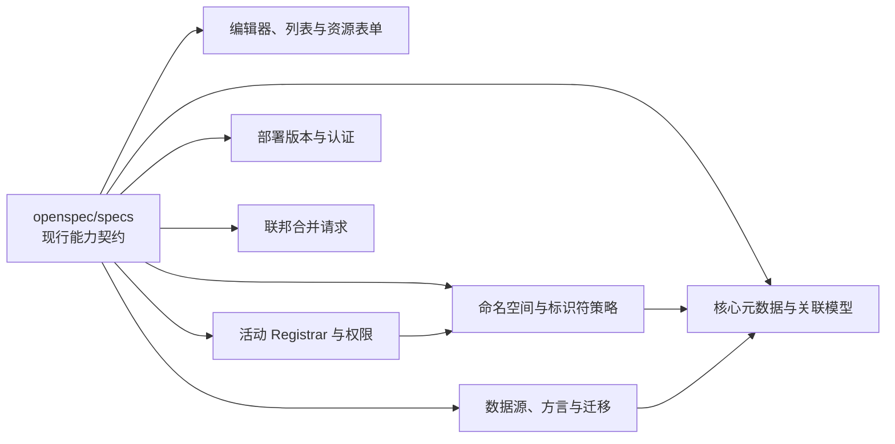

# openspec — specs

# openspec — specs

## 模块定位

`openspec/specs` 是系统的现行能力规约库，保存需求、约束、接口契约和验收场景。它不是运行时模块，不会被应用代码直接加载；当前调用图也未检测到任何内部、外部或传入调用。

该目录的主要职责是：

- 归档变更完成后，将仍然有效的行为沉淀为按能力划分的长期规约。
- 为后端实体、服务、REST API、前端组件、数据库迁移和测试提供共同契约。
- 明确不同部署版本、数据库方言和角色之间的行为差异。
- 约束跨模块协作，例如“活动 Registrar”“命名空间策略”“标识符生成”和“注册状态”之间的组合语义。
- 通过 `Scenario` 描述可验证的验收条件，使需求可以直接映射到单元测试、集成测试和端到端测试。

每个能力使用独立目录：

```text
openspec/specs/<capability>/spec.md
```

例如：

```text
openspec/specs/active-registrar-ownership/spec.md
openspec/specs/identifier-auto-generation/spec.md
openspec/specs/database-portability/spec.md
```

部分规约的 `Purpose` 仍保留了由归档变更自动生成的 `TBD` 文本。这不影响其中 `Requirements` 的约束力，但维护者应在继续扩展该能力时补全其用途说明。

## 规约结构与阅读方式

每个 `spec.md` 通常包含以下层次：

1. `Purpose`：说明该能力解决的问题和边界。
2. `Requirements`：按业务能力组织约束。
3. `Requirement`：描述一个必须满足的系统行为。
4. `Scenario`：以 `GIVEN`、`WHEN`、`THEN`、`AND` 描述输入条件、操作和可观察结果。

其中：

- `SHALL`、`MUST` 表示强制要求。
- `MAY` 表示可选行为。
- `Scenario` 是验收测试的主要来源，不只是使用示例。
- 归档目录中的旧变更保留历史语义；当前行为应优先查看对应的 `openspec/specs/<capability>/spec.md`。
- 跨能力要求经常通过 `active-registrar-ownership`、`namespace-identifier-policy`、`registry-merge-strategy` 等能力名称互相引用。

## 能力架构

下图表示规约之间的主要依赖关系，而不是运行时调用关系。



## 核心元数据与公共设施

### 约束集

`constraint-set` 定义 `Constraint_Set` 领域实体：

- `Constraint_Set` 继承 `Item`，并作为 JPA 实体映射。
- 包含三个布尔约束属性：
  - `item_shall_be_designated_indicator`
  - `item_shall_be_defined_indicator`
  - `item_shall_be_classified_indicator`
- 三个属性默认均为 `true`。
- 通过 `registered_item_constraint_set` 关联，允许零个或一个 `Constraint_Set` 对应零个或多个 `RegisteredItem`。
- REST API 位于 `/api/v1/constraint-sets`，提供列表、创建、读取、更新和删除操作；列表响应采用分页结构。

### 四个核心对象的标准关联

`metadata-object-association` 统一维护数据元、数据元概念、概念域和值域之间的关联。

| 关联类型 | 源对象 | 目标对象 | 基数与约束 |
|---|---|---|---|
| `data_element_meaning` | `DataElement` | `DataElementConcept` | `0..* → 0..1` |
| `data_element_domain` | `DataElement` | `ValueDomain` | `0..* → 0..1` |
| `value_domain_meaning` | `ValueDomain` | `ConceptualDomain` | `0..* → 0..1`，值域与概念域子类型必须一致 |
| `data_element_concept_domain` | `DataElementConcept` | `ConceptualDomain` | 多对多 |

关联写入遵循以下规则：

- 建立、解除或替换关联前，必须执行对应校验器。
- 未列入白名单的对象组合必须被拒绝，且数据库不发生变化。
- 对基数 `0..1` 的关联，重复建立表现为替换目标。
- 解除不存在的关联时抛出 `MetadataAssociationValidationException`。
- 目标对象不存在时抛出 `ResourceNotFoundException`。
- 关联方向只决定落库方式；查询和界面必须同时展示正向与反向关联，不使用“被引用”等方向性文案。
- 成功写入后记录版本历史快照。

统一 REST 接口为：

- `GET /api/v1/items/{itemId}/associations`
- `POST /api/v1/associations/{relationType}`
- `DELETE /api/v1/associations/{relationType}`

其中 `relationType` 使用：

- `data-element-meaning`
- `data-element-domain`
- `value-domain-meaning`
- `data-element-concept-domain`

写请求使用 `{ sourceItemId, targetItemId }`，成功响应返回源实体的最新完整关联列表。

关联子包中的纯服务类由 `metadata-registry-data-specification` 迁移到 `metadata-registry-web` 的 `service/association` 包，REST 行为和前端关联页保持不变。

### 关联类型与目标存在性校验

两个独立规约补充了更细粒度的校验：

- `data-element-concept-relation-validation`
  - 数据元概念的 `ObjectClass` 位置只能接受 `ObjectClass`。
  - `Property` 位置只能接受 `Property`。
  - `ConceptualDomain` 位置只能接受 `ConceptualDomain`。
  - 数据元概念与概念域的多对多集合在建立和解除关联后必须双向一致。
  - 类型错误抛出 `MetadataAssociationValidationException`，并分别提示“数据元概念必须关联到 ObjectClass”“数据元概念必须关联到 Property”或“数据元概念必须关联到 ConceptualDomain”。

- `data-element-relation-validation`
  - 数据元只能关联 `DataElementConcept` 和 `ValueDomain`。
  - Repository 必须加载数据库中存在且未逻辑删除的目标。
  - 目标不存在或已删除时抛出 `ResourceNotFoundException`，不得继续修改关联。

### 注册项与参考文档

`reference-document-link` 定义 `RegisteredItem` 与 `ReferenceDocument` 的多对多关联：

- 关联表名为 `registered_item_reference_document`。
- `POST /api/v1/registered-items/{id}/reference-documents` 为注册项添加参考文档。
- `DELETE /api/v1/registered-items/{id}/reference-documents` 仅解除关联，不删除参考文档实体。
- 查询参考文档时返回与其关联的注册项列表。
- 关联表两侧标识列必须建立索引，避免大数据量下全表扫描。

### 注册状态

`registration-status` 定义与 ISO/IEC 11179-3:2023 Table 30、ISO/IEC 11179-6:2023 Table 1 对齐的 `RegistrationStatus`：

```text
INCOMPLETE
CANDIDATE
RECORDED
QUALIFIED
STANDARD
PREFERRED_STANDARD
SUPERSEDED
RETIRED
HISTORICAL
APPLICATION
```

关键约束：

- `PREFERRED_STANDARD` 对应标准中的 “Preferred Standard”。
- 不存在 `SUBMITTED` 状态。
- 持久化读取必须大小写不敏感。
- 必须兼容 `Standard`、`Incomplete` 以及 `Preferred Standard` 等标准书写形式。
- 持久化层不得使用只允许大写枚举名的检查约束阻止标准格式导入。
- 新建 `Administered_Item` 的初始注册状态统一为 `INCOMPLETE`，包括联邦并入路径。
- 存量条目的状态不因该规则自动改变。

### 数据元精度

`data-element-precision` 为数据元增加可选的 `precision` 属性：

- 类型为 `Integer`，基数为 `0..1`。
- 贯通实体、创建请求、更新请求和响应 DTO。
- 更新请求携带 `precision=null` 时清除已有精度。
- 编辑对话框提供“精度”数字输入项，最小值为 `0`。
- 占位提示为“关联数据元值允许的小数位数”。

### 语言标识

`language-identification-edit` 管理语言标识及其启用状态：

- 首次启动或恢复出厂后的初始化阶段，自动准备 G20 常用的 22 种语言标识，例如 `zh-CN`、`en-US`、`ja-JP`、`de-DE`、`fr-FR`、`ru-RU`、`ko-KR`。
- 内置语言默认启用。
- 管理页面路由为 `/languages`。
- 列表接口为 `GET /api/v1/languages`。
- 列表展示“语言标识”“文字标识”“地区标识”“语言名称”“地区名称”，并提供启用开关。
- 切换启用状态后立即调用更新接口；失败时回滚开关状态。
- 多语言指称和定义编辑器只加载已启用语言。
- 语言名称和地区名称保存在与标准语言表一对一关联的扩展卫星表中。
- 列表和详情中的名称只来自持久化扩展数据，不允许通过 JDK `Locale` 在运行时解析或自动回填。
- 下拉框在名称缺失时回退显示 `language_identifier`，但提交值仍为 BCP 47 标识符。
- 语言下拉支持按中文名称搜索。
- 初始化向导的“文档语言”也由 `GET /api/v1/languages` 驱动，不使用前端硬编码数组。

团队版使用 `ext.language_identification`；SQLite 使用 `ext_language_identification`。预置名称以迁移脚本为唯一数据源，应用代码不内置名称数组。

## 前端编辑组件

### `AcceptabilitySelect`

`AcceptabilitySelect` 封装可接受性枚举选择：

- 渲染 `el-select`。
- 固定提供五个选项：
  - `PREFERRED` → “首选”
  - `ADMITTED` → “认可”
  - `DEPRECATED` → “已弃用”
  - `SUPERSEDED` → “已取代”
  - `OBSOLETE` → “已过时”
- 通过 `v-model` 双向绑定当前值。
- Props：
  - `size: 'small' | 'default' | 'large'`，默认 `'small'`
  - `clearable: boolean`，默认 `false`
  - `placeholder: string`，默认“可接受性”

### `ContextSelector`

`ContextSelector` 提供远程搜索上下文：

- 渲染可远程搜索的 `el-select`。
- 搜索时调用 `contextApi.options({ q: query })`。
- 挂载时调用 `contextApi.options({ q: '' })` 预加载初始选项。
- 请求期间展示 loading 状态。
- `v-model` 绑定 `contextId`，类型为字符串或 `undefined`。
- Props：
  - `clearable`，默认 `true`
  - `size`，默认 `'small'`
  - `placeholder`，默认“选择上下文（可选）”
- 清除时发出 `undefined`。

`ContextSelector` 不内置 `AcceptabilitySelect`。父组件需要同时编辑上下文和可接受性时，应将二者放在同一行中组合使用。

### `DesignationEditor`

`DesignationEditor` 编辑多语言指称：

- 接收 `modelValue: TextLineForm[]`。
- 挂载时调用 `languageApi.list({ size: 100 })`。
- 每行包含语言选择、指称文本、删除按钮和可展开的上下文配置区。
- 上下文区域组合 `ContextSelector` 与 `AcceptabilitySelect`。
- 新增指称时追加 `{ languageId: '', value: '', contexts: [] }`。
- 新增上下文时追加 `{ contextId: '', acceptability: 'ADMITTED' }`。
- 通过 `update:modelValue` 返回新数组，不直接修改 prop。

### `DefinitionEditor`

`DefinitionEditor` 与 `DesignationEditor` 保持相同布局和交互：

- 接收 `modelValue: TextLineForm[]`。
- 定义文本使用 `type="textarea"` 的 `el-input`，允许换行。
- 占位提示为“输入定义文本”。
- 新增定义时追加 `{ languageId: '', value: '', contexts: [] }`。
- 同样通过 `update:modelValue` 保持单向数据流。

### `DesignationDefinitionSection`

`DesignationDefinitionSection` 将指称、定义和配对编辑整合到一个折叠组件中：

- `designations: TextLineForm[]`，对应 `v-model:designations`
- `definitions: TextLineForm[]`，对应 `v-model:definitions`
- `pairings: PairingForm[]`，对应 `v-model:pairings`
- `showPairings?: boolean`，默认 `true`
- `itemId?: string`

三个面板分别使用：

- `DesignationEditor`
- `DefinitionEditor`
- `DesignationDefinitionPairingEditor`

组件分别发出：

- `update:designations`
- `update:definitions`
- `update:pairings`

没有 `itemId` 时，配对面板显示“保存后方可配置配对”。`showPairings=false` 时使用 `v-if`，完全不渲染配对面板。

`NamespaceList.vue`、`ConceptualDomainList.vue`、`ValueDomainList.vue` 等简单表单调用方使用该复合组件。`ItemFormDialog` 如需独立控制各页签校验，可继续直接组合三个子组件。

### 命名空间列表与表单

`namespace-ui-list` 定义列表页：

- 数据来源为 `GET /api/v1/namespaces`。
- 展示“标识符”“名称”“简写前缀”“父命名空间”“治理标志摘要”“状态”六列。
- 三个治理标志分别以高亮 `el-tag` 展示。
- 工具栏提供“新建”，行内提供“编辑”“删除”。
- 编辑通过 `namespaceApi.detail(id)` 回填 `NamespaceDetailResponse`。
- 搜索参数使用 `q`。

`namespace-ui-form` 定义新建和编辑表单：

- 基础信息：
  - `designations`
  - `definitions`
- ISO 治理属性：
  - `shorthandPrefix`
  - `schemeReference`
  - `mandatoryNamingConventionIndicator`
  - `oneNamePerItemIndicator`
  - `oneItemPerNameIndicator`
- 关联引用：
  - `namingAuthorityId`
  - `namingConventionIds`
  - `parentId`

表单必须提交完整的 `NamespaceRequest`，包括 `registration: ItemRegistrationRequest`。不得继续使用旧的 `{ identifier, titleZh, titleEn }` 平铺结构。

关联候选项来源：

- `GET /api/v1/organizations?size=200`
- `GET /api/v1/naming-conventions?size=200`
- `GET /api/v1/namespaces?size=200`

父命名空间候选必须排除自身及所有后代，提交前还要再次校验，不能形成循环引用。

命名空间自身的 `meta.identifier` 不在表单中显示，但编辑提交时必须通过 `registration.identifier` 原样回传。

删除前调用：

```text
GET /api/v1/namespaces/{id}/deletion-check
```

存在标识符或子命名空间时，提示应包含关联数量。

自有命名空间和外部命名空间的性质在创建后不可修改：

- 自有命名空间提供段规则设计器和版本生成策略。
- 外部命名空间只提供手动录入说明和可选正则校验，不提供自动生成配置。

### 命名规范界面

`naming-convention-ui` 提供独立的命名规范 CRUD 页面，API 为：

- `POST /api/v1/naming-conventions`
- `GET /api/v1/naming-conventions`
- `GET /api/v1/naming-conventions/{id}`
- `PUT /api/v1/naming-conventions/{id}`
- `DELETE /api/v1/naming-conventions/{id}`

列表展示名称及五个规则属性：

- `scopeRule`
- `authorityRule`
- `semanticRule`
- `syntacticRule`
- `lexicalRule`

其中 `scopeRule` 必填，其余规则属性可选。指称和定义可以为空。

删除前，前端最多扫描 200 个命名空间统计引用数量。存在引用时显示引用数量；超过扫描上限时提示用户通过搜索进一步确认，但不得仅因上限阻断删除。

`metadata-registry-ui/src/api/resources.ts` 中的 `namespaceApi` 和 `namingConventionApi` 必须使用明确 TypeScript 类型，不得使用 `any`。

## 活动 Registrar、权限与归属

### 活动身份解析

`active-registrar-ownership` 规定注册工作基于当前活动 Registrar：

1. 优先使用浏览器端选择且仍属于当前账号的有效 Registrar。
2. 浏览器没有有效选择时，使用账号默认注册人员身份。
3. 默认身份缺失或失效时，回退首个有效 Registrar。
4. 账号没有 Registrar 时，不得执行注册治理操作。

浏览器切换只影响当前浏览器的后续请求，不得调用持久化激活状态接口，也不影响其他设备。

默认注册人员由 Registrar 卫星表上的 `is_default` 标识：

- 同一账号最多一个默认 Registrar。
- 设置新默认时，在同一事务内清除其他默认标志。
- 首个 Registrar 自动成为默认。
- 删除默认 Registrar 后，剩余首个 Registrar 自动递补。
- 普通 `Contact` 不能设为默认。
- 默认标志属于扩展模型，不存放在标准 `mdr` 表或 `account` 表。

### Registrar 与 Submitter 权限边界

Registrar 可以执行注册受管项、生成标识、编辑策略和推进注册状态等治理操作。

已登记为 Contact 但没有 Registrar 身份的 Submitter：

- 可以通过 Submitter 通道创建或编辑元数据内容。
- 不能生成标识。
- 不能编辑标识或版本生成策略。
- 不能推进注册状态。

既不是 Registrar、也不是 Contact 的账号只能查看条目，不能注册 `Administered_Item`。

超级管理员不自动豁免条目所有权校验；如果需要修改某机构条目，应先取得并激活对应 Registrar 身份。

### 自有与外部命名空间

自有或外部属性只依据活动 Registrar 的 `registrationAuthority` 判定，不依赖角色名字符串：

- 命名空间关联的注册机构与活动 Registrar 所属注册机构相同：自有。
- 命名空间关联其他机构或没有关联注册机构：外部。

标识自动生成只允许在自有命名空间执行。外部命名空间中的无标识创建请求必须被拒绝，不能回退到全局默认生成策略。

标识及版本生成策略只能由命名空间所属注册机构的活动 Registrar 编辑。

### 条目所有权

新建条目必须具有非空的 `registrationAuthority_id`：

- Registrar 创建的条目归属其活动 Registrar 所在注册机构。
- Submitter 创建的条目归属系统唯一注册机构。
- 请求体不得接受 `registrationAuthorityId`、`owningRegistrationAuthorityId` 或等效归属字段。
- 前端创建和编辑表单只读展示服务端推导的归属，不提供注册机构选择器。
- 本地创建、更新和删除不得改变既有条目的归属。
- 归属变化只能由注册表合并流程触发。

修改或删除条目时，当前用户必须满足：

- 正以条目所属注册机构的 Registrar 身份为活动身份；或
- 是 Submitter，且条目归属系统唯一注册机构。

仅持有目标机构 Registrar 身份但当前激活的是其他机构时，操作仍被拒绝。

### 默认命名空间推导

`default-namespace-by-active-registrar` 规定，新建受管项未显式携带 `namespaceId` 时：

- 后端从 `ActiveRegistrarContext` 读取活动 Registrar。
- 查找唯一满足以下条件的命名空间：
  - `registrationAuthority != null`
  - `registrationAuthority == activeRegistrar.registrationAuthority`
  - `namespaceKind != EXTERNAL`
- 显式传入的 `namespaceId` 始终优先。
- 无活动 Registrar、活动 Registrar 失效或没有唯一自有命名空间时，不执行默认推导。
- 同一注册机构出现多个自有命名空间时视为数据一致性错误，不得任意选择。
- 前端创建对话框使用相同规则预选，但允许用户修改。
- 不持久化“上一次命名空间”，避免活动身份切换后被旧选择污染。
- 联邦合并路径以显式 `explicitAuthority` 为准，不应用该默认逻辑。

## 部署版本、认证与恢复出厂

### `PERSONAL` 与 `TEAM`

`deployment-edition` 定义两个正式交付版本：

| 能力 | `PERSONAL` | `TEAM` |
|---|---|---|
| 登录与令牌 | 不提供登录流程，业务 API 自动按唯一超级管理员处理 | 所有业务 API 要求有效令牌 |
| 用户管理入口 | 不提供 | 提供 |
| 密码与应急码 | 不适用 | 适用 |
| 注册机构 | 超级管理员可创建任意数量 | 可创建任意数量 |
| SQLite | 支持，默认使用 | 不支持 |
| SQL Server / 达梦 DM8 | 支持 | 支持 |

初始化时选择的版本写入 `system_setting` 的 `system.edition`：

- `system.edition` 写入后不可通过常规 API 或管理界面修改。
- `/api/v1/init-wizard/status` 在已初始化时返回当前版本。
- `CLOUD` 只作为枚举占位，不出现在初始化选项中；直接提交时必须被拒绝。
- 系统不存在 `SINGLE`/`MULTI` 注册表运行模式，也没有相应切换 API。

`PERSONAL` 版初始化创建带 Primary 标志的主要注册机构，该机构不可删除。管理员的第一个 Registrar 自动成为默认注册人员。

### 超级管理员应急登录

`admin-emergency-login` 仅适用于 `TEAM`：

- 超级管理员首次登录可免密进入，但会话被标记为必须改密。
- 必须改密状态下，普通业务 API 被 498 拦截。
- 未初始化系统可例外访问 `/api/v1/init-wizard/**` 和 `/api/v1/datasource/**`。
- 应急码位于部署目录的本地文件中，成功使用后立即废弃并生成新应急码。
- 应急登录后必须改密，新密码不能与旧密码相同。
- 超级管理员不能禁用或删除自己的账号，前端按钮禁用，后端也必须拒绝。
- 超级管理员可以为普通用户重设一次性临时密码。
- 临时密码成功登录一次后标记为已使用；再次使用必须返回“临时密码已失效，请联系管理员重新重置密码”。
- 完成改密后清除强制改密和临时密码已使用标志。

### 恢复出厂

`factory-reset` 要求按部署版本采用不同确认方式：

- `TEAM`
  - 调用者必须具有 ADMIN 角色。
  - 必须输入当前管理员密码。
  - 密码错误或缺失返回 `400 Bad Request`，按认证失败处理。
- `PERSONAL`
  - 不要求密码。
  - 必须逐字输入确认短语“恢复出厂设置”。
  - 只接受 `127.0.0.0/8` 或 `::1` 回环来源；远程请求返回 403 业务响应。
  - 无法确定部署版本时，前端按团队版密码确认方式渲染。

成功恢复出厂时：

- 清除业务数据、用户数据、审计日志、设置和关联系统配置。
- 保留并重建默认 `admin` 账号。
- `PERSONAL` 版将 `password_hash` 写为 `NO_PASSWORD` 哨兵值。
- `TEAM` 版恢复默认密码哈希。
- 将 `system.initialized` 设置为 `false`。
- 使此前签发的 JWT 和活跃会话失效。
- 后续业务请求应返回 401 或 499，并引导至 `/init-wizard`。
- 前端清理 Pinia 和 localStorage 中的认证状态，展示全屏加载并跳转到初始化向导。

恢复出厂的数据库清理必须通过 JPA 元模型发现业务表，不得依赖 `INFORMATION_SCHEMA`、`sys.*`、`DBCC` 或直接拼接的 T-SQL。

### 初始化向导

`initialization-wizard` 定义了治理对象初始化、Registrar 自指派、命名空间创建、组织创建、Contact 批量配置和命名空间 ACL 等基础行为：

- 超级管理员创建默认注册机构。
- 可选择是否将自己指派为该机构的 Registrar。
- 自指派后继续询问是否创建命名空间。
- 自有命名空间的 `naming_authority` 默认指向注册机构且不可编辑。
- 删除存在 `ScopedIdentifier` 的命名空间前必须二次确认。
- 外部命名空间不关联注册机构，可选择或自动创建外部 `Organization` 作为命名机构。
- Registrar 可以创建组织并批量登记其他用户为 Contact。
- 未登记 Contact 或没有角色的用户默认只读。
- 用户权限优先于组织权限；组织无配置时默认只读；无组织且无显式权限时默认只读。

## 命名空间与标识符策略

### `ScopedIdentifier` 模型清理

`identification` 明确 `ScopedIdentifier` 不包含：

- `identifierType`
- `effectiveStrategyConfig`

对应数据库表也不得保留：

- `scoped_identifier.identifier_type`
- `scoped_identifier.effective_strategy_id`

`IdentifierStrategyConfig` 同样不包含 `identifierType`，唯一约束为：

```text
(namespace_id, version)
```

`SequenceRegistry` 每个命名空间只能有一条记录，唯一约束为命名空间单列。

`IdentifierGenerationStrategyRegistry.resolve(namespace)` 只按命名空间解析策略：

1. 命名空间特定策略；
2. 全局默认策略。

移除 `identifier_type` 列时必须保留所有既有 `ScopedIdentifier.identifier` 的原始字符串值，包括 `urn:xxx:uuid` 形式。

### 命名空间输入模式

`namespace-identifier-policy` 为标识符和版本分别定义输入模式：

| 模式 | 创建时行为 | 前端行为 |
|---|---|---|
| `AUTO_ONLY` | 拒绝非空标识符或版本 | 禁用输入，不显示切换控件 |
| `AUTO_WITH_OVERRIDE` | 空值自动生成，非空值校验后采用 | 创建态允许切换自动或手动 |
| `MANUAL_ONLY` | 空值被拒绝 | 启用输入并强制必填，不显示切换控件 |

无法解析的模式回退为 `AUTO_WITH_OVERRIDE`。

版本化策略：

| 策略 | 初始自动版本 | 手动格式 |
|---|---|---|
| `SEMVER` | `1.0.0` | 语义化版本 |
| `SEQUENTIAL` | `1` | 非负整数 |
| `DATE` | 当天 `yyyy-MM-dd` | 合法 `yyyy-MM-dd` 日期 |

命名空间可配置可选的 `manualIdentifierPattern`：

- 手动标识符必须完整匹配正则。
- 非法正则只记录警告，并按未配置正则处理，不阻断保存。
- 未配置正则时仍执行非空和唯一性校验。

命名空间策略属性由 `NamespaceIdentifierPolicy` 卫星实体承载，`ScopedIdentifier` 的生命周期属性由 `ScopedIdentifierLifecycle` 承载。标准 `Namespace` 和 `ScopedIdentifier` 实体只保留标准模型属性。

### 创建模式持久化

创建时选择的模式写入：

- `ScopedIdentifier.identifierCreationMode`
- `ScopedIdentifier.versionCreationMode`

取值为 `AUTO`、`MANUAL` 或历史数据的 `NULL`。

| 持久化值 | 标识符编辑 | 版本编辑 |
|---|---|---|
| `AUTO` | 输入禁用，后端拒绝手动改写 | 后端忽略请求版本并按策略递增 |
| `MANUAL` | 单 SI 条件下允许改写并校验 | 接受显式版本并校验；空值按策略递增 |
| `NULL` | 等价 `MANUAL` | 等价 `MANUAL` |

创建请求未携带模式时，后端按字段是否为空反推：

- 标识符为空：`identifierMode='AUTO'`
- 标识符非空：`identifierMode='MANUAL'`
- 版本为空：`versionMode='AUTO'`
- 版本非空：`versionMode='MANUAL'`

模式在创建后锁定，不允许通过编辑反向切换。

### 标识符自动生成

`identifier-auto-generation` 规定，自有命名空间只有在用户选择自动生成且请求未填写标识符时才执行生成。

运行时标识策略以已发布段模板为核心，支持的段类型为：

- `LITERAL`
- `OBJECT_ABBREVIATION`
- `SEQUENCE`
- `UUID`
- `SEPARATOR`
- `TIMESTAMP`
- `CHECKSUM`
- `VARIABLE`

`RANDOM` 已移除，含 `RANDOM` 的模板必须拒绝。

模板必须恰好包含一个唯一性段：

- `SEQUENCE`
- `TIMESTAMP`
- `UUID`

缺少唯一性段或包含多个唯一性段均不能发布。`TIMESTAMP` 作为唯一性段时必须精确到毫秒。

顺序号作用域由模板结构自动决定：

- 包含 `OBJECT_ABBREVIATION`：按对象缩写分别计数，例如 `DE.00001`、`VD.00001`。
- 不包含 `OBJECT_ABBREVIATION`：命名空间内全局计数。
- 禁止显式提交 `scopeRefs`。
- 计数器按 `(namespace_id, scope_key)` 持久化，并使用数据库行级排他锁原子分配。

手动标识符仍必须通过：

- 已发布模板派生的格式正则；
- 命名空间内唯一性校验。

### 外部命名空间策略

外部命名空间必须手动提供标识符和版本：

- 无标识创建请求必须被拒绝。
- 不得回退到全局默认自动生成策略。
- 外部命名空间中的 `ScopedIdentifier` 写入：
  - `identifierCreationMode=NULL`
  - `versionCreationMode=NULL`
- 编辑时允许修改标识符和版本。
- 可选正则只用于格式校验，不参与生成。

### 段模板设计器

`identifier-template-designer` 定义可视化段模板编辑器：

- 支持增加、删除、上下移动和编辑段。
- 调色板按内容段、唯一性段和修饰段分类。
- 包含类型化参数面板、实时预览、合法性校验和只读模板表达式。
- 表达式示例：`{LITERAL:WN}.{OBJECT_ABBREVIATION}.{SEQUENCE(pad=5)}`。
- 可试生成最多连续 5 个样例，顺序号样例从配置的起始值递增。
- 时间戳参数提供年月日、秒、毫秒、微秒预设及自定义格式。
- 添加第二个唯一性段时引导用户替换已有唯一性段。
- 内置通用编排预设，不包含 `RANDOM`。
- 输出总长度不得超过 `scoped_identifier.identifier` 的 255 字符上限。

段类型目录采用可扩展注册机制。每种段类型必须提供：

1. 参数 schema；
2. 生成器；
3. 格式正则片段；
4. 反向解析片段；
5. 设计器 UI 配置面板。

同一份段定义派生三个能力：

- 注册时生成器；
- 手工输入和导入校验正则；
- 既有标识反向解析器。

反向解析结果可用于按各作用域已用最大序号回填计数器。

对象缩写通过系统级 JSON 映射表解析，例如：

```text
DataElement       → DE
DataElementConcept → DEC
ObjectClass       → OC
Property          → PR
ConceptualDomain  → CD
ValueDomain       → VD
ValueMeaning      → VM
DataType          → DT
UnitOfMeasure     → UOM
```

段参数中的旧 `mapping` 字段被废弃；未命中映射时可使用段内 `default` 兜底。

策略配置提供查询、保存草稿、发布、停用、预览和格式校验能力。无命名空间上下文的预览端点为：

```text
POST /identifier-strategy/preview
```

它与命名空间预览共用同一渲染引擎，不分配真实序号。

策略状态复用：

```text
DRAFT
PUBLISHED
DISABLED
```

同一命名空间同一时间最多一个 `PUBLISHED` 配置。策略升级不得修改历史标识。

### 所有 Item 子类的统一注册区段

所有 `Item` 子类都应复用同一注册区段，包括：

- `DataElement`
- `DataElementConcept`
- `ObjectClass`
- `Property`
- `ValueMeaning`
- `MeasureClass`
- `UnitOfMeasure`
- `Dimensionality`
- `DataType`
- `DataTypeScheme`
- `ConceptualDomain`
- `ValueDomain`
- `Context`
- `ConstraintSet`
- `NamingConvention`

注册区段包含：

- 命名空间选择；
- 标识符输入及内嵌自动/手动切换；
- 版本输入及内嵌自动/手动切换；
- 段模板变量录入。

切换控件必须位于 `el-input` 的 `append` 槽位，不得作为独立表单字段行。

`RegistrySpecification` 不是 `Item` 子类，不显示注册区段。`ClassificationScheme`、`ClassificationNode`、`MappingScheme` 也不受该统一区段约束。

## 数据库方言、配置与迁移

### 支持矩阵

`database-portability` 定义三种一等数据库：

| 部署版本 | SQLite | SQL Server | 达梦 DM8 |
|---|---|---|---|
| `PERSONAL` | 支持，默认 | 支持 | 支持 |
| `TEAM` | 不支持 | 支持 | 支持 |

实体类不得通过注解硬编码 schema。schema 由部署配置和 `hibernate.default_schema` 决定。

团队版物理分层：

- 标准模型表位于 `mdr` schema。
- 扩展表位于 `ext` schema。
- `item_mapping`、`item_mapping_subject`、`item_mapping_object` 仍属于标准模型，位于 `mdr` schema。
- EXT schema 通过 team profile 的 ORM 映射资源 `orm-team.xml` 指定。

SQLite 不使用 schema，扩展卫星表采用 `ext_` 物理前缀。

### Flyway 三方言目录

迁移脚本按方言维护：

```text
db/migration/sqlserver
db/migration/sqlite
db/migration/dm
```

共同基线之后的迁移必须在三个目录中使用相同版本号并实现等价语义。SQL Server 当前最新版本作为共同基线权威；给出的基线版本为 `20261009012`。

已有 Flyway 历史的数据库必须保留：

- 已应用版本；
- 迁移状态；
- 校验和；
- 历史表记录。

不得为新库基线重新基线化已有数据库，也不得重写历史迁移。

### SQLite 查询形状

SQLite 单条查询的 `FROM` 项上限为 64。条目更新和删除路径不得加载完整 `Administered_Item` 对象图。

权限校验只需要归属注册机构标识时，应使用收敛查询，避免展开全部受管项关联。否则带有复杂受管项的条目在 SQLite 上可能触发：

```text
[SQLITE_ERROR] at most 64 tables in a join
```

SQL Server 与达梦必须保持相同业务结果。

### 关联表索引与唯一约束

多对多关联表必须在两侧关联列上建立索引，包括：

- `registered_item_reference_document`
- `registered_item_submission_record`

施加组合唯一约束前必须先检查历史数据：

- 无重复时直接增加约束。
- 有重复时按确定性规则去重并重定向引用。
- 去重过程必须可重入。
- 重复执行迁移应得到相同结果。

### 数据源配置

`datasource-configuration` 要求配置显式记录方言：

- `sqlite`
- `sqlserver`
- `dm`

保存或应用前必须进行连接测试，并探测数据库版本。测试失败时：

- 返回明确失败原因；
- 不持久化配置；
- 不影响当前运行数据源。

配置持久化到本地 `application-local.yml`，不得写入数据库。用户配置在重启后优先于 profile 默认值。

系统设置提供当前数据源的只读信息和变更入口：

- 变更入口只允许超级管理员使用。
- 保存前必须连接测试。
- 明确提示变更需要重启。
- 密码不得明文回显或写入日志。

初始化向导数据库步骤只保留“下一步”一个前进入口：

- 参数修改且连接测试通过时，下一步保存配置并提示重启。
- 参数修改但未测试时阻止前进。
- 参数未修改时直接继续，不保存、不提示重启。
- 测试通过后再次修改参数，之前的测试结果立即失效。
- “配置新的数据源”表单预填当前方言和非敏感参数，密码留空。

### 跨库迁移

`database-migration` 定义迁移管线：

1. 源库全量导出。
2. 目标库连接测试。
3. 目标库建表与基线迁移。
4. 按依赖顺序导入。
5. 逐表比较行数。
6. 切换数据源配置。
7. 提示并引导重启。

约束：

- `TEAM` 不得迁移到 SQLite。
- 目标库必须为空。
- 迁移期间系统进入只读维护状态，所有业务、账号和配置写入均被拒绝。
- 任一表行数不一致时不得切换配置，并报告差异表。
- 导入失败后可中止并继续使用原数据源。
- 迁移失败不得修改原库数据或原数据源配置。

## 联邦合并

`merge-request` 定义注册表间合并请求的生命周期：

```text
DRAFT
→ SUBMITTED
→ UNDER_REVIEW
→ MERGED / REJECTED
```

异常路径进入 `FAILED` 并记录原因。

### 增量计算与首次匹配

- 首次合并没有同步水位线时，包含全部候选条目。
- 后续合并没有水位线时，只包含自上次成功合并以来新增或变更的条目。
- 来源为版本历史 `version_history`。
- 首次匹配按以下顺序产生候选：
  - 标识符精确相等；
  - designation 相似度；
  - 结构特征。
- 候选状态为 `MATCH_CANDIDATE`，必须经人工确认后才能建立链接。

### 三方比对

已链接条目使用上次并入的来源端版本快照作为合并基：

| 来源侧 | 目标侧 | 结果 |
|---|---|---|
| 变化 | 未变化 | `UPDATE` |
| 未变化 | 变化 | 跳过并提示 |
| 变化 | 变化 | `CONFLICT` |

当前不提供字段级自动合并，也不传播删除。

### 事务性并入

评审批准后，在单个事务中完成：

- 应用条目写入；
- 写入 `change_type=MERGE` 的版本历史；
- 建立或更新链接；
- 更新同步水位线；
- 生成并入回执。

任一条目失败时整体回滚，并将合并请求置为 `FAILED`。

评审人必须拥有目标命名空间权限或是超级管理员。来源节点通过节点凭据和包内签名表示，不要求来源账号存在于目标端。

### 归属重关联与双标识

并入来源方条目后：

- 条目重新关联到目的方 RAI 匹配的注册机构。
- 来源命名空间及来源标识、版本原样保留。
- 来源命名空间不关联注册机构，其 `Naming_Authority` 记录来源机构。
- 条目同时关联目的方命名空间。
- 目的方按命名空间策略生成新标识。

迁移后的条目同时具有：

- 来源命名空间下的来源标识；
- 目的方命名空间下的新标识。

### 幂等重迁移与冲突

再次迁移时：

- 来源版本与合并基一致：跳过。
- 来源版本递增且目的方未本地更新：覆盖目的方旧版本并推进合并基。
- 来源和目的方都递增：判定为 `CONFLICT`。

冲突必须由目的方注册机构的活动 Registrar 以整项方式裁决。存在未裁决冲突时，合并请求不得进入 `MERGED`。

## 可接受性持久化

`acceptability-select` 同时定义前端枚举和数据库标准格式。

前端、REST API 和 Java 枚举可继续使用大写常量：

```text
PREFERRED
ADMITTED
DEPRECATED
SUPERSEDED
OBSOLETE
```

数据库必须保存 ISO/IEC 11179-3:2023 Table 20 规定的小写形式：

```text
preferred
admitted
deprecated
superseded
obsolete
```

涉及字段：

- `designation.acceptability`
- `definition.acceptability`
- `designation_context_relation.acceptability`
- `definition_context_relation.acceptability`
- `designation_definition_pairing.acceptability`

持久化层负责大写枚举与标准小写值之间的双向转换。读取必须大小写不敏感，以兼容历史导入数据。

## 关键请求与响应契约

### `ItemRegistrationRequest`

Item 创建和更新接口可携带可选的 `registration` 负载：

```text
namespaceId
identifier
version
identifierMode
versionMode
variables
```

缺少 `registration` 的旧客户端继续按原行为工作，不应因本次统一收口而失败。

注册成功后：

- `ScopedIdentifierResponse` 暴露 `identifierCreationMode` 和 `versionCreationMode`。
- `ItemMetaResponse` 同样暴露这两个字段，允许 API 调用方检索创建时的 AUTO/MANUAL 选择。
- 双标识条目中，每个 `ScopedIdentifier` 独立保留自己的模式。

### `NamespaceRequest`

命名空间表单必须提交：

```text
designations
definitions
registration
namingAuthorityId
parentId
shorthandPrefix
schemeReference
mandatoryNamingConventionIndicator
namingConventionIds
oneNamePerItemIndicator
oneItemPerNameIndicator
```

即使字段为空，也应保持完整请求结构。

### `NamingConventionRequest`

命名规范请求至少包含：

```text
scopeRule
authorityRule
semanticRule
syntacticRule
lexicalRule
designations
definitions
registration
```

`scopeRule` 非空；指称和定义可以为空。

## 与代码库的集成边界

本模块不直接调用代码库，但规约明确指定了以下集成位置：

| 规约领域 | 代码库集成点 |
|---|---|
| 标准元数据 | `metadata-registry-common-facilities` 中的 `Item`、`Constraint_Set`、`ScopedIdentifier` 等实体 |
| 扩展策略 | `metadata-registry-ext` 中的 `IdentifierGenerationStrategy`、`IdentifierStrategyConfig`、`SequenceRegistry`、`IdentifierVersionHistory`、段模板引擎和版本治理 |
| 关联服务 | `metadata-registry-web` 的 `service/association` 包及关联 REST 控制器 |
| 活动 Registrar | `ActiveRegistrarContext`、Registrar 默认标志卫星表、命名空间所有权校验 |
| 前端组件 | `DesignationEditor`、`DefinitionEditor`、`ContextSelector`、`AcceptabilitySelect`、`DesignationDefinitionSection` |
| 前端 API | `metadata-registry-ui/src/api/resources.ts` 中的 `namespaceApi`、`n