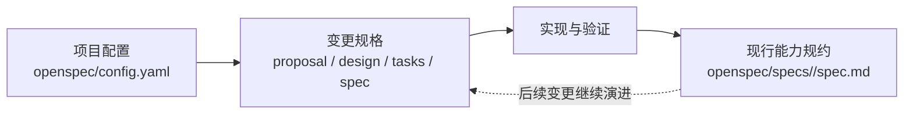

# openspec

# openspec

`openspec` 是项目的声明式规格工作区，用于连接项目上下文、变更提案、技术设计、实施任务与现行能力规约。该模块不包含可执行逻辑，不会被应用代码加载，也不参与 Java、Vue 或数据库迁移的运行时调用。

## 子模块分工

- [项目配置（openspec — openspec）](openspec-openspec.md)：通过 `openspec/config.yaml` 声明 `spec-driven` 工作流，并使用 `context` 向产物生成过程提供简体中文要求以及 `specs\system.md`、`specs\tech-stack.md` 等架构背景。
- [变更规格（openspec — changes）](openspec-changes.md)：保存变更期间的 `proposal.md`、`design.md`、`tasks.md` 和能力规格增量，记录变更原因、设计决策、实施步骤及验收要求。
- [现行规约（openspec — specs）](openspec-specs.md)：保存变更完成后仍然有效的能力契约，以 `openspec/specs/<capability>/spec.md` 组织需求、约束和 `Scenario` 验收条件。

## 跨模块工作流

1. `openspec/config.yaml` 为新变更提供统一的产物结构和生成上下文。
2. 变更在 `openspec/changes/<change>/` 中形成提案、设计、任务和规格增量，并通过明确的类、DTO、API 路径及数据库迁移建立可追溯关系。
3. 实施完成后，仍具约束力的行为进入 `openspec/specs`，例如 `identifier-auto-generation`、`namespace-identifier-policy`、`metadata-object-association` 与 `database-portability`。
4. 后续变更以现行规约为基线继续演进；因此，`changes` 表示尚未完成或正在实施的差异，`specs` 表示系统当前承诺保持的能力。

当前未检测到跨模块执行流；这里的协作关系是文档生命周期中的“配置 → 变更 → 实施 → 规约沉淀”流程。