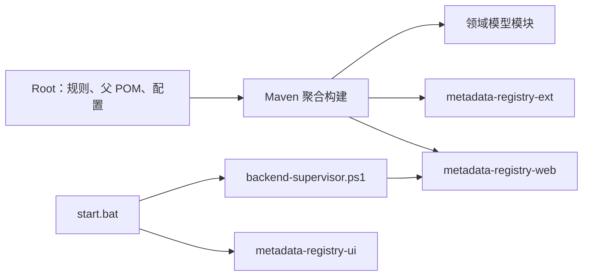

# Root

# Root

## 模块定位

Root 是 `MetadataRegistry4j` 仓库的构建、配置、运行与协作入口，不包含独立的 Java 业务包，也不生成可执行制品。它负责协调以下内容：

- 定义整个 Maven 多模块工程及统一依赖版本。
- 提供 Maven Wrapper，避免依赖本机预装 Maven。
- 集中管理 Spring Boot、数据源、JWT、Flyway 等运行配置。
- 提供 Windows 启动、停止和进程托管脚本。
- 定义 ISO/IEC 11179 数据分层、实体继承、受管链闭环等强制建模规则。
- 约束 OpenSpec、GitNexus、文档同步和测试等贡献流程。

GitNexus 未在 Root 中检测到入站、出站调用或执行流，这是预期结果：Root 的集成关系主要是 Maven 声明、配置文件引用、脚本调用和文档约定，而不是 Java 方法调用。

## 总体架构



其中：

- `metadata-registry-ui` 不属于 Maven Reactor，由 npm 单独构建和启动。
- `start.bat` 负责协调后端、前端、端口检查、构建和进程托管。
- `metadata-registry-web` 是 Spring Boot 运行入口，其他 Java 模块向其提供领域模型和扩展能力。

## 根目录关键文件

| 文件或目录 | 职责 |
|---|---|
| `pom.xml` | Maven 父工程，聚合 Java 子模块并统一依赖、插件和 Java 版本 |
| `mvnw`、`mvnw.cmd` | Unix 与 Windows Maven Wrapper |
| `application.yml` | 根目录外置 Spring Boot 配置模板 |
| `application-local.yml` | 本地 SQLite 配置模板，主要供个人开发环境使用 |
| `start.bat` | Windows 主启动器，负责构建、端口检查、后端托管和前端启动 |
| `stop.bat` | 通过后端监督器停止受管服务 |
| `run.bat` | `start.bat` 的简化入口 |
| `run.ps1` | 独立 PowerShell 启动脚本；当前版本的变量引用不完整，不应作为首选入口 |
| `AGENTS.md` | 所有 Coding Agent 必须遵守的项目级规则唯一事实源 |
| `CLAUDE.md` | 通过 `@AGENTS.md` 导入项目规则，不重复维护规则正文 |
| `enum_consts.json` | 枚举常量快照式辅助文件，不是 Maven 运行时配置或 Java 枚举的权威来源 |
| `login.json` | 本地 API 登录辅助数据，不会被 Spring 自动加载，不能视为生产凭据 |

## Maven 聚合工程

### 父工程坐标

根 `pom.xml` 使用：

```xml
<groupId>io.github.matrixlane</groupId>
<artifactId>metadata-registry4j-parent</artifactId>
<version>0.1.0-SNAPSHOT</version>
<packaging>pom</packaging>
```

其 `packaging` 为 `pom`，因此 Root 本身不生成可运行 JAR。Spring Boot 可执行包由 `metadata-registry-web` 生成。

### 当前 Reactor 模块

根 POM 当前声明以下模块：

| 模块 | 作用 |
|---|---|
| `metadata-registry-common-facilities` | ISO/IEC 11179 Common Facilities 领域模型 |
| `metadata-registry-data-specification` | ISO/IEC 11179 Data Specification 领域模型 |
| `metadata-registry-data-set-registration` | 数据集注册模块，当前为占位模块 |
| `metadata-registry-item-mapping` | ISO/IEC 11179-3 第 11 章 Item Mapping 领域模型 |
| `metadata-registry-ext` | 应用扩展实体和 `ext` schema 卫星表 |
| `metadata-registry-web` | Spring Boot 后端、REST API、安全、持久化和启动配置 |

`README.md` 的项目树还列出了 `metadata-registry-schema-extraction` 和 `metadata-registry-draft-generation`，但这两个目录目前没有出现在根 POM 的 `<modules>` 中，因此不会自动参与根 Reactor 构建。调整模块清单时，应同步检查根 POM 与 `README.md`。

### 依赖管理

根 POM 通过 `dependencyManagement` 统一以下关键版本：

- Java 17。
- Spring Boot 3.5.0。
- Hibernate 6.6.11.Final。
- Jakarta Persistence 3.2.0。
- MapStruct 1.6.2。
- JJWT 0.12.6。
- SpringDoc OpenAPI 2.8.8。
- HikariCP 5.1.0。
- Microsoft SQL Server JDBC 12.6.3。
- Testcontainers 1.20.1。
- Mockito 5.23.0。
- Lombok 1.18.48。
- JaCoCo 0.8.15。

`dependencyManagement` 只规定版本，不等于所有子模块都依赖这些组件。实际依赖关系仍以各子模块自己的 `pom.xml` 为准。

### 插件行为

根 POM 提供以下公共构建约定：

- Maven Compiler Plugin 3.13.0，编译目标为 Java 17。
- Lombok 1.18.48 作为注解处理器运行。
- Spring Boot Maven Plugin 3.5.0 由 Web 模块使用。
- Maven Surefire Plugin 3.2.2 在多模块中执行 `-Dtest=...` 时，将 `failIfNoSpecifiedTests` 设置为 `false`，避免没有匹配测试的模块直接失败。
- JaCoCo 在测试阶段生成覆盖率报告。

### 常用构建命令

在仓库根目录执行完整构建：

```bash
./mvnw clean package
```

Windows：

```bat
.\mvnw.cmd clean package
```

仅构建 Web 模块及其所需上游模块：

```bash
./mvnw -pl metadata-registry-web -am clean package
```

运行后端：

```bash
mvn -pl metadata-registry-web -am spring-boot:run
```

`start.bat` 所需的产物路径为：

```text
metadata-registry-web/target/metadata-registry-web-0.1.0-SNAPSHOT.jar
```

### Maven Wrapper

`mvnw` 和 `mvnw.cmd` 会：

1. 从 `.mvn` 目录定位 Maven 项目根目录。
2. 读取 `.mvn/jvm.config` 和 `.mvn/wrapper/maven-wrapper.properties`。
3. 在本地缺少 Wrapper JAR 时，从 Maven Central 下载。
4. 通过 `MAVEN_REPOURL` 指定内部仓库。
5. 在需要认证时使用 `MAVEN_USERNAME` 和 `MAVEN_PASSWORD`。
6. 最终调用 `org.apache.maven.wrapper.MavenWrapperMain`。

Windows 脚本要求有效的 `JAVA_HOME`；Unix 脚本会在未设置时尝试从 `java` 命令推导。

## Windows 启动流程

### 推荐入口

```bat
run.bat
```

`run.bat` 只负责切换到仓库根目录并调用 `start.bat`。日常开发和本地验收应优先使用 `start.bat` 或 `run.bat`，因为它们包含端口所有权检查、JAR 有效性检查和进程托管。

### `start.bat` 执行步骤

1. **选择 Java**
   - 优先使用已配置的 `JAVA_HOME`。
   - 其次检查 `%ProgramFiles%\Java\jdk-17`。
   - 最后从 `PATH` 中查找可用的 JDK 17 或更高版本。

2. **检查后端端口 `8081`**
   - 调用 `scripts/port-state.ps1`。
   - 只复用命令行中匹配 `metadata-registry-web` 的 Java 进程。
   - 如果端口由其他程序占用，脚本拒绝终止该进程并退出。
   - 如果发现上一次启动处于不完整状态，则进入后端恢复流程。

3. **检查后端 JAR**
   - 校验文件是否存在。
   - 进一步检查 `META-INF/MANIFEST.MF` 是否包含 `Main-Class`。
   - 缺失或不是 Spring Boot 重打包 JAR 时，执行：

   ```bat
   mvnw.cmd clean package -DskipTests
   ```

4. **启动后端**
   - 通过 `scripts/backend-supervisor.ps1` 启动 `javaw.exe`。
   - 控制目录默认为：

   ```text
   %USERPROFILE%\.metadata-registry\restart
   ```

   - 监督器负责持有后端进程、记录状态、执行受控重启以及只停止自己创建的进程。
   - 个人版配置路径为 `%USERPROFILE%\.metadata-registry\application-local.yml`。

5. **检查并启动前端**
   - 检查端口 `5173` 是否已被本项目的 `metadata-registry-ui` 占用。
   - 已是本项目进程时直接复用。
   - 被其他程序占用时给出警告；Vite 可能改用 `5174` 等相邻端口，实际端口应以 Vite 输出为准。
   - 在 `metadata-registry-ui` 中执行 `npm run dev`。
   - 启动前需确保已执行 `npm install`。

6. **显示访问地址**
   - 后端：`http://localhost:8081`
   - 前端：`http://localhost:5173`
   - Swagger UI：`http://localhost:8081/swagger-ui.html`

关闭窗口不会停止服务，应使用 `stop.bat`。

### 停止服务

`stop.bat` 不按端口粗暴终止进程，而是：

1. 加载 `scripts/backend-supervisor.ps1`。
2. 初始化监督器控制路径。
3. 原子写入停止请求。
4. 等待监督器停止其持有的后端和前端进程。
5. 返回受管服务是否全部停止的结果。

### 个人版自动重启

README 定义的受支持场景仅包括“Windows 单机个人版 + 项目启动器”：

- 初始化向导保存新的数据库配置后，启动器自动重启后端。
- 重启过程中准备数据库、核对实际数据源并返回初始化向导。
- 新配置无法启动时，恢复原数据库配置并重新启动。
- 失败目标数据库文件不会自动删除。
- 控制文件可能包含数据库口令，不应提交或对外分享。

### `run.ps1` 限制

`run.ps1` 的设计目标较简单：缺少 JAR 时构建、以后端 `personal` profile 启动 JAR、运行前端、等待用户输入后停止进程。

但当前提供的 `run.ps1` 中多处 PowerShell 变量名缺失，按文件现状无法可靠解析和执行。应修复该脚本后再将其作为正式入口；当前优先使用 `start.bat`。

## Spring Boot 配置

### 配置层级

Root 同时存在外置配置和 Web 模块内的 classpath 配置。理解优先级时应区分：

| 配置 | 作用 |
|---|---|
| `metadata-registry-web/src/main/resources/application.yml` | Web 模块打包后的 classpath 默认配置 |
| 根目录 `application.yml` | 当根目录作为工作目录或被显式加载时使用的外置配置 |
| `%USERPROFILE%\.metadata-registry\application-local.yml` | 启动器使用的个人用户配置 |
| 根目录 `application-local.yml` | 本地配置模板 |
| 环境变量、命令行参数 | 对应配置的运行时覆盖来源 |

根 `application.yml` 通过以下语句导入用户目录配置：

```yaml
spring:
  config:
    import: optional:${user.home}/.metadata-registry/application-local.yml
```

Spring Boot 外部配置优先于 JAR 内默认配置。排查“配置没有生效”时，应依次确认：

1. 是否加载了根目录外置 `application.yml`。
2. 用户目录的 `application-local.yml` 是否存在。
3. 环境变量是否覆盖了对应属性。
4. 启动命令是否显式传入参数。
5. 当前运行的是个人版还是团队版配置。

### 关键环境变量

| 变量 | 默认值或用途 |
|---|---|
| `DB_URL` | JDBC 连接地址 |
| `DB_DRIVER` | JDBC 驱动类 |
| `DB_VENDOR` | Flyway 迁移目录，默认 `sqlite` |
| `DB_DEFAULT_SCHEMA` | Hibernate 默认 schema |
| `HIBERNATE_DIALECT` | Hibernate 方言 |
| `DDL_AUTO` | Hibernate DDL 行为，默认 `update` |
| `FLYWAY_ENABLED` | 是否启用 Flyway，根配置默认关闭 |
| `SERVER_PORT` | 后端端口，默认 `8081` |
| `JWT_SECRET` | JWT 签名密钥，生产环境必须替换 |
| `JWT_EXPIRES_MINUTES` | JWT 有效期，默认 `480` 分钟 |
| `CORS_ORIGINS` | 允许的前端来源，默认 `http://localhost:5173` |
| `SEED_ENABLED` | 是否执行启动种子数据 |

根配置偏向个人版 SQLite 默认值，例如：

```text
jdbc:sqlite:${user.home}/.metadata-registry/data/metadata-registry.db
```

团队版 SQL Server 或达梦部署不应直接沿用 SQLite 默认连接、连接池数量和 schema 设置，应使用团队版配置并核对 `application-team.yml`。

### Flyway 与 ORM 方言

- Flyway 迁移目录由 `db/migration/${DB_VENDOR}` 选择。
- 团队版需要显式启用 Flyway。
- SQLite 使用 `orm/orm-sqlite.xml`。
- SQL Server 和达梦使用 `orm/orm-team.xml`。
- SQLite 的扩展卫星表可能使用 `ext_` 前缀；SQL Server 和达梦使用全限定 `ext`/`EXT` schema。
- 标准层表位于 `mdr` schema。

个人版首次启动会先由 ORM 创建结构，再由 Flyway 执行基线化及预置脚本；不要仅根据根目录 `application-local.yml` 中的 `flyway.enabled: false` 推断团队版迁移也不会运行。

### API 与健康检查

- REST API 统一前缀：`/api/v1/`
- Swagger UI：`/swagger-ui.html`
- OpenAPI JSON：`/v3/api-docs`
- Actuator 暴露端点：`health`、`info`、`loggers`
- 健康检查：`/actuator/health`

根 `application.yml` 和启动脚本均使用端口 `8081`。`README.md` 中“后端启动后访问 `http://localhost:8181/swagger-ui.html`”与当前配置不一致，应以实际启动输出为准，并将文档统一为 `8081`。

## 身份认证模式

### 个人版 `PERSONAL`

- 没有账号密码和登录页。
- `PersonalEditionAuthenticationFilter` 为未认证请求自动装载系统唯一 `SUPER_ADMIN` 隐式主体。
- 不触发密码强制修改或 `498` 拦截。
- Agent 冒烟和 E2E 可以直接请求 API。
- 不需要创建测试账号。

### 团队版 `TEAM`

- 使用账号密码和 JWT。
- 根 README 提供 `admin`、`registrar`、`viewer` 三个默认账号。
- 登录相关测试需要创建专用 Admin 测试账户。
- 严禁使用 `emergency-code.txt` 中的应急码登录测试，因为该流程会修改真实库的 `force_password_reset` 并使应急码失效。
- 冒烟和验证优先使用临时实例或 `scratch/` 副本库。

根目录 `login.json` 只是辅助文件，不会自动注入 Spring Security，也不应被当作团队版的凭据管理机制。

## 强制数据建模规则

Root 的 `AGENTS.md` 是全仓库建模规则的事实源，任何涉及实体、表、迁移或标准映射的改动都必须遵守。

### Schema 分层

- `mdr` schema 只存放 ISO/IEC 11179 标准定义的表和标准列。
- 应用扩展字段必须放在 `ext` schema 的卫星表中。
- 扩展表与标准表按 `id` 建立 1:1 关系。
- 扩展卫星表有意不建立 JPA 实体关联，使用值键读写。
- 扩展实体放在 `metadata-registry-ext`。
- SQL Server 迁移使用 `ext.<table>`，并配合 `COL_LENGTH` 守卫。
- SQLite 使用裸表名和 `ext_` 前缀约定。
- 达梦使用全限定 `EXT.<TABLE>`。
- 判断字段是否进入 `mdr` 的依据是能否在 ISO/IEC 11179 标准中找到对应定义，不能因为字段“看起来常用”而放入标准层。

### 内容链与受管链

内容链和受管链是两条正交链，由 `item_identification` 关联连接，不能用错误继承代替：

```text
内容链：Entity → Item → DataElement / ValueDomain / ...
受管链：Entity → IdentifiedItem → RegisteredItem → AdministeredItem / AttachedItem
```

必须保持以下不变式：

- 已标识条目恰好绑定一个 `IdentifiedItem`。
- 每个 `IdentifiedItem` 至少关联一个 `Scoped_Identifier`。
- 已标识条目必须继续落到 `AdministeredItem` 或 `AttachedItem`，不能停在中间层。
- `administered_item`、`registered_item` 和 `registration_state` 只能由 `ItemAdministrationService.ensureAdministeredItem()` 创建。
- 裸 SQL 还原脚本必须自行建立完整关联链，不能假设数据库会自动生成受管链。
- 验收测试必须断言关联链语义，而不只是比较行数或字节内容。

守护测试为：

```text
AdministeredItemClosureConformanceTest
```

### 实体继承

- 每条 `extends` 关系都必须有标准中的 “Direct superclass” 依据。
- 标准未声明直接父类的实体应建模为独立根实体。
- 不得凭领域直觉添加继承边。
- 新增或修改继承关系时，必须同步更新 `metadata-registry-web` 测试目录中的 `StandardInheritanceConformanceTest` 白名单，并附标准依据。
- `RegistrySpecification` 曾因错误继承 `Item` 导致孤立数据、约束失败和生产启动挂起，是新增继承边时必须避免的历史案例。

## OpenSpec 贡献流程

以下改动必须先使用 `superpowers-openspec-superpowers-workflow`，完成 proposal、design、specs 和 tasks，并经确认后才能实现：

- 新增业务功能、API 或模块。
- 修改数据模型、元模型或注册项结构。
- 澄清或修改 ISO/IEC 11179 对应关系。
- 修改跨模块、跨版本的 federation、merge request、导入导出机制。
- 修改 SQLite、SQL Server、达梦的 schema 或迁移脚本。

以下情况可以豁免：

- 纯缺陷修复。
- 测试补充。
- 日志、注释或文案调整。
- 不改变业务行为的重构。
- 配置默认值、环境变量或依赖版本的微调。
- 用户明确要求直接实现且不使用 OpenSpec。

## GitNexus 工作流

修改任何函数、类或方法前，必须先分析上游影响：

```bash
node .gitnexus/run.cjs impact "SymbolName" --direction upstream --repo .
```

提交前必须分析全部图变更：

```bash
node .gitnexus/run.cjs detect-changes --scope all --repo .
```

与 `main` 比较：

```bash
node .gitnexus/run.cjs detect-changes --scope compare --base-ref main --repo .
```

执行规则：

- `HIGH` 或 `CRITICAL` 风险必须在修改前明确告警。
- `UNKNOWN` 表示索引无法回答，不等于低风险或无人调用。
- 空调用者集合不能证明代码未被使用；应结合文本搜索确认动态调用或属性访问。
- 重命名应使用 GitNexus 的 rename 能力，不应执行全仓库查找替换。
- `partial: true` 或 `truncated: true` 不能视为干净检查结果。

## 与代码库其他部分的连接

### Java 模块

Root POM 是所有 Java 子模块的父工程。子模块通过继承获得：

- Java 17 编译目标。
- UTF-8 源码编码。
- 依赖版本约束。
- 公共插件配置。
- JaCoCo 和 Surefire 行为。

领域模块提供标准元模型，Web 模块承载控制器、服务、仓储、安全和运行入口，扩展模块承载应用自有卫星实体。

### 前端

`metadata-registry-ui` 使用 Vue 3、TypeScript、Vite、Element Plus、Pinia、Vue Router 和 Axios，但不参与 Maven 构建。其开发服务器由 `start.bat` 启动，默认端口为 `5173`；后端允许的 CORS 默认也指向该地址。

### 数据与迁移

数据库迁移由 Web 模块的 `db/migration/<方言>/` 资源承担，Root 只负责通过 `DB_VENDOR` 和 `FLYWAY_ENABLED` 选择是否加载及加载哪个目录。

### 文档与规范资产

以下目录虽然不参与 Java 编译，但属于 Root 所协调的工程资产：

- `docs/architecture/`：架构、领域模型和执行流程。
- `openspec/changes/`：进行中变更的 proposal、design、specs 和 tasks。
- `docs/technical/`：技术栈和数据库可移植性规则。
- `docs/audits/`：ISO/IEC 11179 一致性审计。
- `data/`：个人版数据库模板、初始化脚本和标准基准数据。

## 常见问题排查

| 现象 | 原因与处理 |
|---|---|
| `8081` 被占用且脚本拒绝启动 | 端口由非本项目进程占用；释放端口或先执行 `stop.bat`，不要强杀未知进程 |
| JAR 存在但没有 `Main-Class` | 可能只是部分构建产生的普通 JAR；重新执行 `mvnw.cmd clean package -DskipTests` |
| 个人版启动时 `ext` 表映射冲突 | 未加载 SQLite ORM 映射；使用 `personal` profile，并检查 `orm/orm-sqlite.xml` |
| 团队版迁移没有执行 | 检查团队版配置和 `FLYWAY_ENABLED`；根目录个人模板默认关闭 Flyway |
| 修改 `application.yml` 后行为未变化 | 根外置配置、用户目录配置、环境变量或启动参数可能覆盖它；按配置层级逐项检查 |
| 前端启动在 `5174` | `5173` 已被其他程序占用，Vite 自动选择相邻端口 |
| 前端依赖缺失 | 在 `metadata-registry-ui` 执行 `npm install` |
| Swagger 地址与文档不一致 | 当前有效后端端口为 `8081`；`README.md` 中的 `8181` 需要修正 |
| `run.ps1` 无法解析 | 当前文件存在变量名缺失；改用 `start.bat`，或先修复脚本 |
| Agent 登录被阻断 | 确认运行模式；个人版无需登录，团队版应使用专用测试账户而非应急码 |

## 提交前检查清单

1. 确认改动是否命中 OpenSpec 强制范围。
2. 使用 GitNexus 执行目标符号的上游影响分析。
3. 核对 `mdr`/`ext` 分层、方言映射和迁移版本一致性。
4. 对继承关系核对标准依据，并更新 `StandardInheritanceConformanceTest`。
5. 对受管链数据验证完整闭环，不只检查记录数量。
6. 执行受影响模块测试及完整 Maven 构建。
7. 执行 GitNexus 全图变更检查。
8. 若影响模块清单、页面、默认账号或技术栈，同步更新 `README.md`。
9. 若影响架构结构或核心执行流程，更新 `docs/architecture/ARCHITECTURE.md`；内容大幅变化时按仓库规则重新生成。
10. 确认未提交 `login.json`、用户目录数据库、重启控制文件、数据库口令或生产密钥。